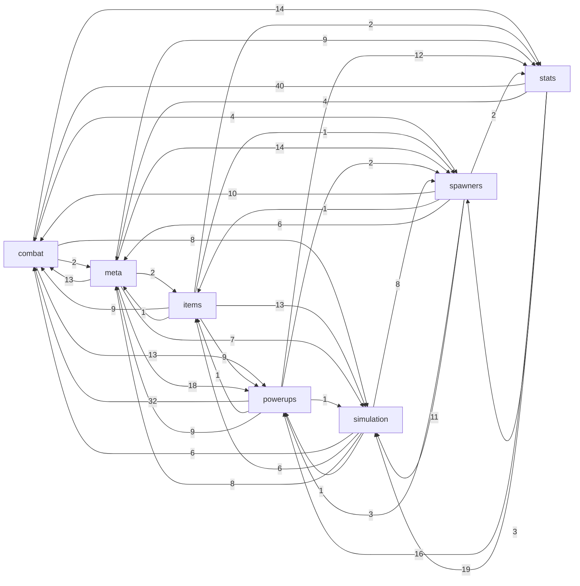

# 数值依赖图

由 `Balance/tufu_balance/graph.py build` 从 [formulas.json](../../Balance/catalog/formulas.json) 的输入输出映射和 [values.json](../../Balance/catalog/values.json) 的派生量词表生成。公式细节见[公式清单](FormulaCatalog.md)。

## 查询改动影响

```bash
cd Balance && .venv/bin/python -m tufu_balance.graph impact CombatBalanceConfig.IslandTargetDays --stop-at combat
```

| 命令 | 作用 |
|---|---|
| `impact <节点>` | 改动这个配置、常量或派生量后，下游受影响的全部公式和派生量，按传播步数排序，标出所在层和上一跳 |
| `depends <节点>` | 反向：一个派生量由哪些配置、常量和公式决定 |
| `path <起点> <终点>` | 一条实际传播路线，回答“为什么 A 会影响 B” |

节点参数可以是完整名，也可以是子串（匹配到的全部作为起点）。含 `[` 的名字在 shell 里要加引号。

### 分层与 `--stop-at`

游戏是一个闭环：玩家战力 → 击杀速度 → 奖励速度 → 玩家战力。所以几乎任何改动最终都会传到大部分公式，这本身没错，但不利于判断。派生量因此分为四层：

| 层 | 含义 |
|---|---|
| `static` | 只由配置和常数决定，例如某等级武器的伤害、基础冷却、插值系数 |
| `progress` | 随游玩累积的成长状态及其直接推导，例如获得的属性加成、玩家属性、装备等级、货币、护符等级 |
| `combat` | 战斗中的即时状态，例如当前血量、目标、触发事件、单次伤害、怒气 |
| `simulation` | 原版离线模拟、烘焙和预测数据 |

`--stop-at` 指定不再继续传播的层，被截断层的节点仍会列出，表示影响到这里为止。常用组合由窄到宽：

| 参数 | 回答的问题 |
|---|---|
| `--runtime-only --stop-at combat,progress` | 改了这个数，哪些推导值立刻跟着变（不重新烘焙） |
| `--runtime-only --stop-at combat` | 再加上长期成长：奖励速度、玩家属性、装备等级随之变化后的连锁影响 |
| `--runtime-only` | 再加上战斗中的即时连锁，例如击杀触发能力、怒气 |
| （无参数） | 再加上重新模拟、烘焙后写回配置的影响，例如敌人血量重新生成 |

例如：武器成长参数在第一种范围只影响 13 条公式；刷怪冷却在第一种范围影响约 10 条，放开成长层后影响约 150 条，因为它改变奖励速度，进而改变整条成长曲线。

每个输出都记录了它真正依赖哪些输入（`depends_on`），玩家与敌人共用的公式不会把敌人数据错误地传到玩家属性上。

烘焙类公式把模拟结果写回配置，例如按玩家战力曲线生成敌人血量。默认查询包含这条链路，表示“改动后重新模拟和烘焙”的影响；加 `--runtime-only` 跳过所有写回配置的公式和离线模拟层，只看不重新烘焙时游戏内的影响。

## 节点类型

| 前缀 | 含义 |
|---|---|
| `config:` | 配置字段，名字与[数据字典](../../Balance/README.md)一致，可以直接在导出表里查到数值 |
| `constant:` | 写死在代码里的常数，同样是设计杠杆 |
| `state:` | 运行时状态（当前血量、怒气、随机数、时间等），不是设计参数 |
| `value:` | 公式算出的派生量，含义见下表 |
| `formula:` | 公式清单中的一条 |

## 规模

| 类型 | 数量 |
|---|---|
| `config` | 341 |
| `constant` | 297 |
| `state` | 18 |
| `value` | 342 |
| `formula` | 281 |
| 边 | 2874 |

## 子系统之间的数值流

箭头上的数字是两个子系统之间传递的派生量个数。



## 派生量

| 节点 | 含义 | 单位 | 由谁计算 | 被谁使用 |
|---|---|---|---|---|
| `value:ability.base_value` | Tier/star-selected base Value / Chance / StackLimit | ability units | `powerups.ability_tier_override` | `powerups.ability_effective_value`, `powerups.ability_boosts`, `powerups.ability_gating_conditions` |
| `value:ability.boost_bonus` | Bonus* / NextProcBonus* boosts from other abilities | ability units | `powerups.ability_boosts` | `powerups.ability_effective_value` |
| `value:ability.chained_execution` | Extra execution of another ability via TriggerAbilityEffect | count | `powerups.trigger_ability_chain` |  |
| `value:ability.condition_pass` | Cooldown / hit-count / stack / threshold gating outcome | bool | `items.weapon_set_synergy_counts`, `powerups.ability_gating_conditions` | `combat.lethal_damage_ignore`, `powerups.ability_boosts`, `powerups.add_stat_effect`, `powerups.add_stat_passive`, `powerups.double_loot`, `powerups.trigger_ability_chain` |
| `value:ability.double_loot_multiplier` | DoubleLoot factor (1 + value) on enemy-source stat rewards | multiplier | `powerups.double_loot` | `meta.devour_stat_grant` |
| `value:ability.economy_proc_chance_bonus` | Economy ability proc chance bonus (economy_item_abilities_chance) | probability | `powerups.economy_proc_bonus` | `powerups.ability_effective_value` |
| `value:ability.effective_chance` | Effective ability proc Chance | probability 0-1 | `powerups.ability_effective_value` | `combat.lethal_damage_ignore`, `powerups.chance_condition`, `powerups.ability_gating_conditions`, `powerups.lightning_damage` |
| `value:ability.effective_stack_limit` | Effective ability StackLimit | count | `powerups.ability_effective_value` | `powerups.value_scaler`, `powerups.ability_gating_conditions`, `powerups.add_stat_passive`, `powerups.weapon_stat_stack` |
| `value:ability.effective_value` | Effective ability Value = base + Bonus + NextProcBonus | ability units | `powerups.ability_effective_value` | `stats.stun_decay`, `combat.thorns_reflection`, `powerups.value_scaler`, `powerups.ability_gating_conditions`, `powerups.add_stat_passive`, `powerups.weapon_stat_stack`, `powerups.weapon_damage_multipliers`, `powerups.attack_speed_multipliers`, `powerups.crit_buffs`, `powerups.empower_hit`, `powerups.shock`, `powerups.marks`, `powerups.heal_effects`, `powerups.stun_bonus`, `powerups.random_stat_per_distance`, `powerups.scaled_multiplier_effect`, `powerups.double_loot`, `combat.cooldown_reset_cycle`, `powerups.missing_health_scaling`, `powerups.empty_slot_and_stat_scaling`, `powerups.unused_effect_stubs` |
| `value:ability.hits_counter` | AbilityState.HitsCounter: outgoing player hits counted per ability state (incremented for every equipped item's states on each outgoing player hit in DamageCalculator, reset when a HitsCount condition fires). Also read by ValueScaler PerHitsTaken. | count | `powerups.ability_gating_conditions` | `powerups.value_scaler`, `powerups.ability_gating_conditions` |
| `value:ability.proc_roll` | Chance condition outcome | bool | `powerups.chance_condition` | `powerups.ability_gating_conditions`, `powerups.add_stat_effect`, `powerups.double_loot`, `powerups.trigger_ability_chain`, `combat.cooldown_reset_cycle`, `powerups.temporary_weapon_buff` |
| `value:ability.scaled_value` | Value * ValueScaler(mode) (missing health, marks, rage, empty slots, stat...) | ability units | `powerups.value_scaler` | `powerups.ability_boosts`, `powerups.add_stat_effect`, `powerups.add_stat_passive`, `powerups.weapon_damage_multipliers`, `powerups.attack_speed_multipliers`, `powerups.crit_buffs`, `powerups.empower_hit`, `powerups.lightning_damage`, `powerups.marks`, `powerups.heal_effects`, `powerups.scaled_multiplier_effect`, `combat.cooldown_reset_cycle`, `combat.mark_meta_synergies`, `powerups.temporary_weapon_buff` |
| `value:ability.stacks` | AbilityState.Stacks: per-ability stack counter (StacksCondition RequiresStacks, StatStackEffect) | count | `powerups.ability_gating_conditions`, `powerups.add_stat_passive` | `powerups.ability_gating_conditions`, `powerups.add_stat_passive` |
| `value:ability.stat_modifier` | Equip / temporary / passive stat modifiers emitted by abilities (AddStatEffect, AddStatPassive, StatStack, BonusStatPerHitsTaken) | stat units | `powerups.add_stat_effect`, `powerups.add_stat_passive` | `stats.modifier_merge`, `stats.temporary_modifier_decay` |
| `value:ability.stub_effect_output` | Output of stub / unused ability effects (ScaledMultiplier, GrantStatOnHit, TreatAsAllSlotsEmpty) | none | `powerups.scaled_multiplier_effect`, `powerups.unused_effect_stubs` | `items.unlocked_slot_caps` |
| `value:ability.trigger_routing` | Whether an item ability sees an event (source-item mask) | bool | `powerups.ability_trigger_routing` |  |
| `value:ads.rewarded_stat_type` | StatType offered by the rewarded ad (pool / dynamic weights) | enum | `meta.rewarded_pool_pick`, `meta.rewarded_dynamic_weights` | `meta.rewarded_ad_stat_value` |
| `value:ads.rewarded_stat_value` | Rewarded-ad permanent stat offer value (~6 min of RPM x AB multipliers) | stat units | `meta.rewarded_ad_stat_value` | `meta.devour_stat_grant` |
| `value:ads.rewarded_weights` | Saved dynamic per-stat offer weights | weight | `meta.rewarded_dynamic_weights` |  |
| `value:amulet.can_unlock` | Amulet unlock gate (location >= UnlockLocationNumber) | bool | `powerups.amulet_unlock_condition` |  |
| `value:amulet.cumulative_xp_threshold` | Total XP at which level L starts | xp | `powerups.amulet_cumulative_xp` | `powerups.amulet_level_from_xp`, `powerups.amulet_add_levels` |
| `value:amulet.is_unlocked` | Amulet activated (filled with soul) | bool | `powerups.amulet_fill_with_soul` | `powerups.amulet_unlock_condition`, `powerups.amulet_upgrade_xp_gain`, `powerups.amulet_add_levels` |
| `value:amulet.level` | Amulet level (and progress) from total XP | level | `powerups.amulet_level_from_xp` | `powerups.amulet_add_levels`, `powerups.amulet_node_availability` |
| `value:amulet.node_available` | Amulet graph node availability / purchasability | bool | `powerups.amulet_node_availability` | `meta.upgrade_purchase_rule`, `powerups.amulet_upgrade_xp_gain` |
| `value:amulet.required_xp_per_level` | XP needed from L-1 to L | xp | `powerups.amulet_required_xp_per_level` | `powerups.amulet_cumulative_xp`, `powerups.amulet_level_from_xp` |
| `value:amulet.total_xp` | Amulet TotalExperience | xp | `powerups.amulet_upgrade_xp_gain`, `powerups.amulet_sim_soul_xp`, `powerups.amulet_add_levels` | `powerups.amulet_level_from_xp` |
| `value:armor.item_armor` | ItemModel.Armor of helmet/shield (pre-evolution or evolved) | defence points | `items.armor_pre_evolution`, `items.armor_evolved` | `combat.player_flat_defense`, `simulation.defense_data` |
| `value:armor.legacy_formula_value` | ArmorFormulas.Get(level) dead helper (returns 0) | defence points | `balance.armor_formulas_get` |  |
| `value:economy.cashback_earned_stat` | Cashback ledger of earned flat stat per StatType | stat units | `meta.cashback_earned_stat` |  |
| `value:economy.currency_balance` | Currency balances (soul.*, crystal.*, event currency, empty_amulet, tickets, quest.*) | currency | `meta.soul_grant_on_devour`, `meta.spawner_currency_reward`, `meta.currency_balance`, `meta.upgrade_max_capacity_bonus`, `meta.event_currency_devour_reward`, `powerups.amulet_fill_with_soul`, `powerups.amulet_sim_soul_xp` | `combat.event_crystal_damage_multipliers`, `meta.upgrade_purchase_rule`, `powerups.amulet_fill_with_soul`, `powerups.amulet_upgrade_xp_gain`, `powerups.amulet_node_availability` |
| `value:economy.event_progress` | Event progress (current / collected event currency toward ProgressMax) | progress points | `meta.event_currency_devour_reward` | `spawners.event_miniboss_spawn_gate` |
| `value:economy.free_chest_cooldown` | Free chest lot cooldown | days | `meta.free_chest_cooldown_days` |  |
| `value:economy.geode_timer_reduction` | Geode timer seconds removed per spawner kill (KillCount * crystal_timer_on_kill_reduce) | seconds | `spawners.geode_kill_count` |  |
| `value:economy.upgrade_cost` | Cost of the next upgrade level (currency key, amount), incl. amulet soul costs | currency | `meta.upgrade_cost`, `powerups.amulet_upgrade_cost` | `meta.upgrade_purchase_rule`, `meta.currency_balance`, `powerups.amulet_upgrade_xp_gain`, `powerups.amulet_node_availability` |
| `value:enemy.ab_hp_damage_multiplier` | AB enemy_hp_damage_mult per-location multiplier m(loc) (override ?? default) | multiplier | `spawners.enemy_spawn_stats`, `combat.ab_enemy_hp_damage_live_rescale`, `simulation.enemy_multiplier` | `combat.quest_mob_armor_and_stats`, `simulation.spawner_dps`, `simulation.spawner_fight_model` |
| `value:enemy.aggro_state` | Per-enemy AggroTimer / RetreatTimer and the derived retreat/chase state (retreat when out of AggroRange with expired aggro and not targeted, or RetreatTimer > 0) | seconds / bool | `combat.enemy_leash_and_aggro` | `combat.enemy_attack_cycle` |
| `value:enemy.attack_damage_ramped` | Event enemy attack after damage ramp (A*(1+ramp)) fed to the defence curve | damage per hit | `combat.event_enemy_damage_ramp` | `combat.flat_defense_curve`, `combat.incoming_damage_to_player` |
| `value:enemy.attacks_per_second` | Enemy hit frequency against the player | hits per second | `combat.enemy_attack_cycle` |  |
| `value:enemy.consumed_shock_count` | ShockComponent.ConsumedShockCount on a target (shocks consumed and not yet decayed), used by PerConsumedShockOnTarget scaling and by the consumed-shock damage bonus | count | `powerups.shock` | `powerups.value_scaler` |
| `value:enemy.current_hp` | Enemy current HP | hp | `combat.enemy_lifesteal_on_hit`, `combat.thorns_reflection`, `stats.damage_application`, `combat.outgoing_damage_to_enemy`, `combat.quest_mob_armor_and_stats`, `combat.enemy_leash_and_aggro`, `combat.enemy_regen`, `combat.player_revive`, `spawners.enemy_spawn_stats`, `combat.ab_enemy_hp_damage_live_rescale`, `powerups.lightning_damage` | `stats.stat_accessors`, `stats.damage_application`, `combat.event_enemy_damage_ramp`, `combat.enemy_regen`, `combat.death_threshold`, `combat.ab_enemy_hp_damage_live_rescale`, `powerups.ability_gating_conditions`, `powerups.lightning_damage` |
| `value:enemy.damage_type` | Enemy attack WeaponType (config or event/quest override) | enum | `spawners.event_plan_override`, `combat.quest_mob_armor_and_stats`, `combat.enemy_attack_cycle` | `combat.player_flat_defense` |
| `value:enemy.first_hit_damage_multiplier` | First-vulnerability one-shot outgoing multiplier vs a marked unit | multiplier | `combat.first_vulnerability_multiplier` | `stats.damage_application`, `combat.outgoing_damage_to_enemy` |
| `value:enemy.hp_regen_per_second` | Enemy regen incl. 5% maxHP/s idle regen after 5 s | hp per second | `combat.enemy_regen` |  |
| `value:enemy.is_far` | Far-distance culling flags (IsFar / FarOnScreen) | bool | `spawners.enemy_far_culling` | `combat.player_attack_range_and_targeting`, `combat.enemy_attack_cycle`, `combat.enemy_leash_and_aggro`, `combat.enemy_regen` |
| `value:enemy.lifesteal_heal_per_hit` | Enemy heal per landed hit on player | hp per hit | `combat.enemy_lifesteal_on_hit` | `stats.damage_application` |
| `value:enemy.lightning_damage` | Lightning proc extra damage | damage per proc | `powerups.lightning_damage` |  |
| `value:enemy.mark_stacks` | Mark stacks on an enemy | count | `stats.damage_application`, `powerups.marks`, `combat.mark_meta_synergies` | `combat.player_lifesteal_on_hit`, `powerups.value_scaler`, `combat.mark_meta_synergies` |
| `value:enemy.max_marks` | Max mark stacks (1 + bonus + IncreaseMaxMarks) | count | `powerups.marks` | `stats.damage_application`, `combat.mark_meta_synergies` |
| `value:enemy.move_speed_effective` | Enemy agent speed incl. x2 retreat | world units per second | `combat.enemy_leash_and_aggro`, `spawners.enemy_spawn_stats` |  |
| `value:enemy.override_base_stats` | Runtime override of spawner base stats before spawn (event plan Health/Damage, quest-mob baked Health/Damage/regen/lifesteal/evasion/attack cooldown) | stat units | `spawners.event_plan_override`, `combat.quest_mob_armor_and_stats`, `spawners.difficulty_semantics` | `spawners.enemy_spawn_stats` |
| `value:enemy.reflection_damage` | Enemy ReflectionDamage field (quest mobs) | damage per hit | `combat.quest_mob_armor_and_stats` | `combat.enemy_reflection` |
| `value:enemy.resist_by_damage_type` | Enemy resist per incoming WeaponType (ArmorConfig.Armors, event/quest overrides); negative = weakness | fraction | `combat.enemy_armor_resist_table`, `spawners.event_plan_override`, `combat.quest_mob_armor_and_stats` | `combat.outgoing_damage_to_enemy`, `combat.outgoing_damage_simulation_mode` |
| `value:enemy.shock_damage_multiplier` | Damage multiplier vs target from consumed shocks | multiplier | `powerups.lightning_damage`, `powerups.shock` | `combat.outgoing_damage_to_enemy`, `combat.outgoing_damage_simulation_mode` |
| `value:enemy.solved_attack_damage` | Enemy attack A solved so that post-defence damage reaches a target T (inverse defence curve) | damage per hit | `combat.solve_attack_for_incoming` | `combat.quest_mob_armor_and_stats`, `spawners.difficulty_semantics` |
| `value:enemy.stat_base` | Enemy instance base stats at spawn (config/override x AB multiplier on Health and Damage, banker rounding), incl. live AB rescale | stat units | `combat.quest_mob_armor_and_stats`, `spawners.enemy_spawn_stats`, `combat.ab_enemy_hp_damage_live_rescale` | `stats.raw_value_aggregation`, `combat.ab_enemy_hp_damage_live_rescale` |
| `value:enemy.stat_modifiers` | Merged active modifier set on enemy stats (boss debuffs, temporary ability debuffs) | modifier set | `stats.modifier_merge`, `stats.temporary_modifier_decay` | `stats.raw_value_aggregation`, `stats.specific_value_pipeline`, `stats.specific_curve.evasion`, `stats.specific_curve.block`, `stats.specific_cap`, `stats.specific_identity`, `stats.temporary_modifier_decay` |
| `value:enemy.stat_raw` | Enemy raw aggregated stat Value, any StatType | stat units | `stats.raw_value_aggregation` | `stats.specific_value_pipeline`, `stats.specific_curve.evasion`, `stats.specific_curve.block`, `stats.specific_cap`, `stats.specific_identity`, `stats.stat_accessors`, `combat.outgoing_damage_to_enemy`, `combat.outgoing_damage_simulation_mode`, `value:enemy.stat_raw[Health]`, `value:enemy.stat_raw[Damage]`, `value:enemy.stat_raw[AttackCooldown]`, `value:enemy.stat_raw[AttackRange]`, `value:enemy.stat_raw[MovementSpeed]`, `value:enemy.stat_raw[LifestealFlat]`, `value:enemy.stat_raw[LifestealPercent]` |
| `value:enemy.stat_raw[AttackCooldown]` | Enemy attack cooldown stat (5) | seconds | `stats.raw_value_aggregation`, `value:enemy.stat_raw` | `combat.enemy_attack_cycle`, `simulation.spawner_dps` |
| `value:enemy.stat_raw[AttackRange]` | Enemy attack range (4) | world units | `stats.raw_value_aggregation`, `value:enemy.stat_raw` | `combat.enemy_attack_cycle` |
| `value:enemy.stat_raw[Damage]` | Enemy attack Damage stat (per hit before defence) | damage per hit | `stats.raw_value_aggregation`, `value:enemy.stat_raw` | `combat.event_enemy_damage_ramp`, `combat.incoming_damage_to_player` |
| `value:enemy.stat_raw[Health]` | Enemy max HP | hp | `stats.raw_value_aggregation`, `value:enemy.stat_raw` | `combat.enemy_lifesteal_on_hit`, `stats.damage_application`, `combat.event_enemy_damage_ramp`, `combat.enemy_leash_and_aggro`, `combat.enemy_regen`, `combat.death_threshold`, `combat.player_revive`, `combat.ab_enemy_hp_damage_live_rescale`, `powerups.ability_gating_conditions` |
| `value:enemy.stat_raw[LifestealFlat]` | Enemy flat lifesteal | hp per hit | `stats.raw_value_aggregation`, `value:enemy.stat_raw` | `combat.enemy_lifesteal_on_hit` |
| `value:enemy.stat_raw[LifestealPercent]` | Enemy percent lifesteal (quest mobs) | fraction of max hp | `stats.raw_value_aggregation`, `value:enemy.stat_raw` | `combat.enemy_lifesteal_on_hit` |
| `value:enemy.stat_raw[MovementSpeed]` | Enemy movement speed raw (0) | world units per second | `stats.raw_value_aggregation`, `value:enemy.stat_raw` | `combat.enemy_leash_and_aggro` |
| `value:enemy.stat_rewards` | Per-unit devour StatRewards list (copy of config, extended by event plan / crystal mob bonus) | stat units per devour | `spawners.event_plan_override`, `spawners.enemy_spawn_stats`, `spawners.event_crystal_mob_bonus`, `meta.event_plan_stat_reward` | `meta.devour_stat_reward_scaling` |
| `value:enemy.stat_specific` | Enemy specific stat value, any StatType | stat-specific units | `stats.specific_value_pipeline`, `stats.specific_cap`, `stats.specific_identity` | `stats.stat_accessors`, `value:enemy.stat_specific[HealthRegen]`, `value:enemy.stat_specific[Evasion]`, `value:enemy.stat_specific[BlockChance]`, `value:enemy.stat_specific[BlockAmount]` |
| `value:enemy.stat_specific[BlockAmount]` | Enemy block reduction fraction | fraction 0-1 | `stats.specific_value_pipeline`, `stats.specific_curve.block`, `stats.specific_cap`, `value:enemy.stat_specific` |  |
| `value:enemy.stat_specific[BlockChance]` | Enemy block chance | probability 0-1 | `stats.specific_value_pipeline`, `stats.specific_curve.block`, `stats.specific_cap`, `value:enemy.stat_specific` |  |
| `value:enemy.stat_specific[Evasion]` | Enemy dodge chance vs player hits (quest mobs) | probability 0-1 | `stats.specific_value_pipeline`, `stats.specific_curve.evasion`, `stats.specific_cap`, `value:enemy.stat_specific` | `combat.dodge_block_rolls` |
| `value:enemy.stat_specific[HealthRegen]` | Enemy HP regen per second (stat 2 specific) | hp per second | `stats.specific_value_pipeline`, `stats.specific_identity`, `value:enemy.stat_specific` | `combat.enemy_regen` |
| `value:enemy.stun_duration` | Remaining stun seconds on an enemy | seconds | `stats.stun_decay`, `powerups.stun_bonus` | `combat.enemy_attack_cycle`, `combat.enemy_leash_and_aggro`, `powerups.ability_gating_conditions` |
| `value:enemy.stunned_damage_multiplier` | Damage multiplier vs stunned targets 1 + BonusDamageToStunned | multiplier | `stats.stun_decay`, `powerups.stun_bonus` | `combat.outgoing_damage_to_enemy`, `combat.outgoing_damage_simulation_mode` |
| `value:enemy.weak_or_event_golem_flag` | Whether the player's current target is a 'weak' enemy (non-VIP/special/event, island below last unlocked, weak_spawner_extra_range modifier for its island) or an event golem (event Mob unit with event_golem_extra_range > 0); gates the x3 range (with chain weapon) and x2.5 attack speed | bool | `combat.player_attack_range_and_targeting` | `combat.attack_speed_multiplier` |
| `value:forecast.boss_preset` | Tuned boss fight time T and difficulty D across the event | seconds / fraction | `simulation.forecast_tune_boss_presets` | `simulation.forecast_auto_balanced_enemy`, `simulation.forecast_damage_ramp_average` |
| `value:forecast.crystal_reward` | Forecast crystal reward entry mapped to a reward | reward | `simulation.forecast_crystal_reward_mapping` | `meta.grant_reward_stat`, `meta.random_item_reward_pick` |
| `value:forecast.damage_ramp_average` | Time-averaged damage ramp divisor RampAvg(T, delay, p) | multiplier | `simulation.forecast_damage_ramp_average` | `simulation.forecast_auto_balanced_enemy` |
| `value:forecast.enemy_damage` | Auto-balanced event golem/boss/grand boss Damage | damage per hit | `simulation.forecast_auto_balanced_enemy` | `simulation.forecast_event_plan` |
| `value:forecast.enemy_health` | Auto-balanced event golem/boss/grand boss Health | hp | `simulation.forecast_auto_balanced_enemy` | `simulation.forecast_event_plan` |
| `value:forecast.enemy_stats_multiplier` | EnemyStatsMultiplier_i = max(0, 1 + minute*EnemyStatsGrowthPerMinute) | multiplier | `simulation.forecast_build_core` | `simulation.forecast_auto_balanced_enemy` |
| `value:forecast.event_plan` | ForecastEventPlan {Golem, Bosses[], GrandBoss} enemy infos and rewards (+crystal stages/milestones) | plan bundle | `meta.event_forecast_gpm_bake`, `simulation.forecast_event_plan` | `spawners.event_plan_override`, `meta.event_plan_stat_reward`, `simulation.forecast_crystal_reward_mapping` |
| `value:forecast.snapshot` | Forecast snapshot series per event boss time point (day_i, playtime, progress, snapshot fields) | snapshot bundle | `simulation.forecast_build_core` | `meta.event_forecast_gpm_bake`, `simulation.forecast_auto_balanced_enemy`, `simulation.forecast_tune_boss_presets`, `simulation.forecast_reward`, `simulation.forecast_event_plan` |
| `value:forecast.stat_reward` | Forecast boss stat reward (type, minutes, value = CurrentGpm*minutes) | stat units | `simulation.forecast_reward` | `simulation.forecast_event_plan` |
| `value:island.fully_cleared` | Island fully cleared predicate | bool | `spawners.island_cleared_predicate` | `spawners.island_medal_progress` |
| `value:island.mastery_incoming_multiplier` | Island mastery reduction of incoming damage | multiplier | `combat.island_mastery_multipliers` | `combat.incoming_damage_to_player` |
| `value:island.mastery_outgoing_multiplier` | 1 + island_medal_bonus(location) on player damage | multiplier | `combat.island_mastery_multipliers` | `combat.outgoing_damage_to_enemy`, `combat.outgoing_damage_simulation_mode` |
| `value:island.medal_level` | Island medal level 0..5 | level | `spawners.island_medal_progress` | `spawners.island_medal_progress` |
| `value:island.target_days` | Cumulative balance day by which island i is finished (IslandTargetDays curve) | days (balance time chunks) | `balance.island_target_days_curve` |  |
| `value:item.config_levers` | Per-item config levers bundle (FlatDamage, AttackCooldown, cast point, stat routing) | mixed | `items.item_config_levers` |  |
| `value:item.copies` | Item copy count (after merges and evolution spending) | copies | `items.evolve_transition`, `items.copy_merge` | `items.weapon_damage_evolved`, `items.armor_evolved`, `items.effective_level`, `items.evolution_cost`, `items.evolve_transition`, `items.next_level_preview`, `simulation.dps_data`, `simulation.defense_data`, `simulation.spawner_reward_value`, `simulation.forecast_current_player_fallback`, `simulation.stat_benefit_weights` |
| `value:item.copies_to_evolve` | LevelsToEvolve (shards needed) and CanEvolve | copies | `items.evolution_cost` | `items.evolve_transition`, `items.next_level_preview` |
| `value:item.display_rarity` | Displayed rarity (Divine when evolved) | enum | `items.display_rarity` |  |
| `value:item.effective_level` | EffectiveLevel fed to CalcDamage/CalcArmor (Copies pre-evolution, Level evolved) | level | `items.effective_level` | `items.weapon_damage_pre_evolution`, `items.armor_pre_evolution`, `items.next_level_preview` |
| `value:item.equip_stat_modifiers` | Item StatModifiers applied to player on equip (Source Item) | stat units | `items.equip_stat_modifiers` | `stats.modifier_merge` |
| `value:item.evolution_level` | Item evolution Level / Evolved flag | level | `items.evolve_transition` | `items.weapon_damage_pre_evolution`, `items.weapon_damage_evolved`, `items.armor_pre_evolution`, `items.armor_evolved`, `items.effective_level`, `items.evolution_level_clamp`, `items.evolution_cost`, `items.evolve_transition`, `items.next_level_preview`, `items.stat_per_copy`, `items.ability_unlock_gate`, `items.display_rarity`, `simulation.forecast_current_player_fallback`, `powerups.ability_tier_override` |
| `value:item.evolution_row_index` | Evolution table row after clamp to MaxEvolutionLevel | index | `items.evolution_level_clamp` | `items.weapon_damage_evolved`, `items.armor_evolved`, `items.stat_per_copy` |
| `value:item.next_level_stat_preview` | NextLevelDamage / NextLevelArmor preview | damage per hit or defence points | `items.next_level_preview` |  |
| `value:item.rarity_base_growth` | Base / growth per copy selected by rarity and damage type (lookup of CombatBalanceConfig tables) | damage per hit or defence points | `items.base_growth_tables` |  |
| `value:item.rarity_param` | Rarity -> meta-stat param index (rarity+1) | index | `items.rarity_stat_param` | `meta.item_drop_copies_per_kill`, `meta.item_drop_for_kill_count`, `spawners.effective_charges`, `spawners.base_cooldown`, `simulation.spawner_charges_limit` |
| `value:item.stat_per_copy` | Marginal damage/armor per extra copy | damage per hit or defence points | `items.stat_per_copy` |  |
| `value:item.unlocked_abilities` | Active ability list and magnitudes per item by evolution/level | ability set | `items.ability_unlock_gate` | `powerups.rage_effective_max`, `powerups.ability_trigger_routing`, `powerups.trigger_ability_chain`, `combat.mark_meta_synergies` |
| `value:player.ability_damage_flat` | Player-level AbilityDamageFlat | damage per hit | `powerups.weapon_damage_multipliers`, `powerups.empty_slot_and_stat_scaling` | `combat.outgoing_damage_to_enemy`, `combat.outgoing_damage_simulation_mode` |
| `value:player.ability_damage_multiplier` | Player-level AbilityDamageMultiplier (DamageForStat on player, crystal damage-per-rage) | multiplier | `powerups.crystal_rage_marks_lightning`, `powerups.weapon_damage_multipliers`, `powerups.empty_slot_and_stat_scaling` | `combat.outgoing_damage_to_enemy`, `combat.outgoing_damage_simulation_mode` |
| `value:player.ability_regen_multiplier` | AbilityHealthRegenMultiplier (missing-health regen effects) | multiplier | `powerups.heal_effects`, `powerups.missing_health_scaling` | `combat.player_regen` |
| `value:player.attack_range_effective` | Player attack range incl. weak-spawner / event-golem extra range | world units | `combat.player_attack_range_and_targeting` | `combat.weapon_equip_warmup_and_primary_range_gate` |
| `value:player.auto_target` | Current auto-selected target of the player | target choice | `combat.player_attack_range_and_targeting`, `combat.unit_auto_target_stub` | `stats.stun_decay`, `stats.player_movement_displacement`, `combat.player_weapon_attack_cycle`, `combat.enemy_leash_and_aggro`, `powerups.value_scaler`, `powerups.ability_gating_conditions`, `powerups.add_stat_passive`, `powerups.weapon_stat_stack`, `powerups.lightning_damage`, `powerups.shock`, `powerups.marks`, `powerups.stun_bonus`, `combat.weapon_equip_warmup_and_primary_range_gate` |
| `value:player.battle_regen` | Battle regen budget (d+1)*HealthRegen + (2d+3)*LifestealFlat that enemy DPS must exceed | hp per second | `combat.battle_regen` | `combat.quest_mob_armor_and_stats`, `simulation.spawner_fight_model` |
| `value:player.block_damage_multiplier` | Expected block factor 1 - BlockChance*BlockAmount (specific) | multiplier | `simulation.combat_multiplier_cache` | `simulation.spawner_dps` |
| `value:player.bonus_lightning_chance` | Crystal legendary bonus lightning chance | probability | `powerups.crystal_rage_marks_lightning` | `powerups.lightning_damage` |
| `value:player.bonus_max_marks` | Crystal legendary BonusMaxMarks | count | `powerups.crystal_rage_marks_lightning` | `powerups.marks` |
| `value:player.boss_tower_incoming_multiplier` | Attack divisor from boss-tower attackers 1/(1 + tower_damage_reduction), applied before the defence curve | multiplier | `combat.boss_tower_damage_multipliers` | `combat.flat_defense_curve`, `combat.incoming_damage_to_player` |
| `value:player.boss_tower_outgoing_multiplier` | Outgoing multiplier vs boss-tower units 1 + tower_damage | multiplier | `combat.boss_tower_damage_multipliers` | `combat.outgoing_damage_to_enemy`, `combat.outgoing_damage_simulation_mode` |
| `value:player.boss_tower_portal_unlocked` | Boss-tower portal unlocked: PlayerModel.IsPortalUnlocked = PortalGemsCollected > 6 (hard-coded 7 gems); the unlock animation additionally checks >= Portal.stones.Length | bool | `spawners.portal_gem` |  |
| `value:player.creeper_explosion_damage` | Creeper explosion damage to player (stub) | damage per hit | `spawners.creeper_explosion` |  |
| `value:player.crit_chance_total` | Crit chance actually rolled: specific CritChance + enemy SpecialAdditionalCritChance + weapon AbilityCritChanceBonus | probability 0-1 | `combat.crit_and_supercrit` | `combat.dodge_block_rolls`, `combat.outgoing_damage_simulation_mode` |
| `value:player.crit_multiplier_total` | Damage multiplier on a crit hit (crit damage specific x weapon ability crit multiplier x crit stack) | multiplier | `combat.crit_and_supercrit` | `combat.outgoing_damage_to_enemy` |
| `value:player.current_hp` | Player current HP | hp | `combat.player_lifesteal_on_hit`, `combat.enemy_reflection`, `stats.damage_application`, `combat.lethal_damage_ignore`, `combat.incoming_damage_to_player`, `combat.player_regen`, `combat.player_revive`, `meta.devour_stat_grant`, `meta.grant_reward_stat`, `powerups.amulet_stat_apply`, `powerups.add_stat_effect`, `powerups.heal_effects` | `stats.stat_accessors`, `stats.damage_application`, `combat.player_regen`, `combat.death_threshold`, `meta.devour_stat_grant`, `simulation.spawner_fight_model`, `powerups.value_scaler`, `powerups.ability_gating_conditions`, `powerups.weapon_damage_multipliers`, `powerups.heal_effects`, `powerups.missing_health_scaling` |
| `value:player.current_location` | Island number the player is in (CurrentLocationNumber) | island number | `combat.player_revive`, `spawners.location_trigger` | `spawners.island_medal_progress` |
| `value:player.empty_slot_count` | Unlocked but empty item slots (or all slots if TreatAsAllSlotsEmpty) | count | `items.unlocked_slot_caps` | `powerups.value_scaler`, `powerups.chance_condition`, `powerups.ability_gating_conditions`, `powerups.weapon_damage_multipliers`, `powerups.attack_speed_multipliers`, `powerups.empty_slot_and_stat_scaling` |
| `value:player.equipped_items` | Items currently equipped in unlocked slots (weapons and armors) incl. starting weapon / auto-equip | item set | `items.copy_merge`, `items.unlocked_slot_caps`, `items.auto_equip_and_starting_weapon` | `stats.damage_application`, `combat.player_flat_defense`, `combat.player_weapon_attack_cycle`, `powerups.rage_extra_hit`, `items.chain_weapon_rules`, `items.weapon_set_synergy_counts`, `items.equip_stat_modifiers`, `powerups.rage_effective_max`, `powerups.ability_gating_conditions`, `powerups.weapon_damage_multipliers`, `powerups.attack_speed_multipliers`, `powerups.empower_hit`, `powerups.marks`, `powerups.double_loot`, `powerups.ability_trigger_routing`, `combat.weapon_equip_warmup_and_primary_range_gate`, `combat.cooldown_reset_cycle`, `combat.mark_meta_synergies`, `powerups.missing_health_scaling`, `powerups.empty_slot_and_stat_scaling` |
| `value:player.equipped_weapon_count` | EquippedWeaponCount | count | `items.chain_weapon_rules` | `powerups.attack_speed_multipliers` |
| `value:player.event_crystal_incoming_multiplier` | Blue crystal event incoming multiplier 1/(1 + 0.02*blue) | multiplier | `combat.event_crystal_damage_multipliers` | `combat.incoming_damage_to_player` |
| `value:player.event_crystal_outgoing_multiplier` | Red crystal event outgoing multiplier 1 + 0.02*red | multiplier | `combat.event_crystal_damage_multipliers` | `combat.outgoing_damage_to_enemy`, `combat.outgoing_damage_simulation_mode` |
| `value:player.event_golem_damage_multiplier` | Outgoing multiplier vs event golems 1 + event_golem_damage | multiplier | `combat.event_golem_damage_multiplier` | `combat.outgoing_damage_to_enemy`, `combat.outgoing_damage_simulation_mode` |
| `value:player.event_percent_factor` | Event percent multiplier E = 1+0.01*sqrt(v)*sqrt(min(v,20)) per type-7 modifier | multiplier | `stats.event_percent_bonus` | `stats.raw_value_aggregation`, `stats.modifier_merge` |
| `value:player.expected_crit_multiplier` | Expected crit factor 1 + cc*(cd-1) from specific stats (simulation) | multiplier | `simulation.combat_multiplier_cache` | `simulation.dps_against_spawner` |
| `value:player.expected_damage_per_hit` | Expected-value (crit-averaged) player hit used by simulation slow path | damage per hit | `combat.outgoing_damage_simulation_mode` | `simulation.dps_against_spawner` |
| `value:player.flat_defense_effective` | Player effective flat defence D vs a damage type = (UniversalDefenceFlat + armor + typed DefenceFlat) * percent | defence points | `combat.player_flat_defense` | `combat.flat_defense_curve`, `combat.incoming_damage_to_player` |
| `value:player.global_attack_multiplier` | Outgoing damage multiplier 1 + 0.01*GlobalAttack_spec | multiplier | `combat.global_attack_multiplier`, `simulation.combat_multiplier_cache` | `combat.outgoing_damage_to_enemy`, `combat.outgoing_damage_simulation_mode`, `simulation.dps_against_spawner` |
| `value:player.global_defence_multiplier` | Incoming damage multiplier 1/(1 + 0.01*GlobalDefence_spec) | multiplier | `combat.global_defence_multiplier`, `simulation.combat_multiplier_cache` | `combat.incoming_damage_to_player`, `simulation.spawner_dps` |
| `value:player.hammer_regen_bonus` | Hammer regen keystone HP regen bonus (stub) | hp per second | `powerups.hammer_regen` |  |
| `value:player.has_chain_weapon` | HasChainWeaponEquipped | bool | `items.chain_weapon_rules` | `combat.player_attack_range_and_targeting` |
| `value:player.hits_taken_count` | Hits-taken counter (BonusStatPerHitsTaken) | count | `combat.enemy_reflection`, `stats.damage_application`, `combat.hits_taken_decay_stub` | `stats.damage_application`, `powerups.add_stat_passive` |
| `value:player.hp_regen_per_second` | Effective player regen = HealthRegen_spec * AbilityHealthRegenMultiplier | hp per second | `combat.player_regen` |  |
| `value:player.incoming_damage_after_flat_defense` | Attack after the flat-defence curve exp(-0.75D/A)*A*max(0,1-0.25D/A) | damage per hit | `combat.flat_defense_curve` | `combat.incoming_damage_to_player` |
| `value:player.incoming_damage_per_hit` | Final damage subtracted from player HP per enemy hit | damage per hit | `combat.incoming_damage_to_player` | `combat.enemy_lifesteal_on_hit`, `stats.damage_application`, `combat.lethal_damage_ignore`, `combat.hits_taken_decay_stub`, `simulation.spawner_dps` |
| `value:player.lethal_ignore_chance` | Chance to survive a lethal hit at 1 HP (from passive abilities, per-target mode, cooldown) | probability 0-1 | `combat.lethal_damage_ignore` | `stats.damage_application` |
| `value:player.lifesteal_heal_per_hit` | Player heal per weapon hit (flat + percent*maxHP, mark and next-hit multipliers) | hp per hit | `combat.player_lifesteal_on_hit` |  |
| `value:player.mark_lifesteal_multiplier` | Lifesteal multiplier 1 + mark_lifesteal*stacks vs a marked target | multiplier | `combat.mark_meta_synergies` | `combat.player_lifesteal_on_hit` |
| `value:player.meta_modifier_applicable` | Whether a meta modifier passes the int/string param filter for a query param | bool | `meta.metastat_param_match` | `meta.metastat_value`, `meta.spawner_stat_drop_multiplier` |
| `value:player.meta_stat` | Account meta stat value v(p) (MetaStatsConfig key, param-filtered modifiers; MetaStat.Value), any key | per key (multiplier, flat, probability, count, seconds) | `stats.raw_value_aggregation`, `meta.metastat_value` | `stats.stun_decay`, `meta.upgrade_max_capacity_bonus`, `spawners.difficulty_semantics`, `value:player.meta_stat[block_to_supercrit]`, `value:player.meta_stat[evasion_mark]`, `value:player.meta_stat[extra_mark]`, `value:player.meta_stat[island_medal_bonus]`, `value:player.meta_stat[event_golem_damage]`, `value:player.meta_stat[tower_damage]`, `value:player.meta_stat[tower_damage_reduction]`, `value:player.meta_stat[rage_damage_reduce]`, `value:player.meta_stat[weak_spawner_extra_range]`, `value:player.meta_stat[event_golem_extra_range]`, `value:player.meta_stat[rage_extra_health]`, `value:player.meta_stat[rage_extra_hit]`, `value:player.meta_stat[hammer_regen]`, `value:player.meta_stat[mark_lifesteal]`, `value:player.meta_stat[soul_drop_bonus]`, `value:player.meta_stat[souls_rarity_amount]`, `value:player.meta_stat[souls_drop_unlock]`, `value:player.meta_stat[feature_unlock]`, `value:player.meta_stat[items_rarity_drop_amount]`, `value:player.meta_stat[items_rarity_charges]`, `value:player.meta_stat[items_rarity_timer]`, `value:player.meta_stat[map_spawner_timer_reduce]`, `value:player.meta_stat[crystal_timer_on_kill_reduce]`, `value:player.meta_stat[chest_level]`, `value:player.meta_stat[free_chest]`, `value:player.meta_stat[economy_item_abilities_chance]`, `value:player.meta_stat[empowered_lightning]`, `value:player.meta_stat[lightning_damage]`, `value:player.meta_stat[location_enemy_reward]` |
| `value:player.meta_stat[block_to_supercrit]` | Meta stat block_to_supercrit: super-crit chance gained per block | probability per block | `meta.metastat_value`, `value:player.meta_stat` | `stats.damage_application`, `combat.block_to_supercrit_bonus` |
| `value:player.meta_stat[chest_level]` | Meta stat chest_level: chest level (1 + amulet flats + VIP level) | level | `meta.metastat_value`, `meta.chest_level_vip`, `value:player.meta_stat` | `meta.chest_drop_weighted`, `meta.chest_copies`, `meta.crystal_chest_legendary_chance` |
| `value:player.meta_stat[crystal_timer_on_kill_reduce]` | Meta stat crystal_timer_on_kill_reduce: geode timer seconds removed per kill | seconds | `meta.metastat_value`, `value:player.meta_stat` | `spawners.geode_kill_count` |
| `value:player.meta_stat[economy_item_abilities_chance]` | Meta stat economy_item_abilities_chance: additive proc chance for economy item abilities | probability | `meta.metastat_value`, `value:player.meta_stat` | `powerups.economy_proc_bonus` |
| `value:player.meta_stat[empowered_lightning]` | Meta stat empowered_lightning: empowered lightning chance | probability | `meta.metastat_value`, `value:player.meta_stat` | `powerups.lightning_damage` |
| `value:player.meta_stat[evasion_mark]` | Meta stat evasion_mark: mark stacks applied to attacker on dodge | count | `meta.metastat_value`, `value:player.meta_stat` | `stats.damage_application`, `powerups.marks`, `combat.mark_meta_synergies` |
| `value:player.meta_stat[event_golem_damage]` | Meta stat event_golem_damage: damage bonus vs event golems | fraction | `meta.metastat_value`, `value:player.meta_stat` | `combat.event_golem_damage_multiplier` |
| `value:player.meta_stat[event_golem_extra_range]` | Meta stat event_golem_extra_range: extra attack range vs event golems | world units | `meta.metastat_value`, `value:player.meta_stat` | `combat.player_attack_range_and_targeting` |
| `value:player.meta_stat[extra_mark]` | Meta stat extra_mark: extra mark chance | probability | `meta.metastat_value`, `value:player.meta_stat` | `stats.damage_application`, `powerups.marks`, `combat.mark_meta_synergies` |
| `value:player.meta_stat[feature_unlock]` | Meta stat feature_unlock: feature unlock flags (string param, e.g. static_souls_drop) | bool (0/1) | `meta.metastat_value`, `value:player.meta_stat` | `powerups.amulet_souls_drop_unlock` |
| `value:player.meta_stat[free_chest]` | Meta stat free_chest: free chest cooldown days per shop lot (string param) | days | `meta.metastat_value`, `value:player.meta_stat` | `meta.upgrade_max_capacity_bonus`, `meta.free_chest_cooldown_days` |
| `value:player.meta_stat[hammer_regen]` | Meta stat hammer_regen: hammer regen keystone value | fraction of max hp | `meta.metastat_value`, `value:player.meta_stat` | `powerups.hammer_regen` |
| `value:player.meta_stat[island_medal_bonus]` | Meta stat island_medal_bonus: island mastery bonus per island (param = location), 0..0.5 | fraction | `meta.metastat_value`, `spawners.island_medal_progress`, `value:player.meta_stat` | `combat.island_mastery_multipliers` |
| `value:player.meta_stat[items_rarity_charges]` | Meta stat items_rarity_charges: flat extra spawner charges for item spawners by rarity param | charges | `meta.metastat_value`, `value:player.meta_stat` | `spawners.effective_charges`, `simulation.spawner_charges_limit` |
| `value:player.meta_stat[items_rarity_drop_amount]` | Meta stat items_rarity_drop_amount: flat extra item copies per kill by rarity param | copies | `meta.metastat_value`, `value:player.meta_stat` | `meta.item_drop_copies_per_kill`, `meta.item_drop_for_kill_count` |
| `value:player.meta_stat[items_rarity_timer]` | Meta stat items_rarity_timer: respawn timer divisor for item spawners by rarity param (base 1) | divisor | `meta.metastat_value`, `value:player.meta_stat` | `spawners.base_cooldown` |
| `value:player.meta_stat[lightning_damage]` | Meta stat lightning_damage: extra empowered lightning damage multiplier | fraction | `meta.metastat_value`, `value:player.meta_stat` | `powerups.lightning_damage` |
| `value:player.meta_stat[location_enemy_reward]` | Meta stat location_enemy_reward (unused) | unknown | `meta.metastat_value`, `meta.location_enemy_reward`, `value:player.meta_stat` |  |
| `value:player.meta_stat[map_spawner_timer_reduce]` | Meta stat map_spawner_timer_reduce: seconds removed from stat-spawner timers per island | seconds | `meta.metastat_value`, `value:player.meta_stat` | `spawners.base_cooldown` |
| `value:player.meta_stat[mark_lifesteal]` | Meta stat mark_lifesteal: lifesteal multiplier bonus per mark stack on target | fraction per stack | `meta.metastat_value`, `value:player.meta_stat` | `combat.mark_meta_synergies` |
| `value:player.meta_stat[rage_damage_reduce]` | Meta stat rage_damage_reduce: incoming-damage reduction per rage level (amulet) | fraction per level | `meta.metastat_value`, `value:player.meta_stat` | `combat.rage_damage_reduction` |
| `value:player.meta_stat[rage_extra_health]` | Meta stat rage_extra_health: Health percent-additive bonus per rage level | fraction per level | `meta.metastat_value`, `value:player.meta_stat` | `powerups.rage_extra_health` |
| `value:player.meta_stat[rage_extra_hit]` | Meta stat rage_extra_hit: rage points per free extra attack | rage points | `meta.metastat_value`, `value:player.meta_stat` | `powerups.rage_extra_hit` |
| `value:player.meta_stat[soul_drop_bonus]` | Meta stat soul_drop_bonus: global soul drop bonus | fraction | `meta.metastat_value`, `value:player.meta_stat` | `meta.soul_drop_per_kill`, `meta.soul_drop_for_kill_count`, `spawners.daily_yield`, `simulation.soul_rpm` |
| `value:player.meta_stat[souls_drop_unlock]` | Meta stat souls_drop_unlock: soul drop unlocked for soul key | bool (0/1) | `meta.metastat_value`, `value:player.meta_stat` | `powerups.amulet_souls_drop_unlock` |
| `value:player.meta_stat[souls_rarity_amount]` | Meta stat souls_rarity_amount: flat extra souls per kill by soul key (string param) | souls | `meta.metastat_value`, `value:player.meta_stat` | `meta.soul_drop_per_kill`, `meta.soul_drop_for_kill_count`, `spawners.daily_yield`, `simulation.soul_rpm` |
| `value:player.meta_stat[tower_damage]` | Meta stat tower_damage: boss-tower outgoing damage bonus | fraction | `meta.metastat_value`, `value:player.meta_stat` | `combat.boss_tower_damage_multipliers` |
| `value:player.meta_stat[tower_damage_reduction]` | Meta stat tower_damage_reduction: boss-tower incoming damage reduction | fraction | `meta.metastat_value`, `value:player.meta_stat` | `combat.boss_tower_damage_multipliers` |
| `value:player.meta_stat[weak_spawner_extra_range]` | Meta stat weak_spawner_extra_range: extra attack range vs weak spawners | world units | `meta.metastat_value`, `value:player.meta_stat` | `combat.player_attack_range_and_targeting` |
| `value:player.meta_stat_base` | Meta stat base values table (MetaStatsConfig.Stats[].BaseValue); consumers may read config directly | per key | `meta.metastat_base_values` | `stats.raw_value_aggregation` |
| `value:player.move_distance` | Player displacement per frame / distance travelled | world units | `stats.player_movement_displacement` | `powerups.random_stat_per_distance` |
| `value:player.next_hit_damage_bonus` | One-shot NextHitDamageBonus (BuffNextHitDamage) | fraction | `powerups.empower_hit` | `combat.outgoing_damage_to_enemy`, `combat.outgoing_damage_simulation_mode` |
| `value:player.next_hit_lifesteal_bonus` | One-shot flat lifesteal multiplier bonus (BuffNextHitLifestealFlat) | fraction | `powerups.heal_effects` | `combat.player_lifesteal_on_hit` |
| `value:player.next_hit_supercrit_bonus` | One-shot NextHitSuperCrit chance/damage bonus | probability / fraction | `powerups.crit_buffs` | `combat.crit_and_supercrit` |
| `value:player.optimum_time_mark` | UserModel.OptimumTime high-water mark | minutes or days | `spawners.progress_markers` | `spawners.progress_markers` |
| `value:player.outgoing_damage_per_hit` | Final damage dealt by a player weapon hit to an enemy | damage per hit | `combat.outgoing_damage_to_enemy` | `stats.damage_application`, `combat.death_threshold`, `powerups.lightning_damage`, `powerups.heal_effects` |
| `value:player.persisted_stat_modifiers` | Part of the player modifier set that is saved (permanent) vs re-derived on load | modifier set | `stats.modifier_source_persistence` | `stats.modifier_merge` |
| `value:player.portal_gems_collected` | Portal gems collected (boss tower portal unlock) | count | `spawners.portal_gem` | `spawners.portal_gem` |
| `value:player.reflection_damage_taken` | Player HP loss from enemy reflection per own non-dodged hit | damage per hit | `combat.enemy_reflection` |  |
| `value:player.rewarded_pool_index` | UserModel.PoolIndex high-water mark (rewarded ad pool tier) | index | `spawners.progress_markers` | `meta.rewarded_pool_pick`, `meta.rewarded_dynamic_weights`, `spawners.progress_markers` |
| `value:player.slot_unlocked` | ItemSlotModel.IsUnlocked set by spawner SlotReward | bool | `spawners.slot_reward` | `items.unlocked_slot_caps`, `spawners.slot_reward`, `items.auto_equip_and_starting_weapon` |
| `value:player.stat_base` | Player base stat per StatType (PlayerConfig.Stats[].BaseValue as a table); consumers may read config:PlayerConfig.Stats[...] directly | stat units | `stats.player_base_stats` | `stats.raw_value_aggregation` |
| `value:player.stat_modifiers` | Merged active modifier set on player stats (all sources: items, devour/rewards, abilities, upgrades, rage, level pass, crystals, events), incl. expiry of temporary ones | modifier set (values in stat units / fractions) | `stats.modifier_merge`, `stats.temporary_modifier_decay`, `powerups.amulet_stat_apply` | `stats.raw_value_aggregation`, `stats.specific_value_pipeline`, `stats.specific_curve.movement_speed`, `stats.specific_curve.evasion`, `stats.specific_curve.crit_chance`, `stats.specific_curve.crit_damage`, `stats.specific_curve.super_crit_damage`, `stats.specific_curve.block`, `stats.specific_cap`, `stats.specific_identity`, `stats.modifier_source_persistence`, `stats.temporary_modifier_decay` |
| `value:player.stat_raw` | Player raw aggregated stat Value (StatBase.CalculateValue / GetStatValue), any StatType | stat units | `stats.raw_value_aggregation` | `stats.specific_value_pipeline`, `stats.specific_identity`, `stats.stat_accessors`, `simulation.forecast_current_player_fallback`, `value:player.stat_raw[Health]`, `value:player.stat_raw[Damage]`, `value:player.stat_raw[DamageFlatByType]`, `value:player.stat_raw[DamagePercentByType]`, `value:player.stat_raw[DefenceFlatByType]`, `value:player.stat_raw[DefencePercentByType]`, `value:player.stat_raw[UniversalDefenceFlat]`, `value:player.stat_raw[UniversalDefencePercent]`, `value:player.stat_raw[LifestealFlat]`, `value:player.stat_raw[LifestealPercent]`, `value:player.stat_raw[AttackRange]`, `value:player.stat_raw[MovementSpeed]`, `value:player.stat_raw[Evasion]`, `value:player.stat_raw[CritChance]`, `value:player.stat_raw[CritDamagePercent]`, `value:player.stat_raw[SuperCritDamagePercent]`, `value:player.stat_raw[GlobalAttack]`, `value:player.stat_raw[GlobalDefence]`, `value:player.stat_raw[BlockChance]`, `value:player.stat_raw[BlockAmount]` |
| `value:player.stat_raw[AttackRange]` | Player attack range raw (4) | world units | `stats.raw_value_aggregation`, `value:player.stat_raw` | `combat.player_attack_range_and_targeting`, `combat.weapon_equip_warmup_and_primary_range_gate` |
| `value:player.stat_raw[BlockAmount]` | Player BlockAmount raw (34) | raw stat points | `stats.raw_value_aggregation`, `value:player.stat_raw` | `stats.specific_value_pipeline`, `stats.specific_curve.block`, `stats.specific_cap` |
| `value:player.stat_raw[BlockChance]` | Player BlockChance raw (33) | raw stat points | `stats.raw_value_aggregation`, `value:player.stat_raw` | `stats.specific_value_pipeline`, `stats.specific_curve.block`, `stats.specific_cap` |
| `value:player.stat_raw[CritChance]` | Player CritChance raw (24), input to the crit-chance curve | raw stat points | `stats.raw_value_aggregation`, `value:player.stat_raw` | `stats.specific_value_pipeline`, `stats.specific_curve.crit_chance` |
| `value:player.stat_raw[CritDamagePercent]` | Player CritDamagePercent raw (25), input to the crit-damage curve | raw stat points | `stats.raw_value_aggregation`, `value:player.stat_raw` | `stats.specific_value_pipeline`, `stats.specific_curve.crit_damage` |
| `value:player.stat_raw[DamageFlatByType]` | Player typed DamageFlat raw (Stab/Cut/Magic/Buckshot 6/8/10/12) selected by the weapon damage type (ItemConfig.DamageStatTypeFlat) | damage per hit | `stats.raw_value_aggregation`, `value:player.stat_raw` | `combat.outgoing_damage_to_enemy`, `combat.outgoing_damage_simulation_mode`, `simulation.dps_data` |
| `value:player.stat_raw[DamagePercentByType]` | Player typed DamagePercent raw (7/9/11/13; base 1) selected by weapon damage type | multiplier | `stats.raw_value_aggregation`, `value:player.stat_raw` | `combat.outgoing_damage_to_enemy`, `combat.outgoing_damage_simulation_mode`, `simulation.dps_data` |
| `value:player.stat_raw[Damage]` | Player Damage stat (StatType 3) raw, added to weapon damage | damage per hit | `stats.raw_value_aggregation`, `value:player.stat_raw` | `combat.outgoing_damage_to_enemy`, `combat.outgoing_damage_simulation_mode` |
| `value:player.stat_raw[DefenceFlatByType]` | Player typed DefenceFlat raw (14/16/18/20) selected by incoming damage type | defence points | `stats.raw_value_aggregation`, `value:player.stat_raw` | `combat.player_flat_defense`, `simulation.defense_data` |
| `value:player.stat_raw[DefencePercentByType]` | Player typed DefencePercent raw (15/17/19/21; base 1) selected by incoming damage type | multiplier | `stats.raw_value_aggregation`, `value:player.stat_raw` | `combat.player_flat_defense`, `simulation.defense_data` |
| `value:player.stat_raw[Evasion]` | Player Evasion raw (23), input to the evasion curve | raw stat points | `stats.raw_value_aggregation`, `value:player.stat_raw` | `stats.specific_value_pipeline`, `stats.specific_curve.evasion`, `stats.specific_cap` |
| `value:player.stat_raw[GlobalAttack]` | Player GlobalAttack raw (30) | percent points | `stats.raw_value_aggregation`, `value:player.stat_raw` | `stats.specific_value_pipeline`, `stats.specific_curve.global_attack_defence` |
| `value:player.stat_raw[GlobalDefence]` | Player GlobalDefence raw (31) | percent points | `stats.raw_value_aggregation`, `value:player.stat_raw` | `stats.specific_value_pipeline`, `stats.specific_curve.global_attack_defence` |
| `value:player.stat_raw[Health]` | Player max HP (raw Health Value) | hp | `stats.raw_value_aggregation`, `value:player.stat_raw` | `stats.specific_value_pipeline`, `stats.specific_identity`, `combat.player_lifesteal_on_hit`, `combat.player_regen`, `combat.player_revive`, `powerups.hammer_regen`, `spawners.creeper_explosion`, `meta.soul_drop_for_kill_count`, `simulation.spawner_fight_model`, `simulation.rpm_time_chunk`, `simulation.soul_rpm`, `simulation.difficulty_map`, `powerups.amulet_stat_apply`, `powerups.heal_effects`, `simulation.bot_fight_resolution` |
| `value:player.stat_raw[LifestealFlat]` | Player flat lifesteal raw (22) | hp per hit | `stats.raw_value_aggregation`, `value:player.stat_raw` | `combat.player_lifesteal_on_hit`, `combat.battle_regen`, `powerups.heal_effects` |
| `value:player.stat_raw[LifestealPercent]` | Player percent lifesteal raw (32) | fraction of max hp per hit | `stats.raw_value_aggregation`, `value:player.stat_raw` | `combat.player_lifesteal_on_hit`, `powerups.heal_effects` |
| `value:player.stat_raw[MovementSpeed]` | Player MovementSpeed raw (0), input to the speed curve | raw stat points | `stats.raw_value_aggregation`, `value:player.stat_raw` | `stats.specific_value_pipeline`, `stats.specific_curve.movement_speed` |
| `value:player.stat_raw[SuperCritDamagePercent]` | Player SuperCritDamagePercent raw (29) (ignored by its curve) | raw stat points | `stats.raw_value_aggregation`, `value:player.stat_raw` |  |
| `value:player.stat_raw[UniversalDefenceFlat]` | Player UniversalDefenceFlat raw (26) | defence points | `stats.raw_value_aggregation`, `value:player.stat_raw` | `combat.player_flat_defense`, `simulation.defense_data` |
| `value:player.stat_raw[UniversalDefencePercent]` | Player UniversalDefencePercent raw (27) | multiplier | `stats.raw_value_aggregation`, `value:player.stat_raw` | `combat.player_flat_defense`, `combat.incoming_damage_to_player`, `simulation.defense_data` |
| `value:player.stat_specific` | Player effective (specific) stat value after curve, post-formula flat/multiplier and cap (GetStatSpecificValue), any StatType | stat-specific units | `stats.specific_value_pipeline`, `stats.specific_cap`, `stats.specific_identity` | `stats.stat_accessors`, `combat.thorns_reflection`, `powerups.value_scaler`, `powerups.weapon_damage_multipliers`, `value:player.stat_specific[MovementSpeed]`, `value:player.stat_specific[Evasion]`, `value:player.stat_specific[CritChance]`, `value:player.stat_specific[CritDamagePercent]`, `value:player.stat_specific[SuperCritChance]`, `value:player.stat_specific[SuperCritDamagePercent]`, `value:player.stat_specific[GlobalAttack]`, `value:player.stat_specific[GlobalDefence]`, `value:player.stat_specific[BlockChance]`, `value:player.stat_specific[BlockAmount]`, `value:player.stat_specific[HealthRegen]`, `value:player.stat_specific[Health]` |
| `value:player.stat_specific[BlockAmount]` | Player block damage-reduction fraction (capped 0.8) | fraction 0-1 | `stats.specific_value_pipeline`, `stats.specific_curve.block`, `stats.specific_cap`, `value:player.stat_specific` | `combat.incoming_damage_to_player`, `combat.dodge_block_rolls`, `simulation.combat_multiplier_cache` |
| `value:player.stat_specific[BlockChance]` | Player block proc chance (capped 0.8) | probability 0-1 | `stats.specific_value_pipeline`, `stats.specific_curve.block`, `stats.specific_cap`, `value:player.stat_specific` | `combat.incoming_damage_to_player`, `combat.dodge_block_rolls`, `simulation.combat_multiplier_cache` |
| `value:player.stat_specific[CritChance]` | Player crit chance from curve (8% at raw 1) | probability 0-1 | `stats.specific_value_pipeline`, `stats.specific_curve.crit_chance`, `value:player.stat_specific` | `combat.crit_and_supercrit`, `simulation.combat_multiplier_cache` |
| `value:player.stat_specific[CritDamagePercent]` | Player crit damage multiplier 1.5*v^0.08 | multiplier | `stats.specific_value_pipeline`, `stats.specific_curve.crit_damage`, `value:player.stat_specific` | `combat.outgoing_damage_simulation_mode`, `combat.crit_and_supercrit`, `simulation.combat_multiplier_cache` |
| `value:player.stat_specific[Evasion]` | Player dodge chance (capped 0.8) | probability 0-1 | `stats.specific_value_pipeline`, `stats.specific_curve.evasion`, `stats.specific_cap`, `value:player.stat_specific` | `combat.incoming_damage_to_player`, `combat.dodge_block_rolls`, `simulation.combat_multiplier_cache`, `simulation.spawner_dps` |
| `value:player.stat_specific[GlobalAttack]` | Player GlobalAttack after soft cap | percent points | `stats.specific_value_pipeline`, `stats.specific_curve.global_attack_defence`, `value:player.stat_specific` | `combat.global_attack_multiplier`, `simulation.combat_multiplier_cache` |
| `value:player.stat_specific[GlobalDefence]` | Player GlobalDefence after soft cap | percent points | `stats.specific_value_pipeline`, `stats.specific_curve.global_attack_defence`, `value:player.stat_specific` | `combat.global_defence_multiplier`, `simulation.combat_multiplier_cache` |
| `value:player.stat_specific[HealthRegen]` | Player HP regen per second (GetStatValue returns the specific value for HealthRegen) | hp per second | `stats.specific_value_pipeline`, `stats.specific_identity`, `value:player.stat_specific` | `stats.stat_accessors`, `combat.battle_regen`, `combat.player_regen`, `simulation.difficulty_map`, `simulation.forecast_current_player_fallback`, `powerups.heal_effects`, `simulation.bot_fight_resolution` |
| `value:player.stat_specific[Health]` | Player specific Health (identity PM*(x+PF)); used for missing-health ratios | hp | `stats.specific_value_pipeline`, `stats.specific_identity`, `value:player.stat_specific` | `powerups.value_scaler`, `powerups.ability_gating_conditions`, `powerups.weapon_damage_multipliers`, `powerups.heal_effects`, `powerups.missing_health_scaling`, `powerups.empty_slot_and_stat_scaling` |
| `value:player.stat_specific[MovementSpeed]` | Player move speed (4.6 at raw 1) | world units per second | `stats.specific_value_pipeline`, `stats.specific_curve.movement_speed`, `value:player.stat_specific` | `stats.player_movement_displacement`, `combat.animation_cast_point`, `simulation.spawner_fight_model`, `simulation.rpm_old`, `powerups.weapon_damage_multipliers`, `powerups.empty_slot_and_stat_scaling` |
| `value:player.stat_specific[SuperCritChance]` | Player super-crit chance (raw passthrough + post mods) | probability 0-1 | `stats.specific_value_pipeline`, `stats.specific_identity`, `value:player.stat_specific` | `combat.crit_and_supercrit` |
| `value:player.stat_specific[SuperCritDamagePercent]` | Player super-crit damage multiplier (constant 2 + post-formula flat) | multiplier | `stats.specific_value_pipeline`, `stats.specific_curve.super_crit_damage`, `value:player.stat_specific` | `combat.crit_and_supercrit` |
| `value:player.supercrit_bonus_from_block` | Accumulated super-crit chance from blocks (block_to_supercrit), reset on super-crit | probability | `stats.damage_application`, `combat.block_to_supercrit_bonus` | `stats.damage_application`, `combat.crit_and_supercrit` |
| `value:player.supercrit_chance_total` | Super-crit chance incl. block bonus, weapon and next-hit bonuses | probability 0-1 | `combat.crit_and_supercrit` | `combat.dodge_block_rolls` |
| `value:player.supercrit_multiplier_total` | Super-crit damage multiplier on top of crit | multiplier | `combat.crit_and_supercrit` | `combat.outgoing_damage_to_enemy`, `combat.outgoing_damage_simulation_mode` |
| `value:player.thorns_damage_per_hit` | Thorns damage reflected to the attacking enemy per enemy attack | damage per hit | `combat.thorns_reflection` |  |
| `value:player.unlocked_location` | Highest unlocked island (UnlockedLocationNumber / BossProgressLocationNumber / LastUnlockedLocation) | island number | `spawners.gate_location_unlock`, `spawners.location_trigger` | `combat.player_attack_range_and_targeting`, `meta.rewarded_ad_stat_value`, `spawners.vip_spawner_gate`, `spawners.location_trigger`, `simulation.spawner_fight_model`, `simulation.forecast_build_core`, `simulation.forecast_event_plan`, `simulation.forecast_current_player_fallback`, `powerups.amulet_unlock_condition` |
| `value:player.unlocked_slot_counts` | Unlocked weapon / armor slot counts (UnlockedWeaponSlots, UnlockedArmorSlots) | count | `items.unlocked_slot_caps` | `items.copy_merge`, `simulation.dps_data`, `simulation.defense_data`, `items.auto_equip_and_starting_weapon` |
| `value:player.upgrade_level` | Purchased level of an upgrade node (amulet graph / crystal upgrade), incl. StartingLevel | level | `meta.upgrade_purchase_rule` | `meta.upgrade_cost`, `meta.upgrade_modifier_apply`, `meta.upgrade_total_preview`, `powerups.amulet_upgrade_cost`, `powerups.amulet_upgrade_stat_value`, `powerups.amulet_meta_modifiers`, `powerups.amulet_node_availability` |
| `value:player.upgrade_meta_modifier` | Meta-stat modifier values emitted by amulet graph / crystal upgrades at the current level | per meta key | `meta.upgrade_modifier_apply`, `powerups.amulet_meta_modifiers` | `stats.raw_value_aggregation`, `meta.metastat_value`, `meta.metastat_param_match`, `meta.spawner_stat_drop_multiplier`, `meta.upgrade_total_preview` |
| `value:player.upgrade_preview_value` | Previewed meta stat contribution of an upgrade at a target level | per meta key | `meta.upgrade_total_preview` |  |
| `value:player.upgrade_stat_modifier` | Combat stat modifier values emitted by amulet graph / crystal upgrades (Source GraphUpgrade/CrystalUpgrade) | stat units | `meta.upgrade_modifier_apply`, `powerups.amulet_upgrade_stat_value` | `stats.modifier_merge`, `powerups.amulet_stat_apply` |
| `value:player.weapon_synergy_counts` | Same-type max count / different-types count of equipped weapons (ability condition) | count | `items.weapon_set_synergy_counts` | `powerups.ability_gating_conditions` |
| `value:rage.active_level` | ActiveRageLevel (RageLevel if EffectiveMax>0 else 0) | level | `powerups.rage_effective_max` | `combat.rage_damage_reduction`, `powerups.rage_extra_health`, `powerups.crystal_rage_marks_lightning`, `powerups.value_scaler`, `powerups.chance_condition` |
| `value:rage.effective_max_level` | Max accessible / effective max rage level | level | `powerups.rage_effective_max` | `powerups.rage_extra_hit`, `powerups.rage_gain`, `powerups.rage_decay`, `powerups.add_rage_effect` |
| `value:rage.extra_health_modifier` | Health PercentAdditive modifier = rage_extra_health * ActiveRageLevel | fraction | `powerups.rage_extra_health` | `stats.modifier_merge` |
| `value:rage.incoming_damage_multiplier` | Rage incoming damage reduction factor | multiplier | `combat.rage_damage_reduction` | `combat.incoming_damage_to_player` |
| `value:rage.level` | Current RageLevel / RagePoints (incl. decay reset) | level | `combat.player_revive`, `powerups.rage_gain`, `powerups.rage_decay` | `stats.temporary_modifier_decay`, `stats.stun_decay`, `powerups.rage_thresholds`, `powerups.rage_effective_max` |
| `value:rage.level_threshold` | Rage points needed for next level | rage points | `powerups.rage_thresholds` | `powerups.rage_gain` |
| `value:rage.points_gained` | Rage points per proc / event | rage points | `powerups.add_rage_effect` | `powerups.rage_extra_hit`, `powerups.rage_gain` |
| `value:reward.baked_stat_reward` | BakedStatReward {Type, Value} (GPM minutes * RPM or absolute, PrettyRound) incl. event forecast bakes | stat units | `meta.bake_stat_reward`, `meta.event_forecast_gpm_bake` | `meta.grant_reward_stat`, `simulation.forecast_event_plan`, `simulation.forecast_crystal_reward_mapping` |
| `value:reward.chest_item_pick` | Chest drop (ItemType, Rarity) selection | item choice | `meta.chest_drop_weighted` |  |
| `value:reward.crystal_chest_legendary_chance` | Crystal chest legendary chance clamp01(0.035+0.005L) | probability 0-1 | `meta.crystal_chest_legendary_chance` |  |
| `value:reward.daily_rotation_stat_type` | Daily rotation StatType for a StatReward | enum | `meta.daily_rotation_stat` | `meta.event_forecast_gpm_bake` |
| `value:reward.devour_delay_seconds` | Latency between kill and reward grant (devour animation) | seconds | `combat.devour_reward_delay` |  |
| `value:reward.devour_stat_modifier` | Per-entry devour stat reward = r.Value * stat_drop * kill multiplier, passed to GrantStatReward | stat units | `meta.devour_stat_reward_scaling` | `meta.devour_stat_grant` |
| `value:reward.event_reward_list` | Prepared event success/failed rewards (stub) | reward list | `meta.prepare_event_rewards` |  |
| `value:reward.granted_stat_modifier` | Final permanent stat modifier added to the player (after cheat, DoubleLoot, VIP multiplier) from devour, quests, shop, pass, ads, ability permanent growth, distance | stat units | `meta.devour_stat_grant`, `meta.grant_reward_stat`, `powerups.add_stat_effect`, `powerups.random_stat_per_distance` | `stats.event_percent_bonus`, `stats.modifier_merge`, `meta.cashback_earned_stat` |
| `value:reward.item_copies_granted` | Item copies granted by chests / item rewards | copies | `meta.random_item_reward_pick`, `meta.chest_copies` | `items.copy_merge` |
| `value:reward.item_copies_per_kill` | Item copies dropped per kill of an item spawner (1 + items_rarity_drop_amount, capped by charges) | copies | `meta.item_drop_copies_per_kill` | `items.copy_merge`, `spawners.item_copies_reward_multiplier_coupling` |
| `value:reward.pretty_rounded_value` | PrettyRound helper output (2 significant digits) | same as input | `meta.pretty_round` |  |
| `value:reward.quest_stat_reward_scaled` | Quest step stat reward scaled by stat_drop of the step island | stat units | `meta.quest_stat_reward_stat_drop` | `meta.devour_stat_grant` |
| `value:reward.souls_granted` | Souls actually granted (unlock gate, Soul Pass double, cheat) | souls | `meta.soul_grant_on_devour` | `powerups.amulet_sim_soul_xp` |
| `value:reward.souls_per_devour` | Souls per devour (1+soul_drop_bonus + rarity amount) * multiplier | souls | `meta.soul_drop_per_kill` | `meta.soul_grant_on_devour` |
| `value:sim.ability_dps_multiplier` | AbDps = 1 + K(4,t) | multiplier | `simulation.ability_multipliers`, `simulation.forecast_build_core` | `spawners.difficulty_semantics`, `simulation.dps_against_spawner`, `simulation.forecast_auto_balanced_enemy` |
| `value:sim.ability_ehp_multiplier` | AbEhp = 1 + K(5,t) | multiplier | `simulation.ability_multipliers`, `simulation.forecast_build_core` | `combat.solve_attack_for_incoming`, `spawners.difficulty_semantics`, `simulation.spawner_fight_model`, `simulation.forecast_auto_balanced_enemy` |
| `value:sim.active_playtime` | Simulated active play minutes (CurrentPlaytime) | minutes | `simulation.player_progression_tick`, `simulation.lifecycle_time_model`, `simulation.bot_fight_resolution` | `balance.evolution_shards_capture`, `spawners.optimum_time_semantics`, `simulation.balance_timing`, `simulation.player_progression_tick`, `simulation.ads_reward_model` |
| `value:sim.ads_stat_income` | Simulated rewarded-ad stat income (0 in shipped config) | stat units | `simulation.ads_reward_model` | `simulation.player_progression_tick` |
| `value:sim.amulet_multipliers` | Simulated amulet soul emission and spawner charge multipliers | multiplier / souls | `simulation.amulet_sim_multipliers` | `simulation.player_progression_tick` |
| `value:sim.bake_new_damage` | Baked per-unit spawner Damage (NewDamage) before writing config | damage per hit | `spawners.difficulty_semantics`, `simulation.bake_spawner_damage` | `simulation.bake_apply` |
| `value:sim.bake_new_health` | Baked per-unit spawner Health (NewHealth) before writing config | hp | `spawners.difficulty_semantics`, `simulation.bake_spawner_health` | `simulation.bake_apply` |
| `value:sim.balance_coefficient` | Combined interpolation coefficient K(type, x) (sum or product of enabled curves) | coefficient | `balance.total_coefficient` | `value:sim.balance_coefficient[PlayerAbilityDPSMult]`, `value:sim.balance_coefficient[PlayerAblityEHPMult]`, `value:sim.balance_coefficient[ItemEmission]`, `value:sim.balance_coefficient[StatsFromFeaturesFlat]`, `value:sim.balance_coefficient[StatModifier]` |
| `value:sim.balance_coefficient[ItemEmission]` | K(ItemEmission): item emission coefficient (Legendary remaps to ItemLegendaryEmission) | coefficient | `balance.total_coefficient`, `value:sim.balance_coefficient` | `simulation.item_emission_model` |
| `value:sim.balance_coefficient[PlayerAbilityDPSMult]` | K(PlayerAbilityDPSMult): ability DPS curve K(4) | coefficient | `balance.total_coefficient`, `value:sim.balance_coefficient` | `combat.quest_mob_armor_and_stats`, `simulation.ability_multipliers`, `simulation.bake_spawner_health`, `simulation.forecast_build_core` |
| `value:sim.balance_coefficient[PlayerAblityEHPMult]` | K(PlayerAblityEHPMult): ability EHP curve K(5) | coefficient | `balance.total_coefficient`, `value:sim.balance_coefficient` | `combat.quest_mob_armor_and_stats`, `simulation.ability_multipliers`, `simulation.bake_spawner_damage`, `simulation.forecast_build_core` |
| `value:sim.balance_coefficient[StatModifier]` | K(StatModifier): multiplicative feature bonus K(3) applied in DpsData/DefenseData | coefficient | `balance.total_coefficient`, `value:sim.balance_coefficient` | `simulation.snapshot_stat_composition`, `simulation.dps_data`, `simulation.defense_data` |
| `value:sim.balance_coefficient[StatsFromFeaturesFlat]` | K(StatsFromFeaturesFlat): flat feature stat bonus K(2) | coefficient | `balance.total_coefficient`, `value:sim.balance_coefficient` | `simulation.snapshot_stat_composition` |
| `value:sim.balance_timing` | Balance timing x for interpolation curves (day index when UseSpawnerCharges else playtime hours) | days (balance time chunks) | `simulation.balance_timing` | `balance.interpolation_evaluate`, `simulation.snapshot_stat_composition`, `simulation.dps_data`, `simulation.defense_data`, `simulation.ability_multipliers`, `simulation.amulet_sim_multipliers`, `simulation.item_emission_model` |
| `value:sim.bot_current_hp` | Simulated bot HP evolution (fights, regen, death) | hp | `simulation.bot_fight_resolution` | `simulation.player_progression_tick` |
| `value:sim.defense_by_damage_type` | Simulated player defence per WeaponType (DefenseData; live and stored) | defence points | `simulation.defense_data`, `simulation.player_progression_tick`, `simulation.snapshot_growth_curve` | `balance.evolution_value_autobalance`, `simulation.spawner_dps`, `simulation.snapshot_lookup_playtime`, `simulation.snapshot_interpolation_chunk`, `simulation.forecast_current_player_fallback` |
| `value:sim.dps_by_damage_type` | Simulated player DPS per WeaponType (DpsData; live runtime cache and stored snapshot field SimulationData.*.DpsData) | damage per second | `simulation.dps_data`, `simulation.player_progression_tick`, `simulation.snapshot_growth_curve` | `balance.evolution_value_autobalance`, `simulation.dps_against_spawner`, `simulation.snapshot_lookup_playtime`, `simulation.snapshot_interpolation_chunk`, `simulation.forecast_current_player_fallback` |
| `value:sim.enemy_hp_damage_multiplier` | Simulation-only enemy multiplier (EnemyHpDamageMultiplier while IsRunning else 1) | multiplier | `simulation.enemy_multiplier` | `simulation.spawner_dps`, `simulation.spawner_fight_model` |
| `value:sim.interpolation_curve_value` | One BalanceInterpolation curve evaluated at x (piecewise linear) | coefficient | `balance.interpolation_evaluate` | `balance.total_coefficient` |
| `value:sim.item_copies_emitted` | Simulated item copies per clear (emission model) | copies | `simulation.item_emission_model` | `simulation.player_progression_tick` |
| `value:sim.item_copies_for_kills` | Forecast item copies for a kill count | copies | `meta.item_drop_for_kill_count` |  |
| `value:sim.player_dps_vs_spawner` | Player DPS against a spawner (best armor resist, AbDps, crit, global attack) | damage per second | `simulation.dps_against_spawner` | `simulation.spawner_fight_model` |
| `value:sim.rpm_stat_class_multiplier` | AB stat-class RPM multiplier (attack/armor/sustain) | multiplier | `simulation.rpm_stat_class_ab_multiplier` |  |
| `value:sim.snapshot_at_time` | Snapshot selected / interpolated for a requested time (bake, forecast, boss tower), or the live-player fallback snapshot | snapshot bundle | `simulation.snapshot_lookup_playtime`, `simulation.snapshot_interpolation_chunk`, `simulation.forecast_current_player_fallback` | `combat.enemy_reflection`, `combat.solve_attack_for_incoming`, `combat.battle_regen`, `combat.quest_mob_armor_and_stats`, `spawners.difficulty_semantics`, `simulation.bake_spawner_health`, `simulation.bake_spawner_damage`, `simulation.forecast_build_core`, `powerups.amulet_autobalance_bake`, `powerups.amulet_level_target_days` |
| `value:sim.snapshot_progress` | Stored snapshot Playtime, TotalPlaytime, TimeChunkIndex, Location, Items (list after trim) | mixed | `simulation.snapshot_trim`, `simulation.player_progression_tick` | `combat.quest_mob_armor_and_stats`, `balance.evolution_shards_capture`, `balance.evolution_value_autobalance`, `simulation.snapshot_lookup_playtime`, `simulation.snapshot_interpolation_chunk`, `simulation.amulet_sim_multipliers`, `simulation.snapshot_growth_curve`, `simulation.forecast_current_player_fallback` |
| `value:sim.snapshot_stat_gpm` | Stored snapshot Stats[].CurrentGpm (RPM at snapshot time) | stat units per minute | `simulation.snapshot_stat_composition` | `simulation.snapshot_lookup_playtime`, `simulation.snapshot_interpolation_chunk` |
| `value:sim.snapshot_stat_total` | Stored snapshot Stats[].TotalValue / TotalFlatValue / StatsFromFeaturesFlat / PercentMultiplier | stat units | `simulation.snapshot_stat_composition`, `simulation.snapshot_growth_curve` | `balance.evolution_value_autobalance`, `simulation.snapshot_lookup_playtime`, `simulation.snapshot_interpolation_chunk` |
| `value:sim.snapshot_stat_value` | Stored snapshot Stats[].Value: stat earned by the bot (base + devour/item rewards) | stat units | `simulation.player_progression_tick` | `simulation.snapshot_stat_composition`, `simulation.snapshot_lookup_playtime`, `simulation.snapshot_interpolation_chunk`, `simulation.snapshot_growth_curve` |
| `value:sim.soul_rpm` | SoulRPMCalculatedValue[soulKey] | souls per minute | `meta.soul_drop_for_kill_count`, `simulation.soul_rpm` |  |
| `value:sim.spawner_difficulty_class` | Spawner difficulty band (debug heatmap) | band index | `simulation.difficulty_map` |  |
| `value:sim.spawner_dps_vs_player` | Spawner per-unit DPS against the player after defence, dodge, block, global defence | damage per second | `simulation.spawner_dps` | `simulation.spawner_fight_model` |
| `value:sim.spawner_eligible` | Spawner eligible in the current simulated day chunk (charges used < limit) | bool | `spawners.optimum_time_semantics`, `simulation.spawner_charges_chunk` | `simulation.player_progression_tick` |
| `value:sim.spawner_farmed_time` | Total time per clear incl. move and regen | seconds | `simulation.spawner_fight_model` | `simulation.rpm_old`, `simulation.player_progression_tick`, `simulation.lifecycle_time_model`, `simulation.spawner_priority`, `simulation.bot_fight_resolution` |
| `value:sim.spawner_fight_time` | Seconds to kill the spawner pack | seconds | `simulation.spawner_fight_model` | `meta.soul_drop_for_kill_count`, `simulation.rpm_time_chunk`, `simulation.soul_rpm`, `simulation.player_progression_tick`, `simulation.bot_fight_resolution` |
| `value:sim.spawner_health_delta` | Player HP change over the fight (battle regen - enemy DPS) * fightTime | hp | `simulation.spawner_fight_model` | `meta.soul_drop_for_kill_count`, `simulation.rpm_time_chunk`, `simulation.soul_rpm`, `simulation.player_progression_tick`, `simulation.difficulty_map`, `simulation.bot_fight_resolution` |
| `value:sim.spawner_player_rps` | Reward per second of farming a spawner | stat units per second | `simulation.spawner_fight_model` | `simulation.rpm_old`, `simulation.spawner_priority` |
| `value:sim.spawner_priority` | Bot spawner priority score (PriorityMultiplier, reward value) | score | `spawners.priority_handbalance_semantics`, `simulation.spawner_priority` | `simulation.player_progression_tick`, `simulation.bot_fight_resolution` |
| `value:sim.spawner_reward_value` | Spawner reward value for bot priority (statsBenefit-weighted) | utility | `simulation.spawner_reward_value`, `simulation.stat_benefit_weights` | `simulation.spawner_priority` |
| `value:sim.stat_benefit_weights` | Bot per-stat / per-item benefit weights | utility per stat unit | `simulation.stat_benefit_weights` | `simulation.spawner_reward_value`, `simulation.spawner_priority` |
| `value:sim.stat_rpm` | RPMCalculatedValue[StatType]: stat gained per minute of play | stat units per minute | `simulation.rpm_time_chunk`, `simulation.rpm_old` | `spawners.event_crystal_mob_bonus`, `meta.grant_reward_stat`, `meta.bake_stat_reward`, `meta.prepare_event_rewards`, `meta.rewarded_ad_stat_value`, `meta.rewarded_pool_pick`, `meta.rewarded_dynamic_weights`, `simulation.snapshot_stat_composition`, `simulation.forecast_current_player_fallback`, `simulation.ads_reward_model` |
| `value:sim.target_incoming_damage_per_hit` | Target post-defence enemy damage per hit that the balance models want (needed DPS per attacker x cooldown/(1-evasion) / (1-block)), passed as T to the inverse defence solver | damage per hit | `combat.quest_mob_armor_and_stats`, `spawners.difficulty_semantics` | `combat.solve_attack_for_incoming` |
| `value:sim.total_playtime` | Simulated wall-clock minutes incl. AFK (CurrentTotalPlaytime) | minutes | `simulation.lifecycle_time_model` | `simulation.balance_timing`, `simulation.player_progression_tick`, `simulation.spawner_charges_chunk` |
| `value:sim.upgrade_purchase_hints` | Per-upgrade simulation purchase settings (SimWeight, SimTargetLevel, SimDay...) | mixed | `meta.upgrade_simulation_settings` | `simulation.player_progression_tick`, `simulation.amulet_sim_multipliers`, `powerups.amulet_autobalance_bake` |
| `value:spawner.ab_charges` | AB charges per unit by location / elite | charges | `spawners.ab_charges_table` | `spawners.effective_charges`, `simulation.spawner_charges_limit` |
| `value:spawner.ab_cooldown_seconds` | AB spawner cooldown by location / elite | seconds | `spawners.ab_cooldown_table` | `spawners.base_cooldown` |
| `value:spawner.bake_optimum_time` | Re-calculated optimum time for bake (early-spawner shift) / bake snapshot time | minutes or days | `spawners.optimum_time_semantics`, `simulation.bake_recalc_optimum_time` | `spawners.difficulty_semantics`, `simulation.snapshot_lookup_playtime`, `simulation.snapshot_interpolation_chunk`, `simulation.bake_spawner_health`, `simulation.bake_spawner_damage` |
| `value:spawner.charges_limit_per_day` | Charges counted per daily big respawn in RPM (Count if DisableAfterFirstClear else ChargesTotal) | charges per day | `simulation.spawner_charges_limit` | `meta.soul_drop_for_kill_count`, `simulation.spawner_fight_model`, `simulation.rpm_time_chunk`, `simulation.soul_rpm`, `simulation.player_progression_tick`, `simulation.spawner_charges_chunk` |
| `value:spawner.charges_total` | ChargesTotal: effective charges before big respawn (AB or config + items_rarity_charges); 0 if disabled | charges | `spawners.effective_charges`, `simulation.spawner_charges_limit` | `spawners.zero_cooldown_collapse`, `meta.item_drop_copies_per_kill`, `spawners.charge_state_init`, `spawners.respawn_tick`, `spawners.death_timer_reset`, `spawners.big_cooldown`, `spawners.charge_restore`, `spawners.island_cleared_predicate`, `spawners.daily_yield`, `spawners.full_or_depleted_wake_schedule`, `spawners.item_copies_reward_multiplier_coupling` |
| `value:spawner.daily_item_yield` | Item copies per UTC day | copies per day | `spawners.daily_yield` |  |
| `value:spawner.daily_min_active_time` | Minimum active play time needed to use a spawner's daily charges = (ceil(chargesTotal/Count) - 1) * smallCooldownSec | seconds per day | `spawners.daily_yield` |  |
| `value:spawner.daily_soul_yield` | Souls per UTC day | souls per day | `spawners.daily_yield` |  |
| `value:spawner.daily_stat_yield` | Stat supply per UTC day = charges * reward * stat_drop | stat units per day | `spawners.daily_yield` |  |
| `value:spawner.debug_gpm_report` | Spawner debugger GPM / CSV export rows | report | `spawners.debugger_gpm_export` |  |
| `value:spawner.extra_charges_consumed` | Additional charges consumed by multi-copy item drops | charges | `meta.item_drop_copies_per_kill`, `spawners.item_copies_reward_multiplier_coupling` | `spawners.geode_kill_count`, `spawners.item_copies_reward_multiplier_coupling` |
| `value:spawner.kill_reward_multiplier` | SpawnerStatRewardMultiplier / CurrentDevourRewardMultiplier (zero-cooldown collapse r+1, or item copies) | multiplier (count) | `spawners.zero_cooldown_collapse`, `meta.item_drop_copies_per_kill`, `spawners.item_copies_reward_multiplier_coupling` | `meta.devour_stat_reward_scaling`, `meta.soul_drop_per_kill`, `spawners.geode_kill_count`, `powerups.add_stat_effect`, `spawners.item_copies_reward_multiplier_coupling` |
| `value:spawner.last_spawn_time` | LastSpawnTime / small cooldown restart | unix seconds | `spawners.respawn_tick`, `spawners.death_timer_reset`, `spawners.big_cooldown`, `spawners.time_skip` | `spawners.respawn_tick` |
| `value:spawner.next_big_spawn_time` | NextBigSpawnTime (big cooldown, UTC alignment) | unix seconds | `spawners.death_timer_reset`, `spawners.big_cooldown`, `spawners.charge_restore`, `spawners.time_skip` | `spawners.respawn_tick`, `spawners.charge_restore`, `spawners.full_or_depleted_wake_schedule` |
| `value:spawner.next_process_time` | Wake-up time of a full or depleted spawner | unix seconds | `spawners.charge_state_init`, `spawners.respawn_tick`, `spawners.death_timer_reset`, `spawners.big_cooldown`, `spawners.full_or_depleted_wake_schedule` |  |
| `value:spawner.optimum_time_days` | OptimumTime converted minutes <-> days (30 playtime minutes per day) | days (balance time chunks) | `spawners.optimum_time_days_converter` | `combat.quest_mob_armor_and_stats`, `spawners.difficulty_semantics` |
| `value:spawner.optimum_timing_chunks` | Spawner optimum timing in current sim mode units | days (balance time chunks) | `spawners.optimum_time_semantics`, `simulation.spawner_optimum_timing_mode` | `simulation.player_progression_tick` |
| `value:spawner.remaining_charges` | RemainingCharges / KnownMaxCharges | charges | `spawners.zero_cooldown_collapse`, `meta.item_drop_copies_per_kill`, `spawners.charge_state_init`, `spawners.respawn_tick`, `spawners.charge_restore`, `spawners.item_copies_reward_multiplier_coupling` | `spawners.zero_cooldown_collapse`, `meta.item_drop_copies_per_kill`, `spawners.charge_state_init`, `spawners.respawn_tick`, `spawners.death_timer_reset`, `spawners.big_cooldown`, `spawners.island_cleared_predicate`, `spawners.full_or_depleted_wake_schedule`, `spawners.item_copies_reward_multiplier_coupling` |
| `value:spawner.small_cooldown` | Effective small respawn cooldown (BaseCooldown / ceil seconds) after meta timer reduction | seconds | `spawners.base_cooldown` | `spawners.zero_cooldown_collapse`, `spawners.respawn_tick`, `spawners.death_timer_reset`, `spawners.daily_yield`, `simulation.rpm_old` |
| `value:spawner.souls_drop_unlocked` | Whether kills/devours of this spawner drop souls | bool | `powerups.amulet_souls_drop_unlock` | `meta.soul_grant_on_devour`, `spawners.daily_yield` |
| `value:spawner.spawn_allowed` | Spawner may spawn (VIP, dummy, one-shot clear, event mini-boss gate, event init) | bool | `spawners.event_miniboss_spawn_gate`, `spawners.event_spawner_init`, `spawners.vip_spawner_gate`, `spawners.disable_after_first_clear`, `spawners.dummy_spawn_block` | `spawners.respawn_tick` |
| `value:spawner.spawned_units` | Units spawned by respawn ticks (incl. catch-up) and alive count | count | `spawners.respawn_tick`, `spawners.death_timer_reset` | `spawners.respawn_tick`, `spawners.death_timer_reset`, `spawners.big_cooldown`, `spawners.charge_restore`, `spawners.disable_after_first_clear`, `spawners.island_cleared_predicate`, `spawners.daily_yield`, `spawners.full_or_depleted_wake_schedule` |
| `value:spawner.stat_drop_multiplier` | stat_drop meta stat at the spawner island (param L, or -1 for event mobs) incl. crystal bonus | multiplier | `meta.spawner_stat_drop_multiplier` | `meta.devour_stat_reward_scaling`, `meta.quest_stat_reward_stat_drop`, `spawners.debugger_gpm_export`, `spawners.daily_yield` |
| `value:spawner.unconsumed_config` | Numeric config fields with no consumer (inert) | none | `spawners.unconsumed_numeric_fields` |  |
| `value:spawner.uses_ab_cooldowns` | Whether AB cooldown/charges override scene config | bool | `spawners.ab_spawner_override_predicate` | `spawners.effective_charges`, `spawners.base_cooldown`, `spawners.charge_state_init`, `simulation.spawner_charges_limit` |
| `value:time.island_timing_days` | Fractional island timing converted to balance days via IslandTargetDays | days (balance time chunks) | `balance.island_timing_to_days` | `balance.interpolation_evaluate`, `balance.evolution_target_timings_from_islands`, `balance.interpolation_points_from_islands`, `simulation.snapshot_interpolation_chunk`, `simulation.forecast_build_core` |
| `value:unit.ability_trigger_events` | Ability trigger events fired by hit resolution (OnHit, OnKill, OnBlock, OnEvasion, OnOneshot, OnGetHitLowHealth) with context damage/target | event | `stats.damage_application`, `combat.death_threshold`, `powerups.rage_extra_hit`, `powerups.add_rage_effect`, `powerups.empower_hit`, `powerups.lightning_damage`, `powerups.shock`, `powerups.marks` | `powerups.rage_decay`, `powerups.add_rage_effect`, `powerups.ability_boosts`, `powerups.economy_proc_bonus`, `powerups.ability_gating_conditions`, `powerups.add_stat_effect`, `powerups.ability_trigger_routing` |
| `value:unit.hit_roll_outcome` | Dodge / block / crit roll outcomes and block reduction factor of one hit | bool / fraction | `combat.dodge_block_rolls` | `combat.enemy_reflection`, `stats.damage_application`, `combat.incoming_damage_to_player`, `combat.outgoing_damage_to_enemy`, `combat.outgoing_damage_simulation_mode`, `combat.block_to_supercrit_bonus`, `powerups.marks`, `combat.mark_meta_synergies` |
| `value:unit.is_dead` | Death event / IsDead flag (HP <= threshold) | bool | `stats.stat_accessors`, `stats.damage_application`, `combat.death_threshold`, `powerups.lightning_damage` | `combat.player_lifesteal_on_hit`, `combat.enemy_lifesteal_on_hit`, `combat.thorns_reflection`, `combat.enemy_reflection`, `stats.player_movement_displacement`, `combat.lethal_damage_ignore`, `combat.player_weapon_attack_cycle`, `combat.player_attack_range_and_targeting`, `combat.enemy_attack_cycle`, `combat.enemy_leash_and_aggro`, `combat.enemy_regen`, `spawners.enemy_far_culling`, `meta.devour_stat_grant`, `spawners.death_timer_reset`, `spawners.gate_location_unlock`, `spawners.portal_gem`, `spawners.slot_reward`, `spawners.progress_markers`, `powerups.heal_effects` |
| `value:unit.stat_display_class` | StatType display / percent classification flags | flags | `stats.percent_stat_classification` |  |
| `value:weapon.ability_attack_speed_multiplier` | ItemModel.AbilityAttackSpeedMultiplier (abilities, empty slots, temporary buff) | multiplier | `powerups.attack_speed_multipliers`, `powerups.empty_slot_and_stat_scaling`, `powerups.temporary_weapon_buff` | `combat.attack_speed_multiplier` |
| `value:weapon.ability_crit_chance_bonus` | ItemModel.AbilityCritChanceBonus | probability | `powerups.crit_buffs`, `powerups.temporary_weapon_buff` | `combat.crit_and_supercrit` |
| `value:weapon.ability_crit_multiplier` | ItemModel.AbilityCritMultiplier (temporary crit-damage buff) | multiplier | `powerups.crit_buffs`, `powerups.temporary_weapon_buff` | `combat.outgoing_damage_simulation_mode`, `combat.crit_and_supercrit` |
| `value:weapon.ability_damage_flat` | ItemModel.AbilityDamageFlat | damage per hit | `powerups.weapon_damage_multipliers`, `powerups.empty_slot_and_stat_scaling` | `combat.outgoing_damage_to_enemy`, `combat.outgoing_damage_simulation_mode` |
| `value:weapon.ability_damage_multiplier` | ItemModel.AbilityDamageMultiplier (all-weapons, empty slots, missing health, stat, temporary buff) | multiplier | `powerups.weapon_damage_multipliers`, `powerups.missing_health_scaling`, `powerups.empty_slot_and_stat_scaling`, `powerups.temporary_weapon_buff` | `combat.outgoing_damage_to_enemy`, `combat.outgoing_damage_simulation_mode` |
| `value:weapon.ability_supercrit_bonus` | Per-weapon super-crit chance / damage bonus and GuaranteedCrit flag | probability / fraction | `powerups.crit_buffs` | `combat.dodge_block_rolls`, `combat.crit_and_supercrit` |
| `value:weapon.attack_animation_timing` | WeaponAttackTiming windup/travel/hit ratios (unreferenced) | seconds | `items.weapon_attack_timing_stub` |  |
| `value:weapon.attack_speed_multiplier` | Total weapon attack-speed factor = stack mult * AbilityAttackSpeedMultiplier * 2.5 vs weak/golem | multiplier | `combat.attack_speed_multiplier` | `combat.player_weapon_attack_cycle`, `powerups.rage_extra_hit` |
| `value:weapon.attacks_per_second` | Effective weapon attack rate incl. attack speed and cooldown resets | attacks per second | `combat.player_weapon_attack_cycle`, `powerups.rage_extra_hit`, `combat.cooldown_reset_cycle` | `powerups.add_rage_effect`, `powerups.ability_gating_conditions`, `powerups.marks` |
| `value:weapon.can_attack` | Equip warm-up / weapon_1 range gate | bool | `combat.weapon_equip_warmup_and_primary_range_gate` | `combat.player_weapon_attack_cycle` |
| `value:weapon.cast_point_effective` | Movement-adjusted animation cast point cp | fraction of cycle | `combat.animation_cast_point` | `combat.player_weapon_attack_cycle`, `powerups.rage_extra_hit`, `combat.cooldown_reset_cycle` |
| `value:weapon.cooldown_reset_flag` | ResetCooldown requests (rage extra hit, reset-cooldown abilities) | flag / count | `powerups.rage_extra_hit`, `powerups.empower_hit` | `combat.player_weapon_attack_cycle`, `combat.cooldown_reset_cycle` |
| `value:weapon.damage_type_defence_stats` | WeaponType -> (DefenceFlat, DefencePercent) StatType mapping | mapping | `combat.weapon_type_defence_mapping` | `combat.player_flat_defense`, `simulation.defense_data` |
| `value:weapon.empowered_hit_multiplier` | One-shot EmpoweredHit / NextHitEmpower bonus consumed as damage*(1+x) | fraction | `powerups.empower_hit`, `combat.cooldown_reset_cycle` | `combat.outgoing_damage_to_enemy`, `combat.outgoing_damage_simulation_mode` |
| `value:weapon.hit_frame` | Hit frame index at 60 fps | frames | `items.hit_frame` |  |
| `value:weapon.item_damage` | ItemModel.Damage (pre-evolution base+growth*copies+flat, or evolved table value + copies*CopyValue + flat) | damage per hit | `items.weapon_damage_pre_evolution`, `items.weapon_damage_evolved` | `combat.outgoing_damage_to_enemy`, `combat.outgoing_damage_simulation_mode`, `powerups.rage_extra_hit`, `items.weapon_dps`, `simulation.dps_data` |
| `value:weapon.item_dps` | ItemModel.DPS = Damage / AttackCooldown (ignores player stats) | damage per second | `items.weapon_dps` | `simulation.dps_data`, `powerups.empower_hit`, `combat.cooldown_reset_cycle` |
| `value:weapon.stat_stack_multiplier[AttackSpeed]` | WeaponStatStack multiplier (value*stacks+1) for buff type AttackSpeed | multiplier | `powerups.weapon_stat_stack` | `combat.attack_speed_multiplier` |
| `value:weapon.stat_stack_multiplier[CritDamage]` | WeaponStatStack multiplier (value*stacks+1) for buff type CritDamage | multiplier | `powerups.weapon_stat_stack` | `combat.outgoing_damage_simulation_mode`, `combat.crit_and_supercrit` |
| `value:weapon.stat_stack_multiplier[Damage]` | WeaponStatStack multiplier (value*stacks+1) for buff type Damage | multiplier | `powerups.weapon_stat_stack` | `combat.outgoing_damage_to_enemy`, `combat.outgoing_damage_simulation_mode` |

## 运行时状态

| 节点 | 含义 | 被谁使用 |
|---|---|---|
| `state:ab_cohort` | Assigned A/B test variant of the user (selects ABTestDataConfig rows) | `spawners.enemy_spawn_stats`, `combat.ab_enemy_hp_damage_live_rescale`, `meta.rewarded_ad_stat_value`, `spawners.charge_state_init`, `spawners.ab_cooldown_table`, `spawners.ab_charges_table`, `simulation.enemy_multiplier`, `simulation.rpm_time_chunk`, `simulation.rpm_old`, `simulation.rpm_stat_class_ab_multiplier` |
| `state:ads_events` | Rewarded ad watched / skipped / offer expiry events | `meta.rewarded_ad_stat_value`, `meta.rewarded_dynamic_weights` |
| `state:boss_tower_context` | Boss-fight context: IsBossFightPart, current floor/boss, boss systems (Vampire spirit, Lich marks, Berserker rage bonus, LavaCrab vulnerability, Hydra) | `stats.modifier_merge`, `stats.temporary_modifier_decay`, `stats.stun_decay`, `combat.player_lifesteal_on_hit`, `combat.first_vulnerability_multiplier`, `combat.incoming_damage_to_player`, `combat.dodge_block_rolls`, `combat.crit_and_supercrit`, `combat.enemy_attack_cycle`, `combat.enemy_leash_and_aggro`, `spawners.difficulty_semantics`, `simulation.snapshot_interpolation_chunk`, `powerups.rage_effective_max`, `powerups.rage_decay`, `powerups.ability_gating_conditions`, `powerups.add_stat_effect`, `powerups.lightning_damage`, `powerups.marks` |
| `state:cheats` | Debug cheat settings: DropMultiplier, OneHitMode, OneDamageMode, GodMode, SoulAlwaysAvailable overrides | `combat.enemy_lifesteal_on_hit`, `combat.enemy_reflection`, `stats.damage_application`, `combat.incoming_damage_to_player`, `combat.outgoing_damage_to_enemy`, `items.copy_merge`, `meta.devour_stat_grant`, `meta.soul_grant_on_devour`, `meta.grant_reward_stat`, `powerups.add_stat_effect` |
| `state:crystal_equipment` | Equipped crystals and their enchant/legendary values (CrystalModel/CrystalBalance, not catalogued) | `stats.modifier_merge`, `meta.metastat_value`, `meta.metastat_param_match`, `meta.spawner_stat_drop_multiplier`, `powerups.crystal_rage_marks_lightning`, `powerups.economy_proc_bonus` |
| `state:current_event` | Active event context: event key/def, difficulty, event WeaponType/ResistType, unit type, event schedule | `combat.event_crystal_damage_multipliers`, `spawners.event_plan_override`, `spawners.event_crystal_mob_bonus`, `meta.event_plan_stat_reward`, `meta.grant_reward_stat`, `meta.prepare_event_rewards`, `meta.event_currency_devour_reward`, `spawners.event_miniboss_spawn_gate`, `simulation.forecast_build_core`, `simulation.forecast_auto_balanced_enemy`, `simulation.forecast_event_plan` |
| `state:frame_delta_time` | Unity Time.deltaTime / Tick(deltaTime) of the current frame | `stats.temporary_modifier_decay`, `stats.stun_decay`, `stats.player_movement_displacement`, `combat.event_enemy_damage_ramp`, `combat.player_weapon_attack_cycle`, `combat.animation_cast_point`, `combat.player_attack_range_and_targeting`, `combat.enemy_attack_cycle`, `combat.enemy_leash_and_aggro`, `combat.enemy_regen`, `combat.player_regen`, `powerups.rage_extra_hit`, `combat.hits_taken_decay_stub`, `spawners.creeper_explosion`, `spawners.island_medal_progress`, `powerups.rage_decay`, `powerups.ability_gating_conditions`, `powerups.weapon_stat_stack`, `powerups.weapon_damage_multipliers`, `powerups.attack_speed_multipliers`, `powerups.crit_buffs`, `powerups.shock`, `powerups.marks`, `powerups.heal_effects`, `combat.weapon_equip_warmup_and_primary_range_gate`, `powerups.temporary_weapon_buff`, `combat.devour_reward_delay` |
| `state:iap_purchases` | In-app purchases and spend (VIP points, level pass, packs, InAppsBoughtValueInRewarded) | `meta.soul_grant_on_devour`, `meta.rewarded_ad_stat_value` |
| `state:install_time` | User install unix time (UserModel.installTime) | `meta.daily_rotation_stat` |
| `state:player_actions` | Player-driven discrete actions: devour a dead enemy, equip/unequip, evolve, buy an upgrade node, open a chest, claim a reward, revive | `combat.enemy_leash_and_aggro`, `combat.player_revive`, `items.evolve_transition`, `items.copy_merge`, `items.unlocked_slot_caps`, `items.equip_stat_modifiers`, `meta.spawner_currency_reward`, `meta.chest_drop_weighted`, `meta.upgrade_purchase_rule`, `meta.currency_balance`, `meta.event_currency_devour_reward`, `meta.quest_stat_reward_stat_drop`, `spawners.death_timer_reset`, `spawners.time_skip`, `powerups.amulet_fill_with_soul`, `powerups.amulet_upgrade_xp_gain`, `powerups.rage_decay`, `powerups.add_stat_effect`, `combat.weapon_equip_warmup_and_primary_range_gate`, `items.auto_equip_and_starting_weapon`, `combat.devour_reward_delay` |
| `state:player_input` | Joystick input vector (magnitude <= 1) | `stats.player_movement_displacement`, `combat.animation_cast_point` |
| `state:quest_progress` | Current quest chain/step state (which step, completion) | `combat.island_mastery_multipliers`, `combat.quest_mob_armor_and_stats`, `items.unlocked_slot_caps`, `meta.quest_stat_reward_stat_drop` |
| `state:rng` | Random draws: dodge/block/crit rolls, proc chances, VIP multiplier roll, chest/pool picks, event variant picks, random stat picks | `stats.damage_application`, `combat.lethal_damage_ignore`, `combat.dodge_block_rolls`, `meta.devour_stat_grant`, `meta.soul_grant_on_devour`, `spawners.event_crystal_mob_bonus`, `meta.grant_reward_stat`, `meta.bake_stat_reward`, `meta.random_item_reward_pick`, `meta.chest_drop_weighted`, `meta.rewarded_ad_stat_value`, `meta.rewarded_pool_pick`, `meta.rewarded_dynamic_weights`, `meta.crystal_chest_legendary_chance`, `meta.event_currency_devour_reward`, `meta.event_forecast_gpm_bake`, `simulation.forecast_reward`, `simulation.forecast_event_plan`, `powerups.chance_condition`, `powerups.lightning_damage`, `powerups.marks`, `powerups.random_stat_per_distance`, `combat.mark_meta_synergies`, `simulation.item_emission_model` |
| `state:save_counters` | Persisted save-game counters loaded at start and not derived by a catalogued formula (DailyProcs counts, saved SpawnerDataUd fields at load, legacy migration flags) | `stats.modifier_source_persistence`, `combat.enemy_reflection`, `items.unlocked_slot_caps`, `meta.upgrade_purchase_rule`, `meta.currency_balance`, `meta.rewarded_ad_stat_value`, `meta.rewarded_dynamic_weights`, `spawners.charge_state_init`, `spawners.charge_restore`, `spawners.disable_after_first_clear`, `spawners.island_medal_progress`, `powerups.add_stat_effect`, `powerups.random_stat_per_distance`, `items.auto_equip_and_starting_weapon` |
| `state:sim_bot_state` | Internal state of the original simulation bot (lastAdsTime, spawnerChargesUsage, chosen path, IsRunning) | `meta.item_drop_for_kill_count`, `spawners.respawn_tick`, `spawners.optimum_time_semantics`, `simulation.enemy_multiplier`, `simulation.spawner_fight_model`, `simulation.spawner_reward_value`, `simulation.player_progression_tick`, `simulation.lifecycle_time_model`, `simulation.spawner_priority`, `powerups.amulet_sim_soul_xp`, `simulation.ads_reward_model`, `simulation.stat_benefit_weights`, `simulation.bot_fight_resolution`, `simulation.spawner_charges_chunk` |
| `state:unit_positions` | World positions/distances of player, enemies, camera (aggro, leash, culling, targeting, camera yaw, trigger entry) | `stats.player_movement_displacement`, `combat.player_attack_range_and_targeting`, `combat.enemy_attack_cycle`, `combat.enemy_leash_and_aggro`, `spawners.creeper_explosion`, `spawners.enemy_far_culling`, `spawners.location_trigger`, `combat.weapon_equip_warmup_and_primary_range_gate` |
| `state:utc_now` | Wall clock / ITimeService.Now / unix seconds (respawn, big cooldown, UTC charge periods, daily rotation, daily proc reset, time skip) | `meta.daily_rotation_stat`, `spawners.respawn_tick`, `spawners.death_timer_reset`, `spawners.big_cooldown`, `spawners.charge_restore`, `spawners.full_or_depleted_wake_schedule`, `powerups.ability_gating_conditions`, `powerups.add_stat_effect`, `powerups.random_stat_per_distance` |
| `state:vip_level` | Current VIP level (VipModel.Level) | `stats.raw_value_aggregation`, `items.unlocked_slot_caps`, `meta.metastat_value`, `meta.devour_stat_grant`, `meta.bake_stat_reward`, `meta.chest_level_vip`, `spawners.vip_spawner_gate` |

## 配置参数被哪些公式使用

| 配置 | 公式 |
|---|---|
| `config:ABTestDataConfig.commonRewardMultipliers.variants[].data.armorStatValueMultiplier` | `simulation.rpm_time_chunk`, `simulation.rpm_stat_class_ab_multiplier` |
| `config:ABTestDataConfig.commonRewardMultipliers.variants[].data.attackStatValueMultiplier` | `simulation.rpm_time_chunk`, `simulation.rpm_stat_class_ab_multiplier` |
| `config:ABTestDataConfig.commonRewardMultipliers.variants[].data.rewardedStatValueMultiplier` | `meta.rewarded_ad_stat_value` |
| `config:ABTestDataConfig.commonRewardMultipliers.variants[].data.sustainStatValueMultiplier` | `simulation.rpm_time_chunk`, `simulation.rpm_stat_class_ab_multiplier` |
| `config:ABTestDataConfig.enemyHpDamageMult.rules` | `simulation.enemy_multiplier` |
| `config:ABTestDataConfig.enemyHpDamageMult.variants[].data.damageMultiplier.defaultValue` | `spawners.enemy_spawn_stats`, `combat.ab_enemy_hp_damage_live_rescale`, `simulation.enemy_multiplier` |
| `config:ABTestDataConfig.enemyHpDamageMult.variants[].data.damageMultiplier.overridesByLocation` | `simulation.enemy_multiplier` |
| `config:ABTestDataConfig.enemyHpDamageMult.variants[].data.damageMultiplier.overridesByLocation.keyData` | `spawners.enemy_spawn_stats`, `combat.ab_enemy_hp_damage_live_rescale` |
| `config:ABTestDataConfig.enemyHpDamageMult.variants[].data.damageMultiplier.overridesByLocation.valueData` | `spawners.enemy_spawn_stats`, `combat.ab_enemy_hp_damage_live_rescale` |
| `config:ABTestDataConfig.enemyHpDamageMult.variants[].data.rewardedValueMultiplier` | `meta.rewarded_ad_stat_value` |
| `config:ABTestDataConfig.fastRPMParams.variants[].data.fightTimeSeconds` | `simulation.rpm_time_chunk` |
| `config:ABTestDataConfig.fastRPMParams.variants[].data.maxHealthLossMultiplier` | `simulation.rpm_time_chunk` |
| `config:ABTestDataConfig.rewardedDelayFromStart.variants` | `meta.rewarded_ad_stat_value` |
| `config:ABTestDataConfig.rpmOldAlgorithm.variants[].data.enabled` | `simulation.rpm_time_chunk`, `simulation.rpm_old` |
| `config:ABTestDataConfig.spawnerCooldowns.variants[].data.elite.charges.defaultValue` | `spawners.ab_charges_table` |
| `config:ABTestDataConfig.spawnerCooldowns.variants[].data.elite.charges.overridesByLocation.valueData` | `spawners.ab_charges_table` |
| `config:ABTestDataConfig.spawnerCooldowns.variants[].data.elite.cooldownMinutes.defaultValue` | `spawners.ab_cooldown_table` |
| `config:ABTestDataConfig.spawnerCooldowns.variants[].data.elite.cooldownMinutes.overridesByLocation.keyData` | `spawners.ab_cooldown_table` |
| `config:ABTestDataConfig.spawnerCooldowns.variants[].data.elite.cooldownMinutes.overridesByLocation.valueData` | `spawners.ab_cooldown_table` |
| `config:ABTestDataConfig.spawnerCooldowns.variants[].data.nonElite.charges.defaultValue` | `spawners.ab_charges_table` |
| `config:ABTestDataConfig.spawnerCooldowns.variants[].data.nonElite.charges.overridesByLocation.valueData` | `spawners.ab_charges_table` |
| `config:ABTestDataConfig.spawnerCooldowns.variants[].data.nonElite.cooldownMinutes.defaultValue` | `spawners.ab_cooldown_table` |
| `config:ABTestDataConfig.spawnerCooldowns.variants[].data.nonElite.cooldownMinutes.overridesByLocation.keyData` | `spawners.ab_cooldown_table` |
| `config:ABTestDataConfig.spawnerCooldowns.variants[].data.nonElite.cooldownMinutes.overridesByLocation.valueData` | `spawners.ab_cooldown_table` |
| `config:AmuletConfig.AutoBalanceCostMultiplier` | `simulation.amulet_sim_multipliers`, `powerups.amulet_autobalance_bake`, `powerups.amulet_level_target_days` |
| `config:AmuletConfig.AutoBalanceExperienceMultipliers` | `simulation.amulet_sim_multipliers`, `powerups.amulet_autobalance_bake`, `powerups.amulet_level_target_days` |
| `config:AmuletConfig.FeatureUnlockDay` | `powerups.amulet_level_target_days` |
| `config:AmuletConfig.LevelTargetDays` | `simulation.amulet_sim_multipliers`, `powerups.amulet_autobalance_bake`, `powerups.amulet_level_target_days` |
| `config:AmuletConfig.MaxLevel` | `simulation.amulet_sim_multipliers`, `powerups.amulet_required_xp_per_level`, `powerups.amulet_level_from_xp`, `powerups.amulet_add_levels`, `powerups.amulet_level_target_days` |
| `config:AmuletConfig.PassDoubleSoulChance` | `meta.soul_grant_on_devour` |
| `config:AmuletConfig.RequiredExperiencePerLevel` | `powerups.amulet_required_xp_per_level` |
| `config:AmuletConfig.SoulDefs[].BaseExperience` | `simulation.amulet_sim_multipliers`, `powerups.amulet_upgrade_xp_gain`, `powerups.amulet_sim_soul_xp`, `powerups.amulet_level_target_days` |
| `config:AmuletConfig.StatModifierMultipliers` | `meta.upgrade_modifier_apply` |
| `config:AmuletConfig.StatModifierMultipliers.valueData` | `powerups.amulet_upgrade_stat_value` |
| `config:AmuletConfig.UnlockLocationNumber` | `powerups.amulet_unlock_condition` |
| `config:AmuletConfig.UpgradeCostMultipliers` | `meta.upgrade_cost` |
| `config:AmuletConfig.UpgradeCostMultipliers.valueData` | `powerups.amulet_upgrade_cost` |
| `config:AmuletShopSectionsConfig.Sections[].Lots[].Key` | `meta.free_chest_cooldown_days` |
| `config:AmuletShopSectionsConfig.Sections[].Lots[].LotType` | `meta.free_chest_cooldown_days` |
| `config:AmuletUpgradeConfig.Upgrades[].RequiredAmuletLevel` | `simulation.amulet_sim_multipliers`, `powerups.amulet_node_availability` |
| `config:AmuletUpgradeConfig.Upgrades[].RequiredUpgradeKeys` | `powerups.amulet_node_availability` |
| `config:ArmorConfig.Armors[].Resist` | `combat.outgoing_damage_to_enemy`, `combat.outgoing_damage_simulation_mode`, `combat.enemy_armor_resist_table`, `spawners.difficulty_semantics`, `simulation.dps_against_spawner` |
| `config:ArmorConfig.Armors[].Type` | `combat.outgoing_damage_to_enemy`, `combat.outgoing_damage_simulation_mode`, `combat.enemy_armor_resist_table`, `spawners.event_plan_override`, `spawners.difficulty_semantics`, `simulation.dps_against_spawner` |
| `config:BossTowerConfig.ArmorBossOptimumTimeOffsetMinutes` | `spawners.difficulty_semantics`, `simulation.snapshot_interpolation_chunk` |
| `config:BossTowerConfig.Bosses[].AggroDuration` | `combat.enemy_leash_and_aggro` |
| `config:BossTowerConfig.Bosses[].AggroRange` | `combat.enemy_leash_and_aggro` |
| `config:BossTowerConfig.Bosses[].ArmorConfig` | `combat.outgoing_damage_to_enemy`, `combat.enemy_armor_resist_table` |
| `config:BossTowerConfig.Bosses[].Difficulty` | `combat.battle_regen` |
| `config:BossTowerConfig.Bosses[].EliteDifficulty` | `combat.battle_regen` |
| `config:BossTowerConfig.Bosses[].Rewards[].rid` | `meta.random_item_reward_pick` |
| `config:BossTowerConfig.Bosses[].WeaponType` | `combat.enemy_attack_cycle` |
| `config:CashBackConfig.Enabled` | `meta.cashback_earned_stat` |
| `config:ChestShopSectionsConfig.Sections[].Lots[].Key` | `meta.free_chest_cooldown_days` |
| `config:ChestShopSectionsConfig.Sections[].Lots[].LotType` | `meta.free_chest_cooldown_days` |
| `config:ChestsConfig.Chests[].Drops[].ItemType` | `meta.chest_drop_weighted`, `meta.chest_copies` |
| `config:ChestsConfig.Chests[].Drops[].Rarity` | `meta.chest_drop_weighted` |
| `config:ChestsConfig.Chests[].Drops[].Weight` | `meta.chest_drop_weighted` |
| `config:ChestsConfig.Chests[].Key` | `meta.chest_drop_weighted`, `meta.chest_copies` |
| `config:CombatBalanceConfig.ArmorBaseByRarity` | `items.armor_pre_evolution`, `items.next_level_preview`, `balance.evolution_value_autobalance`, `items.base_growth_tables` |
| `config:CombatBalanceConfig.ArmorGrowthPerLevelByRarity` | `items.armor_pre_evolution`, `items.next_level_preview`, `items.stat_per_copy`, `balance.evolution_value_autobalance`, `items.base_growth_tables` |
| `config:CombatBalanceConfig.CommonArmorEvolutionTargetTimings` | `balance.evolution_shards_capture`, `balance.evolution_value_autobalance` |
| `config:CombatBalanceConfig.CommonEvolutionTargetTimings` | `balance.evolution_shards_capture`, `balance.evolution_value_autobalance` |
| `config:CombatBalanceConfig.CopyValueTargetShare` | `balance.copy_value_rule`, `balance.evolution_autobalance_thresholds` |
| `config:CombatBalanceConfig.CutDamageBaseByRarity` | `items.weapon_damage_pre_evolution`, `items.next_level_preview`, `balance.evolution_value_autobalance`, `items.base_growth_tables`, `balance.evolution_autobalance_thresholds` |
| `config:CombatBalanceConfig.CutDamageGrowthPerLevelByRarity` | `items.weapon_damage_pre_evolution`, `items.next_level_preview`, `items.stat_per_copy`, `balance.evolution_value_autobalance`, `items.base_growth_tables`, `balance.evolution_autobalance_thresholds` |
| `config:CombatBalanceConfig.EpicArmorEvolutionTargetTimings` | `balance.evolution_shards_capture`, `balance.evolution_value_autobalance` |
| `config:CombatBalanceConfig.EpicEvolutionTargetTimings` | `balance.evolution_shards_capture`, `balance.evolution_value_autobalance` |
| `config:CombatBalanceConfig.EvolutionArmorShardsRequirements` |  |
| `config:CombatBalanceConfig.EvolutionArmorShardsRequirements[].EvolutionLevel` | `items.evolution_cost` |
| `config:CombatBalanceConfig.EvolutionArmorShardsRequirements[].Rarity` | `items.evolution_cost` |
| `config:CombatBalanceConfig.EvolutionArmorShardsRequirements[].Value` | `items.evolution_cost`, `balance.evolution_value_autobalance`, `balance.copy_value_rule`, `balance.evolution_autobalance_thresholds` |
| `config:CombatBalanceConfig.EvolutionArmorValues` |  |
| `config:CombatBalanceConfig.EvolutionArmorValues[].CopyValue` | `items.armor_evolved`, `items.next_level_preview`, `items.stat_per_copy`, `balance.shield_value_sync_by_leader`, `balance.evolution_autobalance_thresholds` |
| `config:CombatBalanceConfig.EvolutionArmorValues[].DamageType` | `items.armor_evolved`, `items.next_level_preview`, `items.stat_per_copy`, `balance.shield_value_sync_by_leader` |
| `config:CombatBalanceConfig.EvolutionArmorValues[].EvolutionLevel` | `items.armor_evolved`, `items.next_level_preview`, `items.stat_per_copy` |
| `config:CombatBalanceConfig.EvolutionArmorValues[].Rarity` | `items.armor_evolved`, `items.next_level_preview`, `items.stat_per_copy` |
| `config:CombatBalanceConfig.EvolutionArmorValues[].ReferenceHeuristicValue` |  |
| `config:CombatBalanceConfig.EvolutionArmorValues[].ReferenceShardsRequirement` |  |
| `config:CombatBalanceConfig.EvolutionArmorValues[].ReferenceStatPercent` |  |
| `config:CombatBalanceConfig.EvolutionArmorValues[].ReferenceStatValue` |  |
| `config:CombatBalanceConfig.EvolutionArmorValues[].ReferenceTimeChunkIndex` | `balance.copy_value_rule` |
| `config:CombatBalanceConfig.EvolutionArmorValues[].Value` | `items.armor_evolved`, `items.next_level_preview`, `balance.copy_value_rule`, `balance.shield_value_sync_by_leader`, `balance.evolution_autobalance_thresholds` |
| `config:CombatBalanceConfig.EvolutionDamageShardsRequirements` |  |
| `config:CombatBalanceConfig.EvolutionDamageShardsRequirements[].EvolutionLevel` | `items.evolution_cost` |
| `config:CombatBalanceConfig.EvolutionDamageShardsRequirements[].Rarity` | `items.evolution_cost` |
| `config:CombatBalanceConfig.EvolutionDamageShardsRequirements[].Value` | `items.evolution_cost`, `balance.evolution_value_autobalance`, `balance.copy_value_rule`, `balance.evolution_autobalance_thresholds` |
| `config:CombatBalanceConfig.EvolutionDamageValues` |  |
| `config:CombatBalanceConfig.EvolutionDamageValues[].CopyValue` | `items.weapon_damage_evolved`, `items.next_level_preview`, `items.stat_per_copy`, `balance.evolution_autobalance_thresholds` |
| `config:CombatBalanceConfig.EvolutionDamageValues[].DamageType` | `items.weapon_damage_evolved`, `items.next_level_preview`, `items.stat_per_copy` |
| `config:CombatBalanceConfig.EvolutionDamageValues[].EvolutionLevel` | `items.weapon_damage_evolved`, `items.next_level_preview`, `items.stat_per_copy` |
| `config:CombatBalanceConfig.EvolutionDamageValues[].Rarity` | `items.weapon_damage_evolved`, `items.next_level_preview`, `items.stat_per_copy` |
| `config:CombatBalanceConfig.EvolutionDamageValues[].ReferenceHeuristicValue` |  |
| `config:CombatBalanceConfig.EvolutionDamageValues[].ReferenceShardsRequirement` |  |
| `config:CombatBalanceConfig.EvolutionDamageValues[].ReferenceStatPercent` |  |
| `config:CombatBalanceConfig.EvolutionDamageValues[].ReferenceStatValue` |  |
| `config:CombatBalanceConfig.EvolutionDamageValues[].ReferenceTimeChunkIndex` | `balance.copy_value_rule` |
| `config:CombatBalanceConfig.EvolutionDamageValues[].Value` | `items.weapon_damage_evolved`, `items.next_level_preview`, `balance.copy_value_rule`, `balance.evolution_autobalance_thresholds` |
| `config:CombatBalanceConfig.EvolutionIslandFillRuleRows[].Rarity` | `balance.evolution_island_fill_rule` |
| `config:CombatBalanceConfig.EvolutionIslandFillRuleRows[].StartValue` | `balance.evolution_island_fill_rule` |
| `config:CombatBalanceConfig.EvolutionIslandFillRuleRows[].StepPerEvolution` | `balance.evolution_island_fill_rule` |
| `config:CombatBalanceConfig.EvolutionIslandTimingRows` | `balance.evolution_target_timings_from_islands` |
| `config:CombatBalanceConfig.Interpolations.Interpolations[].CoefPoints` | `balance.interpolation_evaluate` |
| `config:CombatBalanceConfig.Interpolations.Interpolations[].IslandPoints` | `balance.interpolation_points_from_islands` |
| `config:CombatBalanceConfig.Interpolations.Interpolations[].TimingPoints` | `balance.interpolation_evaluate` |
| `config:CombatBalanceConfig.Interpolations.Interpolations[].Type` | `balance.total_coefficient` |
| `config:CombatBalanceConfig.Interpolations.Interpolations[].Use` | `balance.total_coefficient` |
| `config:CombatBalanceConfig.IslandTargetDays` | `balance.island_timing_to_days`, `balance.island_target_days_curve`, `balance.evolution_target_timings_from_islands`, `balance.interpolation_points_from_islands`, `spawners.relative_optimum_time`, `spawners.optimum_time_semantics`, `simulation.bake_recalc_optimum_time` |
| `config:CombatBalanceConfig.LegendaryArmorEvolutionTargetTimings` | `balance.evolution_shards_capture`, `balance.evolution_value_autobalance` |
| `config:CombatBalanceConfig.LegendaryEvolutionTargetTimings` | `balance.evolution_shards_capture`, `balance.evolution_value_autobalance` |
| `config:CombatBalanceConfig.MaxEvolutionLevel` | `items.evolution_level_clamp`, `items.evolution_cost`, `items.next_level_preview` |
| `config:CombatBalanceConfig.MinArmorEvolutionValueFromPreviousEvolutionMultiplier` | `balance.evolution_value_autobalance`, `balance.evolution_autobalance_thresholds` |
| `config:CombatBalanceConfig.MinCopyValueGrowthMultiplier` | `balance.copy_value_rule`, `balance.evolution_autobalance_thresholds` |
| `config:CombatBalanceConfig.MinEvolutionValueFromShardsMultiplier` | `balance.evolution_value_autobalance`, `balance.evolution_autobalance_thresholds` |
| `config:CombatBalanceConfig.MythicalEvolutionValues[].CopiesToEvolve` |  |
| `config:CombatBalanceConfig.MythicalEvolutionValues[].CopyValue` |  |
| `config:CombatBalanceConfig.MythicalEvolutionValues[].Value` |  |
| `config:CombatBalanceConfig.PierceDamageBaseByRarity` | `items.weapon_damage_pre_evolution`, `items.next_level_preview`, `balance.evolution_value_autobalance`, `items.base_growth_tables`, `balance.evolution_autobalance_thresholds` |
| `config:CombatBalanceConfig.PierceDamageGrowthPerLevelByRarity` | `items.weapon_damage_pre_evolution`, `items.next_level_preview`, `items.stat_per_copy`, `balance.evolution_value_autobalance`, `items.base_growth_tables`, `balance.evolution_autobalance_thresholds` |
| `config:CombatBalanceConfig.RareArmorEvolutionTargetTimings` | `balance.evolution_shards_capture`, `balance.evolution_value_autobalance` |
| `config:CombatBalanceConfig.RareEvolutionTargetTimings` | `balance.evolution_shards_capture`, `balance.evolution_value_autobalance` |
| `config:CombatBalanceConfig.SmashDamageBaseByRarity` | `items.weapon_damage_pre_evolution`, `items.next_level_preview`, `balance.evolution_value_autobalance`, `items.base_growth_tables`, `balance.evolution_autobalance_thresholds` |
| `config:CombatBalanceConfig.SmashDamageGrowthPerLevelByRarity` | `items.weapon_damage_pre_evolution`, `items.next_level_preview`, `items.stat_per_copy`, `balance.evolution_value_autobalance`, `items.base_growth_tables`, `balance.evolution_autobalance_thresholds` |
| `config:CombatBalanceConfig.SyncShieldValuesByLeader` | `balance.evolution_value_autobalance`, `balance.shield_value_sync_by_leader` |
| `config:CombatBalanceConfig.UncommonArmorEvolutionTargetTimings` | `balance.evolution_shards_capture`, `balance.evolution_value_autobalance` |
| `config:CombatBalanceConfig.UncommonEvolutionTargetTimings` | `balance.evolution_shards_capture`, `balance.evolution_value_autobalance` |
| `config:CreeperMobProvider.serializedData.DamageMaxHealthPercent` | `spawners.creeper_explosion` |
| `config:CreeperMobProvider.serializedData.ExplosionDelay` | `spawners.creeper_explosion` |
| `config:CreeperMobProvider.serializedData.ExplosionRadius` | `spawners.creeper_explosion` |
| `config:CrystalConfig.LegendaryDamagePerRageLevelBase` | `powerups.crystal_rage_marks_lightning` |
| `config:CrystalConfig.LegendaryDamagePerRageLevelPerEnchant` | `powerups.crystal_rage_marks_lightning` |
| `config:CrystalConfig.LegendaryEconomyProcChancePerEnchant` | `meta.metastat_value`, `powerups.economy_proc_bonus` |
| `config:CrystalConfig.LegendaryHammerLightningChancePerEnchant` | `powerups.crystal_rage_marks_lightning` |
| `config:CrystalConfig.LegendaryMaxMarksPerEnchant` | `powerups.crystal_rage_marks_lightning` |
| `config:CrystalConfig.LegendaryStatDropBonus` | `meta.spawner_stat_drop_multiplier` |
| `config:CrystalConfig.LegendaryStatDropBonusPerEnchant` | `meta.spawner_stat_drop_multiplier` |
| `config:CrystalConfig.LegendaryTowerDamageBonus` | `meta.metastat_value` |
| `config:CrystalConfig.LegendaryTowerDamageBonusPerEnchant` | `meta.metastat_value` |
| `config:CrystalConfig.LegendaryTowerDamageReduction` | `meta.metastat_value` |
| `config:CrystalConfig.LegendaryTowerDamageReductionPerEnchant` | `meta.metastat_value` |
| `config:CrystalConfig.ObjectiveReflectionDamageMultiplier` | `combat.enemy_reflection` |
| `config:CrystalConfig.ObjectiveSnapshotBaseDay` | `combat.enemy_reflection` |
| `config:CrystalConfig.ObjectiveSnapshotDayStep` | `combat.enemy_reflection` |
| `config:CrystalEventRosterConfig.BossMinutes` | `meta.event_currency_devour_reward`, `meta.event_forecast_gpm_bake`, `spawners.event_miniboss_spawn_gate`, `simulation.forecast_build_core`, `simulation.forecast_event_plan`, `simulation.forecast_current_player_fallback` |
| `config:CrystalEventRosterConfig.ForecastSettings.AutoBalanceInput.BossDifficultyMax` | `simulation.forecast_tune_boss_presets` |
| `config:CrystalEventRosterConfig.ForecastSettings.AutoBalanceInput.BossDifficultyMin` | `simulation.forecast_tune_boss_presets` |
| `config:CrystalEventRosterConfig.ForecastSettings.AutoBalanceInput.BossFightTimeSecondsMax` | `simulation.forecast_tune_boss_presets` |
| `config:CrystalEventRosterConfig.ForecastSettings.AutoBalanceInput.BossFightTimeSecondsMin` | `simulation.forecast_tune_boss_presets` |
| `config:CrystalEventRosterConfig.ForecastSettings.AutoBalanceInput.BossSnapshotTimingStep` | `balance.island_timing_to_days` |
| `config:CrystalEventRosterConfig.ForecastSettings.AutoBalanceInput.DamageRampDelaySeconds` | `simulation.forecast_damage_ramp_average` |
| `config:CrystalEventRosterConfig.ForecastSettings.AutoBalanceInput.DamageRampPercentPerSecond` | `simulation.forecast_damage_ramp_average` |
| `config:CrystalEventRosterConfig.ForecastSettings.AutoBalanceInput.EnemyStatsGrowthPerMinute` | `simulation.forecast_build_core` |
| `config:CrystalEventRosterConfig.ForecastSettings.AutoBalanceInput.EventBossMinutes` | `simulation.forecast_build_core`, `simulation.forecast_event_plan`, `simulation.forecast_current_player_fallback` |
| `config:CrystalEventRosterConfig.ForecastSettings.AutoBalanceInput.EventEndMinute` | `simulation.forecast_event_plan` |
| `config:CrystalEventRosterConfig.ForecastSettings.AutoBalanceInput.ForecastLocationNumber` | `balance.island_timing_to_days` |
| `config:CrystalEventRosterConfig.ForecastSettings.AutoBalanceInput.RewardMinutes` | `simulation.forecast_reward` |
| `config:CrystalEventRosterConfig.ForecastSettings.AutoBalanceInput.RewardMinutesMax` | `simulation.forecast_reward` |
| `config:CrystalEventRosterConfig.ForecastSettings.AutoBalanceInput.RewardMinutesMin` | `simulation.forecast_reward` |
| `config:CrystalEventRosterConfig.ForecastSettings.EnemyPresets.Boss.Difficulty` | `simulation.forecast_tune_boss_presets` |
| `config:CrystalEventRosterConfig.ForecastSettings.EnemyPresets.Boss.FightTimeSeconds` | `simulation.forecast_tune_boss_presets` |
| `config:CrystalEventRosterConfig.ForecastSettings.EnemyPresets.Golem.Difficulty` | `simulation.forecast_auto_balanced_enemy` |
| `config:CrystalEventRosterConfig.ForecastSettings.EnemyPresets.Golem.FightTimeSeconds` | `simulation.forecast_auto_balanced_enemy` |
| `config:CrystalEventRosterConfig.ForecastSettings.EnemyPresets.GrandBoss.Difficulty` | `simulation.forecast_auto_balanced_enemy` |
| `config:CrystalEventRosterConfig.ForecastSettings.EnemyPresets.GrandBoss.FightTimeSeconds` | `simulation.forecast_auto_balanced_enemy`, `simulation.forecast_damage_ramp_average` |
| `config:CrystalEventRosterConfig.ForecastSettings.RewardAllowedStats` | `simulation.forecast_reward` |
| `config:CrystalEventRosterConfig.Leagues[].SnapshotIslandNumber` | `simulation.forecast_build_core`, `simulation.forecast_event_plan` |
| `config:CrystalEventRosterConfig.Milestones[].RequiredCrystals` | `simulation.forecast_event_plan` |
| `config:CrystalEventRosterConfig.Milestones[].Rewards` | `simulation.forecast_event_plan`, `simulation.forecast_crystal_reward_mapping` |
| `config:CrystalEventRosterConfig.Milestones[].Rewards[].rid` | `meta.daily_rotation_stat`, `meta.event_forecast_gpm_bake` |
| `config:CrystalEventRosterConfig.Stages[].Rewards` | `simulation.forecast_event_plan`, `simulation.forecast_crystal_reward_mapping` |
| `config:CrystalEventRosterConfig.Stages[].Rewards[].rid` | `meta.daily_rotation_stat`, `meta.event_forecast_gpm_bake` |
| `config:EnemySpawnerConfig.AggroDuration` | `combat.enemy_leash_and_aggro` |
| `config:EnemySpawnerConfig.AggroRange` | `combat.enemy_leash_and_aggro` |
| `config:EnemySpawnerConfig.ArmorConfig` | `combat.outgoing_damage_to_enemy`, `combat.outgoing_damage_simulation_mode`, `combat.enemy_armor_resist_table`, `spawners.event_plan_override`, `spawners.difficulty_semantics`, `simulation.dps_against_spawner`, `simulation.bake_spawner_health` |
| `config:EnemySpawnerConfig.AverageFightTime` | `spawners.difficulty_semantics`, `simulation.bake_spawner_health`, `simulation.bake_spawner_damage` |
| `config:EnemySpawnerConfig.BigCooldown` | `spawners.death_timer_reset`, `spawners.big_cooldown`, `spawners.charge_restore`, `spawners.full_or_depleted_wake_schedule` |
| `config:EnemySpawnerConfig.ChargesBeforeBigRespawn` | `spawners.effective_charges`, `simulation.spawner_charges_limit` |
| `config:EnemySpawnerConfig.Cooldown` | `spawners.base_cooldown`, `spawners.ab_spawner_override_predicate`, `spawners.death_timer_reset`, `spawners.big_cooldown`, `spawners.charge_restore`, `spawners.debugger_gpm_export`, `spawners.full_or_depleted_wake_schedule` |
| `config:EnemySpawnerConfig.Count` | `spawners.ab_charges_table`, `spawners.respawn_tick`, `spawners.death_timer_reset`, `spawners.difficulty_semantics`, `spawners.daily_yield`, `spawners.full_or_depleted_wake_schedule`, `simulation.spawner_fight_model`, `simulation.spawner_reward_value`, `simulation.rpm_old`, `simulation.bake_spawner_health`, `simulation.bake_spawner_damage`, `simulation.player_progression_tick`, `simulation.spawner_charges_limit`, `simulation.stat_benefit_weights`, `simulation.item_emission_model` |
| `config:EnemySpawnerConfig.CurrencyReward` | `meta.spawner_currency_reward` |
| `config:EnemySpawnerConfig.CurrencyRewardAmount` | `meta.spawner_currency_reward` |
| `config:EnemySpawnerConfig.Difficulty` | `combat.battle_regen`, `spawners.difficulty_bulk_setter`, `spawners.difficulty_semantics`, `simulation.spawner_fight_model`, `simulation.bake_spawner_damage` |
| `config:EnemySpawnerConfig.DisableAfterFirstClear` | `spawners.disable_after_first_clear`, `spawners.island_cleared_predicate`, `simulation.spawner_fight_model`, `simulation.spawner_charges_limit` |
| `config:EnemySpawnerConfig.EventDef` | `meta.event_currency_devour_reward` |
| `config:EnemySpawnerConfig.EventDef.Key` | `combat.event_crystal_damage_multipliers`, `spawners.event_plan_override`, `spawners.event_crystal_mob_bonus`, `meta.event_currency_devour_reward`, `spawners.death_timer_reset`, `spawners.event_miniboss_spawn_gate` |
| `config:EnemySpawnerConfig.EventDef.UnitType` | `combat.event_golem_damage_multiplier`, `spawners.event_plan_override`, `combat.player_attack_range_and_targeting`, `meta.spawner_stat_drop_multiplier`, `spawners.event_crystal_mob_bonus`, `meta.event_currency_devour_reward`, `spawners.death_timer_reset`, `spawners.event_miniboss_spawn_gate` |
| `config:EnemySpawnerConfig.HandBalance` | `spawners.priority_handbalance_semantics`, `simulation.bake_apply` |
| `config:EnemySpawnerConfig.IsBossFightPart` | `combat.island_mastery_multipliers`, `combat.boss_tower_damage_multipliers`, `spawners.island_cleared_predicate` |
| `config:EnemySpawnerConfig.IsDays` | `spawners.relative_optimum_time`, `spawners.difficulty_semantics`, `spawners.optimum_time_semantics`, `simulation.spawner_fight_model`, `simulation.spawner_optimum_timing_mode`, `simulation.bake_recalc_optimum_time`, `simulation.bake_spawner_health`, `simulation.bake_spawner_damage`, `simulation.player_progression_tick` |
| `config:EnemySpawnerConfig.IsDummy` | `combat.island_mastery_multipliers`, `spawners.island_cleared_predicate`, `spawners.dummy_spawn_block` |
| `config:EnemySpawnerConfig.IsEliteBoss` | `spawners.ab_cooldown_table`, `spawners.ab_charges_table`, `simulation.rpm_time_chunk` |
| `config:EnemySpawnerConfig.IsEvent` | `combat.event_enemy_damage_ramp`, `combat.island_mastery_multipliers`, `combat.event_crystal_damage_multipliers`, `combat.event_golem_damage_multiplier`, `spawners.event_plan_override`, `combat.player_attack_range_and_targeting`, `spawners.enemy_spawn_stats`, `combat.ab_enemy_hp_damage_live_rescale`, `meta.spawner_stat_drop_multiplier`, `meta.item_drop_copies_per_kill`, `spawners.effective_charges`, `spawners.base_cooldown`, `meta.event_currency_devour_reward`, `spawners.ab_spawner_override_predicate`, `spawners.death_timer_reset`, `spawners.big_cooldown`, `spawners.event_spawner_init`, `spawners.disable_after_first_clear`, `spawners.island_cleared_predicate`, `spawners.full_or_depleted_wake_schedule`, `simulation.spawner_dps`, `simulation.spawner_fight_model`, `simulation.spawner_charges_limit` |
| `config:EnemySpawnerConfig.IsSpecial` | `combat.island_mastery_multipliers`, `combat.player_attack_range_and_targeting`, `spawners.island_cleared_predicate` |
| `config:EnemySpawnerConfig.IsStatic` | `combat.enemy_attack_cycle`, `powerups.amulet_souls_drop_unlock`, `spawners.progress_markers`, `spawners.debugger_gpm_export`, `simulation.spawner_dps`, `powerups.empower_hit` |
| `config:EnemySpawnerConfig.IsVip` | `combat.island_mastery_multipliers`, `combat.player_attack_range_and_targeting`, `spawners.ab_spawner_override_predicate`, `spawners.vip_spawner_gate`, `spawners.island_cleared_predicate`, `simulation.spawner_fight_model` |
| `config:EnemySpawnerConfig.ItemReward` | `spawners.zero_cooldown_collapse`, `meta.item_drop_copies_per_kill`, `spawners.effective_charges`, `spawners.base_cooldown`, `spawners.ab_spawner_override_predicate`, `spawners.daily_yield`, `spawners.geode_kill_count`, `simulation.spawner_reward_value`, `simulation.spawner_charges_limit`, `spawners.item_copies_reward_multiplier_coupling`, `simulation.stat_benefit_weights`, `simulation.item_emission_model` |
| `config:EnemySpawnerConfig.LocationNumber` | `combat.island_mastery_multipliers`, `combat.player_attack_range_and_targeting`, `spawners.enemy_spawn_stats`, `combat.ab_enemy_hp_damage_live_rescale`, `meta.spawner_stat_drop_multiplier`, `spawners.base_cooldown`, `spawners.ab_cooldown_table`, `spawners.ab_charges_table`, `spawners.island_cleared_predicate`, `spawners.optimum_time_days_converter`, `spawners.relative_optimum_time`, `spawners.difficulty_bulk_setter`, `spawners.debugger_gpm_export`, `spawners.optimum_time_semantics`, `simulation.enemy_multiplier`, `simulation.spawner_dps`, `simulation.spawner_fight_model`, `simulation.rpm_time_chunk`, `simulation.bake_recalc_optimum_time`, `simulation.bake_spawner_damage`, `simulation.player_progression_tick` |
| `config:EnemySpawnerConfig.NonSelectable` | `spawners.unconsumed_numeric_fields` |
| `config:EnemySpawnerConfig.OptimumTime` | `spawners.progress_markers`, `spawners.optimum_time_days_converter`, `spawners.relative_optimum_time`, `spawners.optimum_time_semantics`, `simulation.spawner_fight_model`, `simulation.spawner_optimum_timing_mode`, `simulation.bake_recalc_optimum_time`, `simulation.bake_apply`, `simulation.player_progression_tick` |
| `config:EnemySpawnerConfig.PortalGemReward` | `spawners.portal_gem` |
| `config:EnemySpawnerConfig.Prefab` | `spawners.disable_after_first_clear`, `spawners.island_cleared_predicate` |
| `config:EnemySpawnerConfig.PriorityMultiplier` | `spawners.priority_handbalance_semantics`, `simulation.spawner_priority` |
| `config:EnemySpawnerConfig.RelativeOptimumTime` | `spawners.relative_optimum_time`, `spawners.optimum_time_semantics`, `simulation.bake_recalc_optimum_time` |
| `config:EnemySpawnerConfig.RequiredVipLevel` | `spawners.vip_spawner_gate` |
| `config:EnemySpawnerConfig.RewardedPoolIndex` | `spawners.progress_markers` |
| `config:EnemySpawnerConfig.SlotReward` | `spawners.slot_reward` |
| `config:EnemySpawnerConfig.SoulAlwaysAvailable` | `powerups.amulet_souls_drop_unlock` |
| `config:EnemySpawnerConfig.SoulReward` | `meta.soul_drop_per_kill`, `meta.soul_grant_on_devour`, `powerups.amulet_souls_drop_unlock`, `meta.soul_drop_for_kill_count`, `spawners.daily_yield`, `simulation.soul_rpm` |
| `config:EnemySpawnerConfig.StatRewards[].ModifierType` | `stats.modifier_merge`, `meta.devour_stat_reward_scaling` |
| `config:EnemySpawnerConfig.StatRewards[].Source` | `meta.devour_stat_reward_scaling` |
| `config:EnemySpawnerConfig.StatRewards[].StatType` | `spawners.enemy_spawn_stats`, `meta.devour_stat_reward_scaling`, `spawners.debugger_gpm_export`, `simulation.spawner_reward_value`, `simulation.rpm_time_chunk`, `simulation.rpm_old`, `simulation.stat_benefit_weights` |
| `config:EnemySpawnerConfig.StatRewards[].Value` | `spawners.enemy_spawn_stats`, `meta.devour_stat_reward_scaling`, `spawners.debugger_gpm_export`, `spawners.daily_yield`, `simulation.spawner_fight_model`, `simulation.spawner_reward_value`, `simulation.rpm_time_chunk`, `simulation.rpm_old`, `simulation.player_progression_tick`, `simulation.stat_benefit_weights` |
| `config:EnemySpawnerConfig.Stats[AttackCooldown]` | `spawners.enemy_spawn_stats`, `spawners.difficulty_semantics`, `simulation.spawner_dps`, `simulation.bake_spawner_damage` |
| `config:EnemySpawnerConfig.Stats[AttackRange]` | `spawners.enemy_spawn_stats` |
| `config:EnemySpawnerConfig.Stats[Damage]` | `spawners.enemy_spawn_stats`, `simulation.spawner_dps` |
| `config:EnemySpawnerConfig.Stats[HealthRegen]` | `spawners.enemy_spawn_stats` |
| `config:EnemySpawnerConfig.Stats[Health]` | `spawners.enemy_spawn_stats`, `simulation.spawner_fight_model` |
| `config:EnemySpawnerConfig.Stats[MovementSpeed]` | `spawners.enemy_spawn_stats` |
| `config:EnemySpawnerConfig.SyncBigRespawnToUtc` | `spawners.death_timer_reset`, `spawners.big_cooldown`, `spawners.charge_restore`, `spawners.full_or_depleted_wake_schedule` |
| `config:EnemySpawnerConfig.WanderDwellTime` | `spawners.unconsumed_numeric_fields` |
| `config:EnemySpawnerConfig.WanderRadius` | `spawners.unconsumed_numeric_fields` |
| `config:EnemySpawnerConfig.WeaponType` | `combat.enemy_attack_cycle`, `spawners.difficulty_semantics`, `simulation.spawner_dps` |
| `config:EnemySpawnersDebugger.considerNonRespawnable` | `spawners.debugger_gpm_export` |
| `config:EnemySpawnersDebugger.considerStatic` | `spawners.debugger_gpm_export` |
| `config:EnemySpawnersDebugger.statsCSVOrder` | `spawners.debugger_gpm_export` |
| `config:EventConfig.DifficultySettings` | `meta.event_currency_devour_reward`, `spawners.event_miniboss_spawn_gate`, `simulation.forecast_event_plan`, `simulation.forecast_current_player_fallback` |
| `config:FirstBuyPackRewardsConfig.Rewards[].rid` | `meta.grant_reward_stat`, `meta.random_item_reward_pick` |
| `config:Gate.NextLocationNumber` | `spawners.gate_location_unlock` |
| `config:GateLocationTrigger.locationNumber` | `spawners.location_trigger` |
| `config:ItemConfig.AbilityDefs` | `items.item_config_levers` |
| `config:ItemConfig.AbilityDefs[].AffectsChance` | `items.ability_unlock_gate`, `powerups.ability_tier_override` |
| `config:ItemConfig.AbilityDefs[].AffectsStacks` | `items.ability_unlock_gate`, `powerups.ability_tier_override` |
| `config:ItemConfig.AbilityDefs[].AffectsValue` | `items.ability_unlock_gate`, `powerups.ability_tier_override` |
| `config:ItemConfig.AbilityDefs[].Chance` | `items.ability_unlock_gate`, `powerups.ability_tier_override`, `powerups.value_scaler`, `powerups.add_stat_passive` |
| `config:ItemConfig.AbilityDefs[].ConditionMode` | `powerups.ability_gating_conditions` |
| `config:ItemConfig.AbilityDefs[].Conditions` | `items.weapon_set_synergy_counts`, `powerups.value_scaler`, `powerups.economy_proc_bonus`, `powerups.chance_condition`, `powerups.ability_gating_conditions`, `powerups.add_stat_passive` |
| `config:ItemConfig.AbilityDefs[].Effects` | `powerups.rage_effective_max`, `powerups.add_rage_effect`, `powerups.value_scaler`, `powerups.ability_boosts`, `powerups.economy_proc_bonus`, `powerups.add_stat_effect`, `powerups.add_stat_passive`, `powerups.scaled_multiplier_effect`, `powerups.double_loot`, `powerups.ability_trigger_routing`, `powerups.trigger_ability_chain`, `powerups.missing_health_scaling`, `powerups.empty_slot_and_stat_scaling`, `powerups.temporary_weapon_buff`, `powerups.unused_effect_stubs` |
| `config:ItemConfig.AbilityDefs[].Effects[].rid` | `powerups.weapon_stat_stack`, `powerups.weapon_damage_multipliers`, `powerups.attack_speed_multipliers`, `powerups.crit_buffs`, `powerups.empower_hit`, `powerups.lightning_damage`, `powerups.shock`, `powerups.marks`, `powerups.heal_effects`, `powerups.random_stat_per_distance` |
| `config:ItemConfig.AbilityDefs[].Key` | `powerups.add_stat_effect`, `powerups.add_stat_passive` |
| `config:ItemConfig.AbilityDefs[].LevelScaling[].ChanceOverride` | `items.ability_unlock_gate`, `powerups.ability_tier_override` |
| `config:ItemConfig.AbilityDefs[].LevelScaling[].Level` | `items.ability_unlock_gate`, `powerups.ability_tier_override` |
| `config:ItemConfig.AbilityDefs[].LevelScaling[].StacksOverride` | `items.ability_unlock_gate`, `powerups.ability_tier_override` |
| `config:ItemConfig.AbilityDefs[].LevelScaling[].ValueOverride` | `items.ability_unlock_gate`, `powerups.ability_tier_override` |
| `config:ItemConfig.AbilityDefs[].StackLimit` | `items.ability_unlock_gate`, `powerups.ability_tier_override` |
| `config:ItemConfig.AbilityDefs[].Trigger` | `powerups.economy_proc_bonus`, `powerups.add_stat_effect`, `powerups.ability_trigger_routing` |
| `config:ItemConfig.AbilityDefs[].UnlockLevel` | `items.ability_unlock_gate` |
| `config:ItemConfig.AbilityDefs[].Value` | `items.ability_unlock_gate`, `powerups.ability_tier_override`, `powerups.ability_effective_value`, `powerups.ability_gating_conditions` |
| `config:ItemConfig.AnimationBackPoint` | `combat.player_weapon_attack_cycle`, `powerups.rage_extra_hit`, `items.item_config_levers`, `combat.cooldown_reset_cycle` |
| `config:ItemConfig.AnimationCastPoint` | `combat.animation_cast_point`, `items.hit_frame`, `items.item_config_levers` |
| `config:ItemConfig.AttackCooldown` | `combat.player_weapon_attack_cycle`, `powerups.rage_extra_hit`, `items.weapon_dps`, `items.hit_frame`, `items.item_config_levers`, `simulation.dps_data`, `simulation.dps_against_spawner`, `combat.cooldown_reset_cycle`, `items.weapon_attack_timing_stub` |
| `config:ItemConfig.DamageStatTypeFlat` | `combat.outgoing_damage_to_enemy`, `combat.outgoing_damage_simulation_mode`, `items.item_config_levers`, `simulation.dps_data` |
| `config:ItemConfig.DamageStatTypePercent` | `combat.outgoing_damage_to_enemy`, `combat.outgoing_damage_simulation_mode`, `items.item_config_levers`, `simulation.dps_data` |
| `config:ItemConfig.DamageType` | `combat.player_flat_defense`, `combat.outgoing_damage_to_enemy`, `combat.outgoing_damage_simulation_mode`, `combat.animation_cast_point`, `items.weapon_damage_pre_evolution`, `items.weapon_damage_evolved`, `items.armor_evolved`, `items.next_level_preview`, `items.stat_per_copy`, `items.base_growth_tables`, `items.item_config_levers`, `items.weapon_set_synergy_counts`, `simulation.dps_data`, `simulation.defense_data`, `powerups.ability_gating_conditions`, `powerups.weapon_damage_multipliers`, `powerups.marks`, `combat.mark_meta_synergies`, `powerups.missing_health_scaling` |
| `config:ItemConfig.FlatDamage` | `items.weapon_damage_pre_evolution`, `items.weapon_damage_evolved`, `items.next_level_preview`, `items.item_config_levers` |
| `config:ItemConfig.Number` | `items.item_config_levers`, `spawners.unconsumed_numeric_fields` |
| `config:ItemConfig.Rarity` | `items.weapon_damage_pre_evolution`, `items.weapon_damage_evolved`, `items.armor_pre_evolution`, `items.armor_evolved`, `items.evolution_cost`, `items.next_level_preview`, `items.stat_per_copy`, `items.rarity_stat_param`, `items.display_rarity`, `balance.evolution_shards_capture`, `items.base_growth_tables`, `items.item_config_levers`, `meta.item_drop_copies_per_kill`, `meta.random_item_reward_pick`, `meta.chest_drop_weighted`, `simulation.amulet_sim_multipliers` |
| `config:ItemConfig.SimulationDpsWeaponMultiplier` | `items.item_config_levers`, `simulation.dps_data`, `simulation.dps_against_spawner` |
| `config:ItemConfig.SlotType` | `combat.player_flat_defense`, `items.evolution_cost`, `items.stat_per_copy`, `balance.evolution_shards_capture`, `items.base_growth_tables`, `items.item_config_levers`, `items.weapon_set_synergy_counts`, `items.unlocked_slot_caps`, `meta.random_item_reward_pick`, `meta.chest_drop_weighted`, `simulation.dps_data`, `simulation.defense_data`, `items.auto_equip_and_starting_weapon` |
| `config:ItemConfig.StatModifiers` | `items.item_config_levers`, `items.equip_stat_modifiers` |
| `config:LevelPassConfig.Passes[].Tiers[].FreeReward.rid` | `meta.grant_reward_stat` |
| `config:LevelPassConfig.Passes[].Tiers[].PaidReward.rid` | `meta.grant_reward_stat` |
| `config:LocationsConfig.Locations[].Number` | `simulation.bake_spawner_damage` |
| `config:LocationsConfig.Locations[].PreferredArmorType` | `spawners.event_plan_override`, `combat.quest_mob_armor_and_stats`, `spawners.event_crystal_mob_bonus`, `simulation.item_emission_model`, `spawners.unconsumed_numeric_fields` |
| `config:LocationsConfig.Locations[].PreferredWeaponType` | `combat.quest_mob_armor_and_stats`, `spawners.event_crystal_mob_bonus`, `spawners.difficulty_semantics`, `simulation.spawner_dps`, `simulation.bake_spawner_damage`, `simulation.item_emission_model` |
| `config:MetaStatsConfig.Stats` |  |
| `config:MetaStatsConfig.Stats[].BaseValue` | `stats.raw_value_aggregation`, `meta.metastat_value`, `meta.metastat_base_values`, `meta.spawner_stat_drop_multiplier`, `meta.location_enemy_reward` |
| `config:MetaStatsConfig.Stats[].Key` | `meta.metastat_value`, `meta.metastat_base_values` |
| `config:PlayerConfig.Slots[].IsVip` | `items.unlocked_slot_caps` |
| `config:PlayerConfig.Slots[].Key` | `items.unlocked_slot_caps`, `spawners.slot_reward`, `combat.weapon_equip_warmup_and_primary_range_gate` |
| `config:PlayerConfig.Slots[].SlotType` | `items.unlocked_slot_caps`, `items.auto_equip_and_starting_weapon` |
| `config:PlayerConfig.Slots[].UnlockedByDefault` | `items.unlocked_slot_caps`, `spawners.slot_reward`, `items.auto_equip_and_starting_weapon` |
| `config:PlayerConfig.StartingWeapon` | `items.auto_equip_and_starting_weapon` |
| `config:PlayerConfig.Stats[].BaseValue` | `stats.raw_value_aggregation`, `stats.player_base_stats` |
| `config:PlayerConfig.Stats[].Type` | `stats.stat_accessors`, `stats.player_base_stats` |
| `config:PlayerDevour.catchingTime` | `combat.devour_reward_delay` |
| `config:PlayerDevour.floatingTime` | `combat.devour_reward_delay` |
| `config:Portal.stones` | `spawners.portal_gem` |
| `config:QuestConfig.Chains[].ChainReward` | `items.unlocked_slot_caps` |
| `config:QuestConfig.Chains[].ChainReward[].rid` | `meta.grant_reward_stat` |
| `config:QuestConfig.Chains[].MobAttackCooldown` | `combat.quest_mob_armor_and_stats` |
| `config:QuestConfig.Chains[].MobAttackMultiplier` | `combat.quest_mob_armor_and_stats` |
| `config:QuestConfig.Chains[].MobEvasionPercent` | `combat.quest_mob_armor_and_stats` |
| `config:QuestConfig.Chains[].MobHealthMultiplier` | `combat.quest_mob_armor_and_stats` |
| `config:QuestConfig.Chains[].MobHealthRegenMaxHealthPercent` | `combat.quest_mob_armor_and_stats` |
| `config:QuestConfig.Chains[].MobLifestealMaxHealthPercent` | `combat.quest_mob_armor_and_stats` |
| `config:QuestConfig.Chains[].MobReflectionMaxHealthPercent` | `combat.quest_mob_armor_and_stats` |
| `config:QuestConfig.Chains[].Steps` | `combat.quest_mob_armor_and_stats` |
| `config:QuestConfig.Chains[].Steps[].IsDays` | `combat.quest_mob_armor_and_stats`, `spawners.optimum_time_days_converter`, `simulation.snapshot_interpolation_chunk` |
| `config:QuestConfig.Chains[].Steps[].LocationNumber` | `combat.quest_mob_armor_and_stats`, `meta.quest_stat_reward_stat_drop` |
| `config:QuestConfig.Chains[].Steps[].OptimumTime` | `combat.quest_mob_armor_and_stats`, `spawners.optimum_time_days_converter`, `simulation.snapshot_interpolation_chunk` |
| `config:QuestConfig.Chains[].Steps[].StatRewards` | `meta.quest_stat_reward_stat_drop` |
| `config:RewardedConfig.RewardChances[].Reward[].Type` | `meta.rewarded_pool_pick`, `meta.rewarded_dynamic_weights` |
| `config:RewardedConfig.RewardChances[].Reward[].Weight` | `meta.rewarded_pool_pick` |
| `config:SecretChestProvider.serializedData.Rewards[].rid` | `meta.grant_reward_stat`, `meta.random_item_reward_pick` |
| `config:SimulationConfig.AdsIntervalMinutes` | `simulation.ads_reward_model` |
| `config:SimulationConfig.AdsRewardMultiplierInMinutes` | `simulation.ads_reward_model` |
| `config:SimulationConfig.AmuletLevelBalance[].Experience` | `powerups.amulet_level_target_days` |
| `config:SimulationConfig.AmuletLevelBalance[].SoulRewards` | `powerups.amulet_level_target_days` |
| `config:SimulationConfig.AmuletLevelBalance[].SoulRewards.valueData` |  |
| `config:SimulationConfig.AutoBalanceAmulet` | `simulation.amulet_sim_multipliers` |
| `config:SimulationConfig.AutoBalanceItems` | `simulation.player_progression_tick` |
| `config:SimulationConfig.DifficultyThresholds[].Threshold` | `simulation.difficulty_map` |
| `config:SimulationConfig.EarlySpawnerOptimumTimeOffsetMultiplier` | `spawners.optimum_time_semantics`, `simulation.bake_recalc_optimum_time` |
| `config:SimulationConfig.EarlySpawnerOptimumTimeOffsetRelativePart` | `spawners.optimum_time_semantics`, `simulation.bake_recalc_optimum_time` |
| `config:SimulationConfig.EarlySpawnerOptimumTimeOffsetStartLocation` | `spawners.optimum_time_semantics`, `simulation.bake_recalc_optimum_time` |
| `config:SimulationConfig.EnemyHpDamageMultiplier` | `simulation.enemy_multiplier` |
| `config:SimulationConfig.FastTickStartChunkOffset` | `simulation.player_progression_tick`, `simulation.bot_fight_resolution`, `spawners.unconsumed_numeric_fields` |
| `config:SimulationConfig.IsCapOptimumTime` | `spawners.optimum_time_semantics`, `simulation.spawner_fight_model`, `simulation.player_progression_tick` |
| `config:SimulationConfig.IsDynamicResourcePriority` | `simulation.player_progression_tick`, `simulation.spawner_priority` |
| `config:SimulationConfig.IsRunning` | `simulation.enemy_multiplier`, `simulation.spawner_fight_model` |
| `config:SimulationConfig.IsSmartPath` | `simulation.player_progression_tick`, `simulation.spawner_priority`, `simulation.bot_fight_resolution` |
| `config:SimulationConfig.LifeCycleInMinutes` | `simulation.lifecycle_time_model` |
| `config:SimulationConfig.SimulationSpeed` | `simulation.bot_fight_resolution`, `spawners.unconsumed_numeric_fields` |
| `config:SimulationConfig.SnapshotInterval` | `simulation.player_progression_tick`, `spawners.unconsumed_numeric_fields` |
| `config:SimulationConfig.SpawnerBakeInfos[].Damage` |  |
| `config:SimulationConfig.SpawnerBakeInfos[].Health` |  |
| `config:SimulationConfig.SpawnerBakeInfos[].OptimumTime` |  |
| `config:SimulationConfig.SpawnerChargesChunkMinutes` | `simulation.balance_timing`, `simulation.player_progression_tick`, `simulation.spawner_charges_chunk` |
| `config:SimulationConfig.StopAtDay` | `simulation.player_progression_tick` |
| `config:SimulationConfig.StopAtLocation` | `simulation.player_progression_tick` |
| `config:SimulationConfig.TargetDay` | `simulation.player_progression_tick` |
| `config:SimulationConfig.TargetLocationNumber` | `simulation.player_progression_tick` |
| `config:SimulationConfig.TimeChunkDurationMinutes` | `combat.quest_mob_armor_and_stats`, `spawners.difficulty_semantics`, `spawners.optimum_time_semantics`, `simulation.spawner_optimum_timing_mode`, `simulation.snapshot_interpolation_chunk` |
| `config:SimulationConfig.TimeChunkSnapshots` | `simulation.snapshot_interpolation_chunk`, `simulation.bake_spawner_health`, `simulation.bake_spawner_damage` |
| `config:SimulationConfig.TimeStep` | `simulation.player_progression_tick`, `simulation.bot_fight_resolution`, `spawners.unconsumed_numeric_fields` |
| `config:SimulationConfig.TrimSimulationData` | `simulation.snapshot_trim` |
| `config:SimulationConfig.UseFastTick` | `simulation.player_progression_tick`, `simulation.bot_fight_resolution`, `spawners.unconsumed_numeric_fields` |
| `config:SimulationConfig.UseSpawnerCharges` | `spawners.optimum_time_semantics`, `simulation.balance_timing`, `simulation.spawner_fight_model`, `simulation.spawner_optimum_timing_mode`, `simulation.player_progression_tick`, `simulation.spawner_charges_chunk` |
| `config:SpawnerOptimumTimeDaysConverter.locationFrom` | `spawners.optimum_time_days_converter` |
| `config:SpawnerRelativeOptimumTimeTool.Islands[].IsDays` | `spawners.relative_optimum_time` |
| `config:SpawnerRelativeOptimumTimeTool.Islands[].LocationNumber` | `spawners.relative_optimum_time` |
| `config:SpawnerRelativeOptimumTimeTool.Islands[].MaxOptimumTime` | `spawners.relative_optimum_time` |
| `config:SpawnerRelativeOptimumTimeTool.Islands[].MaxSpawner` | `spawners.relative_optimum_time` |
| `config:SpawnerRelativeOptimumTimeTool.Islands[].MinOptimumTime` | `spawners.relative_optimum_time` |
| `config:SpawnerRelativeOptimumTimeTool.Islands[].MinSpawner` | `spawners.relative_optimum_time` |
| `config:VipConfig.Features` | `items.unlocked_slot_caps`, `meta.devour_stat_grant` |
| `config:VipConfig.Features[].rid` | `meta.grant_reward_stat`, `meta.bake_stat_reward`, `meta.random_item_reward_pick` |
| `config:WeaponAttackAnimationSettings.<AnimationDurationCap>k__BackingField` | `items.weapon_attack_timing_stub` |
| `config:WeaponAttackAnimationSettings.<OvertravelRatio>k__BackingField` | `items.weapon_attack_timing_stub` |
| `config:WeaponAttackAnimationSettings.<ReturnRatio>k__BackingField` | `items.weapon_attack_timing_stub` |
| `config:WeaponAttackAnimationSettings.<TravelRatio>k__BackingField` | `items.weapon_attack_timing_stub` |
| `config:WeaponAttackAnimationSettings.<WindupRatio>k__BackingField` | `items.weapon_attack_timing_stub` |
| `constant:ABTestService.is_dynamic_rewarded_weights` | `meta.rewarded_pool_pick`, `meta.rewarded_dynamic_weights` |
| `constant:AbilityExecuteEventSystem.broadcast_trigger_mask` | `powerups.ability_trigger_routing` |
| `constant:AbilityExecuteEventSystem.broadcast_trigger_min` | `powerups.ability_trigger_routing` |
| `constant:AdsInitialize.density_exp_coef` | `meta.rewarded_ad_stat_value` |
| `constant:AdsInitialize.double_chance_offset` | `meta.rewarded_ad_stat_value` |
| `constant:AdsInitialize.double_min_playtime_minutes` | `meta.rewarded_ad_stat_value` |
| `constant:AdsInitialize.double_value_multiplier` | `meta.rewarded_ad_stat_value` |
| `constant:AdsInitialize.dynamic_weight_default` | `meta.rewarded_dynamic_weights` |
| `constant:AdsInitialize.dynamic_weight_floor` | `meta.rewarded_dynamic_weights` |
| `constant:AdsInitialize.dynamic_weight_skip_exponent` | `meta.rewarded_dynamic_weights` |
| `constant:AdsInitialize.dynamic_weight_skip_factor` | `meta.rewarded_dynamic_weights` |
| `constant:AdsInitialize.dynamic_weight_watch_increment` | `meta.rewarded_dynamic_weights` |
| `constant:AdsInitialize.offer_rpm_minutes` | `meta.rewarded_ad_stat_value` |
| `constant:AmuletConfig.AutoBalanceStatTypes` | `powerups.amulet_autobalance_bake` |
| `constant:AmuletConfig.default_base_experience` | `powerups.amulet_upgrade_xp_gain` |
| `constant:AmuletModel.default_base_experience` | `powerups.amulet_sim_soul_xp` |
| `constant:AmuletModel.fill_empty_amulet_cost` | `powerups.amulet_fill_with_soul` |
| `constant:AmuletModel.fill_required_huge_souls` | `powerups.amulet_fill_with_soul` |
| `constant:AmuletUpgradeDefsBuilder.SimCostShare` | `meta.upgrade_simulation_settings` |
| `constant:AmuletUpgradeDefsBuilder.SimDay` | `meta.upgrade_simulation_settings` |
| `constant:AmuletUpgradeDefsBuilder.SimStatSnapshotPercent` | `meta.upgrade_simulation_settings` |
| `constant:AmuletUpgradeDefsBuilder.SimTargetLevel` | `meta.upgrade_simulation_settings` |
| `constant:AmuletUpgradeDefsBuilder.SimWeight` | `meta.upgrade_simulation_settings` |
| `constant:AmuletUpgradeDefsBuilder.cost_curves` | `meta.upgrade_cost` |
| `constant:AmuletUpgradeDefsBuilder.cost_lambdas` | `powerups.amulet_upgrade_cost`, `powerups.amulet_autobalance_bake` |
| `constant:AmuletUpgradeDefsBuilder.crystal_timer_on_kill_reduce_per_level` | `powerups.amulet_meta_modifiers` |
| `constant:AmuletUpgradeDefsBuilder.display_param` | `meta.upgrade_total_preview` |
| `constant:AmuletUpgradeDefsBuilder.economy_item_abilities_chance_per_level` | `powerups.amulet_meta_modifiers` |
| `constant:AmuletUpgradeDefsBuilder.event_golem_damage` | `powerups.amulet_meta_modifiers` |
| `constant:AmuletUpgradeDefsBuilder.items_rarity_values` | `powerups.amulet_meta_modifiers` |
| `constant:AmuletUpgradeDefsBuilder.map_spawner_timer_reduce` | `powerups.amulet_meta_modifiers` |
| `constant:AmuletUpgradeDefsBuilder.mark_lightning_values` | `powerups.amulet_meta_modifiers` |
| `constant:AmuletUpgradeDefsBuilder.max_level` | `meta.upgrade_cost`, `meta.upgrade_purchase_rule`, `meta.upgrade_total_preview` |
| `constant:AmuletUpgradeDefsBuilder.meta_lambdas` | `powerups.amulet_meta_modifiers` |
| `constant:AmuletUpgradeDefsBuilder.node_max_level` | `powerups.amulet_upgrade_cost`, `powerups.amulet_node_availability` |
| `constant:AmuletUpgradeDefsBuilder.rage_damage_reduce_per_level` | `powerups.amulet_meta_modifiers` |
| `constant:AmuletUpgradeDefsBuilder.rage_extra_health_per_level` | `powerups.amulet_meta_modifiers` |
| `constant:AmuletUpgradeDefsBuilder.rage_extra_hit_threshold` | `powerups.amulet_meta_modifiers` |
| `constant:AmuletUpgradeDefsBuilder.stat_drop_per_level` | `powerups.amulet_meta_modifiers` |
| `constant:AmuletUpgradeDefsBuilder.stat_lambdas` | `powerups.amulet_upgrade_stat_value`, `powerups.amulet_autobalance_bake` |
| `constant:AmuletUpgradeDefsBuilder.tower_damage_per_level` | `powerups.amulet_meta_modifiers` |
| `constant:AmuletUpgradeDefsBuilder.value_curves` | `meta.upgrade_modifier_apply`, `meta.upgrade_total_preview` |
| `constant:ApplyMarkEffect.PiercingWeaponHitChance` | `powerups.marks` |
| `constant:ApplyMarkEffect.base_max_marks` | `powerups.marks` |
| `constant:ApplyMarkEffect.mark_decay_seconds` | `powerups.marks` |
| `constant:BakeRewardsCommandRunner.default_multiplier` | `meta.bake_stat_reward` |
| `constant:BakeRewardsCommandRunner.min_gpm_value` | `meta.bake_stat_reward` |
| `constant:BakeRewardsCommandRunner.pretty_round_args` | `meta.bake_stat_reward` |
| `constant:BakeRewardsCommandRunner.randomStats` | `meta.bake_stat_reward` |
| `constant:BalanceInterpolationsConfig.additive_type_mask` | `balance.total_coefficient` |
| `constant:BerserkerBossSystem.boss_max_level_bonus` | `powerups.rage_effective_max` |
| `constant:BossModel.floor_optimum_time_curve` | `simulation.snapshot_interpolation_chunk` |
| `constant:BossSpawnService.beyond_snapshot_growth` | `combat.quest_mob_armor_and_stats`, `spawners.difficulty_semantics` |
| `constant:BossSpawnService.damage_round_step` | `combat.quest_mob_armor_and_stats` |
| `constant:BossSpawnService.lava_crab_lightning_vulnerability` | `powerups.lightning_damage` |
| `constant:BossSpawnService.max_attackers` | `combat.quest_mob_armor_and_stats` |
| `constant:BossSpawnService.resist_cap` | `combat.quest_mob_armor_and_stats` |
| `constant:CashbackModel.excluded_modifier_name` | `meta.cashback_earned_stat` |
| `constant:CashbackModel.excluded_stat_types` | `meta.cashback_earned_stat` |
| `constant:ChestsModel.ArmorCountDivider` | `meta.chest_copies` |
| `constant:ChestsModel.CrystalLegendaryBaseChance` | `meta.crystal_chest_legendary_chance` |
| `constant:ChestsModel.CrystalLegendaryChancePerLevel` | `meta.crystal_chest_legendary_chance` |
| `constant:ChestsModel.EquipmentLegendaryBaseChance` | `meta.chest_drop_weighted` |
| `constant:ChestsModel.EquipmentLegendaryChancePerLevel` | `meta.chest_drop_weighted` |
| `constant:ChestsModel.FallbackLevel` | `meta.chest_drop_weighted`, `meta.chest_copies`, `meta.crystal_chest_legendary_chance` |
| `constant:ChestsModel.normal_copies_offset` | `meta.chest_copies` |
| `constant:ChestsModel.normal_copies_per_level` | `meta.chest_copies` |
| `constant:ChestsModel.rare_chest_keys` | `meta.chest_drop_weighted`, `meta.chest_copies` |
| `constant:ChestsModel.rare_copies_offset` | `meta.chest_copies` |
| `constant:CombatBalanceConfig.EvolutionTimingLevelsCount` | `balance.evolution_island_fill_rule`, `balance.mythical_evolution_curve` |
| `constant:CombatBalanceConfig.InitialShardsRequirement` | `balance.evolution_shards_capture` |
| `constant:CombatBalanceConfig.mythical_copies_per_level` | `balance.mythical_evolution_curve` |
| `constant:CombatBalanceConfig.mythical_copy_value` | `balance.mythical_evolution_curve` |
| `constant:CombatBalanceConfig.mythical_value_coef` | `balance.mythical_evolution_curve` |
| `constant:ConsumeShockEffect.consumed_decay_seconds` | `powerups.shock` |
| `constant:CrystalModel.objective_kill_blacksmithing_bonus` | `meta.metastat_value` |
| `constant:CrystalObjectiveBalance.reflection_kill_ramp_divisor` | `combat.enemy_reflection` |
| `constant:CrystalUpgradeDefsBuilder.cost_curves` | `meta.upgrade_cost` |
| `constant:CrystalUpgradeDefsBuilder.max_level` | `meta.upgrade_cost`, `meta.upgrade_purchase_rule`, `meta.upgrade_total_preview` |
| `constant:CrystalUpgradeDefsBuilder.starting_level` | `meta.upgrade_purchase_rule` |
| `constant:CrystalUpgradeDefsBuilder.value_curves` | `meta.upgrade_modifier_apply`, `meta.upgrade_total_preview` |
| `constant:CurrencyModel.min_balance` | `meta.currency_balance` |
| `constant:DamageCalculator.battle_regen_coefficients` | `simulation.bake_spawner_damage` |
| `constant:DamageCalculator.battle_regen_lifesteal_coef` | `spawners.difficulty_semantics` |
| `constant:DamageCalculator.battle_regen_lifesteal_offset` | `combat.battle_regen` |
| `constant:DamageCalculator.battle_regen_lifesteal_slope` | `combat.battle_regen` |
| `constant:DamageCalculator.battle_regen_regen_coef` | `spawners.difficulty_semantics` |
| `constant:DamageCalculator.battle_regen_regen_offset` | `combat.battle_regen` |
| `constant:DamageCalculator.event_damage_ramp_delay_seconds` | `combat.event_enemy_damage_ramp` |
| `constant:DamageCalculator.event_damage_ramp_per_second` | `combat.event_enemy_damage_ramp` |
| `constant:DamageCalculator.flat_defense_exp_coef` | `combat.flat_defense_curve`, `combat.solve_attack_for_incoming`, `simulation.spawner_dps`, `simulation.bake_spawner_damage`, `simulation.forecast_auto_balanced_enemy` |
| `constant:DamageCalculator.flat_defense_linear_coef` | `combat.flat_defense_curve`, `combat.solve_attack_for_incoming`, `simulation.spawner_dps`, `simulation.bake_spawner_damage`, `simulation.forecast_auto_balanced_enemy` |
| `constant:DamageCalculator.global_attack_percent_scale` | `combat.global_attack_multiplier` |
| `constant:DamageCalculator.global_defence_percent_scale` | `combat.global_defence_multiplier` |
| `constant:DamageCalculator.simulation_flat_defence_multiplier` | `combat.player_flat_defense` |
| `constant:DamageCalculator.solve_attack_tolerance` | `combat.solve_attack_for_incoming`, `simulation.bake_spawner_damage` |
| `constant:DamageCalculator.weapon_type_to_defence_map` | `combat.weapon_type_defence_mapping` |
| `constant:DamageForMissingHealthEffect.missing_health_percent_scale` | `powerups.weapon_damage_multipliers`, `powerups.missing_health_scaling` |
| `constant:DoubleExtensions.firstDigitBoundary` | `meta.pretty_round` |
| `constant:DoubleExtensions.pretty_round_digits` | `powerups.amulet_upgrade_cost` |
| `constant:DoubleExtensions.roundingDigits` | `meta.pretty_round` |
| `constant:DoubleExtensions.secondDigitBoundary` | `meta.pretty_round` |
| `constant:DoubleExtensions.small_value_threshold` | `meta.pretty_round` |
| `constant:EnemyAttackSystem.leash_radius` | `combat.enemy_leash_and_aggro` |
| `constant:EnemyAttackSystem.retreat_speed_multiplier` | `combat.enemy_leash_and_aggro` |
| `constant:EnemyRegenSystem.HEAL_PER_SECOND` | `combat.enemy_regen` |
| `constant:EnemyRegenSystem.NO_DAMAGE_TIME_TO_HEAL` | `combat.enemy_regen` |
| `constant:EnemySpawner.DormantProcessTime` | `spawners.full_or_depleted_wake_schedule` |
| `constant:EnemySpawner.ab_min_cooldown_seconds` | `spawners.ab_spawner_override_predicate` |
| `constant:EnemySpawner.crystal_mob_min_reward` | `spawners.event_crystal_mob_bonus` |
| `constant:EnemySpawner.crystal_mob_rpm_minutes` | `spawners.event_crystal_mob_bonus` |
| `constant:EnemySpawner.event_weakness_resist` | `spawners.event_plan_override` |
| `constant:EnemySpawner.miniboss_progress_offset` | `spawners.event_miniboss_spawn_gate` |
| `constant:EnemySpawner.vip_min_unlocked_location` | `spawners.vip_spawner_gate` |
| `constant:EnemyVisibilitySystem.FarDistance` | `spawners.enemy_far_culling` |
| `constant:EnemyVisibilitySystem.FarOnScreenDistance` | `spawners.enemy_far_culling` |
| `constant:EventBalance.blue_crystal_defence_per_unit` | `combat.event_crystal_damage_multipliers` |
| `constant:EventBalance.currency_double_factor` | `combat.event_crystal_damage_multipliers` |
| `constant:EventBalance.red_crystal_damage_per_unit` | `combat.event_crystal_damage_multipliers` |
| `constant:EventForecastService.crystal_boss_snapshot_timing_step` | `simulation.forecast_build_core`, `simulation.forecast_event_plan` |
| `constant:EventForecastService.event_weakness_resist` | `simulation.forecast_auto_balanced_enemy` |
| `constant:EventForecastService.pretty_round_digits` | `meta.event_forecast_gpm_bake` |
| `constant:EventForecastService.resisted_type_weakness` | `simulation.forecast_event_plan` |
| `constant:ForecastCrystalRewardEntryHelper.mythical_tier` | `simulation.forecast_crystal_reward_mapping` |
| `constant:ForecastSnapshots.battle_regen_lifesteal_coef` | `simulation.forecast_auto_balanced_enemy` |
| `constant:ForecastSnapshots.battle_regen_regen_coef` | `simulation.forecast_auto_balanced_enemy` |
| `constant:ForecastSnapshots.boss_difficulty_ramp_bosses` | `simulation.forecast_tune_boss_presets` |
| `constant:ForecastSnapshots.damage_round_step` | `simulation.forecast_auto_balanced_enemy` |
| `constant:ForecastSnapshots.min_damage` | `simulation.forecast_auto_balanced_enemy` |
| `constant:ForecastSnapshots.min_fight_time` | `simulation.forecast_auto_balanced_enemy` |
| `constant:ForecastSnapshots.resist_clamp` | `simulation.forecast_auto_balanced_enemy` |
| `constant:GrantRewardCommandRunner.randomStats` | `meta.grant_reward_stat` |
| `constant:GrantSpawnerEventCurrencyRewardCommandHandler.miniboss_progress_per_kill` | `meta.event_currency_devour_reward` |
| `constant:HammerRegenSystem.flat_bonus_stub` | `powerups.hammer_regen` |
| `constant:HealFromDamageEffect.missing_health_percent_scale` | `powerups.heal_effects` |
| `constant:IslandMasteryModel.BonusPerMedalLevel` | `spawners.island_medal_progress` |
| `constant:IslandMasteryModel.MaxMedalLevel` | `spawners.island_medal_progress` |
| `constant:IslandMasterySystem.CheckInterval` | `spawners.island_medal_progress` |
| `constant:ItemConfig.frames_per_second` | `items.hit_frame` |
| `constant:ItemDropAmountCalculator.base_copies_per_kill` | `meta.item_drop_copies_per_kill`, `meta.item_drop_for_kill_count` |
| `constant:ItemSlotKeys.ChainWeaponSlotKeys` | `items.chain_weapon_rules` |
| `constant:LavaCrabExplosionSystem.shock_regen_duration` | `stats.temporary_modifier_decay` |
| `constant:LavaCrabExplosionSystem.shock_regen_value` | `stats.temporary_modifier_decay` |
| `constant:LavaCrabExplosionSystem.special_multiplier` | `combat.incoming_damage_to_player` |
| `constant:MetaStat.temporary_source_mask` | `stats.modifier_source_persistence` |
| `constant:PiercingWeaponMarkSystem.base_piercing_mark_chance` | `combat.mark_meta_synergies` |
| `constant:PlayerAttackSystem.AnimationCastPointSpeedFactor` | `combat.animation_cast_point` |
| `constant:PlayerAttackSystem.AttackCancelRewindMultiplier` | `combat.player_weapon_attack_cycle` |
| `constant:PlayerAttackSystem.BuckshotCastPointSpeedMultiplier` | `combat.animation_cast_point` |
| `constant:PlayerAttackSystem.CuttingCastPointSpeedMultiplier` | `combat.animation_cast_point` |
| `constant:PlayerAttackSystem.EventGolemAttackRangeMultiplier` | `combat.player_attack_range_and_targeting` |
| `constant:PlayerAttackSystem.EventGolemAttackSpeedMultiplier` | `combat.attack_speed_multiplier` |
| `constant:PlayerAttackSystem.ResetCooldownPostCastPointDelay` | `combat.player_weapon_attack_cycle`, `powerups.rage_extra_hit` |
| `constant:PlayerAttackSystem.StabbingCastPointSpeedMultiplier` | `combat.animation_cast_point` |
| `constant:PlayerAttackSystem.TargetOutOfRangeRetainDuration` | `combat.player_attack_range_and_targeting` |
| `constant:PlayerAttackSystem.WeakEnemyAttackRangeMultiplier` | `combat.player_attack_range_and_targeting` |
| `constant:PlayerAttackSystem.WeakEnemyAttackSpeedMultiplier` | `combat.attack_speed_multiplier` |
| `constant:PlayerAttackSystem.cast_point_smoothing_rate` | `combat.animation_cast_point` |
| `constant:PlayerAttackSystem.equip_warmup_seconds` | `combat.weapon_equip_warmup_and_primary_range_gate` |
| `constant:PlayerAttackSystem.reset_cooldown_offset` | `combat.cooldown_reset_cycle` |
| `constant:PlayerDevour.FinishTimeout` | `combat.devour_reward_delay` |
| `constant:PlayerHitsTakenDecaySystem.OutOfCombatTimeout` | `combat.hits_taken_decay_stub` |
| `constant:PlayerModel.portal_unlock_gem_threshold` | `spawners.portal_gem` |
| `constant:PlayerModel.save_exclude_source_mask` | `stats.modifier_source_persistence` |
| `constant:QuestMobSpawnerService.aggro_duration` | `combat.enemy_leash_and_aggro` |
| `constant:QuestMobSpawnerService.aggro_range` | `combat.enemy_leash_and_aggro` |
| `constant:QuestMobSpawnerService.attack_range` | `combat.quest_mob_armor_and_stats` |
| `constant:QuestMobSpawnerService.count` | `combat.quest_mob_armor_and_stats` |
| `constant:QuestMobSpawnerService.difficulty` | `combat.quest_mob_armor_and_stats` |
| `constant:QuestMobSpawnerService.fight_time_last_step` | `combat.quest_mob_armor_and_stats` |
| `constant:QuestMobSpawnerService.fight_time_step` | `combat.quest_mob_armor_and_stats` |
| `constant:QuestMobSpawnerService.move_speed` | `combat.quest_mob_armor_and_stats` |
| `constant:QuestMobSpawnerService.other_resist` | `combat.quest_mob_armor_and_stats` |
| `constant:QuestMobSpawnerService.weakness_resist` | `combat.quest_mob_armor_and_stats` |
| `constant:RageModel.DecayTimeout` | `powerups.rage_decay` |
| `constant:RageModel.Thresholds` | `powerups.rage_thresholds` |
| `constant:RevivePlayerCommandHandler.last_damage_get_shift` | `combat.player_revive` |
| `constant:RevivePlayerCommandHandler.revive_hp` | `combat.player_revive` |
| `constant:RevivePlayerCommandHandler.revive_location` | `combat.player_revive` |
| `constant:RevivePlayerCommandHandler.revive_retreat_timer` | `combat.enemy_leash_and_aggro` |
| `constant:RewardedDelayFromStartData.delayMinutes` | `meta.rewarded_ad_stat_value` |
| `constant:RewardedDelayFromStartData.delayMinutesPerUsdSpent` | `meta.rewarded_ad_stat_value` |
| `constant:SimulationConfig.MaxSimultaneousAttackers` | `simulation.bake_spawner_damage` |
| `constant:SimulationConfig.attacker_factor_divisor` | `simulation.bake_spawner_damage` |
| `constant:SimulationConfig.bake_damage_rounding_step` | `simulation.bake_spawner_damage` |
| `constant:SimulationConfig.bake_default_difficulty` | `simulation.bake_spawner_damage` |
| `constant:SimulationConfig.bake_resist_clamp` | `simulation.bake_spawner_health` |
| `constant:SimulationConfig.damage_floor` | `spawners.difficulty_semantics` |
| `constant:SimulationConfig.damage_round_step` | `spawners.difficulty_semantics` |
| `constant:SimulationConfig.difficulty_zero_fallback` | `spawners.difficulty_semantics` |
| `constant:SimulationConfig.early_offset_days_to_minutes_factor` | `spawners.optimum_time_semantics` |
| `constant:SimulationConfig.max_simultaneous_attackers` | `spawners.difficulty_semantics` |
| `constant:SimulationConfig.minutes_per_day` | `spawners.difficulty_semantics` |
| `constant:SimulationConfig.minutes_per_day_minute_mode` | `simulation.bake_recalc_optimum_time`, `simulation.bake_spawner_health`, `simulation.bake_spawner_damage` |
| `constant:SimulationConfig.resist_clamp` | `spawners.difficulty_semantics` |
| `constant:SimulationConfig.trim_geometric_ratio` | `simulation.snapshot_trim` |
| `constant:SimulationSystem.combat_flat_interpolation_stats` | `simulation.snapshot_stat_composition` |
| `constant:SimulationSystem.count_factor_cap` | `simulation.spawner_fight_model` |
| `constant:SimulationSystem.count_factor_divisor` | `simulation.spawner_fight_model` |
| `constant:SimulationSystem.current_boss_reward_value` | `simulation.spawner_reward_value`, `simulation.stat_benefit_weights` |
| `constant:SimulationSystem.direct_interpolation_stats` | `simulation.snapshot_stat_composition` |
| `constant:SimulationSystem.dps_epsilon` | `simulation.spawner_fight_model` |
| `constant:SimulationSystem.global_stat_percent_scale` | `simulation.combat_multiplier_cache` |
| `constant:SimulationSystem.heavy_damage_hp_fraction` | `simulation.spawner_fight_model` |
| `constant:SimulationSystem.heavy_damage_rps_penalty` | `simulation.spawner_fight_model` |
| `constant:SimulationSystem.locationMultipliers` | `simulation.rpm_time_chunk` |
| `constant:SimulationSystem.main_interpolation_stats` | `simulation.snapshot_stat_composition` |
| `constant:SimulationSystem.max_fight_time_seconds` | `simulation.spawner_fight_model` |
| `constant:SimulationSystem.minutes_per_hour` | `simulation.balance_timing` |
| `constant:SimulationSystem.off_type_dps_divisor` | `simulation.dps_data` |
| `constant:SimulationSystem.preferred_item_emission_multiplier` | `simulation.item_emission_model` |
| `constant:SimulationSystem.rpm_fight_time_multiplier` | `simulation.spawner_fight_model` |
| `constant:SimulationSystem.rpm_min_floor` | `simulation.rpm_time_chunk`, `simulation.rpm_old` |
| `constant:SimulationSystem.rpm_minutes_divisor` | `simulation.rpm_time_chunk`, `simulation.rpm_old`, `simulation.soul_rpm` |
| `constant:SimulationSystem.rpm_move_distance` | `simulation.spawner_fight_model` |
| `constant:SimulationSystem.rpm_move_distance_factor` | `simulation.rpm_old` |
| `constant:SimulationSystem.rpm_old_time_budget` | `simulation.rpm_old` |
| `constant:SimulationSystem.rpm_regen_time_factor` | `simulation.spawner_fight_model` |
| `constant:SimulationSystem.soul_kill_time_pad_seconds` | `meta.soul_drop_for_kill_count` |
| `constant:SimulationSystem.soul_rpm_fight_time_softening` | `simulation.soul_rpm` |
| `constant:SimulationSystem.soul_rpm_floor` | `meta.soul_drop_for_kill_count` |
| `constant:SimulationSystem.soul_rpm_min_floor` | `simulation.soul_rpm` |
| `constant:SimulationSystem.stats_benefit_init` | `simulation.stat_benefit_weights` |
| `constant:SimulationSystem.unowned_item_benefit_fallback` | `simulation.stat_benefit_weights` |
| `constant:SimulationSystem.unowned_item_reward_value` | `simulation.spawner_reward_value` |
| `constant:SoulDropAmountCalculator.min_drop_multiplier` | `meta.soul_drop_per_kill` |
| `constant:SpawnLightningEffect.empowered_base_multiplier` | `powerups.lightning_damage` |
| `constant:SpawnLightningEffect.shocked_timer_seconds` | `powerups.lightning_damage` |
| `constant:SpawnerCooldownsData.elite_charges_default` | `spawners.ab_charges_table` |
| `constant:SpawnerCooldownsData.nonElite_charges_default` | `spawners.ab_charges_table` |
| `constant:SpawnerOptimumTimeDaysConverter.minutes_per_day` | `spawners.optimum_time_days_converter`, `simulation.snapshot_interpolation_chunk` |
| `constant:SpawnerOptimumTimeDaysConverter.round_scale` | `spawners.optimum_time_days_converter` |
| `constant:SpawnerRelativeOptimumTimeTool.minutes_per_target_day` | `spawners.relative_optimum_time` |
| `constant:SpawnerRelativeOptimumTimeTool.ot_rounding` | `spawners.relative_optimum_time` |
| `constant:SpawnerRelativeOptimumTimeTool.rel_round_digits` | `spawners.relative_optimum_time` |
| `constant:SpawnerTimerCalculator.min_item_timer_divisor` | `spawners.base_cooldown` |
| `constant:SpawnerTimerCalculator.min_stat_cooldown` | `spawners.base_cooldown` |
| `constant:Stat.CappedSpecificValueLimit` | `stats.specific_value_pipeline`, `stats.specific_curve.evasion`, `stats.specific_curve.block`, `stats.specific_cap` |
| `constant:Stat.block_amount_coef` | `stats.specific_curve.block` |
| `constant:Stat.block_amount_curve` | `simulation.bake_spawner_damage` |
| `constant:Stat.block_amount_exp` | `stats.specific_curve.block` |
| `constant:Stat.block_chance_coef` | `stats.specific_curve.block` |
| `constant:Stat.block_chance_curve` | `simulation.bake_spawner_damage` |
| `constant:Stat.block_chance_exp` | `stats.specific_curve.block` |
| `constant:Stat.crit_chance_breakpoint` | `stats.specific_curve.crit_chance` |
| `constant:Stat.crit_chance_curve` | `simulation.bake_spawner_health` |
| `constant:Stat.crit_chance_high_coef` | `stats.specific_curve.crit_chance` |
| `constant:Stat.crit_chance_high_exp` | `stats.specific_curve.crit_chance` |
| `constant:Stat.crit_chance_high_offset` | `stats.specific_curve.crit_chance` |
| `constant:Stat.crit_chance_low_coef` | `stats.specific_curve.crit_chance` |
| `constant:Stat.crit_chance_low_exp` | `stats.specific_curve.crit_chance` |
| `constant:Stat.crit_damage_coef` | `stats.specific_curve.crit_damage` |
| `constant:Stat.crit_damage_curve` | `simulation.bake_spawner_health` |
| `constant:Stat.crit_damage_exp` | `stats.specific_curve.crit_damage` |
| `constant:Stat.evasion_breakpoint` | `stats.specific_curve.evasion` |
| `constant:Stat.evasion_curve` | `simulation.bake_spawner_damage` |
| `constant:Stat.evasion_high_coef` | `stats.specific_curve.evasion` |
| `constant:Stat.evasion_high_exp` | `stats.specific_curve.evasion` |
| `constant:Stat.evasion_high_offset` | `stats.specific_curve.evasion` |
| `constant:Stat.evasion_low_coef` | `stats.specific_curve.evasion` |
| `constant:Stat.evasion_low_exp` | `stats.specific_curve.evasion` |
| `constant:Stat.global_soft_cap_exp` | `stats.specific_curve.global_attack_defence` |
| `constant:Stat.global_soft_cap_knee` | `stats.specific_curve.global_attack_defence` |
| `constant:Stat.move_speed_breakpoint` | `stats.specific_curve.movement_speed` |
| `constant:Stat.move_speed_high_coef` | `stats.specific_curve.movement_speed` |
| `constant:Stat.move_speed_high_exp` | `stats.specific_curve.movement_speed` |
| `constant:Stat.move_speed_high_offset` | `stats.specific_curve.movement_speed` |
| `constant:Stat.move_speed_low_coef` | `stats.specific_curve.movement_speed` |
| `constant:Stat.move_speed_low_exp` | `stats.specific_curve.movement_speed` |
| `constant:Stat.super_crit_damage_base` | `stats.specific_curve.super_crit_damage` |
| `constant:StatModifier.event_percent_knee` | `stats.event_percent_bonus` |
| `constant:StatModifier.event_percent_scale` | `stats.event_percent_bonus` |
| `constant:StatTypeExtensions.percent_stat_mask` | `stats.percent_stat_classification` |
| `constant:StatTypeExtensions.specific_percent_stat_mask` | `stats.percent_stat_classification` |
| `constant:StatTypeExtensions.specific_stat_mask` | `stats.percent_stat_classification` |
| `constant:UnitCore.dead_hp_threshold` | `stats.stat_accessors` |
| `constant:UnitCore.death_hp_threshold` | `combat.death_threshold` |
| `constant:UnitCore.stat_lookup_size` | `stats.stat_accessors` |
| `constant:UnitDamageSystem.hydra_mark_flat_lifesteal_per_stack` | `combat.player_lifesteal_on_hit` |
| `constant:UnitDamageSystem.lethal_ignore_hp` | `stats.damage_application` |
| `constant:UnitDamageSystem.lethal_ignore_survive_hp` | `combat.lethal_damage_ignore` |
| `constant:UnitDamageSystem.one_hit_mode_hp_fraction` | `stats.damage_application` |
| `constant:UnitDamageSystem.oneshot_full_hp_tolerance` | `stats.damage_application`, `combat.death_threshold` |
| `constant:UnitDamageSystem.player_death_hp_threshold` | `stats.damage_application` |
| `constant:UnitMovement.VisualTargetEnterRadius` | `stats.player_movement_displacement` |
| `constant:UnitMovement.VisualTargetExitRadius` | `stats.player_movement_displacement` |
| `constant:UnitMovement.rotation_speed_deg_per_sec` | `stats.player_movement_displacement` |
| `constant:UpgradeDef.sim_settings_defaults` | `meta.upgrade_simulation_settings` |
| `constant:UserModel.density_min_elapsed_minutes` | `meta.rewarded_ad_stat_value` |
| `constant:VampireSpiritSystem.first_vulnerability_damage_modifier` | `combat.first_vulnerability_multiplier` |
| `constant:VikingsRageDebuffSystem.level_decrease_per_viking_death` | `powerups.rage_decay` |
| `constant:VikingsRageDebuffSystem.max_scale_reduction` | `stats.temporary_modifier_decay` |
| `constant:WeaponAttackTiming.HitCooldownRatio` | `items.weapon_attack_timing_stub` |
| `constant:WeaponAttackTiming.HitElapsedRatio` | `items.weapon_attack_timing_stub` |
| `constant:WeaponAttackTiming.ReturnDurationRatio` | `items.weapon_attack_timing_stub` |
| `constant:WeaponAttackTiming.TravelDurationRatio` | `items.weapon_attack_timing_stub` |
| `constant:WeaponAttackTiming.WindupDurationRatio` | `items.weapon_attack_timing_stub` |

## 校验

- 未映射输入输出的公式：0
- 问题：0
