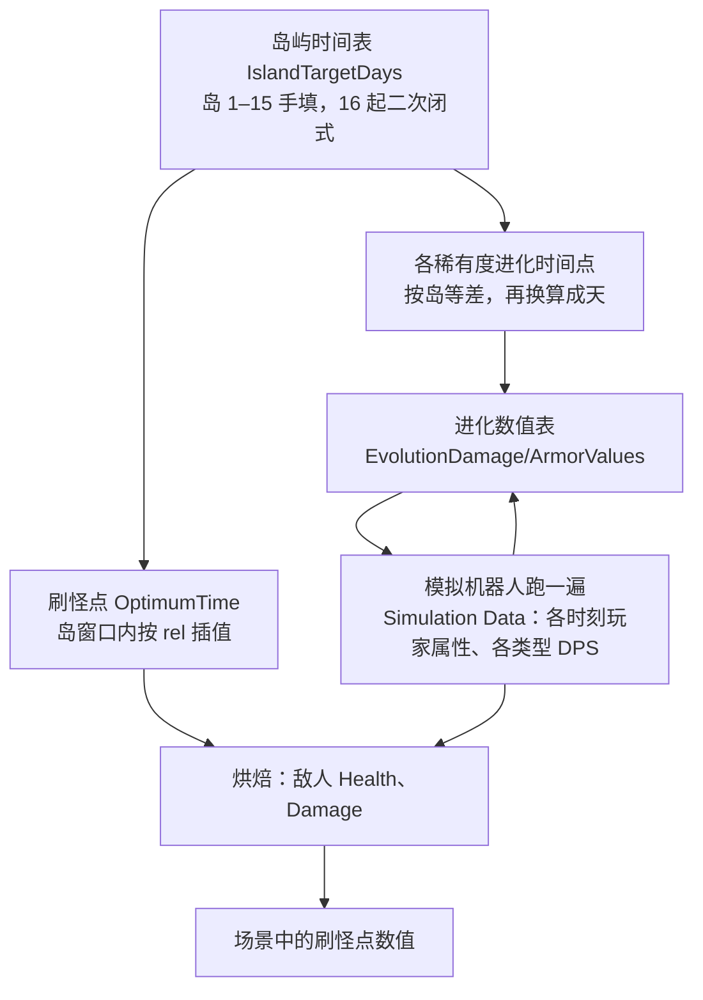

# 原版数值的生成规则

阶段 4 的总览。原团队的编辑器生成工具不在 APK 里，这里从它们留下的数据反推规则，并用已恢复的运行时公式核对。分三条线，各有详细报告：

| 报告 | 内容 | 脚本 |
|---|---|---|
| [BakeCheck.md](BakeCheck.md) | 用模拟数据重跑烘焙公式，与场景里每个刷怪点的 Health、Damage 对比 | `analysis/bake_check.py` |
| [IslandTimeline.md](IslandTimeline.md) | 岛屿时间表、岛内刷怪点的 OptimumTime、各稀有度进化时间点、模拟是否按时到岛 | `analysis/island_timeline.py` |
| [ItemGrowth.md](ItemGrowth.md) | 武器和护甲的成长、进化数值表、碎片需求 | `analysis/item_growth.py` |

在 `Balance/` 下运行，各自约 10 秒，只读 `out/balance.sqlite`，结果写到 `out/analysis/<轨道>/`，重复运行输出逐字节一致。烘焙公式的 Python 实现放在 `Balance/tufu_balance/model/`，阶段 5 的可执行模型以它为核心。

每个结论都标了可信度：**精确复现**是规则逐值还原了数据；**拟合规则**是规则与数据吻合，但规则本身不是从代码读出来的；**假设**是尚未证实的解释。每条线都经过独立评审：评审者重跑脚本、对照 C# 检查移植是否忠实，再由作者修订。

## 原版的数值生成流程

进化数值表和模拟互为输入：模拟按当前进化表成长，进化表又按模拟出的玩家属性生成（`AutoBalanceItems = 1`）。原团队应当是交替迭代到稳定的。

## 已确认的规则

### 时间线

| 规则 | 可信度 | 吻合 |
|---|---|---|
| 岛 16 起：`IslandTargetDays(i) = (5/6)(i+1)(i+2) − 105` 天（i 为岛号），相邻岛间隔每岛多 5/3 天 | 拟合，零误差 | 岛 16–99：84/84 |
| 岛 1–15 是手填值（岛 15 按闭式应为 121.67，实为 130） | 数据事实 | — |
| 每个岛的门禁刷怪点 OT 就等于该岛的 `IslandTargetDays` | 数据恒等式 | 16/16 |
| 岛内刷怪点：`OT = Round((Min + rel·(Max − Min))·k)/k`，天制 k=10、分钟制 k=1，平局取偶 | 拟合 | 701/717 |
| 进化时间点：第 k 级在第 `Start + (k−1)·Step` 岛，再按岛表换算成天；Step = 1.75 + 0.25·稀有度，Legendary 为手调的 3.5 | 精确复现 | 150/150 |
| 插值曲线的时间节点由岛号换算成天 | 精确复现 | 49/49 |

### 物品成长

| 规则 | 可信度 | 吻合 |
|---|---|---|
| 进化值：`Value[L] = nice(max(H, Value[L−1] + 2·CopyValue[L−1]·Shards[L], 护甲另加 1.3·Value[L−1]))`；`CopyValue[L] = max(CopyValue[L−1], nice(0.5·(H − Value[L−1])/Shards[L]))`；第 0 级是进化前的物品；nice() 按尾数分段取整、中点取偶 | 精确复现 | 武器、护甲的 Value 和 CopyValue 各 225/225 |
| `ReferenceStatValue` 就是该时刻模拟玩家的对应平坦属性 | 精确复现 | 16/16 |
| Mythical 单独成式：`Value = 50000·L·(L+1)`，每级需 10L 份，CopyValue 5000 | 精确复现 | 15/15 |
| 进化前成长：`BaseByRarity` 全为 0，伤害 = 每级成长 × 拷贝数 + FlatDamage | 代码确认 | — |
| H（目标值）在后期约为武器 `k·M·攻速·玩家属性`、护甲 `0.80 × DefenceFlat` | 拟合，仅后期渐近 | 早期偏差系统性更大 |

规则的设计含义：每次进化的增益至少是被消耗拷贝原价值的 2 倍，进化永远不亏；增量的一半摊到每份拷贝上作为新的拷贝价值。

### 烘焙

| 规则 | 可信度 | 吻合 |
|---|---|---|
| `Health = round(有效 DPS × AverageFightTime / Count × (1 − 抗性))`，有效 DPS 取玩家最强伤害类型对敌人最弱抗性，含暴击期望 | 原生代码，精确复现 | 分钟制 HP 79/108，Damage 104/108 |
| Damage：先求满足“玩家在 AverageFightTime 内承受得住”的每击伤害，再反解防御曲线，按 10 取整、最低 10 | 原生代码，精确复现 | 同上 |
| 第 11 岛起、rel < 0.5 的刷怪点烘焙时间提前 | 代码确认，数据相符 | 受影响的 182 个刷怪点中，HP 在 5% 内：用偏移 147、无偏移 13；Damage 在 5% 内：用偏移 177、无偏移 16 |

天制刷怪点（第 4 岛起，609 个）只有 1 个血量完全一致，但同一烘焙时间、同一武器类型的刷怪点之间偏差完全成比例（92 个非平凡分组中 90 个一致）。这说明公式没错，是烘焙时用的玩家状态和随包的 Simulation Data 不同。没有找到能统一解释的少参数变换，详见 BakeCheck.md 第 3 节。

## 三条时间轴

改数值时最容易出错的是单位。数据里同时存在三种“天”：

| 时间轴 | 含义 | 用在哪里 |
|---|---|---|
| 活跃分钟 | 实际游玩分钟数 | 第 1–3 岛的分钟制刷怪点 OT；`Playtime` |
| TimeChunkIndex | `floor(TotalPlaytime / 1440)`，含离线时间的 24 小时自然日 | 天制刷怪点 OT、第 4 岛起的岛表、进化时间点、烘焙的“天”（46/46、63/63 个快照成立） |
| 代码里的 30 分钟 | `TimeChunkDurationMinutes = 30`，`SpawnerOptimumTimeDaysConverter` 也写死 30 | 分钟与天的换算工具、模拟中的 OT 换算、Boss 塔 |

两处有矛盾，改动前务必知道：

- 前三个岛的数据按 **60 活跃分钟 = 岛表 1 天**编排：门禁 30/110/240 分钟，对应岛表 0.5/1.83/4。但换算工具用的是 30 分钟。
- 模拟机器人到最后每个自然日只玩 46 活跃分钟左右，所以活跃分钟和自然日不是固定比例。

## 已知例外

这些点不是噪声，是手调的设计信息，详见各报告：

- **烘焙**：首个刷怪点 HP 80、伤害 4（按公式应为 96、10），第二生物群落门 HP 200，假人 HP 1e9。整数值的 200000（`Spawner_1_epic_buck`）和 270000（`Spawner_elite_regen`）、伤害 20000 和 80000 是手调痕迹。活动刷怪点的场景值只是占位，运行时由活动计划覆盖。
- **时间线**：16 个刷怪点的 OT 两条规则都对不上，大多数是烘焙后又手改过 OT。
- **成长**：Legendary 的进化步长是手调值；5 个护甲格子的参考字段跨类型共用。

## 尚未解决

1. 天制刷怪点烘焙时用的玩家状态 B 与随包模拟数据 A 有什么不同。两者在前 120 分钟一致，之后先是 Cut/Buckshot 的 DPS 不同。要下结论需要移植 `SimulationSystem.CalculateDpsData`（模拟主循环在 APK 中是空的）。
2. 目标值 H 在早期的系统性偏高（随时间按约 tc^-1.9 衰减），确切公式未知。
3. 碎片需求取自“拷贝最多的那件”还是“Stabbing 那件”，用快照数据分不出来。
4. `ArmorBaseByRarity` 由模拟写入，量级与首次拿到该稀有度护甲时的玩家防御相当，但具体时刻和系数不确定。
5. 模拟机器人每个岛都比目标晚 1–2 天到达，原因未定。

## 改动时会牵动什么

| 改动 | 需要重新生成 |
|---|---|
| `IslandTargetDays` | 岛内刷怪点 OT（按 rel 重新插值）→ 进化时间点 → 烘焙时间 → 敌人 Health、Damage；进化数值表的参考时刻 |
| 刷怪点的 rel、AverageFightTime、Count、Difficulty、ArmorConfig | 该刷怪点的 Health、Damage（重新烘焙即可，`tufu_balance.model.bake`） |
| 武器/护甲成长、进化表 | 模拟玩家战力 → 进化表（互为输入）→ 所有刷怪点的烘焙值 |
| 玩家基础属性、属性曲线 | 模拟 → 进化表 → 烘焙；属性曲线同时直接影响战斗结算 |

前两项现在可以离线算出：时间线规则和烘焙公式已经有 Python 实现。后两项依赖模拟机器人，而它的主循环在 APK 中是空的，必须在阶段 5 重建模拟器才能算。依赖关系可以用[数值依赖图](../DependencyGraph.md)的 `impact` 命令逐项查。

阶段 5 工作树与刷新流程见[模拟器说明](../Simulator/README.md)和 [Runbook](../Simulator/Runbook.md)。
