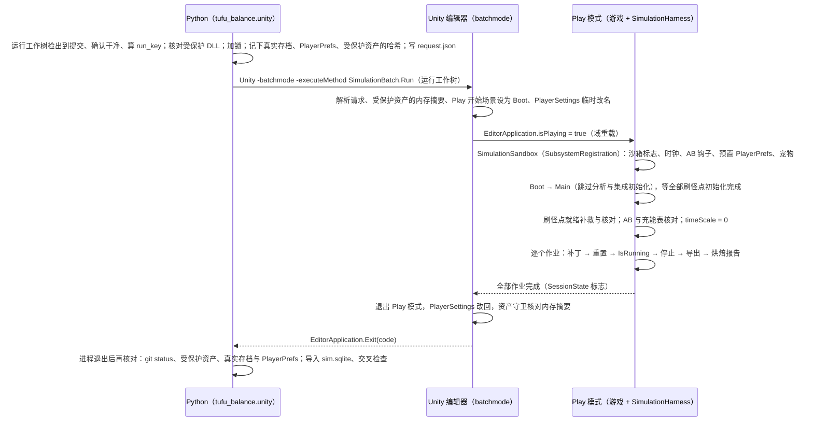
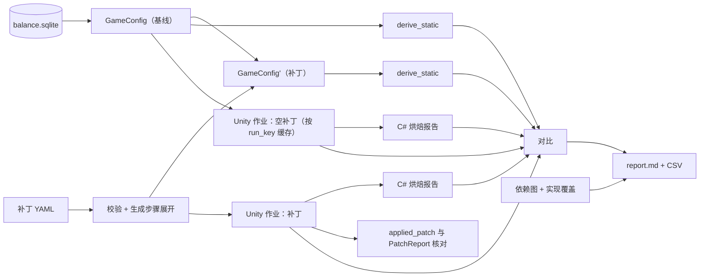
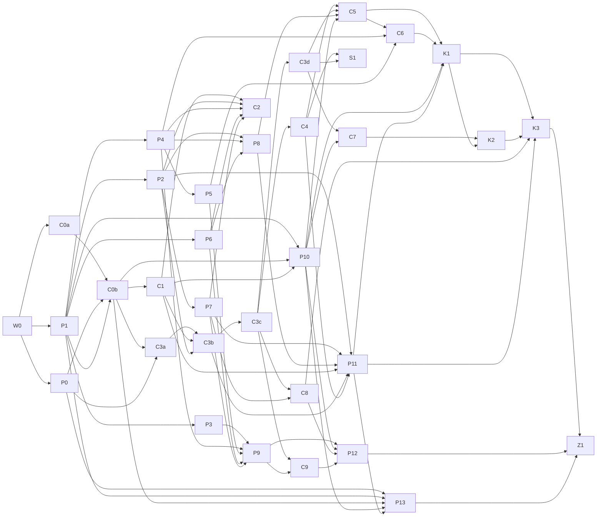

# 阶段 5 设计：混合架构的可执行模型与重建模拟器

> 状态：阶段 5 已集成（2026-10-29）；可选 S1 未实现，科学失败与未决项见第 10 节。第 3 版按两份评审（无头运行与工作流程；数据保真）修订，逐条处理记录见第 9 节。
>
> 本版按用户决定改为**混合架构**：模拟器用 C# 在 Unity 工程里重建，Python 保留工具链并作为独立预言机。它取代此前以 Python 为主模拟器的设计稿。旧稿备份在 `/private/tmp/claude-501/-Users-joyfort-MyProjects-Tufu/f3201c8d-2463-46c4-95af-b416f6c1537d/scratchpad/stage5/architect/rev/Design.v2-python-sim.md`。旧稿里经数据核实的事实、测试数字、校准目标和两轮评审的修正原样沿用，清单见附录 C。

阶段 5 有两个目标：

1. **从配置重算每一张派生表**，以原版数据为黄金基线做回归测试。
2. **重建模拟机器人**。原版 `SimulationSystem` 的逐刷怪点经济学代码保留了下来，主循环和策略的方法体是空的。现在按随包 `Simulation Data` 校准重建它们，模块边界与 C# 方法一一对应，日后从原生代码恢复出的方法体可以逐个替换。

用户的决定：

- **模拟器在 C# 里重建**。就在原版 `SimulationSystem` 类上填空方法，类名、方法名和签名不变，跑在真实游戏代码和真实配置资产上，与原团队在 Play 模式里跑机器人一样。游戏逻辑一改，模拟器自动跟着变。烘焙结果可以由编辑器工具写回资产，有守卫，需要显式开启。
- **Python 保留**数据抽取、公式目录、依赖图、分析与校准拟合、改动对比报告。现有的 `tufu_balance.model` 降为**独立预言机**，用来交叉检查 C# 的输出，不再是主模拟器。

本文各节：

| 节 | 内容 |
|---|---|
| 1 | 两侧的职责、目录与接口 |
| 2 | 无头、确定性地运行模拟器 |
| 3 | 静态模型与黄金回归测试 |
| 4 | C# 模拟器架构 |
| 5 | 校准 |
| 6 | 改动对比工具、代码漂移检查、一键刷新 |
| 7 | 工作拆分 |
| 8 | 风险与待决事项 |
| 9 | 评审意见处理 |

原版代码一律读提交 `6af011f`，读法见附录 A。之后的提交加了可选的宠物功能，模拟一律在没有宠物或宠物关闭的状态下运行。`CodeBase/Simulation` 目录在 `6af011f` 与当前 HEAD 之间没有变化。

## 0. 设计要点

- **在原类上填空，按模块拆成 partial 文件**。
  - `SimulationSystem` 加 `partial` 关键字。已恢复的方法体（带 `Original ELF VA` 注释）留在原文件，一字不改。
  - 全部空方法按模块移到 `SimulationSystem.<模块>.cs`，签名不变。
  - 新增成员只能是 `private` 或 `internal`，名字以 `Rebuild` 开头。
  - 签名锁测试保证成员集合与 `6af011f` 一致。签名锁、禁用 API 检查和编译检查都由离线的 Roslyn 工具 `cscheck` 完成，不需要 Unity（1.6 节）。

  这样各模块的文件归属互不交叉，原生方法体日后可以按方法替换。
- **每个重建方法标明出处**：`[SimulationRebuild(Provenance.Inferred|Calibrated|Null|DebugOnly, "公式 id")]`。每次运行把清单写进 manifest，Python 的覆盖率统计也读它。
- **无头运行走自定义批处理入口**：
  - 命令是 `Unity -batchmode -executeMethod SimulationBatch.Run`，不带 `-quit`。
  - 入口从 Boot 进入 Play 模式。运行时的 `SimulationHarness` 等游戏就绪，然后跑作业、导出。
  - 编辑器最后退出 Play 模式，以退出码结束。
  - 不用 Unity Test Framework：工程没有这个包，游戏代码在预定义的 `Assembly-CSharp` 里，asmdef 测试程序集引用不到它。
  - Unity 只在**专用的运行工作树**里启动，检出到某个提交，不带未提交改动。开发用的工作树里的半成品不会混进运行（2.10）。
- **沙箱**（2.3）：
  - 进入 Play 之前在内存里改 `PlayerSettings.companyName`/`productName`，`persistentDataPath` 和 PlayerPrefs 的 plist 都随之换到沙箱名下，结束前改回。存档目录钩子作为后备。
  - **沙箱时钟**：`TimeService` 在沙箱下返回请求给定的固定时刻，不读 `DateTime.UtcNow`，也不读 PlayerPrefs 的 `TimeSkipSeconds`。
  - **AB 分组在初始化之前固定**：`ABTestModel` 的随机抽组在沙箱下直接返回请求的分组（默认 A），刷怪点自举时看到的就是这一组；就绪时再核对一遍。
  - **刷怪点就绪**：就绪后、开始作业前，对每个非活动、非 VIP 刷怪点补做一次初始化，启用被任务禁用的刷怪点，断言 `AnyoneAlive && IsEnabled` 的个数等于冻结值。
  - 分析与第三方集成的初始化在沙箱下跳过，自检断言没有外发连接。
  - 游戏就绪后设 `Time.timeScale = 0`，冻结其它按帧推进的系统，并禁用 UI。
  - 配置资产只在内存里改。每个作业前后核对受保护资产的内存摘要，Unity 进程退出后启动器再核对一次磁盘。
  - 宠物必须不存在或已关闭。
- **确定性**：
  - 同一请求（资产版本 + 代码版本 + 参数）得到逐字节相同的输出，与真实日期、时刻和共用的 PlayerPrefs 无关。
  - 结果与 `SimulationSpeed`（每帧 Tick 数）无关。
  - 不用 `UnityEngine.Random`、`Time` 和墙钟。
  - 每天写一个状态摘要，用来比较两次运行。
- **换天顺序已由数据确定**：先用旧修饰器重算 RPM 与 DpsData，再换 K2/K3 修饰器，再拍强制快照（`RpmFirst`）。依据是 G20 在这个顺序下 1380/1380 全中（4.4）。原来的三选一参数 P07 只保留作消融。
- **插值的舍入方式是枚举**：`stepwise`、`fma`、`double_tail`、`double_all`。编辑器 Mono 实测为 `double_all`（DP3 109/109）；预言机默认取这一种，Q03 无需修改游戏代码。
- **以期望值为主**：唯一的随机项是物品份数的小数部分。默认按物品分流做"进位取整"：结果是整数，长期无偏，没有噪声。另有固定种子的随机模式。
- **参数不进代码**：可校准参数是一个 `[Serializable] partial class SimulationRebuildParams`。默认值放在资产 `Assets/Simulation/Simulation Rebuild Params.asset` 里（不在 `Resources/`，不进正式构建），由编辑器里的驱动读取；每次批处理运行由请求 JSON 整体覆盖。Python 拟合参数不用改代码。
- **请求与旁路文件用 Newtonsoft.Json**（`Assets/Plugins` 里已有）。`JsonUtility` 读不了字典、可空值和多态的补丁值。
- **输出与原表同构**：导出的 `simulation_data.json` 按 Unity 序列化 `SimulationData` 的字段结构写。Python 用抽取器同一套展开代码把它导入成 `sim.sqlite`，表名与 `balance.sqlite` 的 `c_SimulationData__*` 相同，`model.data.load_simulation_data` 可以原样使用。
- **预言机与差分测试**：
  - Python 的 `model` 继续负责"从配置重算派生表"，即 G/R 系列测试，断言今天的通过数。
  - 新增 C# 对 Python 的差分测试，覆盖特定值曲线、防御曲线、插值、快照查找、烘焙、刷怪点充能和物品数值。
  - 新增对每次模拟输出的交叉检查，覆盖属性列合成、DpsData、RPM 和烘焙。

  游戏逻辑一改，差分测试会先报警。
- **两层基线**：原版基线（ORIGINAL）冻结；当前基线（CURRENT）只能用 `golden accept` 命令带理由接受。放宽必须登记，由守卫测试检查。
- **校准由 Python 驱动 C# 批量运行**：一次启动跑多个作业，或者用常驻模式按队列接作业。尽量用开环重放和"从运行轨迹直接求参数"来减少运行次数。
- **对比工具两侧同时打补丁**：
  - Python 在内存里改 `GameConfig`，重算静态表。
  - C# 在 Play 模式里按同一份补丁改内存中的配置，再模拟、再烘焙。
  - 两侧把改动后的值互相核对。
- **独立工作树**：在 `balance/stage-3-4` 上切出集成分支 `balance/stage-5`，放在独立工作树 `/Users/joyfort/MyProjects/Tufu-stage5` 里。主检出不跑任何 Unity 批处理。
  - 另有一个**运行工作树** `/Users/joyfort/MyProjects/Tufu-stage5-run`，检出为游离 HEAD，只供 Unity 运行，同一时间只开一个 Unity。
  - 并行的单元各在自己的分支和工作树里写代码（`Tufu-s5-<单元>`），按依赖顺序合并进 `balance/stage-5`。
  - C# 代码由 `cscheck` 离线编译检查，所以 C# 单元可以并行写和编译，只有运行验收要排队用 Unity。

## 1. 职责划分、目录与接口

### 1.1 分工

| 能力 | C#（Unity 工程）| Python（`Balance/`）|
|---|---|---|
| 数据来源 | 运行时直接读真实配置资产与 Main 场景 | `extract` 把资产和场景导出成 `balance.sqlite`（现有）|
| 模拟机器人 | `SimulationSystem` 的空方法、`SpawnerData` 的优先级、`SimulationConfig` 的空方法 | 无（不再有 Python 模拟器）|
| 已恢复的逐刷怪点经济学 | 原版代码，不改 | `model.simcalc` 独立移植，用于差分与交叉检查 |
| 派生表（岛表尾部、OT、进化时间点、插值节点、进化表、物品成长、充能冷却、烘焙、快照列）| 游戏代码运行时用到哪些就算哪些 | `model` 从配置全部重算，跑 G/R 黄金测试 |
| 烘焙 | 原版 `BuildSpawnerBakeReport` 出报告；有守卫时写回场景 | `model.bake` 作预言机，与 C# 报告逐值比较 |
| 无头运行 | 批处理入口在 `Assets/Editor/Simulation/`，运行时驱动在 `CodeBase/Simulation/Harness/` | `tufu_balance.unity` 负责启动、加锁、超时和导入 |
| 参数 | `SimulationRebuildParams`：默认值资产加请求覆盖 | 参数分层 JSON、拟合、哈希 |
| 校准 | 运行并输出轨迹 | 目标、指标、拟合循环、报告 |
| 对比与漂移 | 在内存里应用补丁，然后模拟、烘焙 | 补丁校验与静态重算、依赖图、报告、代码漂移检查、一键刷新 |
| 测试 | 不写 C# 测试框架，Unity 侧只产出数据 | pytest：静态黄金、差分、交叉检查、回归 |
| 离线编译检查 | 无 | `Balance/tools/cscheck`（.NET 8 + Roslyn）：编译 `Assembly-CSharp`、签名锁、禁用 API、无 `UNITY_EDITOR` 宏的编译（P0）|

### 1.2 C# 侧

下文 `CB` 指 `Recovery/StudyProject/Assets/Scripts/Assembly-CSharp/CodeBase`，`ED` 指 `Recovery/StudyProject/Assets/Editor/Simulation`。括号里是负责的单元（第 7 节）。

```
CB/Simulation/
  SimulationConfig.cs                       # 加 partial；填 GetTrimmedTimeChunkSnapshots、Tick；其余为 null（C3a 移、C3b 填）
  Systems/
    SimulationSystem.cs                     # 加 partial；空方法全部移出；已恢复部分不改（C3a 一次性机械提交）
    SimulationSystem.Run.cs                 # 准备、ExecuteTick、Tick、换天、插值修饰器、停止、时间线换算、RebuildAdvanceFastDay（C3b）
    SimulationSystem.Lifecycle.cs           # 会话、离线、回血、广告（C3b）
    SimulationSystem.Snapshot.cs            # MakeSnapshot（C3b）
    SimulationSystem.Amulet.cs              # 护符与水晶的 4 个空实现（C3b）
    SimulationSystem.Rebuild.cs             # 新增成员：清怪写入点、解锁、门禁冲刷、停止标志、作业重置、partial 钩子声明（C3b）
    SimulationSystem.Replay.cs              # 重放与检查点钩子的实现（C3a 建空 partial 实现，交给 C4）
    SimulationSystem.FastTick.cs            # FastTick 与累积/冲刷（C3a 移出，C3b 写最小方法体，交给 C5）
    SimulationSystem.Inventory.cs           # 掉落、合并、进化、开槽、自动平衡（C3a 建空壳，交给 C6）
    SimulationSystem.Targeting.cs           # 目标选择、属性收益、路径（C3a 建空壳，交给 C7）
    SimulationSystem.Fight.cs               # 慢阶段战斗、死亡、日志（C3a 建空壳，C3b 放入调用点，交给 C7）
    SpawnerData.cs                          # 5 个优先级方法（C7）
    AmuletSimulationMultipliers.cs          # 不动；配置关闭时不构造
  Rebuild/                                  # 原版没有的目录
    SimulationRebuildAttribute.cs           # 出处标注（C3a）
    SimulationRebuildParams.cs              # 参数类的核心部分（C3b 建，带代码默认值）；资产包装类与请求覆盖（C3c）
    SimulationRebuildParams.FastTick.cs     # （C5）
    SimulationRebuildParams.Inventory.cs    # （C6）
    SimulationRebuildParams.SlowPolicy.cs   # （C7）
    SimulationRandom.cs                     # 确定性随机与进位取整（C3c）
    SimulationTrace.cs                      # 每天记录、事件、状态摘要（C3c）
  Harness/                                  # 批处理运行的运行时一侧；不加条件编译（见说明）
    SimulationRunRequest.cs                 # 请求的核心字段（C0b）；partial class
    SimulationRunRequest.<单元>.cs           # 各单元追加的请求字段：.Override（C4）、.Bake（C8）、.Patch（C9）
    SimulationHarness.cs                    # 就绪检测、刷怪点就绪补救、作业循环、心跳、完成信号、partial 钩子声明（C0b）
    SimulationSandbox.cs                    # 沙箱标志、时钟、AB、分析初始化跳过、宠物、timeScale、UI（C0b）
    SimulationJson.cs                       # Newtonsoft.Json 的设置（数值格式、NaN、枚举写整数）（C0b）
    SimulationExport.cs                     # 与 SimulationData 同构的 JSON 及旁路文件（C1）
    SimulationRuntimeProbes.cs              # Play 模式下的差分探针（C2）
    SimulationStateOverride.cs              # 读随包快照、构造重放状态（C4）
    SimulationBakeExport.cs                 # 作业结束时生成烘焙报告（C8）
    SimulationConfigPatcher.cs              # 内存补丁（C9）
CB/Core/UserData/GameDataService.cs         # 只加沙箱存档目录钩子；PlayerSettings 改名能覆盖时不加（C0b，后备）
CB/Services/Time/TimeService.cs             # 只加沙箱时钟钩子（C0b）
CB/ABTests/ABTestModel.cs                   # 只在随机抽组处加沙箱钩子（C0b）
CB/Core/MainSceneInitializer.cs             # 只在沙箱下跳过分析与第三方集成的初始化（C0b，C0a 读代码后确定范围）
CB/Balance/CombatBalanceConfig.cs           # 自动平衡的被调方法；Regenerate 模式下改注入的实例、作业结束恢复（C6）
Recovery/StudyProject/Assets/Simulation/Simulation Rebuild Params.asset   # 参数默认值（C3c 建，K3 写入发布值）；不在 Resources 下
ED/
  SimulationBatch.cs                        # -executeMethod 入口 Run、Serve、SelfTest；参数解析与退出码（C0a 建最小版，交给 C0b）
  SimulationPlayModeDriver.cs               # [InitializeOnLoad]：跨域重载接续、看门狗、PlayerSettings 改名与恢复（C0b）
  SimulationAssetGuard.cs                   # 每个作业前后核对资产的内存摘要与磁盘；必要时强制重新导入（C0b）
  SimulationRunnerWindow.cs                 # 交互窗口：提交作业、单步（handTick）（C0b，可选）
  SimulationExportRoundTrip.cs              # 把随包 Simulation Data 走一遍导出器（C1）
  SimulationProbes.cs                       # 编辑模式下的差分探针（C2）
  SimulationParamsImporter.cs               # 参数 JSON → 参数资产（C3c）
  SimulationBakeTool.cs                     # 烘焙计划与守卫写回（C8）
```

说明：

- `Harness/` 与 `Rebuild/` **不加条件编译**。机器人只在 `IsRunning` 或 `handTick` 时执行，正常游玩不会走到这些代码；`SimulationSystem` 的 partial 文件又要引用请求和作业类型，给 `Harness/` 单独加宏会让不带宏的构建编译失败。只有真正依赖编辑器的几处（`AssetDatabase` 读参数资产、`PlayerSettings`）包在 `#if UNITY_EDITOR` 里。`cscheck` 在 L0 里另做一次不带 `UNITY_EDITOR` 的编译，保证正式构建能编译。
- 参数资产不放在 `Resources/` 下，不随正式构建打包。编辑器里由 `SimulationHarness` 经 `AssetDatabase.LoadAssetAtPath` 读取；播放器构建里没有资产，用代码默认值。
- `SimulationSystem` 在正常游戏里本来就注册着（`SystemsInstaller`）。活跃游戏会调用它已恢复的 RPM 函数，包括商店的 `ShopLotRpmCalculationSystem`、广告和奖励池。重建的方法只在 `IsRunning` 或 `handTick` 时执行，所以正常游玩不受影响。
- 编辑器代码的命名空间用 `Codebase.Simulation.EditorTools`，避免和 `UnityEditor.Editor` 冲突。
- 新建的 C# 文件、目录和资产，其 `.meta` 归建它的单元。

### 1.3 Python 侧

```
Balance/
  requirements.txt  pytest.ini                       # 增加 pytest；标记 slow、unity（P1）
  sim/params/
    defaults/engine.json                             # （C3b 建，C3c 补齐）
    defaults/fasttick.json                           # （C5）
    defaults/inventory.json                          # （C6）
    defaults/slow_policy.json                        # （C7）
    open.json  slow.json  calibrated.json            # 校准分层（K1、K2、K3）
  patches/examples/*.yaml                            # 对比工具示例（P12）
  tools/cscheck/                                     # .NET 8 控制台工具：Roslyn 编译、签名锁、禁用 API（P0）
    cscheck.csproj  Program.cs  signature_6af011f.json
  tufu_balance/
    extract.py graph.py render_catalog.py ...        # 现有
    model/                                           # 预言机：移植与生成规则，全是纯函数
      registry.py enums.py                           # （P1）
      f32.py interpolation.py snapshots.py timeaxis.py   # （P2）
      timeline.py                                    # （P3）
      items.py                                       # （P4）
      evolution_gen.py                               # （P5）
      spawners.py ab.py                              # （P6）
      bake.py data.py                                # （P7）
      simcalc.py                                     # （P8）
      config.py patch.py pipeline.py                 # （P9）
      stats.py defense.py                            # 现有，不变
    golden/__init__.py store.py __main__.py          # 基线管理与 accept 命令（P1）
    cscheck.py                                       # 调用 tools/cscheck，解析结果（P0）
    unity/
      __init__.py __main__.py launcher.py request.py # 启动、加锁、超时、请求、运行后磁盘核对（C0b）
      runner.py                                      # 运行工作树：检出到提交、树哈希、run_key（C0b）
      simio.py schema.py                             # 导入运行输出（C1）
      probes.py                                      # 差分探针的输入生成与比较（C2）
      bake_report.py                                 # C# 烘焙报告的导入与比较（C8）
    calibrate/
      __init__.py targets.py metrics.py tolerances.yaml fit.py report.py driver.py runcache.py params.py   # （P10）
      sensitivity.py                                 # （C5）
      killseq.py                                     # （C7）
      stage_open.py  stage_slow.py  stage_full.py    # （K1、K2、K3）
    crosscheck/                                      # 模拟输出的预言机交叉检查（P11）
    diff/                                            # 改动对比（P12）
    drift.py  refresh.py                             # 代码漂移、一键刷新（P13）
  tests/
    conftest.py                                      # （P1）
    test_*.py                                        # 只读数据库和夹具，不需要 Unity
    unity/conftest.py                                # 会话级夹具：找输出或启动 Unity（C0b）
    unity/test_*.py                                  # 标记 unity，读 Unity 运行的输出
    patch_cases/*.yaml + *.expected.json             # 补丁语义用例，两侧共用（P9）
    golden/
      fixtures/*.json                                # 从调研脚本冻结的夹具（W0），之后不可变
      original/<suite>.json                          # 原版基线
      current/<suite>.json  current/sim_run/*.csv    # 当前基线
      loosening/<suite>.jsonl  accepted/<suite>.jsonl    # 放宽登记、接受记录
      registry.json                                  # 公式实现登记的开关（P1 建，Z1 改）
```

### 1.4 两侧之间的接口

#### 1.4.1 交换的文件

| 文件 | 方向 | 内容 |
|---|---|---|
| `request.json` | Python → C# | 一次启动要跑的作业列表（1.4.2）|
| `Balance/out/sim/runs/<run_key>/<job_id>/` | C# → Python | 每个作业的输出（1.4.3）|
| `probes_in.json` / `probes_out.json` | 双向 | 差分探针的输入网格与 C# 的计算结果 |
| `queue/inbox/*.json`、`queue/done/`、`heartbeat.json`、`stop` | 双向 | 常驻模式的作业队列（2.5）|
| `bake_plan.json` | C# → 人 → C# | 烘焙写回计划；写回时用它的哈希作口令 |
| `Simulation Rebuild Params.asset` | Python 经编辑器导入 → C# | 发布参数 |

运行输出放在开发工作树的 `Balance/out/sim/`，不入库。Unity 在运行工作树里执行，输出目录由请求给出绝对路径。队列放在运行工作树的 `Recovery/StudyProject/Temp/TufuSimulation/`，Unity 退出时清理。

#### 1.4.2 请求

Python 把参数分层合并完，把**完整的参数对象**写进请求；C# 不做分层合并。

请求、补丁和旁路文件一律用 `Newtonsoft.Json` 读写（`Assets/Plugins/Newtonsoft.Json.dll` 已有）：字典、可空值、多态的补丁值（数字、字符串、数组）都能直接表示，`params` 子对象以 `JObject` 原样交给参数类反序列化。`SimulationRunRequest` 是 partial class：核心字段由 C0b 定义，C4、C8、C9 各在自己的文件里追加字段。字段只增不改，改语义时把 `schema` 的版本号加 1；C# 遇到未知字段报错（`MissingMemberHandling.Error`），Python 侧由 `schema.py` 校验。

```json
{
  "schema": "tufu.sim.request/1",
  "run_key": "sha256…",
  "code_rev": "<运行工作树检出的提交>",
  "out_dir": "/Users/joyfort/MyProjects/Tufu-stage5/Balance/out/sim/runs/<run_key>",
  "unity": {"simulation_speed": 500, "frame_budget_ms": 1000, "time_scale_zero": true, "disable_ui": true,
            "reset_mode": "reenter_play"},
  "sandbox": {"ab_variant": "A", "pets": "absent_or_disabled", "clock_epoch_utc": "2024-01-01T00:00:00Z",
              "identity": "TufuSimSandbox", "prefs_seed": {}, "expected_ready_spawners": "ready_spawners.expected.csv"},
  "jobs": [{
    "job_id": "golden-405",
    "mode": "free",
    "override": {"from_day": null, "econ_caches": "stored", "replay_items": "snapshot", "unlock": "derived",
                 "items_evolved": null, "slots": null},
    "stop": {"day": 405, "location": null, "max_ticks": 5000000, "max_wall_seconds": 900},
    "config_overrides": {},
    "patch": [],
    "params": {"SchemaVersion": 1, "RollMode": 0, "Seed": 1, "…": "…"},
    "params_hash": "sha256…",
    "outputs": {"timechunk_full": true, "daily": true, "events": true, "spawner_days": false,
                "bake_report": true, "items_ext": true}
  }]
}
```

- `mode` 有三种：`free`（闭环）、`checkpoint`（在随包天快照处重置）、`replay`（每天开头设成随包插值状态），见 4.6。
- `override` 里需要推断的数据由 Python 算好传入，C# 不重复实现：
  - `items_evolved`：每个快照中各物品是否已进化，由 P4 的 `infer_evolved` 给出；
  - `slots`：每天的武器/护甲槽数，默认取夹具 `stage4_slot_schedule.json`（拟合值）；`slots_rule = "p12"` 时改用闭式 P12 规则，与 R2b、闭环同口径。
- `config_overrides` 只允许改 `SimulationConfig` 的运行开关，如 `UseFastTick`、`FastTickStartChunkOffset`。只改内存，清单里记录。
- `patch` 是对比工具的配置补丁（6.1），由 C9 在内存里应用。
- `sandbox`：
  - `clock_epoch_utc`：沙箱时钟的固定时刻，写进 manifest；
  - `identity`：进入 Play 前临时使用的 `companyName`/`productName`；
  - `prefs_seed`：沙箱 PlayerPrefs 的预置键值，只用于测试（例如 `TimeSkipSeconds`）；
  - `expected_ready_spawners`：P6 生成的期望表（每个运行时刷怪点的 ChargesTotal、BaseCooldown），就绪时逐个核对。P6 完成之前可以省略，这时只导出不核对。
- `unity.frame_budget_ms`：每帧的时间预算，驱动器据此在内存里调整 `SimulationSpeed`（2.4）。结果与速度无关，所以它不进 `run_key`。
- `run_key = sha256(规范化请求（去掉只影响速度的字段）+ 代码与资产版本 + Unity 版本 + 受保护 DLL 的哈希)`，相同的 `run_key` 直接用缓存。
  - 代码与资产版本：运行工作树检出的提交，以及该提交上 `Recovery/StudyProject/{Assets,ProjectSettings,Packages}` 三个目录的树哈希。ProjectSettings 和 Packages 里有脚本宏、进入 Play 模式的设置和包版本，都会改变行为。
  - 运行工作树不允许有未提交改动或未跟踪文件（`git status --porcelain -uall` 为空）。开发工作树里的临时运行（`--dev`）改用 `git status --porcelain -uall` 的内容加上这些文件的内容哈希，运行结束后重算一遍，变了就判失败（2.2）。
  - Unity 版本取编辑器的完整版本字符串。

#### 1.4.3 每个作业的输出

```
<job_id>/
  simulation_data.json     # 与 Unity 序列化的 SimulationData 同构：Snapshots，以及按原规则裁剪的 TimeChunkSnapshots
  timechunk_full.json      # 不裁剪的逐日天快照
  snapshots_ext.csv        # 每个快照：所在列表、序号、UnlockedWeaponSlots、UnlockedArmorSlots、CurrentHealth
  items_ext.csv            # 每个快照里每件物品：Key、Level、Copies、Evolved、EvolutionLevel
  daily.csv                # 每天：活跃分钟、离线分钟、击杀数、清怪次数、Σ fightTime、Σ farmedTime、合格集合签名、解锁
  spawner_days.csv.gz      # 可选：每天每个合格刷怪点的 clears、fightTime、loss/H（校准用）
  events.jsonl             # 首杀、解锁、开槽、进化、死亡
  digests.csv              # 每天的状态摘要（2.6）
  bake_report.json/.csv    # 用本次快照跑原版 BuildSpawnerBakeReport 得到的全部字段（C8）
  applied_patch.json       # 补丁应用前后的叶子值（C9）
  rebuild_coverage.json    # 带 [SimulationRebuild] 的成员及其出处
  ready_spawners.csv       # 就绪时每个注册刷怪点：路径+Key、AnyoneAlive、IsEnabled、ChargesTotal、BaseCooldown、是否经补救初始化
  manifest.json            # 请求、参数哈希、资产/代码版本、AB 生效值与分组（不是 A 时标"策略外推"）、沙箱时钟、沙箱报告、停止原因、计数
  timings.json             # 耗时；单独存放，其余文件可以逐字节比较
  unity.log                # 本次 Unity 日志的副本
```

数值格式：

- double 用 `R` 往返格式，float 用 `G9`；
- NaN 写成 `NaN`，Python 的 `json` 能读；
- 枚举写整数，与 YAML 一致。

**导入**：`tufu_balance.unity.simio.ingest(job_dir)` 复用 `extract.add_record_tables` 和同一个枚举解码器，生成 `<job_dir>/sim.sqlite`：

- `simulation_data.json` 展开成 `c_SimulationData`、`c_SimulationData__Snapshots`、`…__Stats`、`…__Items`、`…__DpsData`、`…__DefenseData` 等表；
- 旁路文件写成 `sim_daily`、`sim_events`、`sim_items_ext`、`sim_snapshots_ext`、`sim_bake_report`、`sim_manifest` 表。

现有工具只要把数据库路径换成 `sim.sqlite`，就能直接读模拟结果。

#### 1.4.4 命令行

都在工作树的 `Balance/` 目录下，以 `.venv/bin/python -m <模块>` 执行。

| 命令 | 作用 | 需要 Unity |
|---|---|---|
| `tufu_balance.extract` | 抽取（现有）| 否 |
| `tufu_balance.graph build\|impact\|depends\|path` | 依赖图（现有）| 否 |
| `tufu_balance.unity open` | 用正确参数交互打开工作树的工程，取代没有入库的 `.command` | 是 |
| `tufu_balance.cscheck [--no-editor-define] [--signature] [--bans]` | 离线编译 `Assembly-CSharp`（及编辑器程序集）、签名锁、禁用 API | 否 |
| `tufu_balance.unity selftest` | 无头启动 → 就绪 → 退出，记录耗时和沙箱检查 | 是 |
| `tufu_balance.unity run --preset golden-405\|smoke-11\|slow-5` 或 `--request R.json`，`[--rev <提交>]` 或 `[--dev]` | 跑一批作业；默认把运行工作树检出到开发工作树的 HEAD | 是 |
| `tufu_balance.unity serve start\|status\|stop` | 常驻模式 | 是 |
| `tufu_balance.unity probe [--suite …]` | 差分探针 | 是 |
| `tufu_balance.unity ingest <job_dir>` | 输出 → `sim.sqlite` | 否 |
| `tufu_balance.unity bake <job_dir> [--plan] [--apply --token T]` | 烘焙计划，或守卫下写回 | 是 |
| `tufu_balance.unity params build\|import` | 合并参数层；把参数写进参数资产 | `import` 需要 |
| `tufu_balance.calibrate stage open\|slow\|full` | 校准 | 是 |
| `tufu_balance.golden status\|accept\|rebaseline-original` | 基线管理 | 否 |
| `tufu_balance.diff PATCH.yaml [--skip-sim]` | 改动对比 | 不加 `--skip-sim` 时需要 |
| `tufu_balance.drift [--base 6af011f] [--head REF]` | 代码漂移检查 | 否 |
| `tufu_balance.refresh --level 0\|1\|2` | 一键刷新 | 级别 ≥ 1 时需要 |
| `pytest [-m "not unity"] [--unity]` | 测试 | 加 `--unity` 时需要 |

### 1.5 约定

C#：

1. 带 `Original ELF VA` 注释的方法体一字不改，例如 `OnAwake`、`OnUpdate`、`CalculateSpawnerData`。只填空方法。
2. 新增成员只能是 `private` 或 `internal`，名字以 `Rebuild` 开头，可以放在本模块的 partial 文件里。不新增 `public` 成员，免得活跃游戏代码依赖它们。
3. 每个填过的空方法都带 `[SimulationRebuild(Provenance.X, "公式 id 或 pending:…")]`。
4. 重建代码不用 `UnityEngine.Random`、`Time.*`、`DateTime` 或墙钟。随机只经过 `SimulationRandom`。
5. float/double 按原声明，不擅自改变乘加的舍入方式（见待决事项 Q03）。
6. 运行期代码不写资产：不调用 `EditorUtility.SetDirty`、`AssetDatabase.SaveAssets`、`CreateAsset`。例外只有两个受守卫的编辑器入口：烘焙写回（C8）和参数导入（C3c）。这两个入口只能在**没有进入过 Play 模式的新编辑器进程**里执行：Play 模式里对配置 ScriptableObject 的内存改动会留到退出 Play 之后（例如 `PlayerModel` 把 `PlayerConfig.Stats[i].Modifiers` 按引用交给 `Stat`，每次奖励都写进资产对象），同一进程里的任何保存都可能把它们落盘。
7. 自动平衡的 `Regenerate` 模式直接改注入的那个 `CombatBalanceConfig` 实例：作业开始前用 `JsonUtility.ToJson` 做深拷贝备份，作业结束用 `FromJsonOverwrite` 恢复，资产守卫核对内存摘要。持有它的系统和模型在构造时就拿到了引用，换实例做不到。`Regenerate` 只允许在 `reenter_play` 作业里用。
8. 刷怪点的"死亡"只用冷却表示。机器人不杀真实单位，也不生成单位，所以就绪补救之后 `AnyoneAlive` 保持为真；`Cooldown > 0` 就视为还没刷新（Q07）。DAFC 刷怪点清过一次后把 `Cooldown` 设为 `float.PositiveInfinity`，`ResetCooldowns` 与离线递减都跳过它，已恢复的过滤 `!(Cooldown <= 0f) && IsRunning` 就会一直排除它，等价于原版里它的单位不再刷新、`AnyoneAlive` 变成假。
9. 属性奖励直接调用 `Stat.AddModifier`，不走 `GrantStatReward`（Q06）。
   - 修饰器的名字、来源和类型照抄刷怪点配置里的奖励（`Devoured`、`Enemy`、`Flat`）。`StatBase.AddModifier` 按 (Name, Source, ModifierType) 合并，值用 float 累加，正好复现数据里约 1e-5 的 float32 累加漂移。
   - 值为 `(float)(Value × Count × 次数)`。
   - Health 奖励同时加当前血量，与 `GrantStatReward` 一致。
   - 不走 `GrantStatReward`，是为了避开作弊倍数、DoubleLoot、VIP 掷骰、飘字和音效。
10. 代码风格照原文件：制表符缩进，注释写法与原文件一致。
11. 只在沙箱标志打开时生效的钩子（时钟、AB、存档目录、分析初始化）都写成"标志关时原样执行"，并在 Runbook 逐个登记文件与行号。
12. 心跳和帧预算用的 `Stopwatch` 只在 `SimulationHarness` 里，不进重建方法；`cscheck --bans` 对 `Rebuild/` 和 `SimulationSystem.*.cs` 禁用 `UnityEngine.Random`、`Time.`、`DateTime`、`Stopwatch`、`Environment.TickCount`。

Python：

1. 读库一律只读（`mode=ro`）。测试的输入只有三种：`balance.sqlite`、`tests/golden/fixtures/*.json`、Unity 运行的输出目录。不读 `out/analysis/`，不 import `analysis/*.py`，不读会话 scratchpad。
2. 预言机里每个移植函数写明 `CodeBase/<文件>:<行>` 和原生 VA，并用 `@implements("公式 id", provenance=...)` 登记。目录里还没有条目的规则用 `pending:<领域>.<名字>`，由 Z1 提升进目录。
3. 编辑器 Mono 的 float 表达式在 binary64 中计算，仅在存储（字段、float 返回/参数及编译器保留的局部变量）时舍入到 float32；Python 比较须模拟这些存储边界。插值提供 `stepwise`、`fma`、`double_tail`、`double_all`，默认由 `model/interpolation_default.json` 指定为 `double_all`（DP3 109/109）。旧的 `evaluate` 等接口仍保持逐步舍入以兼容夹具；新路径用 `evaluate_rounded` / `total_coefficient`。
4. 同一输入必须得到逐字节相同的输出。排序键要显式写出。
5. 刷怪点身份用 `SpawnerId = (scene, file_id)`。C# 运行时拿不到 file_id，与 C# 对应时用"层级路径 + Key"。两者的映射表由 C1 生成，测试检查。
6. 预言机不实现机器人策略，策略只在 C# 里有一份。

### 1.6 离线 C# 检查（cscheck）

每次改 C# 都进 Unity 编译，要拿锁、做域重载、再等 30–90 秒启动。`Balance/tools/cscheck` 是一个 .NET 8 控制台工具（`/opt/homebrew/bin/dotnet`，SDK 8.0.131），用 Roslyn 离线完成三件事：

1. **编译**：引用、宏和语言版本取 Unity 上次编译留下的响应文件 `Library/Bee/artifacts/*/Assembly-CSharp.rsp` 与 `Assembly-CSharp-Editor.rsp`（主检出的 Library 里已有），源文件换成当前工作树的文件列表。这样引用集合与 Unity 实际使用的完全一致，不需要手工列 Unity 的托管 DLL 和包的 DLL。另做一次去掉 `UNITY_EDITOR` 宏的编译，确认播放器构建能编译。
2. **签名锁**：用 Roslyn 的语义模型读出 `SimulationSystem`、`SpawnerData`、`SimulationConfig` 的成员（名字、返回类型、参数类型与默认值、修饰符、元组与编译器生成的结构体按符号显示），与 `6af011f` 生成的 `signature_6af011f.json` 比较；新增成员必须是 private/internal 且以 `Rebuild` 开头。用正则解析 ILSpy 的输出太脆弱，不用。
3. **禁用 API**：对重建代码（`Rebuild/`、`SimulationSystem.*.cs`、`SpawnerData.cs` 的重建方法）按符号检查 `UnityEngine.Random`、`UnityEngine.Time`、`System.DateTime`、`Stopwatch`、`Environment.TickCount` 的使用。

`cscheck` 不需要 Unity，也不占锁，C# 单元可以在各自的工作树里并行迭代。它是 L0 的一部分。`.rsp` 只在 Library 里有，单元工作树没有 Library，所以一律读运行工作树 Library 里的那份（里面引用的 DLL 路径也都在运行工作树里），源文件列表取调用者所在的工作树。`.rsp` 引用的 DLL 缺失或包版本变了（Packages 有改动）时，工具报错并提示先在运行工作树里让 Unity 编译一次。

## 2. 无头、确定性地运行

### 2.1 链路



`reenter_play` 有多个作业时，每个作业重复"进入 Play → … → 退出 Play"，并且在**进入 Play 之前**核对受保护资产的内存摘要；与启动时的基线不同，就对该资产 `AssetDatabase.ImportAsset(path, ImportAssetOptions.ForceUpdate)` 重新导入，再核对一次，仍不同则以退出码 2 结束。原因见 1.5 节第 6 条：Play 模式里写进配置资产对象的修饰器会留到下一个作业。

跨过域重载的方法：

- `SimulationBatch.Run` 把请求路径和编辑器进程号写进 `Temp/TufuSimulation/active_request.json`，并设 `SessionState` 标志。
- 域重载后，`[InitializeOnLoad]` 的 `SimulationPlayModeDriver` 接着注册看门狗和 `playModeStateChanged`。
- 运行时一侧，`SimulationSandbox` 用 `[RuntimeInitializeOnLoadMethod(SubsystemRegistration)]`，在第一个场景加载、`GameDataService` 构造之前读到请求。
- 请求文件里的进程号与当前进程不符时一律忽略，免得崩溃残留的文件影响正常 Play。

### 2.2 启动命令

```bash
/Applications/Unity/Hub/Editor/6000.6.3f1/Unity.app/Contents/MacOS/Unity \
  -batchmode -projectPath /Users/joyfort/MyProjects/Tufu-stage5-run/Recovery/StudyProject \
  -disable-assembly-updater Unity.Mathematics.dll Unity.Burst.dll \
  -logFile <run_dir>/unity.log \
  -executeMethod Codebase.Simulation.EditorTools.SimulationBatch.Run \
  -tufuSimRequest <run_dir>/request.json
```

启动器 `tufu_balance.unity.launcher` 在启动前后做以下几件事：

1. **核对受保护的 DLL**。按 `Recovery/Open-StudyProject.ps1` 的规则检查 `Assets/Plugins/Unity.Mathematics.dll`、`Unity.Burst.dll` 的 sha256：
   - 等于期望值：放行；
   - 等于已知的损坏值：备份后用 `Recovery/Tools/OfficialPlugins/` 里的副本替换；
   - 其它值：中止。

   macOS 的 `.command` 没有入库（被 `.gitignore` 的 `/Recovery/*` 排除），新工作树里没有它。哈希常数照抄入库的 `.ps1`，测试断言两者一致。
2. **拒绝主检出路径** `/Users/joyfort/MyProjects/Tufu/Recovery/StudyProject`，除非显式给 `--allow-main-checkout`。
3. **准备运行工作树**：默认 `git -C Tufu-stage5-run checkout --detach <开发工作树的 HEAD>`，或 `--rev` 指定的提交；要求 `git status --porcelain -uall` 为空。`--dev` 直接在开发工作树里运行，用于临时调试：启动前和 Unity 退出后各算一次 `Recovery/StudyProject` 下改动的内容哈希，不同就判失败（退出码 7），结果不进缓存。
4. **检查是否已有 Unity 打开同一工程**。用不区分大小写的 `pgrep -fi`：Hub 启动的编辑器写的是小写的 `-projectpath`，`.command` 里区分大小写的 `pgrep -f` 查不到它。然后取运行工作树内的文件锁 `Balance/out/unity.lock`。
5. **记下真实存档、偏好和受保护资产的哈希**：真实存档是 `~/Library/Application Support/Multicast Games/Butcher hero_ hook'n'chew RPG/game_data.bin`，PlayerPrefs 是 `~/Library/Preferences/unity.Multicast Games.<产品名>.plist`；受保护资产见 2.3。**Unity 进程退出之后**再比一次，并检查运行工作树的 `git status --porcelain -uall` 仍为空：编辑器退出时的自动保存也会被抓到。
6. **不加 `-quit`**。入口方法返回后编辑器继续运行，由运行结束时的 `EditorApplication.Exit(code)` 退出。另设进程级超时，超时判断读心跳（2.4），不按固定的总时长。
7. **先不加 `-nographics`**。macOS 下有 Metal 设备，这样更保守。C0a 验证无图形模式可用后，再改成默认。

退出码：

| 退出码 | 含义 |
|---|---|
| 0 | 成功 |
| 1 | 未捕获的异常 |
| 2 | 守卫失败：资产被改、真实存档被动、宠物开启或参数守卫不通过 |
| 3 | 超时 |
| 4 | 游戏未就绪 |
| 5 | 请求无效 |
| 6 | 确定性自检失败 |
| 7 | `--dev` 运行期间工作树被改动 |
| 8 | 就绪核对失败：AB 分组、刷怪点充能/冷却表或 `AnyoneAlive` 个数与期望不符 |

### 2.3 沙箱

| 风险 | 做法 | 检查 |
|---|---|---|
| 存档与 PlayerPrefs 共用：主检出的编辑器和另一会话都在用同一个 `persistentDataPath` 和 `~/Library/Preferences/unity.<公司>.<产品>.plist`；共用的键有 `TimeSkipSeconds`、`game_loaded_once`、`ShowSnapshotSelectorOnce`、DataVar 的各个键 | **首选**：`SimulationPlayModeDriver` 在进入 Play 之前把 `PlayerSettings.companyName`/`productName` 在内存里改成请求的 `sandbox.identity`，退出 Play 之后、编辑器退出之前改回。编辑器里 `persistentDataPath` 和 PlayerPrefs 的 plist 都由这两个名字决定，所以存档和偏好一起换到沙箱名下；每次运行前清空沙箱的存档目录和 plist，再写入 `prefs_seed`。**C0a 必须验证**两件事：改名在 Play 模式里确实改变了这两个位置；改回之后 `ProjectSettings/ProjectSettings.asset` 在磁盘上没有变化（启动器在进程退出后检查）。验证不通过时退到后备：`GameDataService` 的存档目录钩子，加上在 SubsystemRegistration 时删除或覆盖已知的共用键 | 日志里的存档路径与 plist 路径；启动器在进程退出后比较真实存档、真实 plist 和 `ProjectSettings.asset` 的 sha256，不同就退出码 2 |
| 墙钟：`TimeService.Now` = `DateTime.UtcNow` + PlayerPrefs 键 `TimeSkipSeconds` 的偏移；约 40 个文件用 `ITimeService`，包括 `EnemySpawner.CompleteBootstrap(now)`/`ProcessSpawnTick`、按 UTC 同步的充能、活动、VIP 和每日奖励。它们读墙钟，不读 `deltaTime`，`timeScale = 0` 时照样运行 | **沙箱时钟**：沙箱标志打开时，`TimeService` 返回 `sandbox.clock_epoch_utc`，固定不动，不读 `TimeSkipSeconds`。自举和全部读墙钟的系统看到同一个时刻 | manifest 记录时刻；C0b 的测试：`prefs_seed` 里把 `TimeSkipSeconds` 设成非零，摘要不变；在不同的真实时刻跑两次，输出逐字节相同 |
| AB 分组：`ABTestModel` 在 `abTestInitializer.Initialize()` 时用 `UnityEngine.Random.Range` 抽组，发生在 `MainSceneInitializer` 里、Main 激活和刷怪点自举之前；`EnemySpawner` 在自举时缓存 `usesSpawnerCooldownsAb` 和充能状态，`EnemyHpDamageMultSystem` 按分组缩放活单位 | 在 `ABTestModel` 的随机抽组处加沙箱钩子：沙箱标志打开时直接返回请求的分组（默认 A）。所以分组在初始化之前就固定了，不在就绪后再改 | 就绪时、任何作业之前：`Data.Tests` 里每个测试都是请求的分组；每个注册刷怪点的 `ChargesTotal`、`BaseCooldown` 与 `expected_ready_spawners`（由 P6 的 `model.spawners` 生成）逐个相等，即 DP6 作为就绪门槛；不符则退出码 8。manifest 记录分组与 `fastRPMParams`、`spawnerCooldowns`、`enemyHpDamageMult` 的生效表 |
| 刷怪点没有单位：`AnyoneAlive` 是 `units.Count > 0`。`EnemySpawnSystem` 在 `IsRunning` 时直接返回，机器人也不生成单位，所以就绪时没有单位的刷怪点会被已恢复的机器人过滤永久排除。可能的来源：新档时被 `QuestSpawnerControlSystem` 禁用的刷怪点、充能为 0 的物品刷怪点、`ProcessSpawnTick` 按墙钟推迟生成的刷怪点 | **就绪补救**（C0b）：设 `IsRunning` 之前，在冻结的沙箱时钟下，对每个非活动、非 VIP 的注册刷怪点，若 `AnyoneAlive` 为假，经反射调用一次私有的 `InitializeSpawnerNow(now)`（`EnemySpawner.cs:594`；不可行时改用 `ProcessSpawn`，C0a 读代码确定）；启用被任务禁用的刷怪点。记录补救的耗时：一个刷怪点的生成可能超过一帧 | 断言 `AnyoneAlive && IsEnabled` 的个数等于冻结值，例外按 `SpawnerId` 列出；结果写进 `ready_spawners.csv`。这个个数是 `selftest` 验收的一部分 |
| 网络与分析：`HubBackendBootstrap.TryLogin`、`MaxUserConsentService.InitializeAndShowUserConsent` 在 `6af011f` 是返回 `default` 的桩，不会卡住；但 `BackendApi.Init`、AppMetrica 的 `BootTimeEvent`（按 PlayerPrefs 每次首启发送）、Adjust/Firebase 的初始化、`HubUpdateAttributesFlowRunner.CollectDeviceIdentifiers` 每次启动都会执行 | 沙箱标志打开时，在 `MainSceneInitializer` 里跳过这些调用。具体清单由 C0a 读代码确定后登记在 Runbook | 自检断言没有外发连接：`selftest` 期间对 Unity 进程采样 `nettop -p <pid> -L 1`，加日志检查；有连接就失败 |
| 宠物 | 本分支没有宠物代码。合并以后，沙箱在启动前用反射把 `PetConfig.Enabled` 设为 false，不建立编译依赖；启动后断言没有带 `PetTag` 的实体 | manifest 的 `pets` 字段：`absent` 或 `disabled`；否则退出码 2 |
| 其它系统按帧干扰 | 就绪后 `Time.timeScale = 0`：`PlayerRegenSystem` 按 `deltaTime` 回血、`ShopLotRpmCalculationSystem` 每 30 秒重算 RPM、敌人 AI 和自动存档都停下。读墙钟的系统由沙箱时钟冻结。等商店 RPM 的计算空闲后再开始作业；`DisableUi = true` | 确定性测试（2.6）|
| 配置资产被改，包括 Play 模式里的内存改动留到退出 Play 之后（1.5 节第 6 条）| 只改内存。受保护资产：Simulation Config、Simulation Data、Combat Balance Config、Player Config、ABTest Data Config、Locations Config、参数资产。资产守卫在每个作业进入 Play 之前和退出 Play 之后，用 `EditorJsonUtility.ToJson` 比较它们的内存摘要与启动时的基线，不同就强制重新导入（2.1）。运行中不调用 `SaveAssets`。Unity 进程退出后，启动器再比较磁盘上的哈希和 `git status` | 退出码 2 |
| 主检出被误用 | 启动器拒绝主检出路径 | — |
| 半成品代码混进运行 | Unity 只在运行工作树里、按提交运行（2.2 第 3 条）| run_key 含提交与树哈希 |
| 并发 | 运行工作树一把锁，用 `pgrep -fi` 检查同一 projectPath | — |
| 进入 Play 模式的设置被改 | 通过 `EditorSettings` 断言进入 Play 模式时域重载和场景重载都开着（工程 README 的要求；Unity 6 的具体属性名由 C0a 核对）| 退出码 2 |

### 2.4 时间推进、加速与停止

- **加速**：`OnUpdate`（已恢复）每帧先调用 `PrepareSimulationRun()`，再连续调用 `SimulationSpeed` 次 `ExecuteTick()`。批处理把 `SimulationSpeed` 设为请求的初值，默认 500（原配置是 9）。帧数越少，跑得越快。
- **帧预算**：一个 FastTick 要处理一整天，策略模块也可能很贵，`SimulationSpeed = 500` 的一帧可能长达数十秒。驱动器在每帧结束时按上一帧的实际耗时调整内存里的 `config.SimulationSpeed`，使一帧不超过 `frame_budget_ms`（默认 1 秒），下限 1。结果与速度无关（2.6 有测试），所以这只影响吞吐。
- **心跳**：`SimulationHarness` 维护一个 Tick 进度计数器，由重建的 `ExecuteTick` 每次加 1（`RebuildOnTickCompleted` partial 钩子）。心跳在计数器的钩子里按墙钟间隔（5 秒）写出，内容是 Tick 数、天序号、P、T，所以一帧再长也不会被误判为卡住。看门狗与启动器的超时都看心跳里的 Tick 数有没有前进，而不是看帧有没有结束。
- **停止守卫**：原版的循环里不检查 `IsRunning`，停止条件在一帧中途触发时，这一帧剩下的 Tick 还会执行。因此：
  - 重建的 `ExecuteTick` 第一行是 `if (rebuildStopped) return;`；
  - `CheckSimulationStopConditions` 置 `rebuildStopped = true`，并把 `IsRunning` 设为 false。

  这样结果就与 `SimulationSpeed` 无关，2.6 节有测试。
- **单步**：`handTick` 是隐藏字段，每设一次跑一个 Tick，用于交互调试。C0b 的交互窗口提供"单步"按钮。
- **FastTick**：配置 `UseFastTick = 1`、`FastTickStartChunkOffset = 4`，第 4 天起每个 Tick 处理一整天。请求可以在内存里改这两个开关做实验，manifest 记录。
- **停止条件**：
  - 请求里的 `stop.day` 和 `stop.location` 写进内存中的 `StopAtDay/TargetDay` 与 `StopAtLocation/TargetLocationNumber`，由 `CheckSimulationStopConditions` 判断；
  - 另有 `max_ticks` 和 `max_wall_seconds` 两道保险；
  - 默认停在第 405 天。这是最后能观测到的一天，不是数据给出的停止规则（4.3）。

### 2.5 多作业与常驻模式

一次启动会跑完请求里的全部作业。作业之间的重置有两种方式：

- `reenter_play`（默认，也是唯一保证正确的方式）：退出再进入 Play 模式。域重载加场景重载，加上进入 Play 前的受保护资产核对（2.1），保证状态干净。代价是每个作业都要重新启动游戏，耗时以 C0a 的实测为准。
- `in_session`（可选的优化，默认禁用）：在同一个 Play 会话里重置。它要把真实的 `PlayerModel`、物品、槽位、`GatesModel`/`UnlockedLocationNumber`、任务、刷怪点状态，以及 `SimulationSystem` 在 `OnAwake` 里建的字段（`sortedSpawners`、画布、缓存）全部恢复成新档状态，很可能做不全或漏状态。所以：
  - 只先用于 `replay` 与 `checkpoint` 作业：这两种模式每天都覆盖状态，漏掉的状态影响最小；
  - 由可选单元 S1 实现并验收（同一作业连跑两次摘要相同，并与 `reenter_play` 逐字节相同）；没有通过就一直禁用；
  - 预算和计划都不依赖它。

常驻模式 `SimulationBatch.Serve` 的含义是"**编辑器常驻，作业默认仍是 `reenter_play`**"，省下的只是编辑器冷启动：

- 编辑器只启动一次，然后轮询运行工作树的 `Temp/TufuSimulation/queue/inbox/`，逐个执行作业，结果写到请求指定的输出目录；
- 队列里的作业必须与常驻编辑器的 `code_rev` 相同，否则拒绝；运行工作树要换提交时先停掉常驻编辑器；
- 每个作业之后，资产守卫重新核对并在需要时重新导入受保护资产（2.1）；
- 心跳见 2.4；
- 遇到以下情况退出：收到 `stop` 文件、空闲超时（默认 30 分钟）、任何守卫失败；
- 常驻期间一直占着运行工作树的锁，其它需要 Unity 的运行要排队。

参数导入和烘焙写回不经过常驻编辑器，一律另起一个没有进入过 Play 的编辑器进程（1.5 节第 6 条）。

### 2.6 确定性

| 保证 | 做法 | 测试（单元）|
|---|---|---|
| 同一请求逐字节相同 | 不用墙钟和全局随机；排序显式；耗时单独放进 `timings.json` | 两次启动比较全部输出（C3d）|
| 与真实日期、时刻无关 | 沙箱时钟（2.3）| 在不同的真实时刻跑两次，输出相同；`TimeSkipSeconds` 预置为非零时摘要不变（C0b、C3d）|
| 与共用的 PlayerPrefs 无关 | PlayerSettings 改名把 PlayerPrefs 换到沙箱名下，每次清空后写入 `prefs_seed` | 真实 plist 运行前后哈希相同；预置不同的共用键时摘要不变（C0b）|
| AB 分组固定 | 抽组钩子；就绪核对 | 连续 3 次 `selftest` 的分组与 `ready_spawners.csv` 相同（C0b）|
| 结果与 `SimulationSpeed` 无关 | `ExecuteTick` 的停止守卫；时钟只由 Tick 推进 | 速度取 1、9、500 各跑第 0–6 天，摘要相同（C3d）；帧预算自动调速时同样相同 |
| 结果与帧时长无关 | 就绪后 `timeScale = 0` | 同上；另外断言运行期间这些系统没有改动玩家血量和 RPM（C0b 的沙箱自检）|
| 刷怪点顺序稳定 | `sortedSpawners = OrderBy(LocationNumber)` 是已恢复的代码，不改；平局取 `EnemiesModel.Spawners` 的注册顺序 | 两次启动的注册顺序摘要相同（C0b）|
| 作业之间没有残留 | 默认 `reenter_play`，进入 Play 前核对受保护资产的内存摘要；`in_session` 要先通过 S1 的验收 | 同一进程里连跑两个相同作业，摘要相同（C3d）|

**每天的状态摘要**是下列内容按键排序后的 sha256：

- 30 项属性的 Value 与 TotalValue（取 IEEE 位）；
- 物品 (Key, Level, Copies, Evolved)；
- Location；
- P、T 的位；
- RPM 字典；
- 充能用量。

**注意 `ShopLotRpmCalculationSystem`**：游戏启动 0.5 秒后它先跑一轮，逐帧调用 `CalculateRPMValue(stat)`，会改写 `spawnerData` 和 `RPMCalculatedValue`。沙箱等它空闲后才开始作业，`PrepareSimulationRun` 再把 RPM 字典清零。

### 2.7 预计耗时

| 阶段 | 估计 | 依据 |
|---|---|---|
| 编辑器冷启动（Library 已就绪）| 30–90 秒 | 未测；C0a 实测 |
| 域重载 | 1.1–1.7 秒 | 本工程 `Logs/Editor.log` 的 Domain Reload Profiling |
| 进入 Play → 游戏就绪（Boot → Main，716 个刷怪点初始化，加就绪补救）| 20–60 秒 | 未测。启动性能文档记录主场景激活约 3.6 秒；远处刷怪点每帧最多初始化 6 个；补救时一个刷怪点可能超过一帧。C0a 实测 |
| 第 0–3 天（Tick 模式，约 2000 个 Tick，每个 Tick 对约 716 个刷怪点做两次 `CalculateSpawnerData`：一次 GPM、一次机器人过滤，都是大量 LINQ 的已恢复代码）| 5–20 秒（空策略）| 估计；C3b 实测每 Tick 基础耗时 |
| 第 4–405 天（402 次 FastTick）| 10–40 秒 | 估计；C3b 实测空策略、C5 实测完整 |
| 导出加 717 个烘焙报告 | 2–5 秒 | 估计 |
| 退出 Play 模式、资产守卫、退出编辑器 | 5–10 秒 | 估计 |

**每 Tick 预算**（C3b 先测空策略的基础耗时，再按下表定死，超出时由 L1 报警）：

| 项 | 预算 | 说明 |
|---|---|---|
| 慢阶段一个 Tick（空策略）| ≤ 5 毫秒 | 两次 `CalculateSpawnerData` 的基础成本；实测超出时先在重建代码里加缓存（4.10），不改已恢复的方法 |
| 慢阶段一个 Tick（完整策略）| ≤ 基础 × 3 | `CalculateStatBenefit` 只在会话开始或换天时重算一次，不逐 Tick 重算；SmartPath 的线段扫描按合格集合签名缓存 |
| 一个 FastTick（一整天）| ≤ 50 毫秒 | 规划轮数通常 1–2 轮 |

由此估计：

- 一次完整的 405 天运行，从冷启动算约 2–4 分钟；
- 编辑器常驻时，每个作业仍要重新进入 Play（`reenter_play`），所以每个作业 = 进入 Play 到就绪的时间 + 模拟时间 + 退出时间；具体数字等 C0a 实测后由 5.4 重算。

预算：模拟计算本身 ≤ 60 秒，冷启动的整次运行 ≤ 5 分钟。C0a、C3b、C5 把实测值写进 `Runbook.md`。超过预算 2 倍时，先做性能分析（4.10）。

### 2.8 类 CI 检查

没有 CI 服务器。检查在本机按级别执行，入口是 `tufu_balance.refresh --level N`，也可以直接用 pytest。

| 级别 | 内容 | 预算 | 何时跑 |
|---|---|---|---|
| L0 | `pytest -m "not unity"`：静态黄金、补丁语义、导入格式、漂移检查；`cscheck`：编译（带与不带 `UNITY_EDITOR`）、签名锁、禁用 API | ≤ 90 秒 | 每次提交前 |
| L1 | L0；`unity probe`（编辑模式加 Play 模式）；`smoke-11`（第 0–11 天）；交叉检查；与当前基线比较 | ≤ 10 分钟 | 合并 C# 改动前 |
| L2 | L1；`golden-405` 完整运行；烘焙报告；空补丁对比；回归棘轮 | ≤ 20 分钟 | 接受基线前；可选每晚一次 |

`tests/unity/conftest.py` 提供会话级夹具：找不到对应 `run_key` 的输出时，带 `--unity` 才启动 Unity 去生成，否则跳过这些测试。失败时打印 `unity.log` 的最后 200 行和 manifest 里的沙箱报告。

### 2.9 可行性评估与后备方案

能做到的依据：

- 游戏的 ECS 是 Morpeh。世界由 `Scellecs.Morpeh.UnityRuntimeHelper`（一个 MonoBehaviour）在 `Update` 里推进，`Editor/RecoveryCompatibility/EditorMorpehHelperLifecycle.cs` 处理的就是它。只要进入 Play 模式，系统就会逐帧运行。`SimulationSystem.OnUpdate` 本身不用 `deltaTime`。
- batchmode 下进入 Play 模式是 Unity 支持的做法。Unity Test Framework 的 PlayMode 测试在 batchmode 下就是这样跑的：设 `EditorApplication.isPlaying = true`，用 `[InitializeOnLoad]` 和 `SessionState` 跨过域重载。
- 原团队就是在 Play 模式里跑这个机器人的：`IsRunning`、`SimulationSpeed`、`handTick`、`DisableUi` 都是为此准备的。

还没有验证、需要 C0a 探路的。C0a **先读代码、再试运行**，每一项的结论写进 Runbook：

1. **启动链路**。在 `6af011f`，`HubBackendBootstrap.TryLogin` 和 `MaxUserConsentService.InitializeAndShowUserConsent` 都是返回 `default` 的桩，立即完成，登录和同意不会卡住。真正的问题是副作用：`BackendApi.Init`（`MainSceneInitializer.cs:204`）、AppMetrica 的 `BootTimeEvent`（`:253`，按 PlayerPrefs 每次首启发送）、Adjust/Firebase 的初始化、`HubUpdateAttributesFlowRunner.CollectDeviceIdentifiers`（`:256`）每次批处理启动都会执行。C0a 列出全部这类调用，C0b 在沙箱下跳过，并断言没有外发连接（2.3）。仍需试运行确认的只有 Addressables 预载、异步加载 Main、播放启动音效在 batchmode 下能否完成。
2. **缺少宠物分支上的编辑器修复**。本分支基于 `6af011f`，没有宠物分支上几个与宠物无关的编辑器修复：`1186f67`（编辑器加载 Addressables 资源的工程副本），以及 `bc4fd60`、`45f62f9`、`22f71d9`（VFX）。它们可能只影响画面，也可能影响启动（Q09）。
3. 无图形模式下，渲染相关代码会不会报错中断。
4. **刷怪点就绪**：新档开局时，任务序章（`QuestSpawnerControlSystem` 等）禁用了哪些刷怪点；哪些刷怪点在就绪时没有单位。补救办法已经定下（2.3 的就绪补救），C0a 要确认 `InitializeSpawnerNow` 或 `ProcessSpawn` 在冻结时钟下能补上，测出补救的耗时，并给出 `AnyoneAlive && IsEnabled` 的个数初值。
5. **PlayerSettings 改名**能否同时改变 `persistentDataPath` 与 PlayerPrefs 的 plist，并且改回后 `ProjectSettings.asset` 不落盘（2.3）。
6. **AB 钩子**：确认抽组只发生在 `ABTestModel` 那一处，钩子之后自举看到的是请求的分组。
7. 帧节奏与吞吐：batchmode 下一帧能跑多少个 Tick；冷启动、进入 Play 到就绪、退出 Play 的耗时，供 5.4 重算预算。

C0a 的进退标准：在 batchmode 下用最小入口进入 Play、等到就绪、退出，连续 3 次成功，游戏就绪 ≤ 120 秒；第 5、6 项有明确结论。做不到时依次退到：

| 后备 | 做法 | 代价 |
|---|---|---|
| F1 | 去掉 `-batchmode`，入口和代码都不变，只是会弹出编辑器窗口；跑完自动退出 | 本机可用；不能在无界面环境里用 |
| F2 | 在开着工作树工程的交互编辑器里跑常驻模式，Python 照常提交队列 | 需要有人开着编辑器 |
| F3 | 构建带 `TUFU_SIMULATION_HARNESS` 宏的 macOS 无头开发版播放器，请求从命令行传入 | 要为 macOS 构建 Addressables 内容（现在只有 Windows 本地包），构建慢；换来多进程并行 |
| F4 | 在编辑模式下手工搭世界，不走 Boot | 要复制 Boot 的依赖注入，脆弱，不推荐 |

### 2.10 工作树、LFS 与 Library

- **分支与路径**：
  - 命令：`git -C /Users/joyfort/MyProjects/Tufu worktree add -b balance/stage-5 ../Tufu-stage5 balance/stage-3-4`，得到 `/Users/joyfort/MyProjects/Tufu-stage5`。
  - `balance/stage-3-4`（`5806ec7`，PR #4）已经包含阶段 2–4 的 Balance 工作：`model/`、`analysis/`、目录和 Generation 文档。主检出里这些文件与该提交逐字节相同，新文件只有本文。
  - PR #4 合并后，把 `balance/stage-5` 变基到 `main`。
  - 建分支和提交需要用户确认（Q01）。
- **三类工作树**：
  - 开发工作树 `Tufu-stage5`（分支 `balance/stage-5`）：集成分支，放文档、夹具和合并后的代码；不开 Unity。
  - 运行工作树 `Tufu-stage5-run`（游离 HEAD）：唯一开 Unity 的地方，按提交检出，不允许有未提交改动（2.2）。只有它需要 Library。
  - 单元工作树 `Tufu-s5-<单元>`（分支 `balance/s5-<单元>`，从 `balance/stage-5` 切出）：并行单元各用一个，各自提交，`.git/index.lock` 不再争用。完成后按依赖顺序合并进 `balance/stage-5`，由调度者执行。不需要 Library；C# 用 `cscheck` 编译，Unity 验收时把单元分支的提交交给运行工作树（`unity run --rev`）。
- **LFS**：`Main.unity`（约 82 MiB）走 LFS。LFS 对象放在共用的 `.git/lfs` 里（共 82 MB），新工作树检出时从本地读取，不需要网络，只是每个工作树多一份 82 MiB 的副本。只读 Python 的单元工作树可以用 `GIT_LFS_SKIP_SMUDGE=1` 检出，省掉这份副本。
- **Library**：主检出的 `Library` 约 588 MB，`Assets` 约 593 MB；Assets 下约 13.5k 个入库文件。现在主检出的编辑器正开着（调研时 pid 14670，加导入工作进程），它在写 ArtifactDB，这时复制 Library 不安全。做法：
  - **首选**：W0 请用户给一个短窗口，关掉主检出的编辑器，执行 `cp -cR /Users/joyfort/MyProjects/Tufu/Recovery/StudyProject/Library /Users/joyfort/MyProjects/Tufu-stage5-run/Recovery/StudyProject/Library`（APFS 写时复制，几乎不花时间、不占空间）。注意主检出在宠物分支上，与 `6af011f` 有 115 个文件不同，运行工作树第一次打开时仍要重新导入和重新编译这些文件。
  - **否则**：在 C0a 之前就在后台让运行工作树冷导入一次（覆盖全部资产和着色器编译），记下耗时。之后运行工作树的 Library 一直保留。
  - Runbook 记录 Library 的来源：从哪个检出、哪个分支复制，或冷导入；以及首次打开的耗时。
- **Python 环境**：
  - `Balance/.venv` 不入库，要在开发工作树里新建：装 `requirements.txt` 加 pytest。`tufu_balance` 不装进 venv，一律在当前工作树的 `Balance/` 下以 `-m` 运行，所以单元工作树直接用开发工作树的解释器 `/Users/joyfort/MyProjects/Tufu-stage5/Balance/.venv/bin/python`，读到的是自己的代码。`balance.sqlite` 也只抽取一次，单元工作树经环境变量 `TUFU_BALANCE_DB` 指向开发工作树的那份（只读）。
  - 然后在工作树里重新抽取 `Balance/out/balance.sqlite`。本分支没有宠物资产。W0 核对它与主检出的数据库，确认只差宠物相关的表和列（`c_PetConfig*` 和 `Player Config` 的 `PlayerAttackItem`），从而确认调研的数字仍然适用。
- **并发**：主检出与运行工作树的工程路径不同，各有自己的 Library 和 Temp，可以同时开着。共用的只有 `~/Library/Application Support/Multicast Games/…` 下的存档，以及 PlayerPrefs 的 plist：
  - 两者都由 PlayerSettings 改名换到沙箱名下（后备：存档目录钩子加删除共用键）；
  - 启动器在 Unity 进程退出后比较真实存档和真实 plist 的哈希，不同就失败（Q08）。
- **合并宠物功能以后**：
  - 宠物改动了 `StatBase`、`PlayerModel`、`DamageCalculator`、`UnitDamageSystem` 等 30 多个文件，按文件粗算触及目录里 105 条公式（6.7）。
  - 沙箱在启动前关闭宠物，启动后断言没有宠物实体（2.3）。
  - 差分测试和回归基线会暴露任何残留影响。

## 3. 静态模型与黄金回归测试

### 3.1 Python 预言机的范围

| 模块 | 从配置算出什么 | 来源 | 单元 |
|---|---|---|---|
| `timeaxis` | 三条时间轴的换算、`GetBalanceTimingMinutes`、`GetSpawnerOptimumTimingForCurrentMode`、OT 上限判定、烘焙日、秒→分钟常数 | 移植（0x13ebe60、0x13ed83c）+ 数据事实 | P2 |
| `interpolation` | K0–K7 曲线（`GetTotalCoefficient`），舍入方式枚举 `stepwise`/`fma`/`double_tail`/`double_all`，按 (类型, 稀有度, 时刻, 舍入) 缓存 | 移植（0x1579ed4、0x1579dac）| P2 |
| `snapshots` | `GetByPlayTime`、`GetByTimeChunkIndex`、插值；属性列合成：SFF = K2、PM = K3、TF = Value·(1+K2)、TV | 移植 + 数据确定 | P2 |
| `stats` | 特定值曲线、0.8 上限 | 移植 | 现有 |
| `defense` | 防御曲线、二分反解、`GetBattleRegen` | 移植 | 现有 |
| `timeline` | 岛表尾部、岛窗口、rel→OT、进化时间点、插值节点、护符 `LevelTargetDays` | 生成规则（从数据反推）| P3 |
| `items` | 武器伤害与护甲值（进化前后，float32）、碎片需求、进化转移、DPS、由份数推断是否已进化 | 移植（`ItemModel`、`EvolveItemCommandRunner`）+ 推断 | P4 |
| `evolution_gen` | 进化 Value/CopyValue 表、Mythical、`ReferenceStatPercent`、护甲同步、碎片捕获、H 拟合 | 生成规则（精确或拟合）| P5 |
| `spawners`、`ab` | 刷怪点定义、AB 覆盖判定、有效充能、小冷却、充能上限、敌人倍率、`fastRPMParams`；就绪核对用的期望表 `expected_ready_spawners`；每个岛的 `currentBoss`（门禁的 `NextLocationNumber` 等于本岛 + 1 的那个刷怪点）| 移植/重建 | P6 |
| `bake` | 烘焙 Health/Damage、提前烘焙偏移；可以注入模拟结果 | 移植 | P7 |
| `simcalc` | DpsData/DefenseData、战斗乘数缓存、对刷怪点 DPS、刷怪点 DPS、`SpawnerData`、奖励值、RPM（带换天顺序开关：K2/K3 取 d−1 或 d）、灵魂 RPM、可杀性谓词、`eligible_spawners`（含 DAFC 已清的排除）| 移植 `SimulationSystem` 的已恢复部分 | P8 |
| `config`、`patch`、`pipeline` | `GameConfig` 聚合、字段节点名、补丁语义与应用、`derive_static`（全部静态派生表）| 新 | P9 |

`simcalc` 不是模拟器。它只有已恢复的逐刷怪点经济学，供三处使用：G20/G21/R2，C# 运行输出的交叉检查（X2、X3、X5），以及 C5 的合格集合对照。

### 3.2 基线管理

```
tests/golden/original/<suite>.json     原版基线：随包数据上今天的通过数与集合。只在"原版数据本身变了"时由 rebaseline-original 修改，单独提交并写理由
tests/golden/current/<suite>.json      当前基线：测试与它比较。只能经 accept 命令修改
tests/golden/current/sim_run/*.csv     当前模拟基线：K3 接受的那次运行的紧凑 CSV
tests/golden/loosening/<suite>.jsonl   放宽登记：{key, from, to, reason, date, git_rev}
tests/golden/accepted/<suite>.jsonl    接受记录：每次 accept 的旧值 → 新值、理由、提交
```

- 每条期望写成 `{"kind": "exact"|"min"|"max"|"set", "value": …, "source": …, "note": …}`。
- 模拟的当前基线存成紧凑 CSV，浮点写 `repr`：
  - 46 个天快照，每个属性的 Value、TotalValue、CurrentGpm；
  - 物品，DPS/防御，Location，P、T；
  - 逐日的 `daily.csv`。
- 测试与当前基线**严格比较**：
  - 精确项用 `==`，结果变好也算失败；
  - 棘轮项用 `>=` 或 `<=`，明显变好时发出警告，提示收紧；
  - 模拟输出的 CSV 逐字节比较。
- `python -m tufu_balance.golden accept <suite> [--keys …] --reason "…"`：把最新结果写进 `current/`，在 `accepted/` 追加一条记录。如果新值比原版基线宽松，命令拒绝执行；同时给 `--loosen` 才放行，并在 `loosening/` 追加记录。
- `test_golden_guard.py` 逐条比较 `current` 与 `original`：比原版宽松、又没有放宽登记的，测试失败。收紧随时允许。
- `rebaseline-original` 只在原版数据本身变化时使用，例如修好抽取器后重新抽取。要求单独提交。
- 移植后的数字与本文不同时，先查原因。只有确认是阶段 4 旧脚本的错误，才可以放宽并登记。

### 3.3 原版数据上的测试（今天的通过数）

下表的数字都可以用阶段 4 的 `analysis/*.py`（及其 `out/analysis/*/summary.json`）或附录 B 的探针复现，标注"由调研给出"的除外。它们就是原版基线。

#### 夹具（W0 冻结，之后不可变）

每个夹具带 `source`（生成脚本路径与 sha256）、`db_sha256`、`git_rev` 和 `date`。

| 夹具 | 内容 | 来源 | 谁用 |
|---|---|---|---|
| `stage4_summaries.json` | `out/analysis/*/summary.json` 的原样归档 | 阶段 4 输出 | 回归对照 |
| `stage4_slot_schedule.json` | 每个天快照的武器/护甲槽数。**这是拟合值**：逐快照用 DpsData 反推，不是独立事实；文件的 `kind` 字段写 `"fitted"` | `analysis/item_growth.py` 的槽数逻辑 | R2（P8）；重放请求的 `override.slots`（C4）；不能用来验证 P12 |
| `item_growth_values.json` | 46 个天快照上每个 (物品, Level, Copies) 的 `calc_damage`/`calc_armor` | `analysis/item_growth.py` | P4 |
| `forensics_targets.json` | 校准目标序列 | forensics `golden_targets.json` | P10 |
| `forensics_killdays.json` | 每个天制刷怪点的首杀日（θ = 1、开局状态）；各岛解锁日；未命中区间及残差；玩家 DPS 缩放 0.95–1.05 时的未命中曲线 | forensics `rulefit.py`、critic_fid `sens.py` | P8、C5 |
| `bake_probe_counts.json` | 烘焙、属性列合成、插值节点、岛表尾部的计数 | model `golden_probe.py` | P7 |
| `extract_parity.json` | 工作树抽取与主检出抽取的差异表 | W0 | 记录 |

#### 精确测试

| ID | 套件 | 断言 | 今天的值 | 单元 |
|---|---|---|---|---|
| G01 | timeline | 岛 16–99 的 `IslandTargetDays` 由尾部闭式 float32 精确给出 | 84/84 | P3 |
| G02 | timeline | 岛 1–16 的门禁 OT 等于该岛 ITD | 16/16 | P3 |
| G03 | timeline | rel→OT（float32、平局取偶）；16 个例外按 `(scene, file_id)` 冻结为集合；消融：改成四舍五入 | 701/717；消融 682/717 | P3 |
| G04 | timeline | 进化填表规则 `E_k = Start + (k−1)·Step`（岛误差 0）；经 `ConvertIslandTimingToDays` 后等于 `*EvolutionTargetTimings` | 150/150；float32 精确 150/150 | P3 |
| G05 | timeline | 插值曲线的 TimingPoints 由 IslandPoints 换算 | 误差 ≤ 5e-5 的 49/49；float32 精确 45/49（最大误差 3.05e-5，存储值是 7 位有效数字的文本）| P3 |
| G06 | timeline | 护符 `LevelTargetDays` 等于岛 8、9、10、12、14、16、18 的起始天 | 7/7 | P3 |
| G07 | evolution_gen | 生成器重放（喂入存储的 H 与碎片）：武器 V、武器 CV、护甲 V、护甲 CV；三个消融必须失败 | 各 225/225；去掉护甲 ×1.3：护甲 V 111；nice 改四舍五入：武器 V 221；去掉下限约束：武器 V 80、护甲 V 63 | P5 |
| G08 | evolution_gen | `ReferenceStatPercent` 平局取偶；消融：改成四舍五入 | 450/450；消融 439 | P5 |
| G09 | evolution_gen | 数据恒等式：填充行的 H 等于最后模拟值、CV 冻结；护甲跨类型同步（V/CV/H/碎片 4 个字段，tc 与 sv 另计）；Universal 占位；`ReferenceShardsRequirement` 等于碎片表 | 265/265；75/75（tc、sv 48/75）；150/150；570/570 | P5 |
| G10 | evolution_gen | Mythical：`Value = 50000·L·(L+1)`、`CopiesToEvolve = 10L`、`CopyValue = 5000`；复制行；碎片行；值落在 nice 网格上 | 各 15/15；120/120；30/30；11/15 | P5 |
| G11 | core | 快照属性列合成：SFF、PM、TF、TV 逐位相等；其余属性为 0/1/恒等；逐快照的 K2、K3。`fma`、`double_tail`、`double_all` 三种舍入**都**必须达到 109/109（数据分不出它们，三者在 0..800 的 60,800 个网格点上彼此差 123–263 个）；`stepwise` 是消融 | 默认舍入下各 981/981；2289/2289；三种舍入的 K2 与 K3 各 109/109；消融 `stepwise`：SFF 972、PM 945、TF 972、TV 960，K2 108/109、K3 105/109 | P2 |
| G12 | evolution_gen | `ReferenceStatValue` 等于快照 TotalValue（相对误差 < 1e-6）；落在区间内；(kind, type, tc) 组内取值唯一 | 16/16；157/162（另 5 个落在别的类型的区间）；178/178 | P5 |
| G13 | bake | 分钟制烘焙精确：HP、Damage、两者都对；OT 0–120 分钟段的 HP；79 个精确刷怪点按 `SpawnerId` 冻结为集合；`SpawnerBakeInfos` 与预测相等的个数；四种舍入下的计数 | 79/108、104/108、79；76/78；Health 13、Damage 43；`stepwise` 与 `fma` 计数相同（已知），`double_tail`、`double_all` 的计数首次运行时记录 | P7 |
| G14 | core | `TimeChunkIndex == floor(TotalPlaytime/1440)`；早期列表 `T − P` 是 230 的整数倍（误差 ≤ 0.005 分钟）| 46/46 与 63/63；63/63（最大残差 0.0032）| P2 |
| G15 | bake | 提前烘焙偏移：受影响的刷怪点个数；用偏移与不用偏移时，5% 内的 HP 与 Damage 个数 | 182；HP 147 对 13，Damage 177 对 16 | P7 |
| G16 | bake | 同组一致性（同模式、同烘焙时刻、同护甲类型时，比值在取整范围内一致）| 天制：非平凡组 90/92，多成员组 125/127；分钟制：13/13、18/18 | P7 |
| G17 | spawners | 计数：AB 覆盖 569/717；DAFC 25；精英 33；活动 6；VIP 10；静态 362；天制 609；`Gates#count>0` 17 行；SlotReward 3 个（weapon_2 在岛 1 门禁、helmet_1 在 dragon、shield_1 在岛 5 门禁）；BossTower 的 Count 为 0 | 全部如左 | P6 |
| G17b | spawners | 物品刷怪点 127 个，充能按稀有度：C 8（39 个，另有 1 个为 0）、U 6（30）、R 4（24）、E 2（21）、L 1（12）。AB keyData：非精英冷却在岛 1–13 为 4, 6, …, 28 分钟；精英在岛 1–4 为 60/90/120/150 分钟；`fastRPMParams` A 组 (10, 1)、B 组 (15, 5) | 全部如左 | P6 |
| G18 | items | 进化瞬间的跳变比（恰在阈值处进化：进化后 c=0 对进化前 c=Shards），由配置重算 | 675 个组合：最小 1.022、中位 1.235、最大 8.4（paddle 第 1 级 2500→21000）| P4 |
| G18b | items | 表覆盖事实：39 个 `*_div` 配置没有表行；DamageType 为 Magic 的物品 0 件 | 39；0 | P4 |
| G19 | core | 早期列表 `CurrentGpm = ΔValue/ΔPlaytime`（相对误差 1e-5），ΔP = 0 时为 NaN；天列表的 CurrentGpm 对全部属性单调不减；按裁剪规则重算的天快照序列 | 1800/1800；60 个 NaN；1380 个值单调；46 天完全一致 | P2 |
| G20 | simcalc | 天列表 CurrentGpm 重放：用快照自身的状态（DpsData/DefenseData 作缓存、满血）、`forGPMBot = true`、AB A 组，跑 `CalculateSpawnerData` + `CalculateRPMValueTimeChunk` + 单调取大。**换天顺序取 `RpmFirst`**：Health、HealthRegen、LifestealFlat 三个直接属性用快照 Value 加**前一天**的 K2/K3（d−1）合成；K4/K5 由 `GetBalanceTimingMinutes` 实时读取，取当天 d | 精确 1380/1380，未命中集合为空。消融：K2/K3 取当天 → 1376/1380，未命中恰为 TC1 Health、TC30 CritDamagePercent、TC94 Health、TC94 StabDamageFlat（4 个都是存储值低于重放值，符合 Health 滞后的方向）；K4/K5 也滞后 → 1047/1380 | P8 |
| G21 | simcalc | 初始玩家（基础属性 + knife 1/1）的 DpsData 与 DefenseData | Cut 9.2308，其它类型 0.92308；DefenseData 全 0 | P8 |
| G22 | core | 慢阶段离线规则（只读数据）：第 k 次离线落在"最后一行 k−1"与"第一行 k"之间；规则 `period_end = P_AFK + 10` 在 63 行上全部可行；天快照把第 6/12/18/24 次离线钉在 P = 63.2775/124.3761/185.9833/248.1339；消融 `period_end += 10` 必须失败 | 63/63 可行；消融违例 5 行（第 49、52、58、60、62 行）| P2 |
| G23 | core | 早期列表的构成：63 行；最后一行是第 62 行（TC3，P = 248.1339，T = 5538.132，第 24 次离线之前的普通快照）；TC4 的强制快照（T = 5768.132）只在天列表里；第 1–3 天的强制快照两个列表都有（第 25、37、50 行）| 全部如左 | P2 |

G03 和 G13 冻结的是集合，不只是计数，防止"换了一批对的，个数恰好不变"。

#### 棘轮测试

| ID | 套件 | 断言 | 今天的值（只许变好）| 单元 |
|---|---|---|---|---|
| R1 | bake | 天制烘焙（随包数据 A 与场景状态 B 不同）。计数口径固定为 by_mode（天制 n = 609）。只对**有信息量**的子集设棘轮：去掉 BossTower（HP = Inf、Count = 0）和 Spawner_Dummy；Damage 再去掉烘焙时刻玩家 DefenseData = 0 的刷怪点。HP 与 Damage 各自的 1%、5% 计数按集合指纹冻结 | 全集参考值只报告：1% 内 HP 163、Damage 177；5% 内 HP 470、Damage 401。"精确 HP = 1"只剩 BossTower 的 Inf 处理，改成单元测试；"精确 Damage = 20"全部落在防御为 0 的段，不进棘轮。有信息量子集的计数由 P7 首次运行时测出并冻结 | P7 |
| R2 | simcalc | 用快照 Items + Stats 重算 DpsData/DefenseData：槽数取夹具（**拟合值**），"已进化"用 `infer_evolved`（不能判定的记日志、按未进化处理），属性用 TotalValue。这是"槽数拟合之后"的误差，不是独立重算的误差 | DPS 精确 ≥ 1/46，最大误差 ≤ 0.2283（TC19），TC ≥ 100 时 ≤ 0.01214，最后一个快照 ≤ 0.00132；Defense 精确 ≥ 9/46，最大 ≤ 0.8786（TC9），TC ≥ 100 时 ≤ 0.00971，最后一个 ≤ 0.00115 | P8 |
| R2b | simcalc | 同 R2，但槽数改用闭式规则 P12（3 号槽在到达岛 4、4 号在到达岛 8，到达日取快照的 Location），这与闭环用的槽数规则相同，所以它度量的是重放桥（存储值对重算值）的真实误差 | 首次运行时测出并冻结；与 R2 的差逐快照列出 | P8 |
| R3 | evolution_gen | 碎片捕获规则"拷贝最多的那件、不分类型" | 武器 5% 内 ≥ 28/35、15% 内 ≥ 34/35；护甲 ≥ 23/30、≥ 29/30；多候选取优 ≥ 59/65；平台段 85/85（精确）| P5 |
| R4 | evolution_gen | H 拟合（武器 `k_t·M_r·cd·sv`，护甲约 0.80·DefenceFlat）| 武器包络 eps 在 ±0.0012 内（15 行）；tc ≥ 200 的样本外误差：中位 ≤ 0.18%、最大 ≤ 0.43%（n = 17）；护甲 T ≥ 150 时 H/sv 在 [0.803, 0.809]（n = 20）；用拟合 H 复现 Value：武器 ≥ 72/95（tc ≥ 200：32/32，50–199：≥ 34/45，< 50：≥ 6/18），护甲 ≥ 43/90（tc ≥ 150：≥ 24/51）| P5 |
| R5 | evolution_gen | `ReferenceTimeChunkIndex == ceil(T)` | 武器 Stabbing 29/35、Cutting 9/30、Buckshot 6/30；护甲 15/30、10/30、6/30（数据事实，按精确登记）| P5 |

静态测试整体应在 3 秒内跑完：载入 0.02 秒，717 个刷怪点烘焙 0.05 秒，属性列合成检查 0.004 秒。阶段 4 的 `implied_time` 二分和假设扫描很慢，不进测试，留在分析脚本里。

### 3.4 C# 与 Python 的差分测试

用途：确认 Unity 里实际运行的游戏代码与预言机在共享公式上一致。也是游戏逻辑改动的报警器：差分测试一旦失败，就要么修 C#，要么经 accept 更新预言机和当前基线，并写明理由。

局限：C# 与 Python 都来自同一份恢复出的代码，两边一致只说明移植没有走样、游戏代码没有被改，不能说明两边对原版的理解都对。所以有随包数据可作**锚点**的套件，锚点测试同时跑在 C# 的输出上，而不只跑在 Python 上（"锚点"一列）。

| ID | 内容 | C# 入口 | 模式 | 比较 | 锚点（对 C# 输出也断言）| 验收 | 单元 |
|---|---|---|---|---|---|---|---|
| DP1 | 特定值曲线与 0.8 上限 | `Stat.CalculateSpecificValue` | 编辑 | 每个有曲线的属性取对数网格约 200 点，逐位比较 `model.stats` | 无 | 全部相等 | C2 |
| DP2 | 防御曲线、反解、战斗回血、类型映射 | `DamageCalculator.ApplyDamageDefense`、`SolveAttackDamageForIncomingDamage`、`GetBattleRegen`、`WeaponTypeToDefence` | 编辑 | 逐位 | 无 | 全部相等 | C2 |
| DP3 | 插值 | `CombatBalanceConfig.GetInterpolationCoefficient`（t 取 0..800 的整数，再加 1000 个小数点）| 编辑 | 与 `model.interpolation` 的四种舍入分别比较，各出一张 ulp 直方图；**判定编辑器 Mono 实际是哪一种**（与某一种逐位相等）| 109 个快照日的 K2/K3 对随包 SFF/PM：109/109 | 实测的舍入方式写进原版基线，预言机的默认舍入改成它；C# 的锚点达不到 109/109 时按 Q03 处理 | C2 |
| DP4 | 快照查找 | `SimulationData.GetByTimeChunkIndex`、`GetByPlayTime` | 编辑 | 网格上逐位比较 `model.snapshots` | G19 的天快照序列 | 相等 | C2 |
| DP5 | 烘焙（随包数据）| `SimulationConfig.BuildSpawnerBakeReport`，对 Main 场景的全部刷怪点 | 编辑（打开 Main）| NewHealth/NewDamage 逐位，中间量相对 1e-12 | G13：分钟制 HP/Damage 精确的 79 个刷怪点集合 | 全部相等；BossTower 的 Inf 单列 | C2 |
| DP6 | 刷怪点运行时量 | `EnemySpawner.ChargesTotal`、`BaseCooldown`、`GetSpawnerChargesLimit` | Play | 与 `model.spawners` 比较 | G17b 的物品刷怪点充能计数与 AB 冷却表 | 全部注册刷怪点相等。另外作为每次运行的就绪门槛（2.3）| C2（门槛在 C0b）|
| DP7 | 物品数值 | `ItemModel.Damage`、`Armor`、`DPS`，每个物品配置抽 (Level, Copies, Evolved) | Play | 与 `model.items` 逐位（float32）比较 | G18 的 675 个进化跳变比（最小 1.022、中位 1.235、最大 8.4）| 全部相等 | C2 |
| DP8 | 逐刷怪点经济学（状态级）| 用 C4 设好的 46 个随包天快照状态，跑 `CalculateSimulationData`、`CalculateRPMValueTimeChunk` | Play | `spawnerData` 各字段相对 1e-12；RPM 与 G20 同口径 | G20：按 `RpmFirst` 的滞后口径 1380/1380 | 与 `model.simcalc` 一致 | P11 |

精度口径：

- 只涉及 double 的路径要求逐位相等。
- 涉及 float 的路径与 `model.f32` 的仿真比较。插值以外的 float 路径按逐步舍入比较；编辑器 Mono 的结果不同时，记录 ulp 直方图，交给 Q03 决定，不放宽成笼统的容差。
- 刷怪点的数量：表 `spawners` 有 717 行（含未启用的）；Main 在运行时注册 716 个（启动性能文档）。C1 生成"层级路径 + Key ↔ `(scene, file_id)`"的映射，DP5、DP6 以运行时注册集合为准，差集单列。

### 3.5 模拟输出的交叉检查

每次 C# 运行导入以后，由 P11 用预言机核对。

| ID | 检查 | 期望 |
|---|---|---|
| X1 | 每个模拟快照的属性列合成（SFF、PM、TF、TV），由 Value 和 K2/K3 重算 | 逐位；与 DP3 同口径 |
| X2 | 由导出的物品（含 `Evolved`）、槽数和属性重算 DpsData/DefenseData；天快照按 `RpmFirst` 用 K2/K3(d−1)，早期快照用当时的 K | 逐位。这里不是 R2 那种近似：槽数和进化状态都有导出 |
| X3 | 沿模拟路径重算天列表的 CurrentGpm（`forGPMBot = true`，单调取大）| 逐位或相对 1e-12 |
| X4 | 用模拟快照跑 Python 烘焙，与 C# 的 `bake_report` 比较 | NewHealth/NewDamage 逐位 |
| X5 | 快阶段的合格集合：C# 每天的合格刷怪点，与 `model.simcalc.eligible_spawners` 在同一状态下给出的集合 | 完全相同 |
| X6 | 轨迹不变量：Value = 基础值 + Σ 奖励（不含装备修饰器）；充能用量不超上限；时钟单调；TC = floor(T/1440)；天快照日序列符合裁剪规则；**每个 DAFC 刷怪点在整次运行里至多清一次，清过之后不出现在任何一天的合格集合里**；每次解锁恰好一次，没有重复解锁 | 全部成立 |
| X7 | 换天顺序：每个天快照的 CurrentGpm 用 K2/K3(d−1) 重算相等，DpsData 与用 K2(d−1) 重算的相等（`RpmFirst`）| 逐位或相对 1e-12 |

### 3.6 先修问题

1. **`BalanceInterpolation.evaluate` 的舍入方式改成枚举**。逐步舍入时 K2 只有 108/109 个快照对，K3 只有 105/109 个；单次舍入的 `fma`、"尾部用 double 再舍入"的 `double_tail`、"全部用 double"的 `double_all` 都是 109/109。所以数据只说明"不是逐步舍入"，分不出是哪一种。还要注意：随包 `Simulation Data` 是原团队在**编辑器的 Play 模式**里跑机器人写出来的，要对上的是那台编辑器的算术，不是 ARM64 设备上的 `fmadd`。由 P2 实现四种变体，默认暂取 `fma`，C2 的 DP3 测出当前编辑器 Mono 的实际变体后改成它（Q32）。
2. **性能与别名**（P2）：
   - `evaluate` 每次调用都重新解析点串，约 8.5 µs；
   - `get_by_time_chunk_index` 每次调用都重新排序，约 49 µs；
   - `SimulationSnapshot.stat()` 是线性查找；
   - `interpolate_snapshot` 与左快照共用同一个 items 列表。
3. **越界保护**（P3、P7）：
   - `convert_island_timing_to_days` 在 n < 1 时静默取负下标，n > 99 时抛 `IndexError`；
   - `recalc_optimum_time` 在 L ≤ 1 时同样取负下标；
   - 刷怪点没有护甲时，烘焙抛出裸的 `StopIteration`。

   统一改成带刷怪点名的 `ValueError` 或 `BakeError`。
4. **重复实现**：
   - `item_growth.py` 用 float64 重写了插值；
   - `island_timeline.py` 有自己的 float64 提前偏移；
   - 数据库加载函数有三套，其中两套以读写模式打开。

   规则移进 `model` 后，分析脚本改用 `model` 是可选工作（Q28）。
5. **措辞**：目录和 README 把"147/177 对 13/16"写成了一个 HP 比例，其实是 HP 与 Damage 两个指标（G15）。`Balance/README.md` 说"代码中的'天'指 30 分钟游玩时间块"，这也不对（4.3）。两处都由 Z1 修正。
6. **抽取缺陷**：`SerializableDictionary` 的 `keyData` 是十六进制字符串。精英冷却的 `01000000020000000300000004000000` 全是数字，被 YAML 当成浮点数读成了 `1.0000000200000003e+30`，敌人倍率 B 组也一样。`model/ab.py` 先按"键为 1..N"回退并告警（P6）；是否修抽取器见 Q27。C# 一侧直接用游戏的 `ABTestData`，不受影响。
7. **快照不存"已进化"标志**。现有分析用 Level ≠ Copies 来猜，进化后 Level 恰好等于 Copies 时会猜错。P4 的 `infer_evolved` 改用碎片表判断，不能判定时返回 None 并说明原因。C# 导出另写 `items_ext.csv` 的 `Evolved` 列，原表结构不变。
8. **公式目录里的坏引用**：有 8 条 `code_refs` 以 `../` 开头，例如 `spawners.optimum_time_semantics` 指向 `../Simulation/SimulationConfig.cs`。漂移检查先规范化它们，Z1 再修目录。

## 4. 模拟器架构（C#）

### 4.1 方法清单与归属

类别：

- **port**：已恢复，不改；
- **inferred**：方法体为空，但数据唯一确定了行为；
- **calibrated**：按数据校准；
- **null**：随包配置下停用，配置一旦启用就报错；
- **debug**：调试与日志用。

| C# 成员 | 文件 | 类别 | 依据 | 单元 |
|---|---|---|---|---|
| `OnAwake`、`OnUpdate`、`ResetStaticState`、`GetSimulationEnemyMultiplier`、`GetRPMConfig`、`GetFastRPMConfig`、`CalculateSimulationData`、`RebuildPerFrameCaches`、`GetCachedEnemyHpDamageMultiplier`、`GetCachedLocation`、两个 `CalculateRPMValue`、两个 `CalculateRPMValueTimeChunk`、`GetCurrentDpsData`、`GetCurrentDefenseData`、`CalculateSoulRPMValues`、`CalculateSoulRPMValue`、`SetSoulRPMValue`、`GetBalanceTimingMinutes`、`GetSpawnerOptimumTimingForCurrentMode`、`GetSpawnerChargesLimit`、`CalculateSpawnerData`、`GetRegen`、`GetBattleRegen`、`GetResourceValue`、`CalculateSpawnerRewardValue`、`GetDpsAgainstSpawner`、`GetBestArmorAgainstDps`、`UpdateDpsDataCache`、`GetPlayerAbilityDpsMultiplier`、`GetPlayerAblityEhpMultiplier`、`CalculateDpsData`、`CalculateDefenseData`、`GetSpawnerDps`、`GetForecastStatValue`、`GetForecastStatSpecificValue` | `SimulationSystem.cs` | port | 原生 VA 注释 | 不改 |
| `PrepareSimulationRun` | `.Run.cs` | inferred | 快照 0（两个列表）；TC0 Health Gpm 2.8507 | C3b |
| `ExecuteTick` | `.Run.cs` | inferred | 早期列表止于 TC3 的第 62 行；停止守卫（2.4）| C3b |
| `Tick` | `.Run.cs` | inferred | 空闲步长恰好到快照到期；跨日强制快照 | C3b |
| `CheckSimulationStopConditions` | `.Run.cs` | inferred | 配置的 `StopAtLocation`/`StopAtDay`，加请求的保险 | C3b |
| `UpdateSpawnerChargesChunk`、`ResetCooldowns`、`RecalculateChunkRpmValues` | `.Run.cs` | inferred：换天顺序 `RpmFirst`（先用旧修饰器重算 RPM 与 DpsData，再换修饰器，再拍强制快照）| TC = floor(T/1440)；天列表的 Gpm 就是 RPM；G20 在此顺序下 1380/1380（反过来 1376）；第 1–2 天 DpsData 滞后一天 | C3b |
| `GetSpawnerChargesPerClear` | `.Run.cs` | inferred：等于 `Count` | 充能按单位计数，`ChargesBeforeBigRespawn = 3·Count` | C3b |
| `UpdateInterpolationStatModifier`、`GetSimulationInterpolationCoefficient`、`GetSimulationSnapshotStatValue`、`UsesInterpolationStats` | `.Run.cs` | inferred | G11 逐位成立；ForecastSnapshots 注明包装函数 0x13ee9d0 只是尾调用 | C3b |
| `GetForecastUnlockedLocationNumber`、`ConvertIslandTimingToDays` | `.Run.cs` | inferred | 后者是 ForecastSnapshots 内联的 0x157ad44 | C3b |
| `GetNextLocationInterpolationTiming` | `.Run.cs` | debug（低置信推断）| 机器人不用 | C3b |
| `CheckLifeCycle`、`NextLifeCycle`、`ProcessAFK`、`ApplyRegen` | `.Lifecycle.cs` | inferred（慢阶段 `period_end = P + 10`，G22）；快阶段离线步长是参数 P05 | T − P = 230k；7/7 天 | C3b |
| `ProcessSimulateAds`、`CalculateBestRewardStat` | `.Lifecycle.cs` | inferred（随包配置下没有效果）| `AdsRewardMultiplierInMinutes = 0` | C3b |
| `MakeSnapshot` | `.Snapshot.cs` | inferred（字段、早期列表门控）；calibrated（前 20 分钟的节奏，P06）| G11、G19、G23 | C3b |
| `ResetAmuletAutoBalance`、`ProcessAmuletAutoBalanceTargets`、`ProcessCrystalSimulationChunk`、`UpgradeCrystalsGreedy` | `.Amulet.cs` | null | `AutoBalanceAmulet = 0`、`CrystalSimulation = 0` | C3b |
| `SimulationConfig.GetTrimmedTimeChunkSnapshots` | `SimulationConfig.cs` | inferred：`i_{n+1} = max(i_n + 1, ceil(1.1f·i_n))`，float32 | G19 | C3b |
| `SimulationConfig.Tick` | `SimulationConfig.cs` | inferred：设 `handTick = true`（检视面板按钮）| — | C3b |
| `SimulationConfig.ResetCombatConfigValues`、`ResetAmuletLevelBalance`、`SetAmuletLevelBalance` | `SimulationConfig.cs` | null（Frozen 模式下不做事）| — | C3b |
| `FastTick` | `.FastTick.cs` | C3b：最小方法体（无合格刷怪点，只调用 `RebuildAdvanceFastDay`）；C5：calibrated（规划轮次、活跃分钟）| 开环 37/41 | C3b → C5 |
| `SimulateFightWithSpawnerFast` | `.FastTick.cs` | 合格判定 inferred（`pending:simulation.fast_kill_gate`：谓词的文字照抄 `CalculateRPMValueTimeChunk`，把它当作机器人的合格条件是按数据拟合的推断，37/41 对 26/41）；方法体内调用 `RebuildApplyClear(…, accumulate: true)` | 开环 37/41 | C5 |
| `AccumulateFastTickSpawnerRewards`、`FlushFastTickChunkRewards` | `.FastTick.cs` | inferred：写/读原版的全部累积字段（属性、物品、灵魂、门禁集合、击杀数），结构来自原字段 | 原版字段 `fastTickChunk*` | C5 |
| `ProcessInventory`、`GetSpawnerItemRewardCopies`、`GetItemEmissionCoefficient`、`IsPreferredItemEmissionType`、`RollFractionalCount`、`GetChainedItemBaseCount`、`UnlockSimulationWeaponSlot` | `.Inventory.cs` | calibrated（链式结构来自签名）| TC4–11 各稀有度的份数 | C6 |
| `TryApplyArmorBaseAutoBalance`、`ApplyAutoBalanceForEvolution`，以及 `CombatBalanceConfig` 的被调方法（`ApplyEvolutionAutoBalance`、`UpdateEvolutionShardsRequirements`、`TrySetArmorBaseValue`、`ResetItemCostAndValues`、`ConvertIslandTimingToDays`）| `.Inventory.cs`、`CombatBalanceConfig.cs` | calibrated（规则见 ItemGrowth.md）；Frozen 下是 no-op | G07 | C6 |
| `FindBestSpawner`、`CalculateStatBenefit`、`ModifyFromItem`、`CalculateFarmPotencial`、`GetFightEfficiency`、`GetTotalDPS`、`GetTotalArmor`、`CalculateSpawnerPaths` | `.Targeting.cs` | calibrated | 没有数值证据，只能拟合 | C7 |
| `GetBestSpawnerForInfo`、`TryGetSpawnerPriority`、`DrawSquare` | `.Targeting.cs` | debug | — | C7 |
| `SimulateFightWithSpawner`、`ProcessDeath` | `.Fight.cs` | 时长 inferred（零参数的已恢复形式：`farmedTime`）；致死门槛与死亡处理 calibrated；方法体内调用 `RebuildApplyClear(…, accumulate: false)` | `CalculateSpawnerData` 的 `farmedTime`、`avMoveTime`、`avRegenTime` | C3b 放调用点，C7 填 |
| `CalcDifficultSpawner`、`LogSpawnerClear`、`GetUnlockTimingLogData` | `.Fight.cs` | debug | 难度热力图、日志 | C7 |
| `SpawnerData.GetMoveTime`、`GetPriority`、`GetStaticPriority`、`GetDynamicPriority`、`GetPriorityInfo` | `SpawnerData.cs` | calibrated（`GetPriorityInfo` 是 debug）| — | C7 |
| `AmuletSimulationMultipliers` 全部 | 原文件 | null（配置关闭时不构造）| — | 不改 |

`GetDpsAgainstSpawner` 与 `GetSpawnerDps` 的慢速分支已经恢复，但机器人用快速分支，不调用它们。

### 4.2 状态

| 状态 | 存在哪里 | 谁写 | `PrepareSimulationRun` 是否重置 |
|---|---|---|---|
| 活跃分钟 P、总分钟 T | `SimulationConfig.CurrentPlaytime`/`CurrentTotalPlaytime`（资产的运行字段，只在内存）| 引擎 | 是 |
| 天序号、会话 | `timeChunkIndex`、`lifeCycleIndex`、`lifeCyclePeriodEnd`、`lastAdsTime`、`wasFastTickActive`（原字段）；`rebuildLastSnapshotPlaytime`（新）| 引擎 | 是 |
| 玩家属性、血量、物品、槽位、已解锁岛 | 真实的 `PlayerModel`：`Unit.Stats` 的修饰器、`CurrentHealth`、`Items`、槽位、`LastUnlockedLocation` | 清怪写入点、物品模块、插值修饰器 | 是：回到新档（基础属性、knife 1/1、weapon_1、岛 1）|
| 位置 | `currentPosition`（原字段）| 战斗模块 | 是 |
| 刷怪点 | `EnemySpawner.Cooldown`（由机器人掌管：`EnemySpawnSystem` 在 `IsRunning` 时直接返回；DAFC 清过后为 `+∞`）、`spawnerChargesUsage`、`currentBoss`（门禁 `NextLocationNumber` 等于当前岛 + 1 的刷怪点，没有则为 null）、`currentSpawner`（原字段）| 清怪写入点、换天 | 是 |
| 策略 | `statsBenefit`（初值全 1.0）、`itemBenefit`、`lastRewardStat`、`PathSpawners`、`statBenefitCandidates`（原字段）| 目标选择 | 是 |
| 门禁 | 真实的 `GatesModel` | 解锁 | 是 |
| 输出 | `RPMCalculatedValue`、`SoulRPMCalculatedValue`、计数器（原字段）；`config.Snapshots`、`TimeChunkSnapshots`、`Log`、`RewardList`；`rebuildTrace`（新）| 各模块 | 是 |
| 快阶段累积 | `fastTickChunkStatRewards`、`fastTickChunkItemRewards`（double）、`fastTickChunkSoulRewards`、`fastTickChunkGateRewardSpawners`、`fastTickChunkKillCount`（原字段）| `AccumulateFastTickSpawnerRewards` 写；`FlushFastTickChunkRewards` 读并清空；门禁集合也可由 `RebuildFlushFastTickGates` 在两轮规划之间先消费 | 每天冲刷后清空 |
| 运行 | `rebuildParams`、`rebuildJob`、`rebuildRandom`、`rebuildStopped`（新）| 驱动器、引擎 | 由作业设置 |

两种 `spawnerData` 不能混用：

- `CalculateSimulationData()`（已恢复）永远用 `forGPMBot = true` 填 `spawnerData`，RPM（即 CurrentGpm）就是在它上面算的；
- 选目标时要另做一遍 `CalculateSpawnerData(false)`，用机器人过滤（冷却、充能、OT 上限）。

混用会改变 RPM。

### 4.3 时间模型

模拟里有下表这几种"时间"。只有 P 和 T 是时钟状态，其余都由它们换算，或者是常数。

| 时间 | C# 表示 | 定义 | 谁用它 |
|---|---|---|---|
| 活跃分钟 | `config.CurrentPlaytime`，float | 移动 + 战斗 + 回血等待 + 空闲之和 | 分钟制刷怪点（岛 1–3）的 OT 上限，`OT > P` 时跳过；慢阶段会话；早期快照节奏（1/5 分钟）；广告间隔；分钟制烘焙（`OT/60`）|
| 总分钟 | `config.CurrentTotalPlaytime`，float | P 加离线分钟 | 只用来算天序号 |
| 天（自然日）| `timeChunkIndex`（int）；`GetBalanceTimingMinutes()` 返回 `Mathf.Floor(T / SpawnerChargesChunkMinutes)`（float），配置值 1440 | 自然日序号 | 天制刷怪点（岛 4 起）的 OT 上限，`OT > d` 时跳过；所有 K 曲线的时刻（K0–K7 都在整数天上取值）；充能每日重置；FastTick；天快照；进化目标时间；岛表；天制烘焙 |
| 代码里的 30 分钟块 | `config.TimeChunkDurationMinutes = 30` | 常数 | 只进 `GetSpawnerOptimumTimingForCurrentMode`，最终只影响 `autoGamblingOptimumTime`。随包配置 `AutoGambling = 0`，所以**不进模拟时钟**。Boss 塔和任务怪也用它，机器人不模拟这两样 |
| 烘焙天 | `BuildSpawnerBakeReport` 里的 `day = isDays ? t : t/60` | 60 活跃分钟折合 1 个岛表天 | 只用于烘焙。岛 1–3 按"60 活跃分钟 = 1 个岛表天"编排：门禁 30/110/240 分钟，对应岛表 0.5/1.83/4 天 |
| 战斗秒 | `SpawnerData.fightTime`、`avMoveTime`、`avRegenTime`，double | 秒 | 推进时钟时除以 60 |
| 配置秒 | `TimeStep = 300`、`SnapshotInterval = 300`，int 秒 | — | 空闲步长上限、快照间隔，都是 5 分钟 |

两条时间轴之间的关系，全部由数据确认：

- **慢阶段**（d < 4，Tick 模式）：
  - 每个会话从上一次离线结束时算起，至少 10 活跃分钟：离线后 `lifeCyclePeriodEnd = P + 10`。会话在第一个使 `P ≥ lifeCyclePeriodEnd` 的 Tick 结束时进入 230 分钟离线。一天 6 个会话。
  - 每个会话的最后一场战斗或空闲会溢出，溢出逐会话累加：TC4 时 P = 248.13 = 24 × 10.34，所以每天活跃 61–63 分钟。例如 TC1 时 P = 63.28、T = 1443.3，离线正好 6 × 230 = 1380 分钟。
  - 按 `+= 10` 的写法，63 行里有 5 行与数据矛盾（G22）。"每次 P 跨过 10 的倍数就离线"的说法也不对。
- **快阶段**（d ≥ 4，FastTick）：
  - 一次 FastTick 处理完一整天，活跃时间就是用完当天充能所需的时间：第 4–10 天 11–22 分钟，之后 33–58 分钟，第 405 天 40 分钟。
  - 然后按 120 分钟一步离线，直到天序号变化。例如 TC5 时 T = 7219.0，当天活跃 16.62 分钟后离线 12 × 120 = 1440 分钟，TC6 时 T = 8675.6。
- **快阶段的 P 不反馈到成长**：所有分钟制刷怪点的 OT 都不超过 240，而 TC4 时 P 已经是 248.13。所以快阶段的活跃分钟只是输出，用来对照数据。
- **换天只有一处**：只有 `UpdateSpawnerChargesChunk` 发现 `floor(T/1440)` 变了才算换天，别处不得自行判断。
- **天快照的语义**：天快照 d 是天序号刚变成 d 时的强制快照，记录的是第 d 天开始、也就是第 d−1 天结束时的状态。所以"第 5 天解锁岛 4"在数据里表现为：Location 4 在 TC6 快照里首次出现。
- **停止日**：第 405 天只是**最后能观测到的一天**。裁剪规则在 368 之后给出 405、446，除非 `GetTrimmedTimeChunkSnapshots` 强制保留最后一个快照，真实停止日可能是 [405, 445] 中的任何一天。
- **浮点**：P、T、OT 都是 float32。第 405 天时 T 约 58.3 万分钟，float32 的分辨率约 0.06 分钟，数据里 229.99997 这样的残差就是这么来的。战斗时间是 double，加到 P 上时转成 float32。
- **运行标志**：随包配置 `IsRunning = 0`，但数据里岛 1 有 4 分钟冷却的重复击杀，说明原版跑的是 `IsRunning = true` 的语义。批处理一律设 `IsRunning = true`：机器人过滤里的 `Cooldown <= 0` 生效，`GetSimulationEnemyMultiplier` 也生效（A 组为 1）。

### 4.4 Tick 与 FastTick

下面是方法之间的调用结构。方法名就是 C# 原名，每个方法都很短，方便日后按原生代码逐个修正。

```text
OnUpdate（已恢复）:
    if handTick: handTick = false; PrepareSimulationRun(); ExecuteTick()
    if IsRunning: PrepareSimulationRun(); 循环 SimulationSpeed 次 ExecuteTick()

PrepareSimulationRun():                       # 幂等：isSimulationPrepared
    重置 4.2 中标"是"的状态；RPM 字典清零；currentBoss = RebuildFindBoss(1)
    UpdateInterpolationStatModifier()          # d = 0 的 K2/K3
    RebuildApplyDayOverrideBeforeRpm(0)        # replay 的状态先于 RPM
    CurrentHealth = Health
    if RebuildReplayRpmDay != null: RecalculateChunkRpmValues()
    else: CalculateRPMValueTimeChunk()
    MakeSnapshot(force: true)                  # 快照 0 同时进两个列表
    [replay/checkpoint] RebuildApplyDayOverride(0)

ExecuteTick():
    if rebuildStopped: return
    if UseFastTick && timeChunkIndex >= FastTickStartChunkOffset: wasFastTickActive = true; FastTick()
    else: Tick()
    CheckSimulationStopConditions()
    RebuildOnTickCompleted()                   # 进度计数器与心跳（2.4）

Tick():                                       # 慢阶段：一次战斗或一次空闲
    CalculateSimulationData(); RebuildApplyReplayCaches()      # 后者只在 replay + stored 时生效
    CalculateSpawnerData(false)                # 机器人过滤
    CalculateStatBenefit()                     # 内部按会话/天缓存，不逐 Tick 重算（4.10）
    best = FindBestSpawner()
    if best != null: SimulateFightWithSpawner(best)            # 方法体内决定时长与血量，并调用 RebuildApplyClear(…, false)
    else: RebuildIdle(min(TimeStep/60, 下一个快照到期 − P))    # P、T 同步推进；回血；冷却递减
    if CurrentPlaytime >= RebuildNextSnapshotDue():
        CalculateSimulationData()             # 战后刷新 DpsData/DefenseData
        SlowTickBasis = 当前属性; RebuildApplyReplayCaches()
    MakeSnapshot(); SlowTickBasis = null
    CheckLifeCycle()                           # P ≥ lifeCyclePeriodEnd 时 NextLifeCycle → ProcessAFK(230)
    ProcessSimulateAds()
    UpdateSpawnerChargesChunk()

FastTick():                                    # C5 的完整版；处理第 d 天剩下的全部时间
    重复：CalculateSimulationData(); RebuildApplyReplayCaches(); CalculateSpawnerData(false)
          对合格刷怪点：SimulateFightWithSpawnerFast(data, fights)   # 方法体内调用 RebuildApplyClear(…, true)
                                                                  #   → AccumulateFastTickSpawnerRewards 写全部累积字段
          RebuildFlushFastTickGates()          # 只消费 fastTickChunkGateRewardSpawners：解锁、更新 currentBoss、开槽
          直到这一轮没有解锁新岛（打掉门禁当天就规划新岛）
    RebuildAdvanceFastDay(活跃分钟)            # 活跃分钟的模型见 4.5

FastTick():                                    # C3b 的最小版：没有合格刷怪点
    RebuildAdvanceFastDay(0)

RebuildAdvanceFastDay(activeMinutes):          # C3b，.Run.cs；与策略无关的部分
    FlushFastTickChunkRewards()                # 属性、物品（取整 + ProcessInventory）、灵魂、剩余门禁、击杀数；然后清空
    P、T += activeMinutes
    d = timeChunkIndex
    while floor(T/1440) == d: ProcessAFK(FastAfkStepMinutes)   # 120
    UpdateSpawnerChargesChunk()

UpdateSpawnerChargesChunk():
    c = floor(T / SpawnerChargesChunkMinutes); if c == timeChunkIndex: return
    timeChunkIndex = c; spawnerChargesUsage.Clear(); ResetCooldowns()   # 跳过 Cooldown = +∞ 的 DAFC
    RebuildApplyDayOverrideBeforeRpm(c); if rebuildStopped: return
    if DpsCacheProvenance == ModifierFirst:
        UpdateInterpolationStatModifier(); RecalculateChunkRpmValues()
    else:                                      # RpmFirst 或 StaleTickCache
        RecalculateChunkRpmValues(); UpdateInterpolationStatModifier()
    RebuildInventoryAfterDayRpm()
    ProcessAmuletAutoBalanceTargets(c); ProcessCrystalSimulationChunk()
    MakeSnapshot(force: true)                  # SFF/PM = K(c)；天列表总写；早期列表按新日门控
    RebuildApplyDayOverride(c); RebuildTraceDayStart()

RecalculateChunkRpmValues():
    if replay 使用 stored caches 且非 StaleTickCache:
        CalculateSimulationData(); RebuildApplyReplayCaches()
        仅随包 TC 日计算 RPM 与 running max；必要时恢复生成物品的缓存
    else if 非 StaleTickCache: CalculateRPMValueTimeChunk()  # free/checkpoint 每日计算
    else: 使用上次 Tick 缓存；replay 非随包 TC 日返回，否则重算 RPM

```

C3b 写的最小 `FastTick` 让时间在第 4 天之后照样推进：空策略下 P 不变，T 按 120 分钟一步离线到下一天，换天、强制快照、RPM 都照常发生。C5 只替换"规划、累积、活跃分钟"三部分，`RebuildAdvanceFastDay` 不动。

早期列表的门控看**新的**天序号，不看 `wasFastTickActive`：第 4 天的换天发生在慢阶段的最后一个 Tick 里，那时 `wasFastTickActive` 还是 false，用它来门控会多出第 64 行。

这个结构和数据的对应关系：

- 早期列表共 63 行，最后一行是第 62 行：TC3，P = 248.1339，T = 5538.132，是第 24 次离线之前的普通快照。
- TC4 的强制快照（P = 248.1339，T = 5768.132）只出现在天列表里。第 1–3 天的强制快照两个列表都有（第 25、37、50 行）。
- 越过天界的那次离线之后，紧跟一个同 Playtime 的强制快照；它在早期列表里的副本 `CurrentGpm = NaN`（第 24/25、49/50 行）。
- 空闲步长恰好结束在快照到期时刻（+1.000、+5.000 分钟）。

**换天顺序已经由数据确定为 `RpmFirst`**（出处：inferred，`pending:simulation.day_change_order`）：

| 证据 | 结果 |
|---|---|
| G20：三个直接属性（Health、HealthRegen、LifestealFlat）用快照 Value 加 **K2/K3(d−1)**，K4/K5 取 d | 1380/1380 全中 |
| 同上，但 K2/K3 取 d | 1376/1380，未命中 TC1 Health（存储 20.40，重放 27.97）、TC30 CritDamagePercent、TC94 Health、TC94 StabDamageFlat；4 个都是存储值低于重放值，正是 Health 滞后的方向 |
| K4/K5 也滞后 | 1047/1380 |
| 快阶段的可杀性用当天的 K（规划在换修饰器之后）| 坏区间 4/41；改用滞后的 K 是 6/41 |
| 第 1–2 天的 DpsData | 滞后一天 |

所以顺序是：换天 → `RecalculateChunkRpmValues`（用旧修饰器，内含 `CalculateSimulationData`，DpsData 也随之按 K(d−1) 重算）→ `UpdateInterpolationStatModifier` → `MakeSnapshot(force)`（按 G11 写 SFF/PM = K(d)）→ 下一个 FastTick 按 K(d) 规划。原来的三选一参数 P07（`RpmFirst`/`ModifierFirst`/`StaleTickCache`）只保留作消融，默认值 `RpmFirst` 不参与拟合。脚本见附录 B 的 `critique-fidelity/lag.py`、`killlag.py`。

**仍未解释的第 5 天 DpsData（Q25）**：TC5 的 DpsData 隐含 K2 ≈ 0.26，介于 K2(4) = 0.207 与 K2(5) = 0.344 之间。换天顺序定下以后，剩下的自由度都在 FastTick 内部：

| 变体（P18 `DayChangeInventoryOrder`）| 做法 |
|---|---|
| `StatsThenItems`（默认）| 冲刷时先加属性修饰器，再取整物品、`ProcessInventory`、进化 |
| `ItemsThenStats` | 先物品后属性 |
| `SlotBeforeRpm` | 前一天 FastTick 里发生的解锁与开槽（以及冲刷时进化的物品）在换天的 RPM 重算之前就进入 DpsData |
| `SlotAfterRpm` | 开槽与新装备在 RPM 重算之后才生效，要到下一次 `CalculateSimulationData` 才进入 DpsData |

前两项与后两项组合成 4 个变体，只用 TC4–11 的 DpsData 打分，T05 不参与。都解释不了时登记为未解决，不调参数去凑。

### 4.5 各模块的契约

#### 生命周期（`.Lifecycle.cs`，inferred，C3b）

- `CheckLifeCycle`：在 `P ≥ lifeCyclePeriodEnd` 时调用 `NextLifeCycle`，后者依次做三件事：
  - `ProcessAFK(LifeCycleInMinutes[1])`，即 230 分钟；
  - `lifeCyclePeriodEnd = P + LifeCycleInMinutes[0]`，即 P + 10，这里的 P 是离线那一刻的活跃分钟；
  - `lifeCycleIndex++`。
- `ProcessAFK(m)`：
  - `T += m`，按 float32 计算；
  - `ApplyRegen(m·60)`，离线足够长，通常会回满；
  - 所有刷怪点的 `Cooldown` 减去 `m·60` 秒，下限为 0；
  - 不给任何属性或物品：两个纯离线快照的增量为 0。灵魂和货币观测不到，也不给。
- `ApplyRegen(s)`：`CurrentHealth = min(Health, CurrentHealth + GetRegen()·s)`。
- `ProcessSimulateAds`：每满 `AdsIntervalMinutes`（6）活跃分钟，给一次 `AdsRewardMultiplierInMinutes × RPM[stat]`。随包倍数是 0，所以没有效果，测试断言属性不变。广告的战力只通过 K2 的 Ads 曲线体现。

#### 快照（`.Snapshot.cs` 与 `SimulationConfig.cs`，inferred；P06，C3b）

- **非强制快照**：在 `P − rebuildLastSnapshotPlaytime ≥ interval` 时拍。`P < 20` 时 `interval` 为 1 分钟，之后为 `SnapshotInterval/60` 即 5 分钟。前 20 分钟为什么是 1 分钟不清楚，作为参数 P06。
- **强制快照**：只在换天时拍，门控见 4.4。
- **字段**：
  - `Value` = `GetSimulationSnapshotStatValue`，即不含两个 `__simulation*` 修饰器的属性值；
  - `StatsFromFeaturesFlat`：9 个主插值属性取 K2(d)，其它取 0；
  - `PercentMultiplier`：同样 9 个取 K3(d)，其它取 1；
  - `TotalFlatValue = Value·(1+K2)`；
  - `TotalValue = GetStatValue`：Health、HealthRegen、LifestealFlat 含 K3；6 个战斗平坦属性不含 K3，因为 K3 在 DpsData 里乘；
  - `Items`：(Key, 有效等级, Copies)，未进化时 Level 等于 Copies；另在 `items_ext` 写 `Evolved`；
  - `DpsData`、`DefenseData`：当前缓存的副本。按 `RpmFirst`，换天的强制快照里它们是在 K2/K3(d−1) 下算的（4.4）。
- **CurrentGpm**：早期列表是 `ΔValue/ΔP`，ΔP = 0 时为 NaN；天列表是当时的 `RPMCalculatedValue[stat]`。
- **插值修饰器**（`UpdateInterpolationStatModifier`）：每次换天时，先删掉旧的 `__simulationStatsFromFeaturesFlatModifier`（PercentAdditive，作用于 9 个主属性）与 `__simulationInterpolationStatModifier`（PercentMultiplicative，作用于 Health、HealthRegen、LifestealFlat），再按新一天的 K2/K3 加上。不能直接再 `AddModifier` 一次：合并规则会把 PercentAdditive 的值相加、把 PercentMultiplicative 的值相乘。
- **裁剪**：内部保留每一天；导出时 `simulation_data.json` 按 `GetTrimmedTimeChunkSnapshots` 裁剪（与随包一致，烘焙对插值方式敏感），不裁剪的完整序列另存 `timechunk_full.json`。

#### 清怪结果（`.Rebuild.cs` 的 `RebuildApplyClear`、`RebuildUnlockLocation`、`RebuildFlushFastTickGates`，inferred，C3b）

慢阶段战斗和快阶段共用的写入点，但它**只在 `SimulateFightWithSpawner` 和 `SimulateFightWithSpawnerFast` 的方法体内被调用**，不在 `Tick`/`FastTick` 里调用。日后哪个方法体换成原生代码，原生方法体自己发奖励、不再调用它，就不会重复发放。

```text
RebuildApplyClear(EnemySpawner spawner, int clears, bool accumulate)
RebuildUnlockLocation(int number)
RebuildFlushFastTickGates()
EnemySpawner RebuildFindBoss(int location)
```

- **刷怪点**（两种模式相同，立即生效）：
  - `spawnerChargesUsage += GetSpawnerChargesPerClear(spawner) × clears`，不超过上限；
  - `Cooldown = BaseCooldown`（AB 表）；
  - DAFC 刷怪点：`clears` 不能超过 1，清过后 `Cooldown = float.PositiveInfinity`（1.5 节第 8 条）。
- **奖励，`accumulate = false`（慢阶段）**：立即发放。
  - 属性：每条 `StatRewards` 的量是 `Value × Count × clears`，立即 `AddModifier`（1.5 节第 9 条）。不乘 `stat_drop`、DoubleLoot 或 VIP：机器人里元属性都停在基础值。
  - 物品：调用 `GetSpawnerItemRewardCopies` 后 `ProcessInventory`。
  - 灵魂和货币（`empty_amulet`）只记录。
  - 门禁：立即 `RebuildUnlockLocation(NextLocationNumber)`。
- **奖励，`accumulate = true`（快阶段）**：只调用原版签名的 `AccumulateFastTickSpawnerRewards(spawner, clears)`，由它写**全部**原版累积字段：
  - `fastTickChunkStatRewards`（每种属性的 double 累加）；
  - `fastTickChunkItemRewards`（每种物品的小数份数，double）；
  - `fastTickChunkSoulRewards`；
  - `fastTickChunkGateRewardSpawners`（打掉的门禁）；
  - `fastTickChunkKillCount`。

  `FlushFastTickChunkRewards` 读这些字段并清空：每种属性加一个修饰器；物品经 `RollFractionalCount` 取整后 `ProcessInventory`；灵魂只记录；集合里还剩的门禁逐个解锁。同日规划新岛靠 `RebuildFlushFastTickGates`：它在 FastTick 的两轮规划之间只消费门禁集合（解锁、更新 `currentBoss`、开槽，并把门禁移出集合），属性和物品仍留到当天结束才冲刷。数据要求同日规划新岛：同日 4/41 个坏区间，次日才规划 14/41（附录 B `nextday.py`）。
- **`RebuildUnlockLocation(n)`**：
  - `playerModel.UnlockLocation(n)`，再更新 `GatesModel`；
  - `currentBoss = RebuildFindBoss(n)`：门禁配置里 `NextLocationNumber == n + 1` 的那个刷怪点，从 `GatesModel`/门禁配置读取；没有就设为 null（岛 17 没有：`Spawner_17_death` 是 DAFC，不带门禁）。不按"OT 最大"取：岛 4 有两个带门禁的刷怪点（dragon，OT 7，DAFC，2 个门禁；`Spawner_boss (3)`，OT 6.2，1 个门禁），按 OT 取在补丁改了 OT 时会选错；
  - 有 `SlotReward` 的开对应槽位：weapon_2 来自岛 1 门禁，helmet_1 来自 dragon，shield_1 来自岛 5 门禁；
  - 调用 `UnlockSimulationWeaponSlot(n)`；
  - 同一个岛重复解锁时直接返回并计数（X6 断言计数为 0）。

**换上原生代码的验收**（C5）：写一个"按原版形状"的参考冲刷（只读累积字段、不调用任何 `Rebuild*`，放在测试专用的 `#if` 分支里，由请求开关选用），换掉 `FlushFastTickChunkRewards` 跑同一作业，摘要必须相同。

#### 目标选择（`.Targeting.cs`、`SpawnerData.cs`，calibrated，C7）

- `FindBestSpawner`：在机器人模式的 `spawnerData` 上，取 `GetPriority(currentPosition, lastRewardStat)` 的最大值；平局取第一个；没有合格刷怪点时返回 null，引擎随即空闲。
- `IsDynamicResourcePriority = 1`，所以用动态优先级。候选公式族：
  - 静态：`rewardValue·PriorityMultiplier / (farmedTime − avMoveTime + GetMoveTime(position))`；
  - 动态：形式相同，奖励值按 `statsBenefit` 加权，即 `CalculateSpawnerRewardValue` 带属性参数的版本。

  `currentBoss` 的奖励值是 1e6；优先级为 reward × PM / cost，门禁仍与其他目标竞争，不保证被选中。
- `CalculateStatBenefit`：基线是常数 1.0。这是 `OnAwake` 的初始化值，也是唯一已知的数值。备选是"该属性对下一批刷怪点（按 OT 顺序取 `statBenefitCandidates`）击杀时间的边际收益"。备选要对 30 项属性逐个重评候选刷怪点，所以只在会话开始或换天时算一次并缓存，不逐 Tick 重算（4.10 的预算）。
- `IsSmartPath = 1`：备选做法是在去目标的路上，顺手清掉线段附近距离 δ 以内的刷怪点（`CalculateSpawnerPaths`、`countNeighbFight`）。线段扫描按合格集合签名缓存。
- 快阶段照单全清，所以这个模块只影响第 0–3 天。诊断用 `calibrate/killseq.py`，它把早期快照的增量分解成"各奖励类别的击杀数"。

#### 战斗（`.Fight.cs`，C7）

- `SimulateFightWithSpawner` 决定时长与血量，并在方法体内调用 `RebuildApplyClear(best.spawner, 1, false)`。
- **时间：首选零参数的已恢复形式**（`TimeModel`，P13 的一部分）。已恢复的 `CalculateSpawnerData` 算出 `farmedTime = regenTime + moveTime + rpm.Item3·fightTime`，其中 `regenTime = rpm.Item2·max(0, loss/H)`（50 秒 × 失血比例）、`moveTime = rpm.Item1/speed`（70/速度）、`rpm.Item3 = 2`，并且把 `avMoveTime`、`avRegenTime` 单独存下来。这个布局说明原版很可能按下面两种之一推进时钟，两者都没有自由参数：
  - `FarmedTime`：`Δt = farmedTime`；
  - `FarmedTimeMoveByDistance`：`Δt = farmedTime − avMoveTime + GetMoveTime(currentPosition)`，即把常数移动时间换成到目标的实际距离。

  P、T 各加 `Δt/60`。`CMove`、`CRegen` 固定为 1，不是参数。只有当两种已恢复形式在 T16/T03 上都失败时，才允许引入"分解形式" `Δt = CMove·move + c_f·fightTime + CRegen·regenTime` 去拟合，而且要在 `Calibration.md` 登记为结构改动。在任何网格搜索之前，K2 先用 `killseq` 从早期快照的增量直接求出每次清怪的平均时间，与 `farmedTime` 逐刷怪点比较。
- **致死门槛**（`SlowLethalityGate`，P15 的一部分）：慢阶段没有已恢复的致死判断，但岛 4 的解锁日依赖它。岛 3 门禁（OT 240 分钟）在第 3 天 P ≥ 240 后通过机器人过滤；在 TC3 状态下 fightTime = 41.9 秒（< 300），loss/H = 4.16。它作为 `currentBoss` 奖励值是 1e6，但 `FindBestSpawner` 按 reward × PM / cost 竞争，不能据此断言一定选中。第 4 天 loss/H = 1.066，刚好高于快阶段的门槛；第 5 天 0.21。只有慢阶段也拒绝致死的战斗，才与"岛 4 在第 5 天解锁"一致（附录 B `l3gate.py`）。候选（封闭清单）：
  - `SameAsFast`（首选）：与快阶段同一谓词，`L·H < loss` 的刷怪点不选；
  - `CurrentHealth`：`loss ≥ CurrentHealth` 的不选；
  - `None`：不设门槛，死了按 `DeathPolicy` 处理（对照用）。
- 血量：`CurrentHealth += healthDelta`，然后 `ApplyRegen(Δt)`。`CurrentHealth ≤ 0` 时调用 `ProcessDeath`：复活计数 `countRespawn` 加 1，回满，位置重置，并按 `DeathPolicy` 处理（默认在本会话跳过该刷怪点）。`countRespawn` 逐日写进 `daily.csv`，"靠在门禁上自杀"这样的策略不能悄悄通过。

#### 快阶段（`.FastTick.cs`，C3b 写最小方法体，C5 完成）

- **合格**：同时满足以下三条的刷怪点：
  - 机器人过滤：岛已解锁、OT 上限、还有充能、冷却已到（已清的 DAFC 冷却为 `+∞`，在这里被排除）；
  - `fightTime < 300`：这是 `CalculateSpawnerData` 的代码常数，已经丢弃了其余；
  - `!(L·H < loss)`，其中 `loss = −healthDelta`，`H = GetForecastStatValue(Health)`。谓词的**文字**照抄 `CalculateRPMValueTimeChunk`（非严格不等式；`<` 与 `≤` 不改变 37/41），但把它用作机器人的合格条件是**按数据拟合出来的推断**（37/41 对去掉它的 26/41），出处标 `Provenance.Inferred`，公式 id `pending:simulation.fast_kill_gate`。
  - **L 是参数 `KillLossMultiplier`，默认 1.0**，即 A 组 `GetFastRPMConfig().Item2` 的值，不随 AB 分组自动变化。只有请求显式打开 `KillLossFromAb` 时才读 AB 表（B 组 L = 5，意味着机器人会去打失血达最大血量 5 倍的刷怪点，数据里没有任何依据）。这时 manifest 与对比报告标"策略外推"。AB 分组不是 A 的运行也一律标"策略外推"，因为同一个常数还改变 RPM。θ 网格消融也通过这个字段做，取代原来的诊断开关。

  分钟制刷怪点（岛 1–3，包括 OT 为 240 的岛 3 门禁）同样要过这个谓词，从 OT ≤ P 之后的那一天起算。岛 4 的解锁日因此由岛 3 门禁的可杀性推出；它同时依赖慢阶段的致死门槛（"战斗"一节）：没有那道门槛，机器人会在第 3 天死在岛 3 门禁上。评估状态 S 由参数 `KillState` 决定（P02）。
- **次数**：`fights = (limit − used) / Count`，DAFC 刷怪点没清过的记 1 次。`SimulateFightWithSpawnerFast` 在不可杀时返回 false；可杀时在方法体内调用 `RebuildApplyClear(spawner, fights, true)`。
- **同日新岛**：一轮里打掉门禁，由 `RebuildFlushFastTickGates` 立即解锁下一个岛，用同一状态 S 对新岛再规划一轮，直到不再解锁。
- **冲刷**：`RebuildAdvanceFastDay` 调用 `FlushFastTickChunkRewards`：每种属性加一个修饰器，所以属性在一天之内不复利；物品经 `RollFractionalCount` 取整后调用 `ProcessInventory`；灵魂；剩余门禁。属性与物品谁先，见 4.4 的 P18。
- **活跃分钟**（P03、P04）：只是输出量（4.3）。两个候选模型：
  - `FarmedTime`（首选）：`A_d = κ · Σ clears·farmedTime / 60`。κ 在 TC11–405 的每个区间都落在 0.227–0.257，中位约 0.245。只有 1 个参数。
  - `NnTour`：`A_d = a·tours·NNtour(合格刷怪点)/speed_specific/60 + b·Σ clears·fightTime/60`，初值 `a = 1.018`、`b = 0.78`、`tours = 3`。

  两个模型在第 4–10 天都失败（这几天隐含的 κ 只有 0.14–0.19），报告里单列，不用宽容差盖住。

  注意：第 30 天以后，`farmedTime` 里 70% 到 97% 是 `70/speed` 的移动项（`critic_fid/farmtime.py`），所以 κ 拟合得好只说明"活跃分钟 ≈ 0.24 × 清怪次数 × 移动时间"，**不能**用来验证 `farmedTime` 在慢阶段的语义。慢阶段的时间模型由 K2 独立确定。
- **诊断开关**（默认关，回归测试断言它们关着）：`DiagnosticDisableKillPredicate`，`DiagnosticPlayerDpsScale`/`DiagnosticDefenseScale` 用于敏感性探针。θ 网格消融改由 `KillLossMultiplier` 做，回归测试断言它等于 1.0。

#### 物品与装备（`.Inventory.cs`，calibrated，C6）

- **每次清怪的份数**。假设清单是封闭的：

  | 假设 | 公式 | 自由参数 |
  |---|---|---|
  | `Chain`（首选）| `GetChainedItemBaseCount(n, K1) = (1 − K1^n)/(1 − K1)`，乘 `GetItemEmissionCoefficient = 1 + K0（传奇用 K6）+ [偏好]·K7`；n 是当天剩余充能 | 0 |
  | `E1`（零模型）| 每次充能 `1 + K0 或 K6 + [偏好]·K7`，用完全部充能 | 0 |

  两者再分别配 `PreferredMapping ∈ {Direct, Swapped}`，一共 4 个组合，拟合前就定死，不再追加。`Swapped` 是交叉映射：武器看当前岛的 `PreferredArmorType`，护甲看 `PreferredWeaponType`（在岛 14–17 上核对过）。

  依据：TC4–11 逐日区间里，每个物品刷怪点每天的份数是：Common（8 次充能）5–6、Uncommon（6）4.4–4.7、Rare（4）3.4–3.6、Epic（2）1.9–2.0、Legendary（1）1。`Chain` 取 K1 = 0.9、不乘 1 + K0 时给出 5.70/4.69/3.44/1.90/1.00，没有自由参数；`E1` 会对 Common 高估约 25%。
- **慢阶段**每次清怪只清一次，`n = 1`，`Chain(1) = 1`，所以每次得到 `Roll(1 · E(d))` 份。物品冷却至少 20 分钟，比 10 分钟的会话长，所以每个物品刷怪点每个会话最多杀一次。
- **取整**：`RollFractionalCount(value)` 按 `RollMode` 处理（4.7）。调用方先把私有字段 `rebuildRollStream` 设为物品 Key，用来分流。
- **合并与进化**（`ProcessInventory`）：
  - 用真实 API 合并份数：`playerModel.CreateItem` 或 `AddItem(…, applySilently: true)`；未进化时 Level 等于 Copies。
  - 进化条件 `Copies ≥ Shards[isArmor][r][min(Level + (Evolved ? 1 : 0), 15)]`。进化触发规则按 `EvolutionTrigger` 选：`Timed`（`d ≥ *EvolutionTargetTimings[L]` 且份数够）、`Greedy`（份数够就进化）、`TimedLag`。
  - 数据支持 `Timed`。要注意刀刃效应：碎片表是在 T_L 时刻按领先物品的份数捕获的，份数少 1–5% 就会让进化推迟好几天。
  - 装备的修饰器不得进入快照的 Value（X6）。
- **槽位**（`UnlockSimulationWeaponSlot`）：weapon_3/4 只能由这个空方法打开。候选规则：到达岛 4 开 3 号，到达岛 8 开 4 号（P12）。阶段 4 的槽数夹具 1→2→3→4（TC0/1/6/24）本身是从 DpsData 拟合出来的，所以 P12 只在 TC1–24 的 DpsData 上拟合，TC ≥ 25 留作验证；夹具不能用来验证 P12。
- **自动平衡**：随包配置 `AutoBalanceItems = 1`，但回归运行用 `AutoBalanceMode.Frozen`：进化表取随包值，相关方法不做事。`Regenerate` 模式直接改注入的 `CombatBalanceConfig` 实例（作业前 `JsonUtility.ToJson` 备份，作业后 `FromJsonOverwrite` 恢复，资产守卫核对内存摘要；只在 `reenter_play` 作业里允许），按 ItemGrowth.md 的规则写入；喂入存储的 H 与碎片时必须复现 G07（Q16）。

#### 停用的模块（null）

- 护符和水晶：配置一旦打开（`AutoBalanceAmulet`、`CrystalSimulation`、`GraphSimulation`、`AutoGambling`），作业就以"not supported"失败，而不是静默忽略。它们的战力只通过 K2/K3 的特征曲线体现。
- 元升级：机器人里 MetaStat 全部取基础值：`stat_drop = 1`、`items_rarity_timer = 1`、`chest_level = 1`，其余为 0；不购买升级。

#### 停止（`.Run.cs`，C3b）

- 遵守内存里的 `StopAtLocation`/`StopAtDay` 和请求的保险。405 只决定输出范围，不算停止规则的证据（Q20）。

### 4.6 运行模式

| 模式 | 做法 | 用途 |
|---|---|---|
| `free` | 闭环，从第 0 天跑到停止日 | 回归、对比工具、最终验证 |
| `checkpoint` | 在随包存档的每个天快照处，把属性 Value、物品、槽位重置为随包值，然后继续闭环；可以用 `from_day` 只从某一天起重置 | 区间误差不累积；把慢阶段误差和快阶段误差分开 |
| `replay` | 教师强制：每天开头把状态设成随包插值快照 | 开环校准单个模块 |

`replay` 的覆盖内容由 C4 实现（`SimulationStateOverride.cs` 与 `SimulationSystem.Replay.cs`）。replay 的 day-d 状态覆盖在 RPM 重算之前生效；强制快照后恢复规划缓存。checkpoint 的其余状态覆盖在强制快照之后生效。

| 项 | 做法 | 选项 |
|---|---|---|
| 属性 | Value 取 `SimulationData.GetByTimeChunkIndex(d)`（已恢复代码）的插值快照。做法是把每个属性的基础值设为快照值、清掉奖励修饰器，再挂上第 d 天的 K2/K3 修饰器，使 TotalValue 与快照一致 | — |
| 物品 | 取插值时提供物品的那一侧快照（`GetByTimeChunkIndex` 不插值物品）；`Evolved` 取请求里的 `items_evolved` | `replay_items = snapshot`（默认），或 `recompute`：从重放第一天起由物品模块按当天的击杀自行累积 |
| 槽位 | 取请求里的 `slots` | — |
| 经济缓存 | `econ_caches = stored`（默认）：在 `CalculateSimulationData` 之后，由 `RebuildApplyReplayCaches` 把插值快照的 DpsData/DefenseData 写进 `currentDpsData`/`dpsDataCache` 和防御缓存，再重建战斗乘数与 `spawnerData`。`recomputed`：用已恢复的 `CalculateDpsData`/`CalculateDefenseData` 从物品和槽位重算 | forensics 的 37/41 是在 `stored` 下得到的。`recomputed` 是通往闭环的桥，两者之差就是 R2 那部分 DPS 重算误差 |
| 解锁 | `unlock = derived`（默认）：由门禁的可杀性推出；`snapshot`：取快照的 Location，只作诊断 | — |

引擎通过 `RebuildApplyDayOverrideBeforeRpm(int day)`、`RebuildApplyDayOverride(int day)` 与 `RebuildApplyReplayCaches()` 调用这些覆盖。策略模块不知道自己处在哪种模式。

### 4.7 期望值与随机

**决定**：核心是确定性的期望值模拟。随机只经过 `SimulationRandom`，有两种模式：

- `Carry`（默认）：每条流各有一个累加器，`acc += x; n = floor(acc); acc −= n`。结果是整数、确定，对任意序列都满足 Σn 与 Σx 之差小于 1。流按物品 Key 分开。
- `Seeded`：SplitMix64，种子由运行种子与流名的哈希决定；`n = floor(x) + (u < frac(x))`。用来估计方差。

理由：

1. 数据里的属性轨迹本身是确定的：自 TC4 起 37/41 个区间逐值等于奖励之和，没有 VIP 或能力翻倍。唯一的随机项是物品份数的小数部分，原版的 `RollFractionalCount` 也只用在这里。
2. 战斗中的暴击、闪避、格挡，在已恢复的代码里本来就是期望值形式，机器人从不掷骰。
3. 对比工具需要确定的输出，差异才只反映改动本身；校准的目标函数没有噪声，才能用确定性的优化器。
4. 原版快阶段把小数份数按天累加成 double（`fastTickChunkItemRewards`），冲刷时才取整。`Carry` 与这个结构一致，又保证份数是整数，进化阈值的判定方式与原版相同。

流按实体切分：改动一处不会打乱别处的随机数，补丁版与基线版共用随机数，差异里的噪声因此被压低。对比工具可以选 N 个种子输出区间，默认不开。

### 4.8 参数注入

```csharp
// CB/Simulation/Rebuild/SimulationRebuildParams.cs（C3b 建核心字段；C3c 加资产包装类）
[Serializable]
public partial class SimulationRebuildParams
{
	public int SchemaVersion = 1;
	public RollMode RollMode = RollMode.Carry;                       // Carry | Seeded
	public int Seed = 1;
	public DpsCacheProvenance DpsCacheProvenance = DpsCacheProvenance.RpmFirst;   // P07：只作消融
	public float[] EarlySnapshotIntervalStarts = { 0f, 20f };       // P06：从哪个 P 起
	public float[] EarlySnapshotIntervals = { 1f, 5f };             // P06：间隔（分钟）
	public float FastAfkStepMinutes = 120f;                          // P05
	public AutoBalanceMode AutoBalanceMode = AutoBalanceMode.Frozen;
}

public class SimulationRebuildParamsAsset : ScriptableObject
{
	public SimulationRebuildParams Params = new SimulationRebuildParams();
}
// 各模块在自己的文件里给同一个 partial 类加字段：
// SimulationRebuildParams.FastTick.cs（C5：KillState、KillLossMultiplier = 1.0f、KillLossFromAb = false、ActiveMinutesModel、Kappa…）
// SimulationRebuildParams.Inventory.cs（C6：EmissionModel、PreferredMapping、EvolutionTrigger、WeaponSlotUnlockLocations、DayChangeInventoryOrder…）
// SimulationRebuildParams.SlowPolicy.cs（C7：PriorityFamily、SmartPath、TimeModel、SlowLethalityGate、DeathPolicy…）
```

- **来源**：
  - 交互运行时（设计师按 Play 并勾 `IsRunning`）：编辑器里由 `SimulationHarness` 经 `AssetDatabase.LoadAssetAtPath("Assets/Simulation/Simulation Rebuild Params.asset")` 读取（`#if UNITY_EDITOR`）；播放器构建里没有资产，用代码默认值。
  - 批处理运行时，用请求里的完整参数对象（Newtonsoft 的 `JObject`）反序列化成一个新实例，未知字段报错。
  - 不修改资产。
- **JSON 格式**：枚举写整数。Python 一侧的枚举对照表由 `csharp_enums.py` 从 C# 源码解析，测试检查两侧一致。参数类的字段只用 int、float、double、bool、string、枚举，以及它们的数组：资产仍由 Unity 序列化，`JsonUtility` 也要能读写它（参数导入入口用它）。
- **分层**：
  - `Balance/sim/params/defaults/<模块>.json` 是初值，各归各的模块单元；
  - `open.json`、`slow.json`、`calibrated.json` 是校准结果；
  - 每次运行还可以有临时覆盖。
  - `tufu_balance.calibrate.params.resolve(layers, overrides)` 合并出完整对象，`params_hash` 是规范化 JSON 的 sha256。
- **发布**：K3 运行 `tufu_balance.unity params import --layers calibrated`，由编辑器入口 `SimulationParamsImporter` 写进资产，这是受守卫的两个写资产入口之一，只在没有进入过 Play 的新编辑器进程里执行。测试断言资产与 `calibrated.json` 一致。
- **抽取**：参数资产是以游戏脚本为类型的 ScriptableObject，抽取器会自动把它导出成 `c_SimulationRebuildParams`，它的字段也就成了依赖图和对比补丁可以引用的配置节点。

### 4.9 换上原生代码

1. 从原生代码恢复出某个方法后，在它所在的 partial 文件里原位替换方法体，加上 `Original ELF VA` 注释，把出处改成 `Provenance.Native`（或删掉标注）。
2. 如果原生实现让某些参数失去意义，就从 `SimulationRebuildParams` 和 JSON 层里删掉，并把 `SchemaVersion` 加 1。
3. 运行 L1、L2：差分、交叉检查、回归。回归的变化经 `golden accept` 接受，并在 `Calibration.md` 记一笔"校准版 → 原生版"的差异。
4. `inferred` 类的引擎逻辑也可能需要修正，比如 Tick 里的调用顺序、换天时的顺序、`RebuildApplyClear`，所以这些方法保持短小。
5. 签名锁测试保证方法名、参数、返回类型始终与 `6af011f` 一致，替换只动方法体。

### 4.10 性能

- 预算：模拟计算 ≤ 60 秒（405 天）；`smoke-11` ≤ 15 秒；每 Tick 的预算见 2.7。
- 已恢复的代码大量用 LINQ，例如 `def.Stats.FirstOrDefault`、`StatRewards.Any`；慢阶段每个 Tick 对约 716 个刷怪点做两次 `CalculateSpawnerData`（GPM 一次、机器人过滤一次），约 2000 个 Tick。C3b 先测空策略下的每 Tick 基础耗时，写进 Runbook，并据此定死各模块的预算；C5、C7 的验收都包含"不超预算"。
- 策略模块的成本上限：`CalculateStatBenefit` 的边际收益备选与 SmartPath 的线段扫描都可能把每 Tick 成本放大 10–36 倍，所以前者只在会话开始或换天时算一次，后者按合格集合签名缓存。
- 不为提速改已恢复的方法。确实需要时，只在重建代码里加缓存，例如按合格集合签名缓存巡回长度。
- 分析性能时去掉 `-batchmode` 打开 Profiler（后备 F1 的方式）。

## 5. 校准

### 5.1 目标与容差

原版值来自随包 `Simulation Data`，P10 在仓库里从数据库重建，并与夹具 `forensics_targets.json` 核对。"开环"指 `replay` 模式（默认 `econ_caches = stored`），"闭环"指 `free` 模式，"检查点"指 `checkpoint` 模式。

**总规则**：闭环容差不得严于同一指标的开环容差或已知下限。T05、T07、T15 的闭环容差要先测量才能定，在 C5 的敏感性探针或 K3 的首次运行之后作为棘轮冻结，不预先宣布。

| ID | 指标 | 原版值（举例）| 开环容差 | 闭环容差 | 训练/留出 |
|---|---|---|---|---|---|
| T01 | 天快照的日序列 | [0..11, 13, 15, …, 368, 405]，共 46 个 | — | 完全一致 | 结构 |
| T02 | 时间不变量 | TC = floor(T/1440)：109/109；慢阶段离线是 230 的整数倍；会话规则 `period_end = P + 10`（G22）；第 405 天 P/T = 0.032 | — | 全部成立（误差 ≤ 0.005 分钟）| 结构 |
| T03 | 早期快照 | 63 行，最后一行 TC3、T = 5538.13；TC4 只在天列表；P < 20 时每 1 分钟，之后每 5 分钟；跨日强制快照（G23）| — | 构成与节奏规则全部成立；行数 ±3 | 结构 |
| T04 | 每天活跃分钟 | 第 0–3 天 63.28/61.10/61.61/62.15；第 4–10 天 10.85、16.62、16.75、13.52、21.94、22.26、20.93；峰值 58.25（154–170）；40.06（368–405）；P(405) = 18,699.5 | TC ≥ 11：中位 ≤ 2%、最大 ≤ 8% 仅 NnTour 达成；FarmedTime 实测 4.29%/8.59%，登记失败；TC 4–10 只报告| TC ≥ 11 每区间 ≤ 8%；TC 4–10 只报告；第 0–3 天 ≤ 3%；P(405) ≤ 3% | 训练 TC < 104，留出 TC ≥ 104 |
| T05 | 区间属性增量（15 项属性 × 自 TC4 起的 41 个区间）| 第 206 天起 Health 每天 +449,712 | TC4–11 的 7 个逐日区间全部精确（相对 2e-5 或绝对 0.5）；多日区间的残差能用某个刷怪点首杀日 ±1 天解释就算通过，解释不了的逐个登记，首次运行时把个数冻结为上限；全体 ≥ 37/41 精确只作报告值 | 由敏感性曲线推出：设闭环在 TC4–30 的 DPS 误差为 e，要求精确数 ≥ 41 − max(DPS 缩放在 [1−e, 1+e] 内的坏区间数)，且不高于开环；另报 `checkpoint`（from_day 4）下的值 | 可杀性规则及其未命中是调研在全部 41 个区间上定的（事后），只报告，不作留出 |
| T06 | 累计 Value | TC4 Health 10,930；TC24 274,388；TC63 2.73984e6；TC154 2.59017e7；TC405 1.39493e8；TC405 StabDamageFlat 4.07551e6、CutDefenceFlat 5.9197e6、MovementSpeed 472,417 | — | TC1–4 见 T16；TC5–23 ≤ max(2%, 1 次清怪的奖励)；TC ≥ 24 时 ≥ 95% 的 (属性, TC) 单元 ≤ 0.5%，全部 ≤ 2% | 同上 |
| T07 | 解锁岛的日子 | 岛 2：P 31.2–37.4；岛 3：110.2–115.3；岛 4：第 5 天；岛 5：8；6：11–12；7：15–16；8：21–23；9：27–29；10：34–36；11：44–45；12：57–62；13：71–76；14：90–93；15：110–114；16：130–139；17：150–153 | 只看岛 5–17：每个岛在区间内或偏差 ≤ 1 天（forensics 规则实测 12/13 在区间内，岛 9 第 26 天早 1 天）；岛 4 由岛 3 门禁推出后才算结果 | 岛 2–17 全部在区间内或偏差 ≤ 1 天；在区间内的个数 ≥ 开环个数 − 敏感性曲线允许的翻转数。岛 4 的结果同时依赖慢阶段的致死门槛，见 T20 | 岛 5–17 的规则是调研在全部数据上定的（事后），只报告，不作留出 |
| T08 | 难打刷怪点的首杀日 | Spawner_elite health 第 7 天；dragon 第 8 天；Spawner_elite_regen 与 Spawner_1 (19) 第 10 天；冰矛阻挡者在 (37, 41]；Spawner_17_death 在 (187, 206]；岛 8 的 Spawner_1_elite health ≥ 27 | ±1 天或落在区间内 | 同左 | 诊断，不参与拟合 |
| T09 | 天快照 CurrentGpm | Health 2.851（TC0）、1110（TC57）、7427（TC405）；MovementSpeed 25.98（TC405）| 重放精确 1380/1380，未命中集合为空（G20 的 `RpmFirst` 口径；消融 1376 及那 4 个）| 沿模拟路径 ≥ 90% 的非零单元 ≤ 1%（另有 X3、X7 保证与预言机逐位一致）| 验证 |
| T10 | 早期 CurrentGpm 的含义 | 1800/1800 | 导出函数精确 | 导出函数精确 | 结构 |
| T11 | 各稀有度首次出现 | 武器 Common 0、Uncommon 1、Rare 2、Epic 7、Legendary 19；护甲 Common 9（头盔；盾 13）、Uncommon 13、Rare 27、Epic 70、Legendary 140 | 同一快照或下一个 | 同左 | 报告（份数结构是事后的，见 T12）|
| T12 | 每个物品刷怪点每天的份数（稀有度 × 阶段）| TC4–11 逐日：C 5–6、U 4.4–4.7、R 3.4–3.6、E 1.9–2.0、L 1；第 4–19 天 C 6.30、U 5.02、R 3.68、E 2.00、L 1.00；19–57 天 11.3/8.7/6.2/3.0/1.05；57–154 天 19.9/15.1/10.1/5.1/1.7；154–405 天 24.8/18.6/12.5/6.2/3.4；后期每次充能 2.50（非偏好）/4.30（偏好），传奇 2.8/4.6 | 训练 ≤ 5%；留出 ≤ 7%；后期平台 ≤ 2%；TC4–11 逐日按稀有度比较掷骰前期望，容差 5% 加每流少于 1 份；整数逐日原契约仅 18/29，保留为 ORIGINAL；`E1` 的残差按稀有度报告 | 同左；闭环下份数还受解锁日影响，超出时先查 T07 | 结构（`Chain`、`Swapped`）是事后的：`Swapped` 是在岛 14–17 上对武器和护甲一起找到的，后期平台 2.50/4.30 来自 TC154–405。只报告；能区分各假设的数据段见 5.5 |
| T13 | 进化到达时间 | 第 k 级落在含 `*EvolutionTargetTimings[k−1]` 的区间或下一个；例如 Common 武器 L1 (17, 21]、Uncommon L1 (24, 27]、Rare L1 (33, 37]、Epic L1 (46, 57]、Legendary L1 (63, 85] | ≥ 90% 的 (物品, 等级) 偏差 ≤ 1 个区间 | 同左，`free` 与 `checkpoint` 都报告；另报 T_L 时刻的份数/碎片余量 | 训练 C/U/R，留出 E/L |
| T14 | 物品 Level/Copies | TC17 knife 117 份（未进化）；TC19 knife L1、86 份；TC405 pike L10、7052 份 | — | ≥ 90% 的 (物品, TC) Level 精确；≥ 80% 的 Copies 误差 ≤ 5%；`free` 与 `checkpoint` 都报告 | 验证 |
| T15 | DpsData/DefenseData | TC405 DPS 9.302e8/6.66e8/7.256e8；DEF 2.245e8/2.999e8/2.437e8；DEF 到 TC8 为止都是 0 | 由 R2b（闭式槽数规则）界定，R2 只作参考 | TC ≥ 100：K3 首次运行后冻结为棘轮（不得低于 R2b 的值）；TC 25–99 ≤ 15%；TC < 25 只报告 | TC1–24 是 P12 的训练段；TC ≥ 25 验证 |
| T16 | 慢阶段累计 Value（TC1–4）| Value 1465/4160/7515/10930；Health 日增 1365/2695/3355/3415（满充能上限 1425/3055/3415/3415）；BuckshotDamageFlat 0/0/12/75/325（TC0–4）| — | Health、HealthRegen、MovementSpeed 相对 ≤ 5%（TC1 的离散清怪粒度可大于 5%，属设计问题）；其余属性的误差 ≤ 到那天为止奖励最大的刷怪点清一次的奖励（`Value × Count`）| 训练（慢阶段）|
| T17 | 槽位 | 武器 1→2→3→4（TC0/1/6/24）；护甲在 TC9 前为 0 | 与夹具 `stage4_slot_schedule.json` 对照，只报告（夹具本身是拟合值）| 同左 | 训练（P12 的拟合目标），不是验证 |
| T18 | 特征列 | SFF = K2(d)，PM = K3(d) | 精确（G11、X1）| 精确 | 结构 |
| T19 | 下游烘焙 | 用随包数据 A，R1 有信息量子集上的 1%、5% 计数（全集参考：HP 163/470、Damage 177/401）；分钟制精确 HP 79 | — | 有信息量子集的 1% 与 5% 计数不低于 A 的 95%；分钟制只报告 | **外部验证**：调研从未用过天制烘焙，闭环的整体验证以它为准（5.5）|
| T20 | 慢阶段的致死与岛 4 | 岛 4（Location 4）首次出现在 TC6；第 3 天岛 3 门禁 loss/H = 4.16，第 4 天 1.066，第 5 天 0.21 | — | 任何 TC6 之前的快照里都没有 Location 4；第 3 天没有 `ProcessDeath`，否则逐次报告；`countRespawn` 逐日报告 | 结构（硬目标）|

说明：

- T16 与 T06 的 TC1–4 是同一个目标。小的平坦属性按"一次清怪的奖励"比较，因为它们每次都整次增加：BuckshotDamageFlat 在 TC2–4 的日增量是 12 和 63，上限 223，多杀或少杀一次的变化远大于 5%。
- **阈值耦合**：有 30 多个 (刷怪点, 天) 的 loss/H 落在 1 的 ±3% 以内，DPS 差 1–2% 就能改变 T05 的坏区间数（0.98 → 6，1.02 → 2）。多日区间的未命中（17→19、24→27、37→41、140→154）都跨在 2–14 天的快照间隔上，这一段线性插值的误差正是 1–2% 量级，所以它们可能是重放状态的产物，不一定是策略的问题。
- T17 有一个限制：每种类型只有一件护甲时，护甲槽数辨识不出来（多开一个槽结果相同），所以只断言"TC9 前为 0"。
- T20 是硬目标：岛 4 的解锁日依赖慢阶段的致死门槛（4.5"战斗"），K2 的拟合无法从 T16 看出这一点，所以单独断言。

### 5.2 自由参数

连续参数总数不超过 8 个，每个都要有物理含义。不允许出现逐岛、逐刷怪点或逐天的修正系数，也不允许把已恢复的常数（RPM 元组、`0.1f`、300 秒、`fastRPMParams` 等）当作参数。

| ID | 参数（C# 字段）| 模块 | 初值（调研）| 类型 | 拟合用的目标 |
|---|---|---|---|---|---|
| P01 | `KillLossMultiplier`（L）：固定为 1.0（A 组的值），不拟合；`KillLossFromAb` 默认 false。θ 网格 {0.5, 0.75, 0.9, 1.0, 1.1, ∞} 只作消融（0.9 → 14 个坏区间，1.0 → 4，1.1 → 6）| FastTick | 1.0 | 固定 | — |
| P02 | `KillState` | FastTick | `StartOfDay` | 离散 {StartOfDay, AfterPass} | T05 训练段、T08 |
| P03 | `ActiveMinutesModel` | FastTick | `FarmedTime` | 离散 {FarmedTime, NnTour} | T04 训练段；留出段按 AIC 比较 |
| P04 | `Kappa`（`FarmedTime`），或 `TourA`、`TourB`、`Tours`（`NnTour`）| FastTick | κ ≈ 0.245；a = 1.018、b = 0.78、tours = 3 | 连续，1 个（`NnTour` 时 2 个）| T04，从轨迹直接求 |
| P05 | `FastAfkStepMinutes` | Lifecycle | 120 | 离散（数据 7/7）| T02、T04 |
| P06 | `EarlySnapshotIntervalStarts`/`EarlySnapshotIntervals` | Snapshot | [(0, 1), (20, 5)] 分钟 | 离散 | T03 |
| P07 | `DpsCacheProvenance` | Engine | `RpmFirst` | **已由数据确定**（G20 1380/1380，4.4），只作消融 | — |
| P08 | `EmissionModel` | Inventory | `Chain` | 离散 {Chain, E1}，封闭 | T12 |
| P09 | `PreferredMapping` | Inventory | `Swapped` | 离散 {Direct, Swapped} | T12 |
| P10 | 已取消：慢阶段份数由 `Chain(1) = 1` 与冷却/会话长度推出 | — | — | — | — |
| P11 | `EvolutionTrigger` | Inventory | `Timed` | 离散 {Timed, Greedy, TimedLag}；`TimedForce` 只作诊断 | T13 |
| P12 | `WeaponSlotUnlockLocations` | Inventory | 3 号在到达岛 4，4 号在到达岛 8 | 离散 | 训练：TC1–24 的 DpsData；验证：TC ≥ 25 的 DpsData（T15）。T17 的夹具是拟合值，只作对照 |
| P13 | `PriorityFamily`、`SmartPath`、`TimeModel` | SlowPolicy | Dynamic、开、`FarmedTime` | 离散；`TimeModel ∈ {FarmedTime, FarmedTimeMoveByDistance}`，都是零参数的已恢复形式（取代上一版的 `MoveModel`：常数 70/速度与按距离，正是这两者的区别）| T16、T07（岛 2/3）、T03；先用 `killseq` 求出的每次清怪时间核对 `TimeModel` |
| P14 | `CMove`、`CRegen`：**固定为 1**，不拟合。只有两种已恢复的 `TimeModel` 在 T16/T03 上都失败时，才作为登记过的结构改动放开 | SlowPolicy | 1、1 | 固定（后备时连续 2 个）| — |
| P15 | `SlowLethalityGate`、`DeathPolicy` | SlowPolicy | `SameAsFast`、`SkipSpawner` | 离散；`SlowLethalityGate ∈ {SameAsFast, CurrentHealth, None}` | T20（硬目标）、T16 |
| P16 | 停止日（请求的 `stop.day`）| — | 405 | 固定，是最后能观测到的一天 | T01 |
| P17 | `RebuildBossRule` | Engine | `GateNextLocation` | 固定（门禁的 `NextLocationNumber` = 当前岛 + 1）；P6 测试列出每个岛的 boss | — |
| P18 | `DayChangeInventoryOrder` | Inventory | `StatsThenItems` × `SlotBeforeRpm` | 离散，4 个组合 | 只用 TC4–11 的 DpsData（Q25）；**不用 T05** |

连续参数只有 κ 1 个；选 `NnTour` 时是 2 个。`CMove`、`CRegen` 只在后备时放开。

### 5.3 拟合循环：Python 驱动 C#

```text
for stage in (open, slow, full):
    hypotheses = 5.2 节里本阶段的封闭清单
    jobs = [作业模板(stage) + resolve(已定的参数层 + 候选) for 候选 in hypotheses]
    results = driver.run(jobs)       # 先查 run_key 缓存；有常驻 Unity 就排队，否则一次启动跑一批（默认每批 ≤ 12 个）
    scores  = [metrics.evaluate(r, targets, split) for r in results]
    在训练段上选最优；同时报告第二名及其残差；在留出段上确认
    写参数层（open/slow/calibrated.json）与报告
```

1. **第 0 阶段，不拟合**：结构规则由测试锁定，包括 G 系列、DP、X、T01–T03、T10、T18。
2. **第 1 阶段，开环快阶段（K1）**，在 `replay` 下进行：
   - 可杀性：谓词是移植的，不拟合，只在 `KillState` 两个取值之间选（T05 训练段 TC < 104，TC ≥ 104 验证，T08 作诊断）。对照零模型：去掉可杀性判定时只有 26/41 个区间精确。另外报告 θ 网格消融和 DPS 敏感性曲线。
   - 活跃分钟：**从轨迹直接求**。κ 不反馈到成长（4.3），所以一次运行的 `daily.csv` 就够了：`κ = Σ A_d F_d / Σ F_d²`，其中 `F_d = Σ clears·farmedTime/60`，只取训练段。`NnTour` 的 a、b 用 `spawner_days.csv.gz` 和刷怪点坐标，由 Python 算最近邻巡回后做最小二乘。留出段按 AIC 选模型；第 4–10 天单列为已知失败。
   - 物品：在 `replay_items = recompute` 下，4 个份数组合只在**能区分它们的数据段**上比较（5.5）；进化触发在 C/U/R 上用 T13 训练，在 E/L 上留出；输出份数/碎片余量。
   - 换天顺序已定（`RpmFirst`），不再打分；P07 的另两个取值各跑一次，作消融记录。
   - Q25：P18 的 4 个组合各跑一次，只用 TC4–11 的 DpsData 打分。
   - P12：在 TC1–24 的 DpsData 上选槽位规则，在 TC ≥ 25 上验证。
   - 再跑一遍 `econ_caches = recomputed`，报告它与 `stored` 的差，作为通往闭环的桥；槽数用闭式 P12（与 R2b 同口径）。
   - 规模：约 15–25 个重放作业。
3. **第 2 阶段，闭环第 0–4 天（K2）**，作业停在第 6 天（T20 要看到 TC6）：
   - 第一步，不运行 Unity：`killseq` 从早期快照的增量求出每次清怪的平均时间，与 `farmedTime` 逐刷怪点比较，判断 `TimeModel` 的两个已恢复形式哪个更近。
   - 第二步，网格搜索离散假设：`PriorityFamily × SmartPath × TimeModel × SlowLethalityGate × DeathPolicy`（2 × 2 × 2 × 3 × 2 = 48 个），`CMove = CRegen = 1`。先用 T20 剔除硬目标不成立的组合，再按 T16 排序。
   - 只有两种 `TimeModel` 都使 T16/T03 失败时，才放开 (`CMove`, `CRegen`)，在 `Calibration.md` 登记为结构改动，然后做 5×5 粗网格加成批单纯形细化。
   - 目标：T20、T16、T03、T04 的第 0–3 天、岛 2/3 的到达时间、TC1–4 的物品数 4/7/8/8。
   - 每个组合报告 `countRespawn` 逐日。
4. **第 3 阶段，闭环完整运行，只验证（K3）**：
   - 不加新参数，报告全部目标；训练段与留出段分开列，`free` 与 `checkpoint`（from_day 4）分开列。
   - 在这里冻结 T05、T07、T15 的闭环棘轮，并经 `golden accept` 接受当前模拟基线。
   - 要重新拟合，必须先写出结构性假设，并在报告里登记。

工具：离散选择用网格；连续参数用 `scipy.optimize`（标量用 `minimize_scalar`，二维先网格再 Nelder–Mead，按批提交单纯形的顶点）；不确定性用按 TC 区间分块的自助法（对已有运行的残差重采样，不重新运行 Unity）。

### 5.4 运行时预算

每个作业都按 `reenter_play` 计，单个作业的耗时 = `B`（进入 Play 到就绪，加就绪补救）+ 模拟时间 + `X`（退出 Play 与资产核对）；编辑器常驻只省掉冷启动 `E`。`B`、`X`、`E` 都等 C0a 实测。下表先按 B = 40 秒、X = 8 秒、E = 60 秒估算：

| 阶段 | 作业数 | 模拟时间 | 单个作业 | 合计（编辑器常驻）|
|---|---|---|---|---|
| K1 开环 | 15–25 个重放 + P18 的 4 个 + P12 的 2–3 个 | 20–60 秒 | 1–2 分钟 | 25–60 分钟 |
| K2 慢阶段 | ≤ 48（T20 剔除后通常少得多）| 10–20 秒 | 约 1 分钟 | ≤ 50 分钟 |
| K3 全程 | 4–6（`free`、`checkpoint`、两个种子）| ≤ 60 秒 | 约 2 分钟 | 约 12 分钟 |

一次完整的校准估计 1.5–2 小时；每批冷启动一次时再加批数 × E。**K1 开始之前，用 C0a 和 C3b 的实测值重算本表**并写进 Runbook；超出 3 小时时，先减少 K2 的组合（例如先用 T20 在开环里筛掉 `SlowLethalityGate` 的候选），或考虑可选单元 S1（`in_session`，只用于重放作业）。日常迭代只重跑受影响的阶段，相同 `run_key` 的作业走缓存。

### 5.5 防止过拟合

- **参数预算**：连续参数 ≤ 8 个，目前 1 个（κ）。优先用离散的结构假设，按训练残差选择，在留出数据上确认；同时报告排第二的假设及其残差。假设清单在拟合前封闭，不在拟合过程中追加。
- **事后规则与真正的留出要分开**。调研阶段已经看过全部数据，下面这些结构规则都是**事后**定的，留出数据对它们没有检验力，报告里一律标"post-hoc"：
  - 快阶段的可杀性规则及其 4 个未命中（在全部 41 个区间上定的，包括 140→154）；
  - `PreferredMapping = Swapped`（在岛 14–17 上对武器和护甲一起找到的）；
  - `Chain` 对 `E1`（在 TC4–11 上选的）；
  - 后期掉落平台 2.50/4.30（来自 TC154–405）；
  - κ 的范围（来自 TC11–405）；
  - 换天顺序 `RpmFirst`（G20 全部 1380 个值）。

  "留出残差 ≤ 1.5 倍训练残差"只用于**阶段 5 里才拟合**的参数：κ（训练 TC < 104，留出 TC ≥ 104）、`KillState`、P12（训练 TC1–24，验证 TC ≥ 25）、P18、`EvolutionTrigger`（训练 C/U/R，留出 E/L），以及 K2 的慢阶段策略参数。
- **每个离散假设写明哪段数据能区分它**，只在那一段上比较，其余段只报告：

  | 假设 | 能区分的数据段 | 原因 |
  |---|---|---|
  | `PreferredMapping` | K7 > 0 的天，约第 28 天起 | K7 在约第 28 天之前为 0，偏好项不起作用 |
  | 掉落系数的形式（`1 + K0` 是否参与）| K0 > 0.1 的天，约第 16 天起 | K0 在第 6 天前为 0，第 11 天只有 0.063 |
  | `Chain` 对 `E1`（链式计数本身）| TC4–11 起即可 | Common 5.70 对约 8，差 25% |
  | P12 | TC1–24 训练、TC ≥ 25 验证 | 夹具是拟合值，不能用 |
  | P18 | TC4–11 的 DpsData | 与 T05 无关 |
  | `SlowLethalityGate` | T20（第 3–6 天）| T16 看不出 |

  TC4–11 上 K0 ≈ 0、K1 = 0.9 不变、K7 = 0，所以在这一段"选中" `Chain` 并不能说明掉落系数的形式或偏好映射。
- **外部验证**：闭环的整体验证用调研从未接触过的数据：天制烘焙的一致性（R1/T19 的有信息量子集）。K3 以它作为闭环是否可信的主要判据，并单列报告。
- **零模型对照**：每条规则都要和"没有这条规则"比较，例如去掉可杀性时是 26/41，`E1` 是份数模型的零模型，`SlowLethalityGate = None` 是致死门槛的零模型。改进必须来自结构，而不是参数。
- **已知未命中**（多日区间）按 5.1 节作为容差带处理，逐个写明可能的成因（插值误差、首杀日 ±1）。不准为了消掉它们加专门的参数。RPM 已经没有未命中（G20 1380/1380）；那 4 个值只在消融里出现，正是它们确定了换天顺序。这与"不用未命中去选结构"并不矛盾：G20 是精确的逐值断言，不是容差带。
- **残差报告**：逐单元写进 CSV，不只报总数。参数的自助法区间如果跨越了性质不同的行为，要标记出来。

### 5.6 报告

- 输出到 `Docs/Balance/Simulator/Calibration.md`（K3）和 `Balance/out/calibration/<stage>/<run_id>/`：`targets.csv`、`residuals.csv`、`params.csv`、`hypotheses.csv`、`sensitivity.csv`、`evolution_margin.csv`、`manifest.json`。
- 只有表格和 CSV，不出图。
- `Calibration.md` 必须写明：θ 网格消融；`<` 与 `≤` 不改变 37/41；DPS 敏感性曲线；第 4–10 天活跃分钟的已知失败；换天顺序的证据与 P07 消融；P18 的打分（Q25）；`E1` 按稀有度的残差；`TimeModel` 与 `killseq` 每次清怪时间的对照；`SlowLethalityGate` 各候选的 T20 结果与 `countRespawn`；每条结构规则是事后的还是阶段 5 拟合的；外部验证（T19）的结果；每个参数的出处（数据、结构推断或拟合）和区间；任何 AB ≠ A 的运行标"策略外推"。

## 6. 改动对比工具与漂移检查

### 6.1 补丁格式

```yaml
# Balance/patches/examples/island10_later.yaml
name: island10_later
description: 第 10 岛晚 2 天
overrides:
  - node: CombatBalanceConfig.IslandTargetDays     # data_dictionary 节点名
    index: 9                                       # 第 10 岛（0 基下标）
    add: 2.0
  - node: EnemySpawnerConfig.AverageFightTime
    where: {LocationNumber: 10, IsEliteBoss: 1}    # 选择器：按字段等值匹配
    mul: 1.2
regenerate:
  island_target_days_tail: false     # 只改手填段时不重算尾部
  optimum_time_from_relative: true   # 窗口变了的岛按 rel 重算 OT；16 个例外保留原值并告警
  evolution_target_timings: true
  interpolation_timing_points: true
  evolution_tables: frozen           # 静态表：frozen | replay_stored_inputs | fitted_h
  sim_autobalance: frozen            # 模拟中：frozen | regenerate
  bake: true                         # 用新轨迹重新烘焙
simulate:
  enabled: true
  params: calibrated                 # 参数层，或 JSON 路径
  stop_day: 405
  bake_iterations: 1                 # 模拟 → 烘焙 → 模拟 的轮数
report:
  key_days: [5, 10, 20, 46, 104, 206, 405]
```

- 每条覆盖有一个操作：`set`、`add` 或 `mul`。数组用 `index`（整数或 `"a:b"`），列表元素和场景对象用 `where`。
- 校验：
  - 节点必须在 `data_dictionary` 里；
  - 值的类型要对；
  - 选择器至少命中 1 行；
  - 新值超出字典里的 min/max 时给出警告。
- 字段存在但没有建模时给出警告，并列出依赖图里读取它的公式。这说明模型不会对这个改动作出反应。
- 补丁可以叠加：`base: <另一份补丁>`。
- 本节就是补丁语义的规范。P9（Python）与 C9（C#）都按它实现，共用 `tests/patch_cases/` 下的用例。

### 6.2 两侧同时应用补丁

1. **Python**：`model.patch.apply(GameConfig, patch)` 得到 `GameConfig'` 和 `PatchReport`（每个叶子的旧值 → 新值）。`regenerate` 打开的生成步骤（rel→OT、进化时间点、插值节点、岛表尾部）在 Python 里算。算出的新值**展开成显式的 `set` 操作**，追加到发给 C# 的补丁里。这样 C# 不需要实现生成规则，生成规则也只有一份。
2. **C#**：`SimulationConfigPatcher` 在 `PrepareSimulationRun` 之前，把补丁应用到内存中的对象：
   - ScriptableObject 配置按类名和字段路径定位，通过序列化字段的反射修改；
   - 场景刷怪点的 `EnemySpawnerConfig` 在 `EnemiesModel.Spawners` 上按 `where` 匹配。

   应用结果写进 `applied_patch.json`。作业结束后恢复原值，由资产守卫核对。
3. **一致性**：P12 逐个叶子比较 `applied_patch.json` 和 Python 的 `PatchReport`，不一致就报错停止。C# 不支持的节点类型直接报错，并列出节点名。

### 6.3 流水线



1. 加载基线 `GameConfig`，应用补丁，得到 `GameConfig'`。
2. 两边各跑一次 `derive_static`。例外点（OT 例外、烘焙例外、`HandBalance`）保留存储值，它们的输入一变就告警。
3. 两边各模拟一次，用的是同一套 C# 代码和同一份参数，只差补丁。基线结果按 `run_key` 缓存。
4. 用各自的天快照重新烘焙（C# 原版烘焙），并由 X4 与 Python 核对。`bake_iterations > 1` 时，用重新烘焙的敌人数值再模拟，两边的轮数必须相同。
5. 对比、写报告。`--skip-sim` 跳过第 3–4 步，烘焙改用随包快照，只用 Python 预言机。

### 6.4 输出

```
Balance/out/diff/<name>/
  report.md
  manifest.json            # 数据库哈希、补丁哈希、参数哈希、两个 run_key、git 版本、耗时
  overrides.csv            # 每条覆盖：节点、选择器、命中行数、旧值 → 新值；C# 是否一致
  touched_formulas.csv     # 公式 id、名称、状态、范围（immediate/progression/full）、深度、上一跳、实现方（C# 成员或 Python 函数）、出处
  static/<table>.csv       # 只含变化的行：key、字段、基线、补丁、差值、比值
  bake/spawners.csv        # 每个刷怪点：基线与补丁的 HP、Damage、比值、烘焙时刻、是否例外
  sim/timechunk_stats.csv  # 天 × 属性：基线与补丁的 Value、TotalValue、Gpm
  sim/island_arrival.csv
  sim/items.csv            # 首次出现、进化到达
  sim/daily.csv            # 活跃分钟、击杀数、解锁
  model_floor.csv          # 基线模型对随包数据的残差，只作背景
```

`report.md` 的章节依次是：

1. 补丁摘要与校验结果（含两侧一致性）；
2. 受影响的公式，按层分组，附实现覆盖率，例如"触及 42 条公式：18 条已恢复、6 条推断、5 条校准、13 条未建模（只属于玩家实时经济，不在机器人里）"；
3. 静态表：每张表的变化行数、最大差值、前 N 行；
4. 烘焙：按岛统计变化个数和比值分布，列出前 N 个刷怪点；
5. 模拟：各岛到达日，关键天的属性/DPS/防御，物品首次出现与进化，活跃分钟，RPM，难打刷怪点的首杀日；
6. 警告：外推、触及校准规则、例外被覆盖、未建模字段。

所有 CSV 按键排序，浮点用 `repr`，两次运行逐字节相同。

### 6.5 受影响公式与实现覆盖

- 用 `tufu_balance.graph.load()` 的 `Graph.match` 和 `Graph.walk`，不解析命令行输出。补丁节点名就是字典节点名，加上 `config:` 前缀就是图里的节点。
- 每条覆盖走三遍，结果合并进 `touched_formulas.csv`：
  - `immediate`：`runtime_only=True, stop_layers=("combat", "progress")`；
  - `progression`：`runtime_only=True, stop_layers=("combat",)`；
  - `full`：不加限制，包含重新模拟和重新烘焙。
- **实现方**：Python 一侧来自 `model.registry`（`@implements`）；C# 一侧来自运行输出的 `rebuild_coverage.json`，或在没有运行时从 `[SimulationRebuild]` 标注静态解析。都没有的标"未建模"。
- 图里找不到的字段写进警告："目录里没有公式读取这个字段"。

**怎么读结果**：

- 差异是模型对模型：基线是同一套代码、同一份参数、空补丁的结果。场景里天制刷怪点的数值来自未知的玩家状态 B，基线模型重新烘焙时本来就会和场景不同（随包数据下只有 1/609 精确），所以这部分只写进 `model_floor.csv` 作背景，不算成差异。
- 外推警告，出现以下情形时列出：
  - 某岛到达比 ITD 晚 2 天以上；
  - 落在可杀性边界（loss/H ≈ L）附近的刷怪点集合明显变化；
  - 超过第 405 天或 17 个岛；
  - 改动触及校准规则的输入；
  - AB 分组不是 A，或打开了 `KillLossFromAb`（"策略外推"）。

### 6.6 资产版本对比

设计师直接改了工作树里的资产（而不是写补丁）时，用 `tufu_balance.diff --head worktree --base <ref|cached>`：

- **head**：重新抽取工作树，用当前资产跑 Unity；
- **base**：取缓存里以资产版本为键的结果，通常是 HEAD 上最近一次 `refresh --level 2` 的产物。缓存里没有时，提示先在基线状态下跑一次 refresh。

报告格式与补丁模式相同。`overrides.csv` 换成由 `config_values` 表求出的"叶子级差异"，所以同样能定位到依赖图节点。

### 6.7 代码漂移检查

`tufu_balance.drift [--base 6af011f] [--head HEAD|<ref>|worktree] [--strict]`：

1. 列出 `CodeBase/` 下从 base 到 head 改过的 C# 文件。head 为 `worktree` 时包括未提交的改动。
2. 用目录里每条公式的 `code_refs` 匹配这些文件：
   - 先规范化 8 条以 `../` 开头的坏引用；解析不了的引用单列。
   - 再用 `git diff -U0` 的改动行段与 `code_refs` 的行段求交集。行号以 `6af011f` 为准，交集区分"行段内改动"与"同文件其它位置的改动"。
3. 对每条命中的公式，标出状态（recovered_native/reconstructed/…）、所属子系统、Python 实现方（`registry`）、C# 重建成员（`[SimulationRebuild]`），以及需要重跑的测试套件（DP、X、G 编号）。
4. 检查签名锁：`SimulationSystem`、`SpawnerData`、`SimulationConfig` 的成员集合与 `6af011f` 是否一致。
5. 输出 `Balance/out/drift/<head>/report.md` 和 `drift.csv`。`--strict` 时只要有命中就返回非零；默认只报告。

示例：按文件粗算（不求行段交集），宠物分支相对 `6af011f` 触及 105 条公式。

- 按状态：recovered_native 71、reconstructed 26、data_only 4、stub 4。
- 按子系统：combat 40、powerups 29、stats 14、spawners 9、items 7、simulation 4、meta 2。
- 其中 `DamageCalculator.cs` 一个文件就关联 39 条，`StatBase.cs` 关联 `stats.raw_value_aggregation` 等 4 条。

这就是合并宠物功能前必须重跑 DP 与 X 的原因。

### 6.8 一键刷新

`tufu_balance.refresh --level 0|1|2`。

| 步骤 | 级别 | 耗时（估计）|
|---|---|---|
| 抽取 `balance.sqlite` | 0 | 约 7 秒 |
| `graph build`、`render_catalog` | 0 | 数秒 |
| `pytest -m "not unity"` | 0 | ≤ 30 秒 |
| `drift --head worktree` | 0 | 数秒 |
| `unity probe`、`unity run --preset smoke-11`、导入、交叉检查、`pytest -m unity`（子集）| 1 | 5–8 分钟 |
| `unity run --preset golden-405`、烘焙报告、空补丁对比、`pytest -m unity`（全部）| 2 | 再加 5–10 分钟 |

- 输出 `Balance/out/refresh/<时间戳>/summary.md`：每一步的结果、耗时，以及与当前基线的差异概要。
- 任何一步失败就返回非零。
- refresh 从不接受基线；接受永远用单独的 `golden accept` 命令。

## 7. 工作拆分

### 7.1 总表

"Unity"一列为"是"的单元，其**运行验收**要占用运行工作树的 Unity，按锁排队。编写和编译（`cscheck`）不占 Unity，所有单元都可以在各自的单元工作树里并行进行。

| 单元 | 目标 | Unity | 依赖 |
|---|---|---|---|
| W0-worktree | 建集成分支与开发/运行工作树、Library、venv、抽取对照、冻结夹具、提交本文 | 是（首次导入）| — |
| P0-cscheck | Roslyn 离线编译、签名锁基线、禁用 API、无 `UNITY_EDITOR` 编译 | 否（读运行工作树 Library 里的 `.rsp`）| W0 |
| P1-golden-harness | pytest、两层基线与 accept 命令、公式实现登记、枚举 | 否 | W0 |
| P2-oracle-core | 舍入方式枚举、性能修复、`timeaxis`、属性列合成、`evolved` 字段 | 否 | P1 |
| P3-oracle-timeline | 时间线生成规则 | 否 | P1 |
| P4-oracle-items | 物品伤害/护甲、进化转移、`infer_evolved` | 否 | P1 |
| P5-oracle-evolution-gen | 进化值生成器 | 否 | P4 |
| P6-oracle-spawners-ab | 刷怪点定义、AB 表、充能与冷却、就绪期望表、每岛 boss | 否 | P1 |
| P7-oracle-bake | 烘焙加固、注入模拟结果、R1 有信息量子集 | 否 | P2 |
| P8-oracle-simcalc | 移植逐刷怪点经济学（`RpmFirst` 口径的 G20 1380/1380）、可杀性谓词、`eligible_spawners`、R2b | 否 | P2、P4、P6 |
| P9-config-patch | `GameConfig`、补丁语义与用例、`derive_static` | 否 | P3、P4、P5、P6、P7 |
| C0a-headless-spike | 探路：batchmode 进入 Play、就绪、耗时；读代码核对启动链路、AB 抽组、PlayerSettings 改名；进退结论 | 是 | W0 |
| C0b-headless-harness | 沙箱（时钟、PlayerPrefs/存档、AB 钩子、刷怪点就绪补救、分析跳过）、批处理入口与常驻、启动器与运行工作树、资产守卫、Newtonsoft 请求与往返、心跳、Runbook | 是 | C0a、P0、P1 |
| C1-export-ingest | C# 导出器 + Python 导入 + 往返测试 + 刷怪点身份映射 | 是 | C0b |
| C2-formula-probes | 差分探针 DP1–DP7 及其数据锚点 | 是 | C1、P2、P4、P6、P7（P8 的锚点 G20 在 P11）|
| C3a-partial-split | 拆 partial、签名锁通过、调用点就位（全部调用空壳），行为不变 | 是（只跑 selftest）| C0b、P0 |
| C3b-engine-core | 引擎、生命周期、快照、清怪写入点、`RebuildAdvanceFastDay` 与最小 FastTick；空策略第 0–30 天；每 Tick 基础耗时 | 是 | C3a、C1、P2 |
| C3c-params-rng-trace | 参数覆盖与参数资产、导入入口、`SimulationRandom`、轨迹与摘要 | 是 | C3b |
| C3d-determinism | 速度无关、两次启动逐字节相同、同进程两作业、沙箱时钟与预置 `TimeSkipSeconds` | 是 | C3c |
| C4-state-override | `replay`/`checkpoint` | 是 | C3c |
| C5-sim-fasttick | FastTick 规划与累积、门禁冲刷、活跃分钟、敏感性探针、原生替换验收 | 是 | C4、C3d、P8、P10 |
| C6-sim-inventory | 掉落、合并、进化、开槽、自动平衡、P18 变体 | 是 | C5、P4、P5 |
| C7-sim-slow-policy | 目标选择、战斗（已恢复的时间形式）、致死门槛、死亡、优先级、路径 | 是 | C3d、P10 |
| C8-bake-tool | C# 烘焙报告、守卫写回、与预言机核对 | 是 | C3c、P7 |
| C9-config-patcher | 内存补丁及与 Python 的一致性 | 是 | C3c、P9 |
| S1-in-session（可选）| `in_session` 重置，只用于 `replay`/`checkpoint` 作业 | 是 | C4、C3d |
| P10-calib-harness | 目标、指标、容差、拟合、报告、驱动、缓存、参数分层 | 否 | P1、C0b、C1 |
| P11-run-crosscheck | X1–X7 与 DP8 | 否（读 Unity 输出）| P2、P7、P8、C1、C3b、C4 |
| K1-calib-open | 开环快阶段校准 | 是 | C5、C6、P10、P11 |
| K2-calib-slow | 慢阶段闭环校准（第 0–6 天）| 是 | C7、K1 |
| K3-calib-full | 全程验证、冻结模拟基线、发布参数、Calibration.md | 是 | K1、K2、C8、P11 |
| P12-diff-tool | 改动对比工具 | 是（验收运行）| P9、P10、C8、C9 |
| P13-drift-refresh | 代码漂移检查、一键刷新 | 是（验收运行）| P0、P1、C0b、P10、P11 |
| Z1-docs-integration | 导出、文档、目录同步、待定 id 提升 | 是（最后一次 refresh）| K3、P12、P13 |

**2026-10-29 状态**：W0、P0–P13、C0a/C0b、C1–C9（C3a–d）、K1–K3 已完成并合入；Z1 为最后的集成。S1 为可选项，未实施，不能标为已完成。科学目标失败不等同于单元实现未完成，见第 9 节。

### 7.2 依赖与执行顺序



**Unity 运行车道**（运行工作树，串行）推荐的顺序：

`W0（首次导入）→ C0a → C0b → C1 → C3a → C3b → C3c → C3d → C4 → C5 → C6 → K1 → C7 → K2 → C8 → C9 → K3 → P12 的验收运行 → P13 的验收运行 → Z1 的最后一次 refresh`

- C2 不在固定位置：它的 Python 预言机（P2、P4、P6、P7）一落地，就插进车道的下一个空档。
- C7、C8、C9 的代码可以与 C4–C6 同时写、同时用 `cscheck` 编译，到车道上只做运行验收。
- S1 是可选的，只在 5.4 重算后的预算超标时才做。

**Python 车道**（并行）：

- W0 之后，P0、P1 同时开工；P1 完成后，P2、P3、P4、P6 同时开工；
- 然后是 P5、P7、P8；
- 再是 P9；
- P10 在 C1 之后，P11 在 C4 之后，都与 Unity 车道交错进行。

Python 单元的进度只受 C0b、C1 的数据格式约束，不受 Unity 车道其余部分约束。

**分支与合并**：每个单元在自己的单元工作树和分支上开发（2.10），完成后由调度者按依赖顺序合并进 `balance/stage-5`。Unity 验收在运行工作树里按单元分支的提交进行（`unity run --rev`）。各单元的文件归属互不交叉（7.4），合并不会冲突；交接文件（如 C3a 建、C5 接手的 `.FastTick.cs`）在接收单元开始前必须已经合并。

如果运行车道仍是瓶颈，可以再开第二个运行工作树（Q26）：用 APFS 从第一个运行工作树复制 Library（复制时第一个运行工作树的 Unity 必须关着），两条车道各持一把锁。

### 7.3 各单元

每个单元的验收都包括：

- 本单元的测试全部通过；
- 全仓 `pytest -m "not unity"` 不退步；
- 动过 C# 的单元：`cscheck`（带与不带 `UNITY_EDITOR`、签名锁、禁用 API）通过；`refresh --level 1` 不退步；
- 黄金文件按 3.2 节维护；
- 新建的 C# 文件带 `.meta`，Unity 编译 0 错误、0 新警告；
- Unity 验收按单元分支的提交在运行工作树里执行，运行工作树干净。

**W0-worktree**（需要用户确认后执行）

- 内容：
  - `git worktree add -b balance/stage-5 ../Tufu-stage5 balance/stage-3-4`（开发工作树）；`git worktree add --detach ../Tufu-stage5-run balance/stage-5`（运行工作树）；
  - Library（只给运行工作树）：请用户给一个短窗口，关掉主检出的编辑器后 `cp -cR`；没有窗口就在后台冷导入（Q02）。记录来源与耗时；
  - 在开发工作树里建 `Balance/.venv`；
  - 抽取，并与主检出的数据库对照；
  - 照 `.ps1` 的规则核对受保护 DLL，然后在运行工作树用 `-batchmode -quit -disable-assembly-updater Unity.Mathematics.dll Unity.Burst.dll` 打开工程一次，留下 `Library/Bee/artifacts/*/Assembly-CSharp.rsp` 供 `cscheck` 使用；
  - 用调研脚本生成并冻结夹具（含附录 B 里评审的 `critique-fidelity/` 脚本给出的数字）；
  - 把本文提交到新分支。
- 文件：`Docs/Balance/Simulator/Design.md`（首次提交）；`Balance/tests/golden/fixtures/*.json`、`fixtures/README.md`、`fixtures/extract_parity.json`。
- 验收：
  - 开发工作树在 `balance/stage-5` 上，父提交是 `5806ec7`；运行工作树检出同一提交、游离 HEAD、干净；主检出的 `git status` 与开始前相同，宠物相关文件没有被碰；
  - Unity 日志里编译错误 0，受保护 DLL 的哈希为期望值；记录导入或复制 Library 的耗时和来源；`.rsp` 存在；
  - `stage4_slot_schedule.json` 的 `kind` 为 `"fitted"`；
  - 抽取对照：除 `c_PetConfig*` 和 `Player Config` 的 `PlayerAttackItem` 相关列外，所有表都与主检出的数据库相同；
  - 每个夹具连续生成两次逐字节相同，并带来源元数据；`forensics_killdays.json` 复现以下数字：
    - θ = 1 下 4/41 个坏区间（17→19、24→27、37→41、140→154）；
    - 解锁日 {4: 5, 5: 8, 6: 11, 7: 15, 8: 21, 9: 26, 10: 35, 11: 44, 12: 57, 13: 71, 14: 90, 15: 110, 16: 131, 17: 151}；
    - DPS 缩放曲线 7/6/5/4/3/2/3；
    - 同日规划新岛 4/41、次日规划 14/41；快阶段可杀性用当天 K 时 4/41、用滞后 K 时 6/41。

**P0-cscheck**

- 文件：`Balance/tools/cscheck/{cscheck.csproj,Program.cs,signature_6af011f.json}`、`Balance/tools/cscheck/README.md`；`tufu_balance/cscheck.py`；`tests/test_cscheck.py`。
- 验收：
  - 在运行工作树的当前提交上，用 `.rsp` 的引用与宏编译 `Assembly-CSharp` 和 `Assembly-CSharp-Editor`，0 错误；警告数与 Unity 日志一致（记录）；
  - 去掉 `UNITY_EDITOR` 宏再编译 `Assembly-CSharp`，结果写进 README（当前 HEAD 若本来就编译不过，登记原有的错误集合作基线，之后只许减少）；
  - `signature_6af011f.json` 由工具在 `6af011f` 的源码上生成，覆盖 `SimulationSystem`、`SpawnerData`、`SimulationConfig` 的全部成员（含默认参数值、元组、编译器生成的类型），生成两次逐字节相同；
  - 构造的改动能被抓到：改返回类型、改参数默认值、新增 public 成员、新增不以 `Rebuild` 开头的成员、在重建文件里用 `UnityEngine.Random`/`DateTime`/`Stopwatch`；
  - 一次完整检查 ≤ 30 秒，不需要 Unity，不占锁。

**P1-golden-harness**

- 文件：
  - `Balance/requirements.txt`、`Balance/pytest.ini`、`Balance/tests/conftest.py`；
  - `tufu_balance/golden/{__init__,store,__main__}.py`；
  - `tufu_balance/model/registry.py`、`tufu_balance/model/enums.py`；
  - `tests/test_golden_guard.py`、`tests/test_registry.py`、`tests/golden/README.md`、`tests/golden/registry.json`。
- 验收：
  - 加入 `pytest>=8`，标记 `slow`、`unity`；根 conftest 注册 `--unity` 选项，没有它时跳过 `unity` 标记的测试；具体的会话夹具由 C0b 的 `tests/unity/conftest.py` 提供；
  - `pytest -q` 全绿，耗时 < 2 秒；
  - 守卫自测五种情况：
    - 比原版宽松但没有登记 → 失败；
    - 登记并写明理由 → 通过；
    - 收紧 → 通过；
    - 精确值被改 → 失败；
    - `accept` 在新值更宽松时，没有 `--loosen` 就拒绝；
  - `registry`：
    - `@implements` 遇到未知的、非 `pending:` 的 id 报错；`pending:` 只警告；
    - 能从 C# 源码静态解析 `[SimulationRebuild]` 标注（这时还没有，结果为 0 条）；
    - `coverage()` 按出处统计；
    - `registry.json` 的 `"pending_allowed"` 初值为 true；
  - `enums.py` 一次加齐 `SlotType`、`ModifierType`、`ModifierSource`，值与 C# 一致。

**P2-oracle-core**

- 文件：`model/f32.py`、`model/interpolation.py`、`model/snapshots.py`、`model/timeaxis.py`；`tests/test_interpolation.py`、`tests/test_snapshots.py`、`tests/test_timeaxis.py`；黄金套件 `core`。
- 验收：
  - G11、G14、G19、G22、G23 达到 3.3 节的数字：`fma`、`double_tail`、`double_all` 都是 109/109，`stepwise` 消融的数字也冻结；
  - 四种舍入在 0..800 网格上两两不同的点数冻结（fma 与 double_tail 123、fma 与 double_all 263、double_tail 与 double_all 140）；默认舍入由 `model/interpolation_default.json` 一处决定（P2 建，交给 C2 修改）；
  - K2(405) = 3.0000002f，K3(405) = 4.90752f；
  - `fmaf` 在构造的舍入平局样例上与有理数精确计算一致；`fmaf` 只用在 `Evaluate` 里（测试检查调用点）；
  - 优化前后，`get_by_time_chunk_index` 在 0..405 的全部整数天和 100 个小数天上结果相同；
  - `interpolate_snapshot` 不再与左快照共用 items；
  - 缓存后 `evaluate` 每次 ≤ 2 µs；
  - `SimulationItem.evolved` 默认 None，比较相等时忽略；
  - `timeaxis` 常数 `TIME_STEP_MIN = SNAPSHOT_INTERVAL_MIN = 5.0`；
  - 现有 `analysis/*.py` 仍能运行。

**P3-oracle-timeline**

- 文件：`model/timeline.py`、`tests/test_timeline.py`；黄金套件 `timeline`。
- 验收：
  - G01–G06 达到 3.3 节的数字，含 G03 的例外集合和四舍五入消融 682；
  - 越界输入（n < 1、n > 99）抛 `ValueError`；
  - 每个函数都登记了公式 id。

**P4-oracle-items**

- 文件：`model/items.py`、`tests/test_items.py`；黄金套件 `items`。
- 验收：
  - G18、G18b 由配置重算，不读 CSV；
  - 与夹具 `item_growth_values.json` 逐值相等；
  - 进化转移与公式 `items.evolve_transition` 一致；
  - `infer_evolved` 在 46 个快照上三类结果（已进化、未进化、不能判定）的个数写进黄金文件；
  - 提供把推断结果写成请求 `override.items_evolved` 的函数。

**P5-oracle-evolution-gen**

- 文件：`model/evolution_gen.py`、`tests/test_evolution_gen.py`；黄金套件 `evolution_gen`。
- 验收：G07（`replay_stored_inputs`）、G08–G10、G12、R3–R5（R4 即 `fitted_h`）达到 3.3 节的数字。

**P6-oracle-spawners-ab**

- 文件：`model/spawners.py`、`model/ab.py`、`tests/test_spawners.py`；黄金套件 `spawners`。可选：`tufu_balance/extract.py` 的 keyData 修复与 `tests/test_extract_keydata.py`（Q27）。
- 验收：
  - G17、G17b，含 `fastRPMParams` A 组 (10, 1)、B 组 (15, 5)；
  - 被抽取成浮点的 keyData 走回退，只警告一次；
  - 充能上限：AB 非精英 3·Count，AB 精英 2·Count，DAFC 为 Count，物品刷怪点取 `ChargesBeforeBigRespawn`；
  - `expected_ready_spawners(variant)` 按 `SpawnerId` 输出每个刷怪点的 ChargesTotal、BaseCooldown；C1 的身份映射就绪后，启动器把它换成"层级路径 + Key"写进请求，供就绪核对；
  - `boss_for_location(n)` 取门禁 `NextLocationNumber == n + 1` 的刷怪点；测试列出岛 1–17 的结果，岛 4 是 `Spawner_boss (3)` 或 dragon 中通向岛 5 的那个（以门禁配置为准），岛 17 为 None。

**P7-oracle-bake**

- 文件：`model/bake.py`、`model/data.py`、`tests/test_bake.py`；黄金套件 `bake`。
- 验收：
  - G13（含 `fma` 开关下计数相同的消融，并与夹具 `bake_probe_counts.json` 对照）、G15、G16；
  - R1：按 by_mode（n = 609）口径定义有信息量子集，测出 HP 与 Damage 的 1%/5% 计数，按集合指纹冻结；全集计数（163/177/470/401）只报告；BossTower 的 Inf 处理单独做单元测试；
  - 没有护甲、缺 DpsData、ITD 越界时抛带刷怪点名的 `BakeError`；
  - `load_bake_context(con, simulation_data=…)` 可以注入模拟结果（`sim.sqlite` 或对象）；
  - 数据库只读。

**P8-oracle-simcalc**

- 文件：`model/simcalc.py`、`tests/test_simcalc.py`；黄金套件 `simcalc`。
- 验收：
  - G20：`RpmFirst` 口径（三个直接属性用 K2/K3(d−1)，K4/K5 取 d）精确 1380/1380，未命中集合为空；消融（K2/K3 取 d）恰为 1376/1380 及那 4 个；K4/K5 也滞后时 1047/1380；
  - G21；
  - R2：槽数取夹具（拟合值），已进化用 `infer_evolved`；R2b：槽数用闭式 P12 规则，数字冻结；
  - `eligible_spawners` 排除已清的 DAFC；
  - BossTower（HP 为 Inf、Count 为 0）的战斗时间是 NaN，被 `fightTime < 300` 丢弃；
  - `rpm_survivable` 与 `CalculateRPMValueTimeChunk` 的谓词逐字一致（非严格不等式）；
  - `eligible_spawners` 在快照状态上给出的首杀日，与夹具 `forensics_killdays.json` 比较，差异集合冻结；
  - 每个移植函数都带 VA 和 `@implements`。

**P9-config-patch**

- 文件：`model/config.py`、`model/patch.py`、`model/pipeline.py`；`tests/patch_cases/*.yaml` 与 `*.expected.json`；`tests/test_config_patch.py`、`tests/test_pipeline.py`；黄金套件 `pipeline`。
- 验收：
  - 测试遍历所有可打补丁的字段，确认都带节点名，且节点存在于 `data_dictionary`；
  - 空补丁时，`derive_static` 与直接调用各领域函数的结果逐表相等；
  - `set`/`add`/`mul`、下标、`where` 的语义用例齐全（≥ 12 个），每个用例都有期望的叶子级 `PatchReport`；
  - 未知节点、类型错误、选择器零命中都给出明确错误；
  - 生成步骤的结果能展开成显式 `set`；
  - `derive_static(随包配置)` 重现 G01–G06、G08–G13 的计数，G07 用 `replay_stored_inputs` 重现；
  - `load_game_config` ≤ 0.5 秒，`derive_static` ≤ 1 秒。

**C0a-headless-spike**（探路，输出进退结论）

- 文件：`ED/SimulationBatch.cs`（最小版：`-executeMethod` 进入 Play、等就绪、记时、退出；提交后交给 C0b）；`Docs/Balance/Simulator/Runbook.md`（首版：探路结论）。
- 内容：先读代码、再试运行，逐项回答 2.9 节的 7 个问题。
- 验收：
  - 在运行工作树里 batchmode 下用最小入口进入 Play、等到就绪（`PendingBootstrap` 与 `PendingEventMobBootstrap` 都为空，`SimulationSystem.Instance` 就绪）、退出 Play、退出编辑器，连续 3 次成功，就绪 ≤ 120 秒；或给出退到 F1/F2 的结论和理由；
  - Runbook 记录实测耗时：编辑器冷启动 `E`、域重载、进入 Play 到就绪 `B`、退出 Play `X`、batchmode 下每帧可跑的空 Tick 数；
  - 读代码的清单：沙箱下要跳过的分析与集成调用（文件:行）；全部 `ITimeService` 使用者中会影响自举与刷怪点的；`ABTestModel` 的抽组位置是唯一的；`InitializeSpawnerNow`/`ProcessSpawn` 哪个能在冻结时钟下补出单位；
  - PlayerSettings 改名实验：Play 模式里的 `Application.persistentDataPath` 与 PlayerPrefs 的 plist 位置随之改变；改回并退出后 `ProjectSettings/ProjectSettings.asset` 的哈希不变。结论决定 C0b 用首选还是后备；
  - 就绪时 `AnyoneAlive && IsEnabled` 的刷怪点个数与例外清单（补救前）。

**C0b-headless-harness**

- 文件：
  - C#：`ED/SimulationBatch.cs`（由 C0a 交接）、`ED/SimulationPlayModeDriver.cs`、`ED/SimulationAssetGuard.cs`、`ED/SimulationRunnerWindow.cs`（可选）；`CB/Simulation/Harness/SimulationRunRequest.cs`、`SimulationHarness.cs`、`SimulationSandbox.cs`、`SimulationJson.cs`；钩子：`CB/Services/Time/TimeService.cs`、`CB/ABTests/ABTestModel.cs`、`CB/Core/MainSceneInitializer.cs`，以及后备时的 `CB/Core/UserData/GameDataService.cs`（每个钩子在 Runbook 登记文件与行号）。
  - Python：`tufu_balance/unity/{__init__,__main__,launcher,request,runner}.py`；`tests/test_unity_launcher.py`、`tests/test_request_roundtrip.py`、`tests/unity/conftest.py`、`tests/unity/test_headless_smoke.py`、`tests/unity/test_sandbox.py`。
  - 文档：`Docs/Balance/Simulator/Runbook.md`（接手 C0a 的版本）。
- 验收：
  - `unity selftest` 在运行工作树里连续 3 次成功：进入 Main、就绪、就绪补救、跑一个空作业、退出 Play、资产守卫通过，退出码 0；
  - 沙箱：
    - Unity 进程退出后，真实存档、真实 PlayerPrefs plist、`ProjectSettings.asset` 与受保护资产的哈希都与运行前相同，运行工作树 `git status --porcelain -uall` 为空；
    - 日志里的存档路径与 plist 路径都在沙箱名下；
    - 沙箱时钟生效：manifest 记录时刻；`prefs_seed` 设 `TimeSkipSeconds = 259200` 时，`ready_spawners.csv` 与空作业的摘要与不设时相同；
    - AB：就绪时 `Data.Tests` 全部为请求的分组；`ready_spawners.csv` 的 ChargesTotal/BaseCooldown 与 `expected_ready_spawners` 逐个相等（P6 未完成时只导出，P6 完成后补跑并冻结）；manifest 记录分组与 `fastRPMParams` (10, 1)、`spawnerCooldowns` 的 A 组表；
    - 刷怪点就绪补救之后，`AnyoneAlive && IsEnabled` 的个数等于冻结值，例外按 `SpawnerId` 列出；补救耗时写进 Runbook；
    - 分析与集成初始化被跳过；`nettop` 采样与日志都显示没有外发连接；
    - 宠物状态为 `absent`；
    - 运行期间玩家血量与 `RPMCalculatedValue` 没有被其它系统改动；
  - 两次启动的刷怪点注册顺序摘要相同；
  - 资产守卫：构造一个在 Play 里往 `PlayerConfig.Stats[0].Modifiers` 加修饰器的作业，下一个作业进入 Play 前检测到并强制重新导入，摘要恢复；
  - 请求：Python 写一个覆盖全部核心字段（含字典、null、多态补丁值）的请求，C# 用 Newtonsoft 解析后原样写回 manifest，Python 比较相等；未知字段报错；
  - 心跳：一帧内跑 10 秒的人造作业不触发超时；Tick 计数停止前进 `N` 秒才触发；
  - 启动器：
    - 拒绝主检出路径；运行工作树不干净时拒绝；`--dev` 运行中改动工作树时以退出码 7 结束；
    - 能用不区分大小写的匹配发现已打开同一工程的 Unity；
    - DLL 哈希常数与入库的 `.ps1` 一致（不需要 Unity 的单元测试）；
    - `run_key` 对 ProjectSettings、Packages 的改动、新增未跟踪文件、Unity 版本、DLL 哈希都敏感（单元测试）；
    - 退出码 2/3/4/5/7/8 各有一个构造场景的测试；
  - 常驻模式：编辑器常驻、作业按 `reenter_play` 执行，两个相同作业摘要相同；
  - `Runbook.md` 写明选用的方式（batchmode、或后备 F1/F2）、钩子清单、Library 来源、实测耗时。

**C1-export-ingest**

- 文件：`CB/Simulation/Harness/SimulationExport.cs`、`ED/SimulationExportRoundTrip.cs`；`tufu_balance/unity/simio.py`、`tufu_balance/unity/schema.py`；`tests/test_simio.py`、`tests/unity/test_export_roundtrip.py`。
- 验收：
  - 往返：随包 `Simulation Data.asset` 经 C# 导出器写出、再由 `simio.ingest` 导入后，`c_SimulationData__*` 各表与 `balance.sqlite` 相同：double 逐位，float32 字段按 `f32` 比较，NaN 的位置相同，`Key__name` 解码相同；
  - `model.data.load_simulation_data(connect(sim.sqlite))` 得到的对象与从 `balance.sqlite` 读出的相等；
  - 旁路文件（manifest、daily、events、items_ext、snapshots_ext、digests）按 `schema.py` 校验，未知字段报错；
  - 同一数据导出两次逐字节相同；
  - 生成"层级路径 + Key ↔ `(scene, file_id)`"的刷怪点映射，覆盖全部运行时注册的刷怪点，差集（如未启用的那一个）单列。

**C2-formula-probes**

- 文件：`ED/SimulationProbes.cs`、`CB/Simulation/Harness/SimulationRuntimeProbes.cs`；`tufu_balance/unity/probes.py`；`tests/unity/test_differential.py`；黄金套件 `differential`。
- 验收：
  - DP1、DP2、DP4、DP5、DP6、DP7 全部相等，DP5 中 BossTower 单列；
  - 各套件的数据锚点在 C# 输出上成立：DP4 → G19 序列，DP5 → G13 的 79 个刷怪点集合，DP6 → G17b，DP7 → G18 的跳变比；
  - DP3：对四种舍入各出一张 ulp 直方图，判定编辑器 Mono 实际是哪一种（与它逐位相等）；C# 输出上 109 个快照日的 K2/K3 通过数写进原版基线；把预言机的默认舍入改成实测的那一种（P2 建的 `model/interpolation_default.json`，交给 C2），并重跑 G11/G13 确认计数；达不到 109/109 时登记并提出 Q03 的处理；
  - 探针输入网格由 Python 生成，固定种子，入库可重放。

**C3a-partial-split**（机械提交，行为不变）

- 文件：`CB/Simulation/Systems/SimulationSystem.cs`（加 partial、移出空方法）；新建 `SimulationSystem.Run.cs`、`.Lifecycle.cs`、`.Snapshot.cs`、`.Amulet.cs`、`.Rebuild.cs`、`.Replay.cs`、`.FastTick.cs`、`.Inventory.cs`、`.Targeting.cs`、`.Fight.cs`，方法体与 `6af011f` 相同（空）；`CB/Simulation/SimulationConfig.cs`（加 partial）；`CB/Simulation/Rebuild/SimulationRebuildAttribute.cs`；`tests/test_cs_signature_lock.py`。
- 内容：
  - 移动空方法，给每个空方法加 `[SimulationRebuild]` 标注（初值 `Provenance.Null` 或 debug）；
  - 在 `.Rebuild.cs` 里声明全部跨模块的 partial 钩子（`RebuildApplyDayOverride`、`RebuildApplyReplayCaches`、`RebuildOnTickCompleted` 等，见 7.4），并在 `.Run.cs`、`.Fight.cs`、`.FastTick.cs` 的空方法体里**不放任何调用**（行为不变）；调用点由 C3b 加上。
- 验收：
  - `cscheck`：编译通过；签名锁与 `6af011f` 完全一致；新增成员只有 `Rebuild*` 且为 private/internal；每个空方法都有标注；
  - 在运行工作树里 `unity selftest` 通过，与 C0b 的 selftest 输出逐字节相同（行为没有变）。

**C3b-engine-core**

- 文件：
  - C#：`SimulationSystem.Run.cs`、`.Lifecycle.cs`、`.Snapshot.cs`、`.Amulet.cs`、`.Rebuild.cs`；`.FastTick.cs` 的最小 `FastTick` 方法体（只调用 `RebuildAdvanceFastDay(0)`），提交后交给 C5；`.Fight.cs` 里 `SimulateFightWithSpawner` 的调用点骨架（调用 `RebuildApplyClear`），提交后交给 C7；`CB/Simulation/SimulationConfig.cs`；`CB/Simulation/Rebuild/SimulationRebuildParams.cs`（核心字段，代码默认值）。
  - Python：`Balance/sim/params/defaults/engine.json`；`tests/unity/test_engine.py`；黄金套件 `sim_engine`。
- 验收：
  - 快照 0：
    - 30 项属性的 Value 等于随包快照 0；
    - 物品为 knife 1/1；
    - DpsData 是 Cut 9.2308、其它 0.92308（G21），DefenseData 全 0；
    - 天列表快照 0 的 Health CurrentGpm 为 2.8507（相对 1e-4）；
  - 空策略（`FindBestSpawner` 返回 null，`FastTick` 为最小版）跑第 0–30 天：
    - 慢阶段 T − P 是 230 的整数倍，会话规则符合 G22；
    - TC = floor(T/1440)；
    - 早期节奏 1/5 分钟，早期列表门控符合 G23；
    - d ≥ 4 时切到 FastTick，P 不再变化，T 按 120 分钟一步离线，每天恰好一次换天；
    - 天快照日序列符合裁剪规则；
  - 换天时：用量清零、冷却清零（`+∞` 的 DAFC 除外）、顺序为 `RpmFirst`：天快照的 Gpm 与 DpsData 按 K2/K3(d−1)，SFF/PM 按 K(d)（X1、X7 逐位，舍入按 DP3 的口径）；RPM 单调；P07 的另两个取值能选（消融）；
  - 写入点：手工调用 `RebuildApplyClear` 的单元场景，立即模式与累积模式写的字段符合 4.5；DAFC 清一次后 `Cooldown = +∞`，`ResetCooldowns` 与离线都不改它；同岛重复解锁计数为 0；`RebuildFindBoss` 与 P6 的 `boss_for_location` 一致；
  - 停止：`StopAtDay` 恰好停在目标日，没有一帧内的溢出；
  - 配置打开 `AutoGambling`、`CrystalSimulation` 或 `AutoBalanceAmulet` 时，作业以"not supported"失败；
  - 性能：空策略下慢阶段每 Tick、每个 FastTick 的耗时写进 Runbook，并按 2.7 定死预算；
  - 7.4 列出的全部跨模块调用点都已就位（调用的是空壳）。

**C3c-params-rng-trace**

- 文件：`CB/Simulation/Rebuild/SimulationRebuildParams.cs`（加资产包装类与请求覆盖）、`SimulationRandom.cs`、`SimulationTrace.cs`；`Assets/Simulation/Simulation Rebuild Params.asset`（初值）；`ED/SimulationParamsImporter.cs`；`tests/unity/test_params.py`、`tests/test_random.py`。
- 验收：
  - 参数：请求覆盖生效；`params_hash` 稳定；未知字段报错；交互运行经 `AssetDatabase` 读资产；
  - `params import` 只在没有进入过 Play 的新编辑器进程里执行，能写入资产，资产守卫只对这个入口放行；
  - `SimulationRandom`：`Carry` 下 Σn 与 Σx 之差 < 1；`Seeded` 的流按名字分开，改动一个流不影响其它流；
  - 轨迹：`daily.csv`、`events.jsonl`、`digests.csv` 按 C1 的 `schema.py` 校验；摘要覆盖 2.6 列出的全部内容。

**C3d-determinism**

- 文件：`tests/unity/test_determinism.py`；黄金套件 `sim_determinism`。
- 验收：
  - `SimulationSpeed` 取 1、9、500，以及 `frame_budget_ms` 自动调速时，第 0–6 天的摘要相同；
  - 两次启动的全部输出逐字节相同，其中一次在不同的真实时刻、并预置 `TimeSkipSeconds` 为非零；
  - 同一编辑器进程里连跑两个相同作业（`reenter_play`），摘要相同。

**C4-state-override**

- 文件：`CB/Simulation/Harness/SimulationStateOverride.cs`、`CB/Simulation/Harness/SimulationRunRequest.Override.cs`、`CB/Simulation/Systems/SimulationSystem.Replay.cs`（由 C3a 交接）；`tests/unity/test_state_override.py`；黄金套件 `sim_override`。
- 验收：
  - `replay` + `stored`：每天覆盖后，DpsData/DefenseData 缓存与插值快照逐位相等，属性 TotalValue 与插值快照一致（逐位，最差 1 ulp，记录实际情况）；
  - 物品取提供物品的那一侧快照，`Evolved` 取请求值；
  - `checkpoint`：在随包天快照处，Value 与物品等于随包值，之后继续闭环；
  - `replay_items`、`econ_caches`、`unlock` 三个选项都能切换，manifest 有记录；
  - 空策略（C3b 的最小 FastTick）下第 4–405 天的重放在 2 分钟内跑完，每天恰好一次覆盖。

**C5-sim-fasttick**

- 文件：`CB/Simulation/Systems/SimulationSystem.FastTick.cs`（由 C3b 交接；只替换 `FastTick` 的规划、累积与活跃分钟部分，以及填写 `SimulateFightWithSpawnerFast`、`AccumulateFastTickSpawnerRewards`、`FlushFastTickChunkRewards`）、`CB/Simulation/Rebuild/SimulationRebuildParams.FastTick.cs`；`Balance/sim/params/defaults/fasttick.json`；`tufu_balance/calibrate/sensitivity.py`；`tests/unity/test_fasttick.py`；黄金套件 `sim_fasttick`。
- 验收（开环 `replay` + `stored`，参数取调研初值）：
  - T05：TC4–11 的 7 个逐日区间在 15 项属性上全部精确；多日区间的每个未命中，要么给出首杀日 ±1 天的解释，要么登记（个数首次运行时冻结为上限）；全体精确数 ≥ 37/41，只作报告；
  - 合格判定的出处为 `Provenance.Inferred`、公式 id `pending:simulation.fast_kill_gate`；`KillLossMultiplier = 1.0`、`KillLossFromAb = false` 为默认，回归测试断言；B 组运行的 manifest 带"策略外推"；
  - 累积：`AccumulateFastTickSpawnerRewards` 写全部 5 个原版累积字段；门禁只经 `RebuildFlushFastTickGates` 或 `FlushFastTickChunkRewards` 解锁，每个岛恰好一次；同日规划新岛（关掉时坏区间应升到约 14/41，实测冻结）；
  - 原生替换验收：用"按原版形状"的参考冲刷替换 `FlushFastTickChunkRewards` 跑同一作业，摘要相同（4.5）；
  - X6：已清的 DAFC 不再出现在之后任何一天的合格集合里；
  - 诊断开关：
    - 去掉可杀性判定时降到约 26/41（实测值冻结）；
    - θ 消融（`KillLossMultiplier`）0.9/1.0/1.1 → 14/4/6（实测值冻结）；
    - DPS 缩放曲线与夹具一致（0.95 → 7 … 1.05 → 3）；
    - 各开关默认关闭，回归测试断言；
  - X5：每天的合格集合与 `model.simcalc.eligible_spawners` 完全相同；
  - T07：岛 5–17 每个都在区间内或偏差 ≤ 1 天；岛 4 由岛 3 门禁推出，结果写进黄金文件；T08 偏差 ≤ 1 天或落在区间内；
  - T04：NnTour 在 TC ≥ 11 达到中位 ≤ 2%、最大 ≤ 8%；FarmedTime 未达到（4.29%/8.59%，已登记）；TC 4–10 只报告；
  - 冲刷：每种属性每天只加一个合并后的 `Devoured` 修饰器；TC405 的 Value 与随包值的相对差 ≤ 1e-5，实际差值写进黄金文件；
  - 实测第 4–405 天 FastTick 的耗时，写进 Runbook；每个 FastTick 不超过 C3b 定下的预算。

**C6-sim-inventory**

- 文件：`CB/Simulation/Systems/SimulationSystem.Inventory.cs`、`CB/Simulation/Rebuild/SimulationRebuildParams.Inventory.cs`、`CB/Balance/CombatBalanceConfig.cs`（只改自动平衡的被调方法与 `ConvertIslandTimingToDays`）；`Balance/sim/params/defaults/inventory.json`；`tests/unity/test_inventory.py`；黄金套件 `sim_inventory`。
- 验收（开环 `replay`，`replay_items = recompute`）：
  - 4 个份数组合都实现；TC4–11 逐日按稀有度断言 `Chain` 的结果：Common 5–6、Uncommon 4.4–4.7、Rare 3.4–3.6、Epic 1.9–2.0、Legendary 1（容差 5%）；`E1` 按稀有度的残差写进黄金文件；
  - T12：武器 ≤ 5%，护甲 ≤ 7%，后期平台 ≤ 2%（都标"post-hoc"）；`PreferredMapping` 的两个取值只在 K7 > 0 的天上比较，掉落系数形式只在 K0 > 0.1 的天上比较（5.5）；
  - P18 的 4 个组合都能选，`StatsThenItems` × `SlotBeforeRpm` 为默认；
  - 槽位：P12 只用 TC1–24 的 DpsData 选，TC ≥ 25 的结果单独报告；
  - T11：同一快照或下一个；
  - T13：`free` 与 `checkpoint` 下都有 ≥ 90% 的 (物品, 等级) 偏差 ≤ 1 个区间，并输出份数/碎片余量表；
  - T17（对照，不是验证）：武器 TC1–5 为 2、TC6–21 为 3、TC24 起为 4；护甲 TC9 前为 0；
  - 慢阶段每次清怪的份数是 `Roll(1 · E(d))`；`Carry` 下 Σ 份数与 Σ 期望之差 < 1；
  - X6：快照 Value 不含装备修饰器；
  - `Frozen` 模式不改 `CombatBalanceConfig`（资产守卫与内存摘要）；`Regenerate` 只在 `reenter_play` 作业里允许，改注入的实例，作业结束后内存摘要恢复到作业前；喂入存储的 H 与碎片时复现 G07 的 225/225（与 P5 比较）。

**C7-sim-slow-policy**

- 文件：`CB/Simulation/Systems/SimulationSystem.Targeting.cs`（由 C3a 交接）、`.Fight.cs`（由 C3b 交接）、`CB/Simulation/Systems/SpawnerData.cs`、`CB/Simulation/Rebuild/SimulationRebuildParams.SlowPolicy.cs`；`Balance/sim/params/defaults/slow_policy.json`；`tufu_balance/calibrate/killseq.py`；`tests/unity/test_slow_policy.py`；黄金套件 `sim_slow`。
- 验收（单元级，闭环目标留给 K2）：
  - 从新档开局，每个 OT = 0 的刷怪点在 1.17 活跃分钟内各被杀一次（Health +15、Cut +3）；
  - 门禁通过过滤和致死门槛后按 reward × PM / cost 与其他目标竞争（奖励值 1e6）；平局取 `sortedSpawners` 里的第一个；没有合格刷怪点时返回 null；
  - 战斗：`TimeModel = FarmedTime` 时 P、T 恰好增加 `farmedTime/60`，`FarmedTimeMoveByDistance` 时恰好增加 `(farmedTime − avMoveTime + GetMoveTime(currentPosition))/60`；`CMove = CRegen = 1` 时分解形式与 `FarmedTime` 逐位相同；血量变化正确；
  - 致死门槛：在 TC3 状态下，`SameAsFast` 与 `CurrentHealth` 都不选岛 3 门禁（loss/H = 4.16），`None` 会选；`ProcessDeath` 计数进 `countRespawn`，并按 `DeathPolicy` 处理；
  - 清怪结果只经 `SimulateFightWithSpawner` 方法体里的 `RebuildApplyClear`；
  - `SmartPath` 可以切换，顺路战斗计入 `countNeighbFight`；
  - `CalculateStatBenefit` 每个会话或每天只算一次（计数器断言）；完整策略下慢阶段每 Tick 不超过 C3b 定下的预算；
  - `killseq` 在随包数据上的分解残差，以及由它求出的每次清怪平均时间与 `farmedTime` 的逐刷怪点对照，写进黄金文件，作为棘轮基线。

**C8-bake-tool**

- 文件：`ED/SimulationBakeTool.cs`、`CB/Simulation/Harness/SimulationBakeExport.cs`、`CB/Simulation/Harness/SimulationRunRequest.Bake.cs`；`tufu_balance/unity/bake_report.py`；`tests/unity/test_bake_tool.py`；黄金套件 `bake_cs`；`Docs/Balance/Simulator/BakeTool.md`。
- 验收：
  - 作业结束时，在 Play 模式下用本次的快照对全部刷怪点跑原版 `BuildSpawnerBakeReport`。天制用内存中的 `config.TimeChunkSnapshots`；分钟制临时换进一个装着本次 `Snapshots` 的瞬时 `SimulationData` 实例，用完换回。报告与 Python `model.bake` 在同一快照上的结果逐位相等（X4）；
  - 用随包数据得到的报告与 DP5 一致；
  - 写回：
    - `bake --plan` 生成 `bake_plan.json`，列出每个刷怪点的旧值 → 新值和跳过原因（活动、VIP、BossTower、Dummy、`HandBalance`、非有限值），不碰资产；
    - `bake --apply --token <sha256(plan)>` 只在以下条件都满足时执行：没有进入过 Play 的新编辑器进程、编辑模式、`Main.unity` 在 git 中干净、口令匹配、不是 refresh 或 CI 调用；
    - 写回用 `SerializedObject` 加 Undo，保存场景前先备份，并写 `bake_apply_manifest.json`；
    - 测试在 `EditorSceneManager.NewScene` 建的临时场景上验证写回逻辑，不保存。

**C9-config-patcher**

- 文件：`CB/Simulation/Harness/SimulationConfigPatcher.cs`、`CB/Simulation/Harness/SimulationRunRequest.Patch.cs`；`tests/unity/test_patcher_parity.py`。
- 验收：
  - `tests/patch_cases/` 的每个用例，在 Play 模式里应用后得到的 `applied_patch.json`，与 Python 的 `PatchReport` 逐叶子相同；
  - 不支持的节点类型报错，并列出节点名；
  - 作业结束后内存中的配置恢复原值：资产守卫通过，内存摘要与作业前相同。

**S1-in-session**（可选；只在 5.4 重算后的预算超标时做）

- 文件：`CB/Simulation/Systems/SimulationSystem.Reset.cs`（实现 C3a 在 `.Rebuild.cs` 里声明的 partial 方法 `RebuildResetForJob`）；`tests/unity/test_in_session.py`。
- 范围：只用于 `replay` 与 `checkpoint` 作业。
- 验收：同一作业连跑两次摘要相同，并与 `reenter_play` 的全部输出逐字节相同；恢复清单（`PlayerModel`、物品、槽位、`GatesModel`/`UnlockedLocationNumber`、任务、刷怪点、`SimulationSystem` 在 `OnAwake` 里建的字段）逐项有断言。不通过就保持禁用并记录原因。

**P10-calib-harness**

- 文件：`tufu_balance/calibrate/{__init__,targets,metrics,tolerances.yaml,fit,report,driver,runcache,params}.py`；`tests/test_calibration_harness.py`。
- 验收：
  - 从数据库重建的目标与夹具 `forensics_targets.json` 逐值相等，但不依赖它；
  - 能由 `sim.sqlite` 直接算的指标（T01–T07、T09–T14、T16–T18），用随包数据对随包数据时全部残差为 0；
  - 把 Health 乘以 1.01 后，只有相应单元报错；
  - 参数分层：合并结果确定，`params_hash` 稳定，枚举对照与 C# 源码一致；
  - 驱动器：缓存命中时不启动 Unity；能把作业分批提交给常驻模式或批处理；失败作业单独重试一次；
  - 网格、标量优化、成批单纯形、最小二乘、分块自助法、AIC 比较都有单元测试；
  - 报告两次运行逐字节相同。

**P11-run-crosscheck**

- 文件：`tufu_balance/crosscheck/{__init__,composition,dps,rpm,bake,eligibility,invariants}.py`；`tests/unity/test_run_crosscheck.py`；黄金套件 `crosscheck`。
- 验收：
  - 在 `smoke-11` 和 `golden-405`（空策略版即可，等 K3 后换成校准版）上，X1–X7 全部成立；
  - DP8：46 个随包天快照状态上（C4 设定），`spawnerData` 各字段与 `model.simcalc` 的相对差 ≤ 1e-12；锚点：C# 输出上的 RPM 按 `RpmFirst` 口径 1380/1380；
  - 每次检查输出逐项的差异 CSV。

**K1-calib-open**

- 文件：`tufu_balance/calibrate/stage_open.py`、`Balance/sim/params/open.json`；`tests/unity/test_calib_open.py`；黄金套件 `calib_open`。
- 验收：
  - 开始前用 C0a、C3b 的实测值重算 5.4 的预算并写进 Runbook；
  - 5.3 节第 1 阶段全部跑完，结果归档到 `out/calibration/open/<run_id>/`；
  - 选定 `KillState`、活跃分钟模型和 κ（从轨迹求得）、份数组合、`PreferredMapping`、进化触发、槽位规则（P12）、P18，每个选择都附排第二的假设及其残差，并注明它是事后规则还是阶段 5 拟合、用哪段数据区分（5.5）；
  - 有 P07 的消融表（`RpmFirst` 以外的两个取值）与 P18 的打分表；第 5 天仍无解时 Q25 保持未解决；
  - 阶段 5 拟合的参数，留出残差不超过训练残差的 1.5 倍；事后规则只报告；
  - 满足 5.1 节开环列的全部容差，T09 为精确 1380/1380。

**K2-calib-slow**

- 文件：`tufu_balance/calibrate/stage_slow.py`、`Balance/sim/params/slow.json`；`tests/unity/test_calib_slow.py`；黄金套件 `calib_slow`。
- 验收（闭环第 0–6 天，实现都是真实的）：
  - 网格之前先有 `killseq` 每次清怪时间与 `farmedTime` 的对照表；
  - T20（硬目标）：TC6 之前的快照里没有 Location 4；第 3 天没有 `ProcessDeath`，有则逐次报告；`countRespawn` 逐日报告；
  - T16：TC1–4 的累计 Value，Health、HealthRegen、MovementSpeed 相对 ≤ 5%，其余属性在一次清怪的奖励以内；
  - 岛 2 在 P ∈ [31.2, 37.4] 到达，岛 3 在 [110.2, 115.3]；岛 4 在第 5 天解锁（TC6 首次出现）；
  - TC1–4 的物品数为 4/7/8/8；
  - T03 全部规则成立；T04 的第 0–3 天 ≤ 3%；
  - 选中的组合 `CMove = CRegen = 1`；若放开了它们，`Calibration.md` 有结构改动的登记，并说明两种已恢复的 `TimeModel` 为何都失败；
  - 慢阶段参数的留出检查：第 0–1 天训练、第 2–3 天留出，残差不超过 1.5 倍。

**K3-calib-full**

- 文件：`tufu_balance/calibrate/stage_full.py`、`Balance/sim/params/calibrated.json`；`Assets/Simulation/Simulation Rebuild Params.asset`（由 C3c 交接，经导入入口写入）；`tests/unity/test_sim_regression.py`；黄金套件 `sim_regression` 与 `current/sim_run/*.csv`；`Docs/Balance/Simulator/Calibration.md`。
- 验收：
  - 5.3 节第 3 阶段跑完并归档，`free` 与 `checkpoint` 分开报告；
  - 满足 5.1 节闭环列里已经定下的容差；T05、T07、T15 的闭环棘轮在首次运行后冻结；没有满足的项在 `Calibration.md` 写明原因，并在 `loosening` 登记；
  - 连续参数 ≤ 8 个，每个都有自助法区间；
  - 外部验证：T19（天制烘焙的有信息量子集）的结果单列，作为闭环可信度的主要判据；
  - 经 `golden accept` 接受当前模拟基线；参数资产与 `calibrated.json` 一致（在没有进入过 Play 的新编辑器进程里导入）；
  - `Calibration.md` 包含 5.6 节列出的各项；
  - `golden-405` 的模拟计算 ≤ 60 秒，冷启动的整次运行 ≤ 5 分钟。

**P12-diff-tool**

- 文件：`tufu_balance/diff/{__init__,__main__,patchfile,impact,tables,compare,report}.py`；`Balance/patches/examples/*.yaml`；`tests/test_diff.py`、`tests/unity/test_diff_e2e.py`；`Docs/Balance/Simulator/DiffTool.md`。
- 验收：
  - 空补丁：所有对比表都没有变化行，报告写明"无变化"；
  - 示例补丁 A（第 10 岛 ITD +2 天）：
    - 只有第 10、11 岛窗口内的刷怪点 OT 改变，例外保留原值并告警；
    - 进化时间点和插值节点相应改变；
    - 受影响公式包含 `balance.island_timing_to_days` 和 `simulation.bake_recalc_optimum_time`；
    - C# 的 `applied_patch.json` 与 Python 的 `PatchReport` 一致；
  - 示例补丁 B（单个刷怪点 AverageFightTime ×1.2，加 `--skip-sim`）：只有这个刷怪点的烘焙值改变；
  - 资产版本模式能在一份临时改动上生成报告，测试结束后恢复；
  - 未建模字段给出警告，并列出读取它的公式；
  - 两次运行输出逐字节相同；`--skip-sim` ≤ 5 秒；基线模拟走缓存。

**P13-drift-refresh**

- 文件：`tufu_balance/drift.py`、`tufu_balance/refresh.py`；`tests/test_drift.py`、`tests/test_refresh.py`；`Docs/Balance/Simulator/DriftCheck.md`。
- 验收：
  - 漂移检查在临时 git 仓库构造的历史上：文件级与行段级匹配都正确；`../` 引用被规范化，解析不了的单列；
  - 对宠物分支跑一次，文件级命中数与 6.7 节一致（105 条），行段级的数字写进 DriftCheck.md；
  - 签名锁的改动能被检测到（调用 P0 的 `cscheck --signature`）；
  - `refresh --level 0 --dry-run` 列出全部步骤；`--level 0` 实际执行 ≤ 60 秒；`--level 1` 在验收时实际跑通一次；
  - 任何一步失败都返回非零；refresh 从不修改 `tests/golden/current/`。

**Z1-docs-integration**

- 文件：`Balance/README.md`、`Docs/Balance/Generation/README.md`、`Docs/Balance/Simulator/README.md`、`Docs/Balance/Simulator/Design.md`（更新状态与偏差）、`Balance/catalog/formulas.json`、重新生成的 `Docs/Balance/FormulaCatalog.md`、`Docs/Balance/formulas/*.md`、`Docs/Balance/DependencyGraph.md`、`Balance/tufu_balance/model/__init__.py`、`tests/golden/registry.json`（由 P1 交接）。
- 验收：
  - 全部 `pending:` id 提升进 `formulas.json`，并补上重建规则的 `code_refs`（指向 partial 文件）；修好 8 条 `../` 引用；`pending_allowed` 改为 false，`test_registry` 通过；
  - 修正"147/177 对 13/16"和"天是 30 分钟块"的措辞；
  - README 写明工作树、Runbook、refresh 的用法；
  - `render_catalog` 与 `graph build` 没有新增 problems；
  - `refresh --level 2` 全绿；
  - `registry.coverage()` 与 `rebuild_coverage.json` 的汇总写进 `Simulator/README.md`。

### 7.4 所有权与并行规则

- 一个文件只属于一个单元。黄金文件、放宽登记、接受记录都按套件拆开，避免多个单元同时改同一个 JSON。
- 明确的交接只有这几处，每处都是"建者提交并合并后，所有权转给接收者"：
  - C0a 建最小的 `ED/SimulationBatch.cs` 与 Runbook 首版 → C0b；
  - C3a 建空壳 → `.Replay.cs` 交给 C4，`.Inventory.cs` 交给 C6，`.Targeting.cs` 交给 C7；
  - C3b 写最小 `FastTick` 和调用点骨架 → `.FastTick.cs` 交给 C5，`.Fight.cs` 交给 C7；
  - `model/interpolation_default.json`：P2 → C2；
  - 参数资产：C3c → K3；
  - `tests/golden/registry.json`：P1 → Z1；
  - 本文：W0（首次提交）→ Z1。
- **跨模块调用点**全部由 C3b 一次放好，调用的是当时还空着的方法或 partial 钩子；后来的单元只填方法体，不改调用方的文件：

  | 调用方（文件，所有者）| 被调方 | 被调方的所有者 |
  |---|---|---|
  | `PrepareSimulationRun`、`UpdateSpawnerChargesChunk`（`.Run.cs`，C3b）| `RebuildApplyDayOverride(int)`（partial）| C4（`.Replay.cs`）|
  | `Tick`（`.Run.cs`，C3b）；`FastTick` 的规划轮（`.FastTick.cs`，C5）| `RebuildApplyReplayCaches()`（partial）| C4 |
  | `Tick`（`.Run.cs`，C3b）| `CalculateStatBenefit`、`FindBestSpawner`（`.Targeting.cs`）| C7 |
  | `Tick`（`.Run.cs`，C3b）| `SimulateFightWithSpawner`（`.Fight.cs`）| C7 |
  | `SimulateFightWithSpawner`（`.Fight.cs`，C7）；`SimulateFightWithSpawnerFast`（`.FastTick.cs`，C5）| `RebuildApplyClear`（`.Rebuild.cs`）| C3b |
  | `RebuildApplyClear`（`.Rebuild.cs`，C3b）| `GetSpawnerItemRewardCopies`、`ProcessInventory`（`.Inventory.cs`）| C6 |
  | `RebuildApplyClear`（C3b）| `AccumulateFastTickSpawnerRewards`（`.FastTick.cs`）| C5 |
  | `RebuildUnlockLocation`（`.Rebuild.cs`，C3b）| `UnlockSimulationWeaponSlot`（`.Inventory.cs`）| C6 |
  | `RebuildAdvanceFastDay`（`.Run.cs`，C3b）| `FlushFastTickChunkRewards`（`.FastTick.cs`）| C5 |
  | `FlushFastTickChunkRewards`（C5）| `RollFractionalCount`、`ProcessInventory`（`.Inventory.cs`）| C6 |
  | `ExecuteTick`（`.Run.cs`，C3b）| `RebuildOnTickCompleted()`（partial）| C3b 在 `.Rebuild.cs` 里实现，转调 `SimulationHarness.OnTickCompleted`（C0b）|
  | `SimulationHarness`（C0b）| `RebuildResetForJob()`（partial）| S1（可选）|
  | 作业结束（`SimulationHarness`，C0b）| `SimulationBakeExport`、`SimulationConfigPatcher` 的入口（经 `SimulationHarness` 里声明的 partial 钩子）| C8、C9 |
  | 编辑器入口 `ED/SimulationBatch.cs`（C0b）| `SimulationRunRequest.<单元>.cs` 的字段 | C4、C8、C9 |

- **请求字段**：`SimulationRunRequest` 是 partial class，C0b 定核心字段，C4、C8、C9 各在自己的文件里追加；字段只增不改，改语义时 `schema` 版本号加 1。
- 参数类用 partial 拆成每个模块一个文件，参数初值用每个模块一个 JSON，所以 C5、C6、C7 不会改同一个文件。
- `tests/golden/fixtures/` 由 W0 建，之后不可变，任何单元都只读。
- `model/enums.py` 由 P1 一次加齐，之后只读。需要新枚举成员时，先找 P1 的负责人补上。
- 新的 `model` 模块不加进 `model/__init__.py`，由 Z1 统一导出。其它单元一律写 `from tufu_balance.model.<模块> import …`。
- 只读引用的文件不受所有权限制，例如 `graph.py`、`extract.py`（P6 的可选修复除外）、`defense.py`、`catalog/*.json`，都可以随意 import 或读取。
- **Unity 锁**：需要 Unity 的运行，用 `tufu_balance.unity` 取运行工作树的锁，结束时释放。常驻模式也占锁。锁冲突时排队，不抢占。编译检查用 `cscheck`，不取锁。
- **分支**：每个单元在自己的单元工作树和分支上提交；调度者按依赖顺序合并进 `balance/stage-5`。不允许两个单元在同一个工作树里同时提交。
- 各单元不修改本文。实现中偏离设计的地方，写进本单元自己的文档或提交说明，由 Z1 汇总回本文。

## 8. 风险与待决事项

### 8.1 风险

1. **无头启动不可行或不稳定**：Addressables、82 MB 的 Main 在 batchmode 下可能卡住；登录与同意在 `6af011f` 是立即完成的桩，但分析与集成初始化有外发副作用。缓解：C0a 是独立的探路单元，先读代码再试运行，有明确的进退标准；后备 F1–F4；沙箱下跳过分析与集成初始化，并断言没有外发连接。
2. **真实存档与偏好被污染**：主检出和另一会话共用 `persistentDataPath` 与 PlayerPrefs，而游戏每 5 秒自动存档一次。缓解：PlayerSettings 改名把两者都换到沙箱名下（后备：存档目录钩子加删除共用键）；Unity 进程退出后启动器比较哈希；拒绝主检出路径；就绪后 `timeScale = 0`，自动存档也随之停下。
3. **内存里改过的资产被意外保存，或留到下一个作业**：Play 模式里写进配置 ScriptableObject 的改动（例如每次奖励都写进 `PlayerConfig.Stats[i].Modifiers`）会留到退出 Play 之后。缓解：运行期代码不写资产；每个作业进入 Play 前核对受保护资产的内存摘要，不同就强制重新导入；`Regenerate` 备份并恢复；参数导入与烘焙写回只在没进过 Play 的新编辑器进程里做；Unity 进程退出后启动器再核对磁盘与 `git status`。
4. **舍入方式辨识不出**：随包数据是原团队在编辑器 Play 模式里跑出来的；`fma`、`double_tail`、`double_all` 在 109 个快照上都对，彼此在 60,800 个网格点里差 123–263 个，这些差别可能落到烘焙或可杀性边界。缓解：预言机的舍入是枚举，G11 断言三者都 109/109；DP3 测出当前编辑器的实际变体并设为默认；只有当前编辑器连 109/109 都达不到时才改游戏代码（Q03）。
5. **其它系统按帧或按墙钟干扰**：玩家回血、商店 RPM 重算、敌人 AI 按帧；刷怪点自举、充能同步、活动、VIP、每日奖励按墙钟（`timeScale = 0` 时照样运行）。缓解：`timeScale = 0`；沙箱时钟；AB 在初始化前固定；等商店 RPM 的计算空闲；确定性测试（不同速度、不同真实时刻、预置 `TimeSkipSeconds` 的摘要都相同）。
6. **原生方法体的假设可能不对**：`ExecuteTick` 的停止守卫、只用冷却表示死亡、奖励直接写修饰器、Health 奖励加当前血量，都是重建时的选择。缓解：写进契约并标注出处；恢复出原生代码后按 4.9 替换并重跑。
7. **策略核心无法唯一辨识**：`FindBestSpawner`、`CalculateStatBenefit`、SmartPath 都没有数值证据，多组参数可能同样吻合。缓解：快阶段照单全清，策略只影响第 0–3 天；慢阶段容差按一次清怪计；参数预算；留出验证；零模型对照。
8. **状态 A 与状态 B 不同**：随包 `Simulation Data`（A）是用旧配置跑出来的；场景的天制刷怪点是用另一次运行（B）烘焙的；`AutoBalanceItems = 1` 在运行中改写过进化表。所以在当前配置上，模拟器不可能精确复现 A。
9. **AB 分组**：充能、冷却、敌人倍率、fastRPM 都取 A 组，数据与 A 吻合。如果原团队实际用的是别的组，所有每日上限和 RPM 都会变。可杀性的 L 固定为 1.0，不随分组自动变成 5；B 组运行一律标"策略外推"。
10. **校准吞吐**：每个作业都要重新进入 Play（`reenter_play`），`in_session` 不可靠。缓解：编辑器常驻省掉冷启动；重放作业；从轨迹直接求参数；按 `run_key` 缓存；T20 先剔除慢阶段组合；K1 之前按实测重算 5.4；可选单元 S1 只用于重放作业。
11. **合并宠物功能后的漂移**：缓解：沙箱关闭宠物并断言；漂移检查列出受影响的公式（宠物分支按文件粗算 105 条）；合并前重跑 DP 与 X。
12. **写回 Main.unity**：场景走 LFS，每次写回产生一个新的 82 MiB 对象；其它分支也可能改这个场景。缓解：写回只能由显式命令触发，带口令和 git 干净检查；refresh 和校准从不写回。
13. **活跃游戏读 `Simulation Data`**：活动计划（`EventForecastService`、`ForecastSnapshots`）用的就是这份随包资产。缓解：模拟只导出，不覆盖资产；是否提供推广入口见 Q12。
14. **签名或出处漂移**：有人改了方法签名，或忘了标出处。缓解：签名锁测试与覆盖测试都放在 L0。
15. **时间单位混淆**：30、60、1440 三个常数散落各处，Balance README 的说法也有误。缓解：`timeaxis`、4.3 节、Z1 修正文档。
16. **调研脚本被清理**：缓解：W0 先把需要的结果冻结成夹具；各单元只能参考脚本的逻辑，不能 import。
17. **工作树冷导入耗时未知**：主检出的编辑器开着，现在不能安全复制 Library；冷导入约 13.5k 个文件、596 MB 资产加着色器编译。缓解：W0 请用户给一个关掉主检出编辑器的短窗口做 APFS 复制；否则在 C0a 之前后台冷导入并记录耗时；只有运行工作树需要 Library。
18. **阈值耦合与进化刀刃效应**：30 多个 (刷怪点, 天) 落在可杀性边界 ±3% 以内；冻结碎片表下，份数少 1–5% 就会推迟进化。缓解：敏感性曲线入库；T05 只对逐日区间断言精确；余量报告；`free` 与 `checkpoint` 双报告。
19. **刷怪点集合不一致**：表里 717 行，运行时注册 716 个。缓解：C1 的映射表，DP5/DP6 以运行时集合为准，差集单列。
20. **停止规则不明**：配置的停止字段全是 0；405 只是最后能观测到的一天，真实停止日在 [405, 445] 内。超过 405 天或 17 个岛的运行都是外推。
21. **半成品代码混进运行**：同一个工作树里，Unity 编译的是当时 Assets 下的全部 .cs。缓解：Unity 只在运行工作树里按提交运行；`--dev` 运行前后比较内容哈希；单元各用自己的工作树。
22. **策略模块的运行成本失控**：边际收益的 `CalculateStatBenefit` 与 SmartPath 可能把每 Tick 成本放大 10–36 倍，一帧可能长达数十秒。缓解：C3b 测基础成本并定预算；`CalculateStatBenefit` 按会话或天缓存；帧预算自动调速；心跳按 Tick 进度写。
23. **事后结构规则无法真正验证**：可杀性、`Swapped`、`Chain`、掉落平台、κ 范围、换天顺序都是看过全部数据后定的。缓解：报告里标"post-hoc"；留出规则只用于阶段 5 拟合的参数；外部验证用天制烘焙（T19）。
24. **慢阶段的致死行为没有已恢复的代码**：致死门槛决定岛 4 的解锁日。缓解：封闭的三候选；T20 作硬目标；`countRespawn` 逐日报告。

### 8.2 待决事项

| ID | 问题 | 建议 |
|---|---|---|
| Q01 | 分支与工作树：在 `balance/stage-3-4` 上切集成分支 `balance/stage-5`（开发工作树 `/Users/joyfort/MyProjects/Tufu-stage5`），加运行工作树 `Tufu-stage5-run` 和每个并行单元一个单元工作树 `Tufu-s5-<单元>`；建分支、提交、合并和日后的变基都需要用户确认 | 照此执行；PR #4 合并后变基到 `main` |
| Q02 | 运行工作树的 Library：请用户给一个关掉主检出编辑器的短窗口做 APFS 复制，还是在后台冷导入 | 先问用户要窗口；没有就在 C0a 之前后台冷导入并记录耗时 |
| Q03 | 如果当前编辑器（Mono）里的插值在 109 个快照上达不到 109/109，是否改 `BalanceInterpolation.Evaluate`。目标是"与原团队那次编辑器运行一致"，不是"与 ARM64 设备一致"；改成 DP3 证明能达到 109/109 的那种变体（`fma` 用 `MathF.FusedMultiplyAdd`，`double_tail`/`double_all` 用 double 计算再转 float）。这会改变编辑器里的正常游玩 | 先由 DP3 测量；达到 109/109 就不改；达不到时单独提交，并在差分测试登记 |
| Q04 | 空方法移到按模块拆分的 partial 文件，还是留在原文件原位填写 | 移到 partial 文件：文件归属不交叉，签名锁测试保证结构不变 |
| Q05 | 是否引入 Unity Test Framework | 不引入，用自定义批处理入口 |
| Q06 | 奖励写入路径：直接 `AddModifier`，还是走 `GrantStatReward` | 直接写；沙箱同时断言作弊倍数为 1、VIP 等级为 0 |
| Q07 | 刷怪点"死亡"：只用冷却表示，还是真的杀死、生成单位 | 只用冷却 |
| Q08 | 共用的 PlayerPrefs 与存档：怎么隔离 | 首选在内存里临时改 `PlayerSettings.companyName`/`productName`（C0a 验证可行且 `ProjectSettings.asset` 不落盘）；后备：存档目录钩子加在 SubsystemRegistration 时删除或覆盖已知的共用键。两种都要在进程退出后比较真实 plist 的哈希 |
| Q09 | 宠物分支上与宠物无关的编辑器修复（`1186f67`、`bc4fd60`、`45f62f9`、`22f71d9`）是否挑到 stage-5 | 只在 C0a 证明启动需要时挑 `1186f67`；其余不挑 |
| Q10 | 作业之间的重置方式 | 一律 `reenter_play`；常驻模式只省冷启动；`in_session` 是可选单元 S1，只用于重放与检查点作业 |
| Q11 | 默认批处理参数 | 先不加 `-nographics`，`SimulationSpeed` 取 500 |
| Q12 | 是否提供"把模拟结果推广为 Simulation Data 资产"的守卫写入。它会改变活跃游戏的活动计划 | 本阶段不做，只导出 |
| Q13 | 烘焙写回的范围：哪些刷怪点；是否同时更新 `SpawnerBakeInfos` | 默认只写普通刷怪点的 Health/Damage，跳过活动、VIP、BossTower、Dummy、`HandBalance`；`SpawnerBakeInfos` 另起一个选项 |
| Q14 | 对比工具默认"模拟 → 烘焙"做一轮，还是迭代到不动点 | 一轮，`bake_iterations` 可调；报告按模型对模型解释 |
| Q15 | 是否把 `TimeChunkDurationMinutes = 30` 当作对比杠杆暴露出来（它对机器人没有影响）| 暴露，但标注"不影响模拟" |
| Q16 | 进化表默认用 `Frozen`（随包表）还是 `Regenerate`（原版的共同演化）| 默认 `Frozen`，`Regenerate` 作为选项 |
| Q17 | 默认用 `Carry` 还是 `Seeded`；对比报告是否给多种子区间 | 默认 `Carry`；多种子区间作为选项 |
| Q18 | 只模拟 AB 的 A 组，还是把 B 组作为场景支持 | 回归只用 A；B 组作为请求选项，标"策略外推"；可杀性的 L 仍为 1.0，只有显式打开 `KillLossFromAb` 才随组变化 |
| Q19 | 慢阶段（第 0–3 天）的容差 | Health、HealthRegen、MovementSpeed 相对 5%，其余属性按一次清怪的奖励 |
| Q20 | 默认终点 | 第 405 天，延长时给外推警告；不把 405 当作停止规则的证据 |
| Q21 | G20 的断言形式 | 已定：`RpmFirst` 口径精确 1380/1380、未命中集合为空；P8 首次复现不到时先查移植 |
| Q22 | 多日区间的未命中，冻结为精确集合还是作为容差带 | 作为容差带（首杀日 ±1），敏感性曲线入库；只试有结构依据的假设。RPM 已无未命中 |
| Q23 | 武器槽 3/4 的开启规则（到达岛 4、岛 8）| 已决定：岛 4/8 校准规则；原版 `UnlockSimulationWeaponSlot` 在 6af011f 为空壳，weapon_2 为岛 1 pier boss 的 SlotReward。 |
| Q24 | 活跃分钟模型：`FarmedTime`（κ）还是 `NnTour` | 已决定：`NnTour` + κ（K1）；K3 拟合 TourA/TourB。 |
| Q25 | 第 5 天 DpsData 异常（隐含 K2 ≈ 0.26）| 未解决：P18 四组合打平，不能辨识；不调参数 |
| Q26 | 是否开第二个运行工作树（第二条 Unity 车道）| 先单车道；C# 已能离线编译并行写，C3d 合入后看运行车道的排队再决定 |
| Q27 | AB `keyData` 的抽取缺陷：修抽取器，还是在 `model/ab.py` 里回退 | 先回退（P6）；修抽取器作为 P6 的可选部分 |
| Q28 | 阶段 4 的分析脚本是否改用 `model`，以去掉重复实现 | 开放：不阻塞模拟器，放在 Z1 之后 |
| Q37 | T12 mace 领先：岛 4 Epic Spawner_1_epic_buck 在第 10–13 天已合格 | 开放；线索为原版 `SimulationSystem.cs:671` 在 loss > H/2 时使用 0.2× RPS，需核验 |
| Q38 | X4 seed-1 的 Scenes/Main.unity:55596 新值 1 位不一致 | 开放：716/717；Carry、checkpoint、seed-2 为 717/717 |
| Q29 | "在线经济"（元升级、护符经验与节点、VIP、广告、宝箱、岛屿奖牌）是否纳入阶段 5 | 不纳入，只留停用模块与协议 |
| Q30 | 是否用重建的模拟器去找状态 B，例如换进化表、换槽位规则，看能否复现场景的天制烘焙值 | 列为阶段 5 之后的研究项 |
| Q31 | R1/T19 的计数口径 | 用 by_mode（天制 n = 609） |
| Q32 | Python 预言机插值的默认舍入方式。`fma`、`double_tail`、`double_all` 在数据上都对；`fma` 对 `stepwise` 会改变 20 个天制刷怪点的烘焙 HP 和 2 个 Damage，计数不变 | 实现为枚举；DP3 之前暂用 `fma`；DP3 测出编辑器的实际变体后改成它，并重跑 G11/G13；`stepwise` 保留为消融 |
| Q33 | 慢阶段的致死门槛（T20）：三个候选 `SameAsFast`、`CurrentHealth`、`None` | 首选 `SameAsFast`；由 K2 按 T20 剔除、按 T16 选 |
| Q34 | 慢阶段的时间形式：已恢复的零参数形式不够时，是否放开 `CMove`/`CRegen` | 只在两种 `TimeModel` 都失败时放开，并登记为结构改动 |
| Q35 | 单元工作树的数量与合并节奏：每个并行单元一个工作树会多占磁盘（每个约 600 MB 加 82 MiB 的 LFS 副本；纯 Python 单元可跳过 LFS）| 照此执行；只读 Python 的单元用 `GIT_LFS_SKIP_SMUDGE=1` |
| Q36 | 刷怪点就绪补救的方式：反射调用私有的 `InitializeSpawnerNow`，还是走 `ProcessSpawn` | 由 C0a 读代码与试运行决定，C0b 实现；补救后的个数作为冻结值 |

## 9. 评审意见处理

第 3 版处理两份评审：A 是无头运行与工作流程，B 是数据保真。B 的证据脚本都已复跑，数字一致（附录 B）。下表"采纳"指按建议修改，"部分采纳"写明差别。

### 9.1 评审 A：无头运行与工作流程

| # | 级别 | 问题 | 处理 |
|---|---|---|---|
| A1 | 阻断 | C3 交出空的 FastTick，第 4 天以后时间不动，C3、C4 的验收做不到 | 采纳。与策略无关的快日推进 `RebuildAdvanceFastDay`（冲刷、记 P/T、120 分钟离线循环、换天）归 C3b，放在 `.Run.cs`；C3b 写最小 `FastTick` 只调用它。C5 只替换规划、累积与活跃分钟（4.4、7.3）|
| A2 | 主要 | AB 分组固定得太晚 | 采纳。`ABTestModel` 的随机抽组处加沙箱钩子，初始化前就返回请求的分组；就绪时核对 `Data.Tests` 并以 DP6 为门槛（`expected_ready_spawners`），不符退出码 8；manifest 记录分组（2.3）|
| A3 | 主要 | 墙钟与共用 PlayerPrefs 破坏确定性 | 采纳。沙箱时钟（`TimeService` 返回请求的固定时刻，不读 `TimeSkipSeconds`）；首选用 PlayerSettings 改名同时隔离 `persistentDataPath` 与 PlayerPrefs，C0a 验证，后备是存档钩子加删除共用键；C0b、C3d 测试预置 `TimeSkipSeconds` 与不同真实时刻下摘要不变（2.3、2.6、Q08）|
| A4 | 主要 | `AnyoneAlive` 没有补救 | 采纳。C0b 的就绪补救：冻结时钟下对缺单位的非活动、非 VIP 刷怪点调用 `InitializeSpawnerNow`（或 `ProcessSpawn`，Q36），启用被任务禁用的刷怪点，断言冻结个数并列出例外；补救耗时进 Runbook（2.3）|
| A5 | 主要 | `JsonUtility` 读不了请求 | 采纳。请求、补丁、旁路文件改用 `Assets/Plugins` 里已有的 Newtonsoft.Json；C0b 加 Python→C#→manifest→Python 的往返测试（1.4.2）|
| A6 | 主要 | Unity 车道串行、C# 改动无法离线编译 | 采纳。新单元 P0 `cscheck`：.NET 8 + Roslyn，引用与宏取 Unity 留下的 `.rsp`，同一工具做签名锁与禁用 API；车道顺序改为 C0a → C0b → C1 → C3a → C3b → C3c → C3d → C4 → C5 → C6 → K1 → C7 → K2 …，C2 随预言机落地插空（1.6、7.2）|
| A7 | 主要 | 共用工作树会把半成品编进运行，并发提交争 `index.lock` | 采纳。专用运行工作树按提交检出、要求干净；`--dev` 运行前后比较内容哈希，变了退出码 7；每个并行单元自己的分支与工作树，按依赖顺序合并（2.2、2.10、7.4）|
| A8 | 主要 | 常驻模式与预算依赖不可靠的 `in_session` | 采纳。常驻模式定义为"编辑器常驻，作业仍是 `reenter_play`"；`in_session` 变成可选单元 S1，只用于重放与检查点作业；5.4 改为按 `B`、`X`、`E` 计算，K1 之前用 C0a、C3b 的实测重算（2.5、5.4）|
| A9 | 主要 | C0、C3 太大 | 采纳。C0 拆为 C0a（探路与进退结论）、C0b（沙箱、入口、启动器、守卫、Runbook）；C3 拆为 C3a（partial 拆分与签名锁，行为不变）、C3b（引擎、生命周期、快照、写入点、最小 FastTick）、C3c（参数、随机、轨迹、导入）、C3d（确定性）；`in_session` 移到 S1（7.3）|
| A10 | 主要 | 策略模块的运行成本没有上界，心跳会误报 | 采纳。C3b 测空策略的每 Tick 基础成本并定预算（慢阶段 ≤ 5 毫秒、FastTick ≤ 50 毫秒为初值）；`CalculateStatBenefit` 按会话或天缓存；心跳由 Tick 进度计数器写；驱动器按 `frame_budget_ms` 在内存里调 `SimulationSpeed`（2.4、2.7、4.10）|
| A11 | 次要 | `Regenerate` 换克隆进注入做不到 | 采纳。改为直接改注入的实例，作业前 `JsonUtility.ToJson` 备份、作业后 `FromJsonOverwrite` 恢复，资产守卫核对内存摘要；只允许在 `reenter_play` 作业里用（1.5 第 7 条）|
| A12 | 次要 | Play 里对配置资产的内存改动留到退出之后 | 采纳。每个作业进入 Play 前核对受保护资产的内存摘要，不同就强制重新导入；启动器在 Unity 进程退出后再核对 `git status` 与哈希；参数导入与烘焙写回只在没进过 Play 的新编辑器进程里做（1.5 第 6 条、2.1、2.5）|
| A13 | 次要 | `Harness/` 的条件编译与不加宏的 partial 文件不一致，参数资产在 `Resources/` | 采纳。去掉 `Harness/` 的条件编译，只把真正依赖编辑器的几处包进 `#if UNITY_EDITOR`；`cscheck` 在 L0 里做一次不带 `UNITY_EDITOR` 的编译；参数资产移到 `Assets/Simulation/`，编辑器里经 `AssetDatabase` 读（1.2）|
| A14 | 次要 | 启动链路的风险说重了，网络副作用说轻了 | 采纳。2.9 改写：登录与同意是立即完成的桩；`BackendApi.Init`、`BootTimeEvent`、Adjust/Firebase、`CollectDeviceIdentifiers` 在沙箱下跳过，C0a 先读代码列清单；自检用 `nettop` 加日志断言没有外发连接 |
| A15 | 次要 | Library 与工作树的成本没有落实 | 采纳。W0 请用户给关掉主检出编辑器的短窗口做 APFS 复制，否则在 C0a 之前后台冷导入并记录耗时；只有运行工作树需要 Library；Runbook 记录 Library 来源（2.10、Q02）|
| A16 | 次要 | 请求字段只有一个所有者，跨单元调用点没有列全 | 采纳。`SimulationRunRequest` 改为 partial class，C4、C8、C9 各加一个文件，字段只增不改；7.4 列出全部跨模块调用点，由 C3b 一次放好，后来的单元只填方法体 |
| A17 | 次要 | `run_key` 漏了未跟踪文件、ProjectSettings、Packages | 采纳。`run_key` 含运行工作树的提交、`Assets`/`ProjectSettings`/`Packages` 的树哈希、Unity 完整版本、受保护 DLL 的哈希；`--dev` 时用 `git status --porcelain -uall` 的内容加文件内容哈希（1.4.2）|

### 9.2 评审 B：数据保真

| # | 级别 | 问题 | 处理 |
|---|---|---|---|
| B1 | 主要 | P07 其实已由数据确定，文档又自相矛盾 | 采纳。复跑 `lag.py`：K2/K3 滞后 1380/1380，不滞后 1376/1380（恰为那 4 个），K4/K5 也滞后 1047/1380；`killlag.py`：快阶段用当天 K 4/41、滞后 6/41。换天顺序定为 `RpmFirst`（inferred），P07 只作消融；G20 改为精确 1380/1380、空未命中集，消融值写明；T09 开环收紧为同一断言；5.5 的矛盾删除；Q25 改为 FastTick 内部冲刷顺序的问题（3.3、4.4、5.2、5.5）|
| B2 | 主要 | FMA 的说法有两处错 | 采纳。复跑 `fma3.py` 数字一致。改为：随包数据来自原团队的编辑器运行；插值的舍入是枚举 `stepwise/fma/double_tail/double_all`；G11 断言后三者都 109/109，`stepwise` 作消融；DP3 判定当前编辑器的实际变体并设为预言机默认；游戏代码只在编辑器达不到 109/109 时才改，理由写"与原团队那次编辑器运行一致"；Python 约定第 3 条只限 `Evaluate`（1.5、3.3、3.6、Q03、Q32、风险 4）|
| B3 | 主要 | 快阶段的可杀性门槛被标成 port，B 组会悄悄外推 | 采纳。合格判定标 `Provenance.Inferred`、`pending:simulation.fast_kill_gate`；新参数 `KillLossMultiplier`（默认 1.0，即 A 组值），只有显式打开 `KillLossFromAb` 才读 AB；AB ≠ A 的运行在 manifest 与对比报告里标"策略外推"；θ 消融也用这个字段（4.5、5.2、6.5）|
| B4 | 主要 | 慢阶段没有致死门槛，而岛 4 的解锁日依赖它 | 采纳。复跑 `l3gate.py`：TC3 时岛 3 门禁 fightTime 41.9 秒、loss/H 4.16，第 4 天 1.066，第 5 天 0.21。新增封闭候选 `SlowLethalityGate ∈ {SameAsFast, CurrentHealth, None}`（P15）；新硬目标 T20：TC6 之前没有 Location 4、第 3 天没有死亡（有则报告）、`countRespawn` 逐日报告（4.5、5.1、5.2）|
| B5 | 主要 | 唯一写入点破坏快阶段那对方法的原生替换 | 采纳。累积模式下 `RebuildApplyClear` 只调用原版签名的 `AccumulateFastTickSpawnerRewards`，由它写全部 5 个原版累积字段（属性、物品、灵魂、门禁集合、击杀数）；`FlushFastTickChunkRewards` 消费它们；同日新岛靠只消费门禁集合的 `RebuildFlushFastTickGates`（`nextday.py`：同日 4/41、次日 14/41）；`RebuildApplyClear` 只在两个 `SimulateFightWithSpawner*` 方法体内调用；C5 加"按原版形状的参考冲刷"替换测试（4.5）|
| B6 | 主要 | DAFC "只清一次"没有在关键处执行 | 采纳。清过的 DAFC `Cooldown = +∞`，`ResetCooldowns` 与离线递减跳过它，已恢复的冷却过滤随之永久排除它，等价于原版 `AnyoneAlive` 变假；删掉 `rebuildClearedOnce`；X6 断言每个 DAFC 至多清一次且之后不再合格；Python 的 `eligible_spawners` 同样排除（1.5 第 8 条、3.5、4.2）|
| B7 | 主要 | 慢阶段时间模型丢掉已恢复常数、加了 2 个连续参数 | 采纳。首选零参数的已恢复形式：`Δt = farmedTime`，或把移动项换成按距离（`TimeModel`，取代 `MoveModel`）；`CMove = CRegen = 1` 固定，只在两种都失败时作为登记的结构改动放开；K2 网格之前先用 `killseq` 求每次清怪时间对照 `farmedTime`；注明 κ 由 `70/speed` 主导，不能验证 `farmedTime` 的语义（4.5、5.2、5.3）。连续参数从 3 个降到 1 个 |
| B8 | 主要 | 留出集已被污染 | 采纳。可杀性、`Swapped`、`Chain`、掉落平台、κ 范围、换天顺序标为事后（post-hoc），只报告；1.5 倍留出规则只用于阶段 5 拟合的参数；每个离散假设写明能区分它的数据段（`PreferredMapping` 只在 K7 > 0、掉落系数形式只在 K0 > 0.1）；外部验证用调研未碰过的天制烘焙（T19）（5.1、5.5）|
| B9 | 次要 | 槽位与 DpsData 的循环验证 | 采纳。夹具标 `"fitted"`；P12 用 TC1–24 的 DpsData 训练、TC ≥ 25 验证，T17 改为训练目标；新增 R2b：用闭式 P12 规则的槽数重算，与闭环同口径；T15 以 R2b 界定（3.3、5.1、5.2）|
| B10 | 次要 | 第 5 天 DpsData 异常无法由 P07 解释 | 采纳。Q25 改为 FastTick 内部的冲刷顺序问题：新离散参数 P18（属性/物品先后 × 开槽在 RPM 重算前/后），只用 TC4–11 的 DpsData 打分，T05 不参与（4.4、5.2）|
| B11 | 次要 | "OT 最大的门禁"作 `currentBoss` 是巧合 | 采纳。`currentBoss` 取门禁 `NextLocationNumber` 等于当前岛 + 1 的刷怪点，没有就是 null；P6 测试列出每个岛的 boss（4.5、P17）|
| B12 | 次要 | C# 对 Python 的差分测试不能发现共同的误读 | 采纳。3.4 加"锚点"列：DP3 → 109 个 K2/K3，DP4 → G19，DP5 → G13 的 79 个集合，DP6 → G17b，DP7 → G18，DP8 → G20 的 1380/1380；锚点也在 C# 输出上断言 |

没有不采纳的条目。两处与建议略有不同：A10 的每 Tick 预算是初值，C3b 实测后定死；A15 的 Library 复制改到运行工作树（开发工作树和单元工作树都不需要 Library）。

## 附录 A：原版代码与数据的引用方式

```bash
# 原版（不含宠物）源码
git -C /Users/joyfort/MyProjects/Tufu show 6af011f:Recovery/StudyProject/Assets/Scripts/Assembly-CSharp/CodeBase/Simulation/Systems/SimulationSystem.cs
git -C /Users/joyfort/MyProjects/Tufu show 6af011f:Recovery/StudyProject/Assets/Scripts/Assembly-CSharp/CodeBase/Simulation/Systems/SpawnerData.cs
git -C /Users/joyfort/MyProjects/Tufu show 6af011f:Recovery/StudyProject/Assets/Scripts/Assembly-CSharp/CodeBase/Simulation/SimulationConfig.cs
git -C /Users/joyfort/MyProjects/Tufu show 6af011f:Recovery/StudyProject/Assets/Scripts/Assembly-CSharp/CodeBase/Enemy/EnemySpawner.cs

# 公式目录、依赖图
python3 /private/tmp/claude-501/-Users-joyfort-MyProjects-Tufu/f3201c8d-2463-46c4-95af-b416f6c1537d/scratchpad/stage2/show.py Balance/catalog/formulas.json simulation.*
cd Balance && .venv/bin/python -m tufu_balance.graph impact <节点> [--runtime-only] [--stop-at combat,progress]
```

数据只读 `Balance/out/balance.sqlite`：

- 快照在 `c_SimulationData__Snapshots`、`c_SimulationData__TimeChunkSnapshots` 及其 `__Stats`、`__Items`、`__DpsData`、`__DefenseData` 子表里；
- 模拟配置在 `c_SimulationConfig`；
- AB 分组在 `c_ABTestDataConfig__*`。

相关资产在 `Recovery/StudyProject/Assets/MonoBehaviour/`：`Simulation Config.asset`、`Simulation Data.asset`、`Combat Balance Config.asset`、`ABTest Data Config.asset`、`Locations Config.asset`、`Player Config.asset`。刷怪点配置（`EnemySpawnerConfig`）序列化在 `Assets/Scenes/Main.unity` 里。

## 附录 B：调研脚本（临时）

下面的脚本都在本次会话的 scratchpad 里，只读数据库，可能被清理。W0 把需要的结果冻结成夹具。工作单元只能参考它们的逻辑，把算法移植进仓库，不能 import。

| 路径 | 内容 |
|---|---|
| `/private/tmp/claude-501/-Users-joyfort-MyProjects-Tufu/f3201c8d-2463-46c4-95af-b416f6c1537d/scratchpad/stage5/forensics/` | `targets.py` 与 `golden_targets.json`（校准目标）；`rulefit.py`、`fight.py`、`spawn.py`（快阶段可杀性规则，37/41）；`playtime2.py`、`tour.py`（活跃分钟）；`emission.py`、`emis_phase.py`（掉落）；`evo.py`（进化时间）；`rpm.py`、`rpm_all.py`（RPM 重放）；`sched.py`（天快照序列）；`features.py`、`tvcheck.py`（属性列）|
| `/private/tmp/claude-501/-Users-joyfort-MyProjects-Tufu/f3201c8d-2463-46c4-95af-b416f6c1537d/scratchpad/stage5/simcode/` | `orig/`（`6af011f` 的 `CodeBase/Simulation` 源码副本）、`EnemySpawner.cs`；`gpm.py`、`cmp.py`、`afk.py` |
| `/private/tmp/claude-501/-Users-joyfort-MyProjects-Tufu/f3201c8d-2463-46c4-95af-b416f6c1537d/scratchpad/stage5/rules/` | `brief.py`（目录精简打印）；`dps_check.py`（第 1–4 天的 DpsData 探针）；各子系统的目录摘录 |
| `/private/tmp/claude-501/-Users-joyfort-MyProjects-Tufu/f3201c8d-2463-46c4-95af-b416f6c1537d/scratchpad/stage5/model/` | `golden_probe.py`（烘焙、合成、节点、岛表尾部的计数探针）；`analysis_before/`（阶段 4 输出的备份）|
| `/private/tmp/claude-501/-Users-joyfort-MyProjects-Tufu/f3201c8d-2463-46c4-95af-b416f6c1537d/scratchpad/stage5/critic_fid/` | `farmtime.py`（κ·Σ clears·farmedTime 活跃分钟模型）；`sens.py`（玩家 DPS 缩放与坏区间数）；`emis419.py`（TC4–19 的掉落份数）；`le.py`（`<` 与 `≤` 的谓词对比）|
| `/private/tmp/claude-501/-Users-joyfort-MyProjects-Tufu/f3201c8d-2463-46c4-95af-b416f6c1537d/scratchpad/stage5/architect/` | `fma_check.py`（G11 有无 FMA 的对比）；`spawner_counts.py`（G17、G17b）；`gpm_facts.py`（G19、裁剪规则、离线步长）；`lifecycle_check.py`（早期列表 63 行与两种离线规则，G22/G23）；`l17check.py`（forensics 规则在 θ = 1 下的解锁日与未命中）|
| `/private/tmp/claude-501/-Users-joyfort-MyProjects-Tufu/f3201c8d-2463-46c4-95af-b416f6c1537d/scratchpad/stage5/architect/rev/` | 以 Python 为主模拟器的旧设计稿：`Design.v1.md` 和 `Design.v2-python-sim.md` |
| `/private/tmp/claude-501/-Users-joyfort-MyProjects-Tufu/f3201c8d-2463-46c4-95af-b416f6c1537d/scratchpad/stage5/critique-fidelity/` | 第 3 版评审的证据脚本（本版已复跑核对）：`lag.py`（G20：K2/K3 滞后 1380/1380，不滞后 1376，K4/K5 也滞后 1047）；`killlag.py`（快阶段可杀性用当天 K 4/41、滞后 K 6/41）；`fma3.py`（四种舍入的 K2/K3 通过数与网格差异点数）；`l3gate.py`（岛 3 门禁与 dragon 逐日的 fightTime 与 loss/H）；`nextday.py`（同日规划新岛 4/41，次日 14/41）|

## 附录 C：从上一版沿用的核实结论

上一版以 Python 为主模拟器，经两位评审修订。改成混合架构后，下列结论不变，C# 实现必须遵守：

1. **慢阶段离线规则**是 `period_end = P + 10`，不是 `+= 10`（G22：63/63 可行；`+= 10` 在 5 行上违例）。溢出逐会话累加：248.13 = 24 × 10.34。
2. **早期列表的最后一行**是 TC3 的普通快照（第 62 行）。TC4 的强制快照只在天列表里。早期列表的门控看新的天序号（G23）。
3. **快阶段的可杀性**用 `CalculateRPMValueTimeChunk` 里已恢复的谓词的文字 `!(L·H < loss)`；把它作为机器人的合格条件是推断（`pending:simulation.fast_kill_gate`）。L 是固定参数 `KillLossMultiplier = 1.0`（A 组的值），不随 AB 自动变化。θ 不是参数，网格只作消融。
4. **分钟制刷怪点**同样要过可杀性谓词，岛 4 的解锁日由岛 3 门禁推出，不写死；这还要求慢阶段有致死门槛（T20）。
5. **物品份数**以链式计数 `Chain` 为首选（零参数），`E1` 作零模型，假设清单封闭为 4 个组合；慢阶段份数由结构推出，不设参数。
6. **开环重放**默认直接用随包快照的 DpsData/DefenseData 作缓存（forensics 的 37/41 依赖这一点），用移植代码重算缓存只作为通往闭环的桥。
7. **T05** 只对逐日区间断言精确，多日区间允许首杀日 ±1；DPS 敏感性曲线入库，闭环容差由曲线推出。
8. **换天顺序**（第 3 版改）：已由 G20 定为 `RpmFirst`（1380/1380），P07 只作消融；第 5 天的 DpsData 异常转为 FastTick 内部冲刷顺序的问题（P18、Q25），只用 TC4–11 的 DpsData 打分，不用 T05。
9. **R1** 只对有信息量的子集设棘轮，口径为 by_mode（n = 609）。
10. **活跃分钟**以 `FarmedTime`（κ）为首选，第 4–10 天的失败单列。
11. **进化**有刀刃效应：输出余量，`free` 与 `checkpoint` 双报告。
12. **第 405 天**只是最后能观测到的一天，真实停止日在 [405, 445]。
13. **运行语义**按 `IsRunning = true`；秒与分钟的换算统一处理。
14. **清怪结果只有一个写入点**（C# 里是 `RebuildApplyClear`/`RebuildUnlockLocation`），慢阶段战斗和快阶段只决定"清哪些、清几次、花多久"。第 3 版补充：写入点只在两个 `SimulateFightWithSpawner*` 方法体内调用；快阶段经原版的 `AccumulateFastTickSpawnerRewards` 写全部原版累积字段，由 `FlushFastTickChunkRewards` 消费，同日新岛靠 `RebuildFlushFastTickGates`。
15. **DAFC 只清一次**（第 3 版新增）：清过后 `Cooldown = +∞`，由已恢复的冷却过滤排除，X6 断言。
16. **`currentBoss`**（第 3 版新增）：门禁 `NextLocationNumber` 等于当前岛 + 1 的刷怪点，没有就是 null。
17. **慢阶段时间**（第 3 版新增）：首选零参数的已恢复形式 `farmedTime`（或把移动项换成按距离），`CMove = CRegen = 1`。


## 10. 2026-10-29 偏差与修订记录

本节记录实施后证据，遇到前文的历史计划或验收文字与本节冲突时以本节及各单元 Runbook、Calibration.md 为准。

- **0、1.5、3.3（C2/P2）**：Mono 采用 binary64 表达式、存储时 float32；默认 double_all，109/109。DP4 796/816、DP7 136/7808 有至多 1 ulp 差异；DP5 四个中间量相对差 3.7e-8。K3(405)=4.90752f；插值缓存按对象身份，原地修改可能失效。G14 的声明容差为 0.005。Q03 不需要改游戏代码。
- **3.3（P3/P4/P6/P7/P8）**：OT→rel 为 653/717；float64 为 676，s=100 返回 ITD[98]。G18 为 675；88 个物品配置、86 个 key，Level 为 EffectiveLevel；机器人并非立刻进化。boss 查找仅限本岛；变体按类默认值回退，Newtonsoft 原位合并；BossTower 走物品奖励路径。R1 为 at-least ratchet，Damage 使用偏好武器的 DefenseData，Dummy 用分钟制；G20 1155/1380 逐位，其余相对误差小于 1e-4（最差 7e-10）；R2 最后 DPS 0.0013227，K3(d−1) 拟合更好。
- **2、7.3（W0/C0/C1/C3）**：fixture --check 不检查 provenance hash，--force 有保护；网络探测在代理后有盲区，manifest 中整数值 double 的类型可能丢失；零冷却就绪修复保留（698 个）。导出总调用 GetTrimmedTimeChunkSnapshots；StatBase.Modifiers 不序列化，守卫遍历托管字段并通过 UnloadAsset 恢复。快照是 30 个属性，不是 36；TotalValue 顺序为 (Value × (1+K2)) × K3。门只打开一次，回门独立计数；清怪次数上限取 ceil((limit−used)/Count)，超出计 charge_clamped。性能预算使用中位数；机器忙时 perf 在负载超过 CPU/4 跳过。
- **4.4、4.6、7.4（Enginefix/K1）**：慢战斗后、普通早期快照前刷新 DpsData/DefenseData；X2 相应重算。replay 的 day-d 覆盖在 RecalculateChunkRpmValues 前，其他覆盖在强制快照后，后者不自动重算 RPM 或开槽。仅 replay 使用 stored caches 时 RPM running max 在随包 TC 日更新；所有日更新会抬高 5336 个单元。T09 为 1380/1380（1190 逐位，其余至多 3 ulp）。X6 按同名 float 修饰器累加。DP8 的钩子跨所有权边界，详见 CrossCheck.md 与 Enginefix.md。
- **4.5、5.1、7.3（C5/C7/K1/K2）**：门禁奖励 1e6 仍须按 reward×PM/cost 竞争；例如第 2 天 98462 对物品点 126445。T04 原 2%/8% 只对 NnTour 可行（开环 1.085%/5.635%）；FarmedTime 4.29%/8.59%。T12 逐日整数原契约 18/29，改用掷骰前期望 5% 加每流少于 1 份；训练 TC57–104、留出 TC104–154。T16 的 5% 对 TC1 MovementSpeed 13 比一次清怪（约 15%）更细，保留为设计问题。C7 初次交付的 countRespawn 与 boss 标志缺口后来由 K2 补充逐日计数并改为清怪前取样；其他边界与优先级测试缺口见 Runbook 21。
- **5、7.3（K3）**：以 TC4–103 的 T06 和 T20 硬筛选，基线 0.621%，H3 0.631%，选基线；TourA [0.9796,1.0535]、TourB [0.7433,0.8266]（seed 0，TC 区间块），CMove 不可辨识固定 1。T05 36/41、T07 11 个区间内且 1 次翻转、T15 后期 DPS 17.06% / defense 0.98% 的 ratchet 仅适用于 Carry；随机种子不满足部分 ratchet。自由运行 T03、T04、T06、T09、T12、T14、T15 中段 DPS（TC25–99 最大 40.036% 对 15%）、T16、T19 Health、岛 3 和早期物品失败，checkpoint 亦有失败，均已登记；闭环可信度未建立。T19 Health：Carry 138/383，seed-1 171/386，seed-2 120/386，A 为 162/469；分钟制 9/108 对 79/108；Damage 通过。X4 seed-1 为 716/717，其余 Carry/checkpoint/seed-2 为 717/717。
- **补丁、导出与刷新（P9/P10/P11/P12/P13）**：143 个可补丁字段；add/mul 以 double 计算后转换，刷怪点键为 (scene,file_id)，新增 evolution_armor_sync；字典非 Python 可补丁节点透传并告警。缓存命中要求 asset_guard.json；X2 的 override 慢快照和 X5 override 有空检范围。diff 的资产版本模式限于安全的已有配置叶子，缓存索引由 diff --cache-base 建立；refresh L0 预算 60/90 秒原文冲突，实际 fail-fast。具体例外、测试缺口及测量见 Patch、CrossCheck、DiffTool、DriftCheck、Runbook 和 Calibration 文档。
- **基线工具**：定义变化或序列化文本变化仍须通过现有 accept/loosen 流程登记；独立的无需 loosen 的纯重接受入口列为后续工作，不改变 ORIGINAL。

### 其他交接修订与未闭合事项

- **抽取和生成（P3/P5/P6/P7/P8）**：抽取器排除 Harness/Rebuild 枚举和重建参数资产。P3 的旧 docstring 中 656 已过时，尚无专门固定该转换逐步 float32 的测试；TimingPoints 用 format_points 复现。P5 的 R4 上下界按阶段 4 的六位精度，armor 中位系数 0.80356，Value 一步计算，nice() 中点有六个；拟合的每类型 armor 不保证 leader 同步，d≤T、T≥150 边界未测试。P7 的 G13 band 独立于匹配判断；四种舍入下 G13 集合相同。P8 的 R2b 在 TC13 给出两槽而拟合为一槽；AB 配置采用 Newtonsoft 类默认值合并，刷怪点按 (scene,file_id) 排序，dataclasses.replace 共享 SimCalcContext 缓存可能过时；随包数据的若干倍率为恒等值，不能验证 running max。
- **运行与所有权（C0b/C1/C3a/C3c）**：Job 新字段均使用 JsonProperty 的 NullValueHandling.Ignore；受代理影响的网络探测和 Job 阶段心跳按帧而非纯 tick 检测仍是限制。退出后 Temp 被删除，常驻报告在 out/sim/serve。真实存档变化仅在干净退出及同一游戏副本编辑器、沙箱证据完整时归因；其他编辑器存在时禁止恢复，失败测试仍可能退出 2。曾发生将备份恢复覆盖另一编辑器写入的事故，后续启动器已修复。C1 导出对大整数 YAML 的规则仅适用 |x|<1e15；rebuild_coverage.json 尚未导出。C3a 有些原有方法虽有代码体却无 VA 注释，签名锁不应把它们称为 Native。参数散列对 Newtonsoft 的 -0.0→0.0 差异安全失败。
- **补丁和校准（P9/P10/C5/C6）**：结构列只在 where 使用，直接设置与既有不一致保留并报告漂移；StatRewards 不可由 Python 打补丁，整数 NaN/inf、枚举小数或 bool 和 float32 where 比较仍有边界缺口。T07 的 2–3 岛按 P 区间日 ±1，T11 容许下一快照；T17 随包夹具 TC9 前已有 armor=1。快阶段门禁允许同日多轮；T04 的早期 FarmedTime 不合原限，忙机测得 405 天 p95 49.3ms、最大 60.8ms，不能把它当空闲中位数。C6 原版开武器槽方法是空壳，weapon_2 来自岛 1 pier boss 的 SlotReward；T12 mace 提前的 C5 单独归因已撤回。
- **校验和基线（P11/P12/P13/K2/K3）**：P11 override 作业的 X2 慢快照与 X5 部分为空检；P12 曾将 reconstructed 计入未建模、readiness 路径影响缓存键，修订见 Enginefix。P13 的 L0 60 秒与 90 秒预算冲突，实际采用 fail-fast；LFS 离线 smudge 是环境限制。K2 的候选排序和 ORIGINAL 修正执行顺序偏离记录在 Calibration.md；H1/H2/H3 比较没有消除岛 3 与早期物品失败。K3 的 405 天作业 9.35 秒、冷启动约 25 秒；科学失败以证据和放宽记录保留，不能误读为科学验收通过。

### Z1 决定与逐条交接索引

- **R2**：保留已验证的 RpmFirst 默认，不把 K3(d−1) 较好拟合当作证明或改动运行行为；作为后续假设记录（3.3、4.4）。
- **DP8 所有权**：接受跨所有权钩子的现状作为集成偏差；C# 钩子由 Enginefix/C1 共同维护，Python 交叉检查由 P11 维护；不移动实现（7.4、CrossCheck.md）。
- **K2**：原始奖励优先级在 statsBenefit=1 时导致首日死亡损失 minisaw；SameAsFast 因岛 2 boss loss/H=1.06 拒绝，空闲约 19 分钟，岛 3 第 2 天，P=128.8 对 [110.2,115.3]。CMove=0.953 为六路平局；H1 训练 0.90 更差，H2 消除首日死亡，H2+H3 T04 为 0.9–2.2%。
- **T03**：K2 cadence 计数 61/60 的问题交 K3；K3 为 57/60，仍失败。
- **K3**：T06 TC≥24 最大相对误差 0.50 对 0.02；calibrated.json hash 前缀 be166b02，归档在 `Balance/out/calibration/full/calibrated-round4`。
- **C7 风险**：死亡判据 ≤0，而游戏 IsDead ≤0.01；SameAsFast 反射读取 KillLossMultiplier，缺失时静默回退 1.0。killseq 的 DAFC 边界和 is_dummy 未测试。
- **基线定义变化**：X2 golden405 4740→6660、smoke11 800→2720；T12 原始单元 11181→11190 经 rebaseline-original；oracle.raw_bits.default 和 G20.variant_b 有 loosening 记录。

下表逐条保留调度者交接原文，作为本节的详细修订记录；编号固定，含历史环境事件与未完成事项。涉及具体契约时以前述正文和链接文档为准。

| 编号 | 对应章节 | 交接记录（原文） |
|---|---|---|
| Z01-01 | 10（及相应单元 7.3、Runbook） | G18 = 675 on pet-free data (design says 690). |
| Z01-02 | 10（及相应单元 7.3、Runbook） | Fixture --check ignores provenance hashes (7da12da); generate.py --force guard. |
| Z01-03 | 10（及相应单元 7.3、Runbook） | C0a Runbook section 9 contradictions. |
| Z02-01 | 10（及相应单元 7.3、Runbook） | Integration fix: extract.py skips Harness/ and Rebuild/ enums (REBUILD_SCRIPT_DIRS); timeline docstring reworded (P2 rounding ban false positive). |
| Z02-02 | 10（及相应单元 7.3、Runbook） | P2: interpolation default (json) reaches only evaluate_rounded / total_coefficient / composition_coefficients; legacy evaluate/get_total_coefficient/get_interpolation_coefficient stay stepwise (fixtures). P7/P8 must use total_coefficient. K3(405) = 4.90752f (design says 4.9075f). get_by_time_chunk_index cache keyed by identity (stale if mutated). original/core.json G14 residual declared 0.005 tolerance not 0.0032 measured. |
| Z02-03 | 10（及相应单元 7.3、Runbook） | P3: OT->rel 653/717 (not 656); f32 vs f64 distinguishable (676 for f64); TimingPoints text reproducible (format_points); s==100.0 returns ITD[98]. Docstring of relative_from_optimum_time still says 656. No test pins f32 stepwise in convert_island_timing_to_days. |
| Z02-04 | 10（及相应单元 7.3、Runbook） | P4: 88 item configs / 86 keys (mushroommancer _0 duplicates); snapshot Level is EffectiveLevel; bot did not evolve ASAP; items_evolved_override day snapshots only. |
| Z02-05 | 10（及相应单元 7.3、Runbook） | P6: boss_for_location restricted to island n; variant fallback to class defaults (B cooldowns == A); Newtonsoft in-place merge over class-default overrides (latent; matters for P9 patches removing keys); BossTower takes item path (ItemReward cut_common_shield) — P6 report wrong; shared DB not re-extracted (keyData fallback warns); original/current int vs float formatting. |
| Z02-06 | 10（及相应单元 7.3、Runbook） | C0b: UserModel.cs hooks (ownership), ABTestModel isNewUser hook, zero_ready_cooldowns default on (698 zeroed; modelling decision for C3b/Q07); net check blind behind proxy 127.0.0.1:7897 (needs proxy-aware check); manifest echo loses float type for integral doubles; heartbeat progress includes Frames (stall check should be ticks-only in Job phase, C3b); partial hooks per unit RebuildJobApplyPatch(C9)/ApplyOverride(C4)/ExportOutputs(C1)/ExportBake(C8); Temp deleted at exit -> resident reports in Balance/out/sim/serve; StatBase.Modifiers not serialized, asset guard walks managed fields, restore via UnloadAsset; editor analytics session written to real save folder pre-rename; -nographics byte-identical. |
| Z03-01 | 10（及相应单元 7.3、Runbook） | Env incident: shared balance.sqlite rewritten 05:54 by a P7 reviewer mutant (CREATE TABLE probe on shared DB); content equal, bytes differ. Restored from pristine (a7a2e3c5) and chmod 444; pristine copy in scratchpad/stage5/db_pristine/. P7 fix: probe now on private copy. |
| Z03-02 | 10（及相应单元 7.3、Runbook） | Dispatcher: added `perf` marker (skip when load > cpus/2) to 3 timing tests (snapshots lookup, interpolation evaluate cost, bake cost) — user's editor in Play loads the machine. |
| Z03-03 | 10（及相应单元 7.3、Runbook） | Real-save guard cannot attribute writes: while the user's main-checkout editor is in Play (rewrites game_data.bin every ~5 s), every launcher run exits 2. Launcher already skips restore when a foreign Unity runs. |
| Z03-04 | 10（及相应单元 7.3、Runbook） | test_cscheck::test_membership_follows_unity_rules depends on run worktree's last compile (C3a adjusted it). |
| Z03-05 | 10（及相应单元 7.3、Runbook） | P5: R4 bounds declared at stage-4 6-dp precision (design rounded 2 sig figs); k_armor = median 0.80356; R4 Value one-step; 6 nice() midpoints (doc says 4); generator arithmetic double (levers double in 6af011f), f32 equivalent on data; fitted_h armor per type ignores SyncShieldValuesByLeader (breaks sync identity — P9/C9 beware); untested boundaries (d<=T, T>=150). |
| Z03-06 | 10（及相应单元 7.3、Runbook） | P7: owns bake.py/data.py; analysis/bake_check.py pinned rounding="stepwise" (outside file list); golden oracle.raw_bits.default depends on interpolation_default.json (C2 must re-accept when it changes the default); R1 counts are at_least ratchets (confirm reading of 按集合指纹冻结); G13 band defined independent of match; R1 Damage uses preferred weapon type's DefenseData; Dummy is minute-mode; all four roundings give identical G13 counts/sets; stepwise vs fma raw differences 47/20/12/20/2. |
| Z03-07 | 10（及相应单元 7.3、Runbook） | P8: G20 1155 bit-exact of 1380 (rest within 1e-4 rel, worst 7e-10); fma/double_tail/double_all identical, stepwise worse; R2.dps.last 0.0013227 (design ≤0.00132 -> 0.001323); R2 fits better with K3(d-1) (Z1 decide); R2b differs at TC13 (P12 rule gives 2 armor slots vs fitted 1); ab.py additions: Newtonsoft merge over class defaults, CommonRewardMultipliers parsing + rpm_stat_value_multiplier (beyond handoff); ab.fast_rpm_config mislabelled formula id; kill days need explicit day (interpolated snapshot carries neighbour's TC); spawner order within island by (scene,file_id); SimCalcContext caches shared by dataclasses.replace (stale risk); keeps_fight_time no own @implements; identities on shipped data (EnemyHpDamageMultiplier=1, GlobalDefence=0, running max never exercised). |
| Z03-08 | 10（及相应单元 7.3、Runbook） | C1: Mono "R" is .NET Framework kind (1396/20650 doubles 17-digit) — verified round-trip with G17 fallback; SimulationJson integral doubles now get ".0"; edits to C0b files (StartJob ResetRecorder, launcher, request, test_sandbox, __main__ CLI) listed in ExportIngest.md §8; exporter calls GetTrimmedTimeChunkSnapshots regardless of TrimSimulationData; ExportedIndices null passed to WriteSnapshotsExt; C3b must call SimulationExport.RecordSnapshot/ResetRecorder from MakeSnapshot; rebuild_coverage.json not written; YAML integral-number rule only \|x\|<1e15. |
| Z03-09 | 10（及相应单元 7.3、Runbook） | C3a: RebuildResetForJob(ref bool) + internal bridge RebuildTryResetForJob(); SpawnerData's 5 empty methods unannotated (C7 owns); edited P0's test_cscheck.py; added Balance/tools/csmembers/; Provenance has Native; some original methods with bodies lack VA comments; Provenance enum values unpinned (manifest writes ints); SimulationConfig partial untested; AttributeUsage untested. |
| Z04-01 | 10（及相应单元 7.3、Runbook） | Launcher attributes real save/PlayerPrefs changes to the user's main-checkout editor (real_changed_by_main_editor) only for clean runs with sandbox proof (same main editor pid before/after, unity exit 0, no others_seen, editor_report pid == proc.pid, real path == protected save dir, probe sandbox-only, no other guard problems); never restores; backup kept whenever a real change was seen and not restored. Reviewed (fix_needed -> fixed), 7/7 mutants killed. Serve mode -> P10 handoff. |
| Z04-02 | 10（及相应单元 7.3、Runbook） | Live check with the user playing: clean runs pass with attribution; deliberately failing harness self-tests (exit 1/3/4/5/8, guard) and serve-mode test still exit 2 while the user plays (by design). |
| Z04-03 | 10（及相应单元 7.3、Runbook） | perf marker: skip when load > cpus/4, checked at test setup. |
| Z05-01 | 10（及相应单元 7.3、Runbook） | P9: 143 patchable fields; non-patchable dictionary nodes pass through to C# with warning `not_python_patchable`; structural cols only in `where`. New regenerate key `evolution_armor_sync` (report\|Stabbing\|Cutting\|Buckshot) -> register pending formula `pending:balance.evolution_armor_sync_by_leader`. optimum_time_from_relative also regenerates SpawnerRelativeOptimumTimeTool windows. Generators keep pre-broken (16 G03 exceptions) and directly-set values, warn on rule drift. add/mul in double then cast; int rejects non-integral; "a:b" half-open. Spawner leaves keyed (scene,file_id). Spawner Stats[*] are double in C#. keyData min/max 1e30 -> no range warnings. simcalc reads s_EnemySpawner__config.Stats; StatRewards not patchable in Python. New modules not in model/__init__.py. Open minors: NaN/inf on int -> raw error; enum set accepts 1.5/bool; float32 `where` compare unspecified (C9 parity). |
| Z05-02 | 10（及相应单元 7.3、Runbook） | P10: T05 closed tolerance/caps, T07 flip count = pending_clause (K1/K3). T08/T15/T19/T20 not computed. T07 islands 2-3: unlock within 1 day of P-range day (TC0/TC1). T11 +-1 snapshot. T12 split at TC104 (57-104 train 5%, 104-154 holdout 7%); cells 11181->11190 via rebaseline-original (definition change, not loosening). T13 vs shipped evolution brackets. T17 fixture has armor=1 before TC9 (contradicts design); T12 tolerances conflict 5.1 vs C6 list. Cache hits need asset_guard.json (fake editors must write one). Serve stop clean only if all requests exit 0. Serve-mode attribution done (sandbox.json). Handoffs: C5 export spawner_days + charge counts; C6 slot counts in sim_snapshots_ext. |
| Z05-03 | 10（及相应单元 7.3、Runbook） | C2: editor Mono = double_all exactly (109/109); Q03 game change NOT needed. Default rounding fma -> double_all; loosening entries in bake.jsonl/simcalc.jsonl (oracle.raw_bits.default, G20.variant_b). DP4 tc 796/816 (TotalPlaytime +-1ulp), DP5 4 NewHealthRaw intermediates 3.7e-8 rel, DP7 136/7808 within 1 ulp -> all from "Mono computes float in binary64, rounds on store". Design 1.5 rule 3 wrong for editor -> Z1/Q03 decide whether other oracle float paths follow. G19 anchor: GetByTimeChunkIndex interpolates with t=1 at stored days. Edited C0b files (SimulationHarness.cs hook RebuildJobRunProbes; PlayModeDriver.StartJob). tests/unity/ dir is itself the unity marker. |
| Z05-04 | 10（及相应单元 7.3、Runbook） | C3b: snapshots have 30 stats not 36. Composition order (Value*(1+K2))*K3 rests on G11 only. Rebuild* prefix (cscheck rejects lowercase rebuild*). Gates open once; back-gates (islands 4,11,12,13) counted separately. Day override AFTER forced snapshot (4.6 over 4.4); RPM not recomputed after override (C4 must call CalculateRPMValueTimeChunk; C4 unlock override must open SlotReward). Engine caps clears at ceil((limit-used)/Count), excess = charge_clamped. zero_ready_cooldowns stays on (Runbook 16.4). Provenance pinned 0-4. Perf budgets on medians (Runbook 16.3), C5/C7 to re-measure idle. Disabled-modules/heartbeat launcher tests never passed: user editor wrote real save continuously -> rerun when quiet. |
| Z05-05 | 10（及相应单元 7.3、Runbook） | Integration fix a9276e2: C2's Job.Probes lacked NullValueHandling.Ignore -> C0b round-trip test failed after merge (C2 had misattributed it to the real save). RULE for every later request field on Job: [JsonProperty(..., NullValueHandling = NullValueHandling.Ignore)] -- check C4/C8/C9 Request partials at batch-5 merge. Also: unit reports' "all failures are real-save" claims must be verified per test (grep guard_problems/assert) before trusting. |
| Z06-01 | 10（及相应单元 7.3、Runbook） | Merged: c12a566 C3c, dc18aa7 C3d, 80f1592 C4 (Runbook 18->19), 422bfd2 C8, b0c2774 C9 (Runbook ->20), 1ed027a extractor skips rebuild ScriptableObject assets (c_SimulationRebuildParamsAsset), 38bda3d C7 (Runbook ->21). Runbook section numbers in unit commit messages/golden notes may say 18/19 — renumbered at merge. |
| Z06-02 | 10（及相应单元 7.3、Runbook） | C3c: params asset class in SimulationRebuildParamsAsset.cs; Newtonsoft reads -0.0 as 0.0 (params_hash check fails safe, exit 5); FromJson/Validate/SimulationCanonicalJson public; new tool Balance/tools/rebuildcheck; job field params_source; daily.csv +ticks/offline_steps/complete. Handoffs C5/C6/C7 trace calls (RebuildTraceEligible/Fight/Death/Evolve/SlotUnlock), K3 `params import --layers calibrated`. |
| Z06-03 | 10（及相应单元 7.3、Runbook） | C7 review minors (accepted, for Z1/K2): countRespawn/countNeighbFight/countFightWithStrong written but never exported/asserted (design wants countRespawn per day in daily.csv); no test of priority value/argmax (reviewer recomputed: correct to 1e-12); slow_fight `boss` flag computed after RebuildApplyClear so gate fights logged boss=false (fix: capture before); killseq DAFC bound + is_dummy untested; HealthBefore==loss edge takes non-death branch, death predicate <=0 vs game IsDead <=0.01; SameAsFast reads KillLossMultiplier via reflection, silently 1.0 if renamed. |
| Z06-04 | 10（及相应单元 7.3、Runbook） | C5 (Codex): T04 median 4.29% / max 8.59% vs 2%/8% -> frozen with loosening records (under review). Diagnostics measured: no-gate 25/41, theta 14/4/7, next-day planning 17 bad. |
| Z06-05 | 10（及相应单元 7.3、Runbook） | Merged 1b586bf C5 (Codex; Runbook 22; FastTick.md lists ownership deviations), 6dbd753 P11 (Codex fix). C5 review minors: T04 2%/8% infeasible even on the survey's own farmtime.py (2.31%/8.14%) -> Z1 must restate T04 tolerance; flush-modifier test is tautological (count real modifiers + Source); T05 batch explanation (8-spawner island group) beyond design wording, window untested; recorder unlock dict merges duplicates; perf measured on busy machine (fast-405 p95 49.3 ms, max 60.8 ms vs 50 ms median budget). |
| Z06-06 | 10（及相应单元 7.3、Runbook） | P11 minors: on override jobs X2 skips all slow-tick snapshots (incl. day 0) and X5 whole check vacuous — wider than needed (could compare against override_days stored caches). DP8 C# hook ownership deviation needs Z1 disposition. |
| Z06-07 | 10（及相应单元 7.3、Runbook） | From batch 6 on: Codex implements (C6, P12, P13 started from 6dbd753), Claude reviews once. |
| Z07-01 | 10（及相应单元 7.3、Runbook） | Merged: P13 (drift/refresh; L0 60 s vs 90 s budget conflict 7.3 vs 2.8; fail-fast documented; LFS smudge offline), P12 ff83aea (diff tool; temporary X2 slow_tick exemption to be removed by Enginefix). |
| Z07-02 | 10（及相应单元 7.3、Runbook） | ENGINE FIDELITY (confirmed from shipped data by an independent reviewer): the original refreshes DpsData/DefenseData after the slow fight and before the early snapshot (day-0 Cutting DPS = c*(CutDamageFlat+12*knifeLevel) with each snapshot's own stats; shipped 12.307693/40.000001 vs tick-start 11.538/38.46). Design 4.4 pseudocode must be corrected. Fix in progress on balance/s5-X2fix ("Enginefix"), together with: X2 slow_tick back to post-fight recompute; X6 oracle float32 accumulation (StatBase.AddModifier merges same-name float modifiers) -> 47 false failures from day 359 vanish; P12 exemption removal. |
| Z07-03 | 10（及相应单元 7.3、Runbook） | C6 review: G07 probe could not detect a no-op generator (fixing); T12 Epic weapons 68 vs 62 = all mace from island-4 Epic spawner Spawner_1_epic_buck, first eligible day 10 in replay vs ~13 shipped -> C5 fast kill gate (K1/C5); T17 free/checkpoint 2 slots at TC1 (replay lag from day-0 override unlock); UnlockSimulationWeaponSlot is an empty stub at 6af011f, weapon_2 is a SlotReward on island-1 pier boss. |
| Z07-04 | 10（及相应单元 7.3、Runbook） | P12 re-review minors: 'reconstructed' formulas counted 未建模 while text says included; readiness path absolute -> cache keys location-dependent (in Enginefix brief). |
| Z07-05 | 10（及相应单元 7.3、Runbook） | Merged C6 (Codex) and c5a1450 Enginefix (Codex; engine refreshes caches after slow fight before non-forced early snapshot; Enginefix.md). Design 4.4 pseudocode must be updated. StaleTickCache ablation semantics changed (Runbook 16.2a). crosscheck X2 counts re-accepted (golden405 4740->6660, smoke11 800->2720: +30 basis checks per non-forced snapshot). P1 golden tool forces --loosen records for exact-object definition changes and serialization-only text changes (C6 headroom) -> Z1: add a plain re-accept for bit-equal/definition changes. |
| Z07-06 | 10（及相应单元 7.3、Runbook） | Island 3 unlock: rebuilt day 4 vs shipped day 1 -> K2 calibration. C5 tests assumed all 16 unlocks in fast phase (stale after C7) -> fixed in Postmerge. |
| Z07-07 | 10（及相应单元 7.3、Runbook） | Postmerge review: design 4.5/7.3 C7 "gate reward 1e6 -> always chosen" is wrong; priority = reward*PM/cost, gate competes (slow-bydist day 2: gate 98462 vs island-1 Cut item spawner 126445). FindBestSpawner/GetPriority empty at 6af011f; CalculateSpawnerRewardValue: boss 1e6, item 1e4*Count. C6 roughly doubled slow-phase clears/ticks (403->854, 237->557) -> K2 re-check killseq/T16/T03. C4 evolution oracle OK. |
| Z07-08 | 10（及相应单元 7.3、Runbook） | K1 round 1 (Codex): choices StartOfDay, NnTour+kappa, Chain/Swapped, Timed evolution, slots 4/8, P18 default (DayChangeInventoryOrder is a tie, not identified). NnTour meets original T04 limits (1.085% / 5.635%) -> C5's "T04 infeasible" holds only for FarmedTime. Exported T09 889/1380: replay day-change order (RPM before override; post-override recompute leaks through running max) -> fixing in K1 round 2 (C3b/C4 hook). T12 daily 5% on integer copies infeasible (shipped scatter +-1-2) -> restate on expectations/bands. Mace +6 copies: Spawner_1_epic_buck killable day 10 even with kill-none -> C5 eligibility, not a K1 lever (C6 handoff note was wrong). Holdout non-discriminating for KillState/P12. |
| Z07-09 | 10（及相应单元 7.3、Runbook） | Merged 88b08e5 K1 (Codex round 2): replay applies the day-d override BEFORE RecalculateChunkRpmValues (C4 hook RebuildApplyDayOverrideBeforeRpm); T09 1380/1380 under G20's 1e-4 cell test (1190 bit-exact, rest <= 3 ulp); RPM running max only updates on shipped TC days (by construction; all-days max would raise 5336 cells, T09 still 1380). T12 daily restated on pre-roll expectation + 5% + <1 copy per stream (Carry-derived, weakly discriminating; original integer check 18/29 kept as ORIGINAL t12.daily_contract). Mace +6: eligible days 10-13 in original filter (skip only OT > TC), oracle, C5 -> K3 policy (lead: original 0.2x RPS when loss > H/2, 6af011f SimulationSystem.cs:671). Inventory.md lines 58/90 superseded (fix requested in K2). |
| Z07-10 | 10（及相应单元 7.3、Runbook） | K2 round 1 (Codex): T20/island 2/island 4/holdout pass; island 3 P 128.8 vs [110.2,115.3], items 4/5/7/8, T16 15.4% (MovementSpeed TC1 11 vs 13), T03 57/60, T04 4.7% fail. Reviewer chain: priority values raw reward (statsBenefit=1) -> day-0 HealthRegen +18 vs +21, MoveSpeed +10 vs +12 (Spawner_1 (12) never targeted), day-0 death loses a minisaw -> island-2 boss loss/H 1.06 vs shipped 1.02/0.98 refused by SameAsFast -> ~19 min idle -> island 3 day 2. T04: idle runs past lifeCyclePeriodEnd. CMove 0.953 moved nothing (6-way tie) -> back to 1. Round 2 tests registered H1 (MarginalKillTime / RPM-normalised benefit), H2 (RegenToFull), H3 (idle cap, en-route chain break). Z1: T16 5% on MovementSpeed(13)/HealthRegen at TC1 is coarser than one clear (15%) -> design issue. |
| Z07-11 | 10（及相应单元 7.3、Runbook） | K2 round 2 (Codex, not re-reviewed by user's choice to save quota; I self-checked slow.json CMove=1, ORIGINAL arrivals = design ranges): grid baseline/H1-marginal/H1-rpm/H2/H3 combos; island 3 day 2 and items 4/5/7/8 in ALL arms; H1 worse (train 0.90); H2 removes day-0 deaths; H2+H3 T04 0.9-2.2%. User chose (2026-10-29): register failures, merge 68a164e, pass H2/H3 to K3 for selection on full-run data. T03 cadence counter bug (61/60) -> K3. |
| Z08-01 | 10（及相应单元 7.3、Runbook） | Selection on full-run T06 TC4-103 (holdout TC>=104), T20 hard filter: baseline kept (0.621%), H3 runner-up (0.631%); H2/H3 not adopted. Two fitted params TourA [0.9796,1.0535], TourB [0.7433,0.8266] (seed 0, TC-interval blocks); CMove unidentified, fixed 1; kappa alternative inactive. |
| Z08-02 | 10（及相应单元 7.3、Runbook） | Scientific FAIL registered (loosening records with evidence): free T03, T04, T06 (TC>=24 max rel 0.50 vs 0.02), T09, T12, T14, T16, T19 Health, island 3, early items; checkpoint failures. T19 Health 1%/5%: Carry 138/383, seed-1 171/386, seed-2 120/386 vs A 162/469 -> FAIL; minute mode 9/108 vs 79/108; Damage passes. Closed-loop credibility NOT established. |
| Z08-03 | 10（及相应单元 7.3、Runbook） | Ratchets T05 (36/41 exact, <=3 unexplained), T07 (11 in range, 1 flip), T15 (late DPS 17.06%, defense 0.98%) apply to deterministic Carry only; seed-2 breaks T05/T07, both seeds break T15 late defense. |
| Z08-04 | 10（及相应单元 7.3、Runbook） | X4 717/717 bit-exact for Carry/checkpoint/seed-2; seed-1 716/717 (Scenes/Main.unity:55596 new-value bit mismatch, unresolved). |
| Z08-05 | 10（及相应单元 7.3、Runbook） | calibrated.json (be166b02...) imported via importer; asset committed; sim_regression golden + 4 sim_run CSVs accepted; P12 labels calibrated. |
| Z08-06 | 10（及相应单元 7.3、Runbook） | Archive: shared Balance/out/calibration/full/{calibrated-round3,calibrated-round4,preflight} (copied from K3 worktree; job dirs referenced in preflight/full_jobs.json live in /Users/joyfort/MyProjects/Tufu-s5-K3/Balance/out/sim/runs). Rebuild: python -m tufu_balance.calibrate.stage_full --cached. |
| Z08-07 | 10（及相应单元 7.3、Runbook） | Runtime: 405-day 9.35 s job, cold 25 s. refresh --level 2 on e46214b green (Unity 308 passed). |
| Z08-08 | 10（及相应单元 7.3、Runbook） | Launcher (c30312b, a6f7ee3, by main session): any other Unity editor blocks real-save restore; only editors on a copy of the game (path contains Recovery/StudyProject) are used for attribution. Incident: before the fix, run b24896723110 restored the save over the Tufu-rpg editor's writes (07:17 PDT 2026-10-29). |
| Z08-09 | 10（及相应单元 7.3、Runbook） | Open for Z1: Q25; T16 5% finer than one clear; T04 tolerance restatement; T12 mace (Spawner_1_epic_buck days 10-13, 0.2x RPS lead); design 4.4 pseudocode and 4.5 gate 1e6 claim; "147/177 vs 13/16" and "day = 30 min" wording. |
